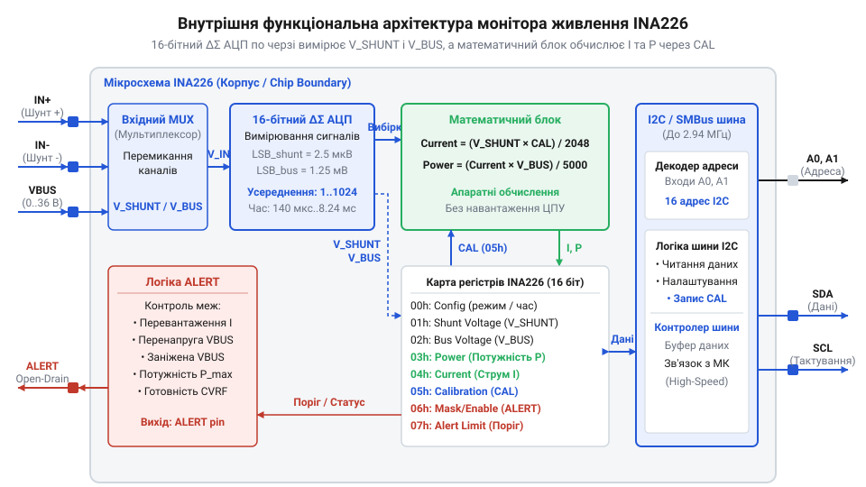
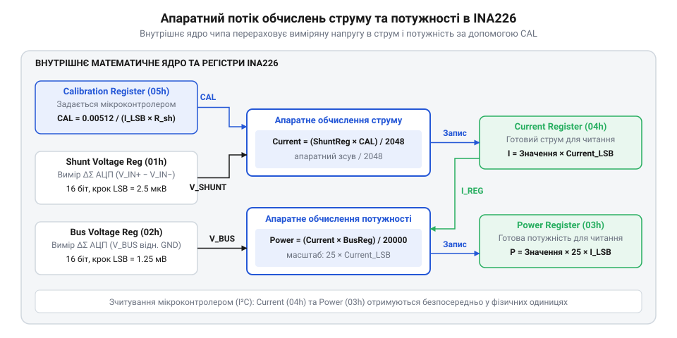
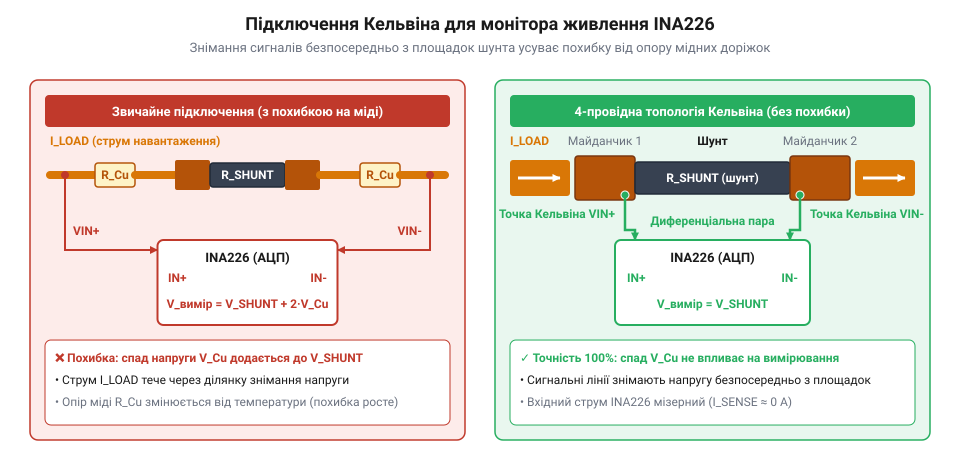
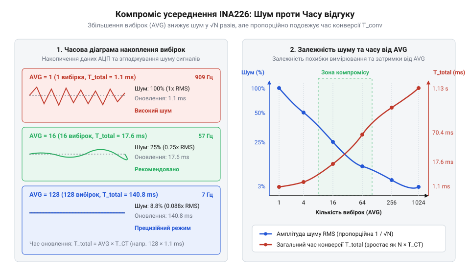
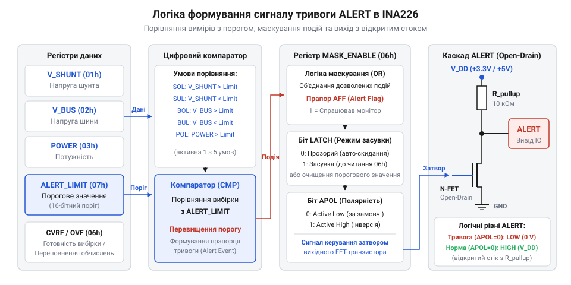

# Цифровий монітор живлення INA226

<preknowlist>
- [INA219 — монітор струму й напруги (I2C)](root:cat-hw-sensors/ina219-power-monitor) — Базовий принцип вимірювання струму через токовимірювальний шунт та цифрового зчитування даних по шині I2C.
- [Конфігурація та усереднення вимірювань INA226](root:cat-hw-sensors/ina226-config-and-averaging) — Базові поняття вибору режимів роботи, періодів конверсії та коефіцієнтів усереднення в цифрових моніторах живлення.
</preknowlist>

## Проблема прецизійного вимірювання напруги й струму

Контроль енергоспоживання у сучасних електронних системах — від автономних робототехнічних комплексів та безпілотників до сонячних інверторів, систем керування електродвигунами й серверних плашок живлення — вимагає постійного прецизійного вимірювання напруги на силовій шині та струму, що протікає через навантаження. Знайшовши миттєві значення напруги та струму, система може обчислити споживану потужність, відстежити залишок заряду акумуляторної батареї та вчасно виявити аномальні режими роботи, такі як коротке замикання чи перевантаження. Однак пряме вимірювання цих величин за допомогою стандартних засобів мікроконтролера стикається із серйозними фізичними та схемотехнічними перешкодами. Мікроконтролери здатні вимірювати аналогову напругу лише відносно власної спільної землі (@@en|GND@@) і в дуже вузькому діапазоні — зазвичай від `0` до `3.3` В або `5` В.

Для вимірювання струму в розрив силового кола послідовно із навантаженням вмикають токовимірювальний резистор — @@en|shunt@@ (від англ. *shunt* — відхиляти, спрямовувати в обхід). Згідно із законом Ома, струм `I`, що проходить через опір `R_shunt`, створює на ньому пропорційний спад напруги `V_shunt`:

```
V_shunt = I × R_shunt
```

Щоб вимірювальний елемент не розсіював зайву потужність у вигляді тепла (`P_loss = I² × R_shunt`) і не викликав просідання напруги живлення на самого споживача, опір `R_shunt` обирають мінімально можливим — зазвичай у діапазоні від `1` мОм до `10` мОм. Коли через @@en|shunt@@ опором `10` мОм протікає струм `1` А, спад напруги на ньому становить лише `10` мВ (`0.01` В). При малому струмі в `10` мА спад напруги зменшується до мікровольтового рівня — `100` мкВ.

Головна проблема виникає тоді, коли [вимірювальний шунт](root:hw-components/shunt-resistor) встановлюють у позитивну лінію живлення — так зване @@en|high-side sensing@@ (від англ. *high-side sensing* — зчитування на боці високого потенціалу). Схема @@en|high-side sensing@@ є значно безпечнішою та кращою за @@en|low-side sensing@@ (зняття струму між навантаженням і землею), оскільки не порушує цілісності земляного провідника системи й дозволяє виявляти короткі замикання навантаження на землю. Проте якщо напруга силової шини становить `24` В, то потенціал одного виводу шунта відносно землі дорівнює `24.010` В, а другого — `24.000` В. Тобто корисний диференціальний сигнал `V_shunt` величиною всього `10` мВ «плаває» на фоні високої синфазної напруги шини — @@en|common-mode voltage@@ (від англ. *common mode* — спільний режим) `V_CM = 24` В.

Спроба виміряти такий сигнал безпосередньо вбудованим аналого-цифровим перетворювачем мікроконтролера — @@en|ADC@@ (від англ. *analog-to-digital converter* — аналого-цифровий перетворювач) — призводить до двох критичних обмежень:

1. **Фізичне руйнування вхідного каскаду**: Подання напруги `24` В безпосередньо на аналоговий вхід мікроконтролера із опорною напругою `3.3` В миттєво виведе з ладу вхідні захисні діоди та спалить кремнієву структуру чипа. 2. **Низька роздільна здатність та катастрофічний шум квантування**: Навіть якщо зменшити напругу шини за допомогою резистивного дільника, стандартний 12-бітний @@en|SAR ADC@@ (від англ. *successive approximation register ADC* — АЦП послідовних наближень) із опорною напругою `3.3` В має крок дискретизації (@@en|LSB@@, від англ. *least significant bit* — найменший значущий розряд):

```
LSB = 3.3 V / 4096
    ≈ 0.805 mV
```

При кроці `0.805` мВ уся шкала вимірюваного спаду напруги `10` мВ покривається лише `12` дискретними відліками @@en|ADC@@. За таких умов виміряти зміну струму в `1` мА стає принципово неможливо: кожен відлік відповідає зміні струму аж на `80.5` мА, а шум квантування геть перекриває корисний сигнал.

Традиційне схемотехнічне розв'язання цієї проблеми на дискретних операційних підсилювачах — @@en|operational amplifier@@ (від англ. *operational amplifier* — операційний підсилювач) або дифпідсилювачах струму (@@en|current-sense amplifier@@) — також має суттєві вади. Для виділення малого диференціального сигналу `10` мВ на фоні високої синфазної напруги `24` В підсилювач повинен мати надзвичайно високий коефіцієнт придушення синфазного сигналу — @@en|CMRR@@ (від англ. *common-mode rejection ratio* — коефіцієнт придушення синфазного сигналу). У дискретних схемах @@en|CMRR@@ критично залежить від точності підбору зовнішніх резисторів зворотного зв'язку. Розбаланс опору резисторів всього на `0.1`% знижує реальний @@en|CMRR@@ до рівня ~`60` дБ. При синфазній напрузі `24` В це створює хибну диференціальну похибку на вході:

```
V_error = 24 V / 10³
        = 24 mV
```

Ця хибна похибка у `24` мВ у `2.4` раза перевищує сам корисний сигнал `10` мВ! Крім того, аналогові підсилювачі страждають від власної напруги зміщення входу — @@en|offset voltage@@ (від англ. *offset voltage* — напруга зміщення) та її температурного дрейфу (@@en|thermal drift@@). Наприклад, напруга зміщення у `100` мкВ створює постійну похибку вимірювання струму в `10` мА, яка хаотично змінюється під час нагрівання плати.

Навіть якщо аналогову частину вдається сформувати за допомогою прецизійних компонентів, обробка даних створює величезне обчислювальне навантаження на мікроконтролер. Для отримання значення потужності процесор повинен постійно зчитувати дані з двох аналогових каналів (спад напруги та напругу шини), виконувати математичне ділення для розрахунку струму `I = V_shunt / R_shunt`, множити струм на напругу шини `P = VBUS × I`, а також реалізовувати цифрові фільтри усереднення (наприклад, ковзне середнє) для придушення мережевих завад `50`/`60` Гц та високочастотних пульсацій імпульсних перетворювачів живлення (@@en|DC-DC@@). Виконання арифметики з плаваючою крапкою в швидких перериваннях споживає значні ресурси процесора, збільшує енергоспоживання й відволікає мікроконтролер від виконання основних алгоритмів керування.

Еволюція схемотехніки вимірювання струму пройшла шлях від громіздких аналогових каскадів на дискретних операційних підсилювачах із зовнішніми АЦП до монолітних цифрових моніторів живлення. Ранні аналогові схеми вимагали прецизійних резистивних збірок для збереження високого @@en|CMRR@@ та складного калібрування температурного дрейфу зміщення. Першим серйозним проривом стала поява чипа @@en|INA219@@ від компанії @@en|Texas Instruments@@, де попередній [монітор струму INA219](root:cat-hw-sensors/ina219-power-monitor) об'єднав прецизійний аналоговий фронтенд, 12-бітний @@en|ADC@@ та цифровий інтерфейс @@en|I2C@@ на єдиному кристалі, дозволивши вимірювати струм на шинах до `26` В. Однак зростаючі вимоги до точності в промислових та серверних системах зумовили створення наступника — мікросхеми @@en|INA226@@. Нове покоління, яке входить у ширшу [родину вимірювачів INA2xx](root:cat-hw-sensors/ina2xx-digital-power-monitors-overview), отримало 16-бітний @@en|delta-sigma ADC@@, розширений діапазон синфазної напруги до `36` В, а також програмований апаратний математичний блок. Це дозволило перенести розрахунок струму, потужності та усереднення вибірок безпосередньо в кремній чипа, повністю звільнивши мікроконтролер від рутинної обчислювальної математики.

## Внутрішня архітектура та дельта-сигма АЦП

Мікросхема @@en|INA226@@ являє собою високоточний двоспрямований цифровий монітор струму, напруги та потужності із цифровим інтерфейсом @@en|I2C@@/@@en|SMBus@@ (від англ. *System Management Bus* — системна шина управління). Головною схемотехнічною особливістю пристрою є здатність вимірювати диференціальний спад напруги на шунті та абсолютну напругу силової шини @@en|VBUS@@ у діапазоні від `0` до `36` В. Цей діапазон є абсолютно незалежним від власної напруги живлення мікросхеми `VS`, яка становить від `2.7` до `5.5` В.

Завдяки внутрішній архітектурі аналогового фронтенду, підсилювач чипа забезпечує коефіцієнт придушення синфазного сигналу @@en|CMRR@@ на рівні `126` дБ (мінімальне значення). Це повністю усуває похибки від коливань високої напруги шини при знятті сигналу з вимірювального шунта на боці високого потенціалу.


*Структурна схема мікросхеми INA226: диференціальні входи шунта та вхід напруги шини подаються на 16-бітний АЦП, звідки оцифровані дані надходять до апаратного обчислювача.*

Внутрішня структура чипа складається з кількох ключових функціональних блоків:

1. **Диференціальний вхідний каскад (`IN+`, `IN-`)**: Призначений для вимірювання спаду напруги `V_shunt = V_(IN+) - V_(IN-)` на токовимірювальному шунті. Повна шкала диференціальної напруги становить `±81.92` мВ. Сигнал оцифровується у 16-бітному форматі зі знаком (`15` бітів даних та `1` біт знаку, що відповідає діапазону від `-32768` до `+32767`). Крок дискретизації напруги шунта (@@en|LSB@@) становить:

```
Shunt_Voltage_LSB = 81.92 mV / 32768
                  = 0.0025 mV
                  = 2.5 µV
```

Дискретність у `2.5` мкВ на один молодший розряд дозволяє мікросхемі @@en|INA226@@ впевнено реєструвати мікровольтові зміни спаду напруги на шунтах малого опору (`1`–`10` мОм) без застосування зовнішніх підсилювальних каскадів.

2. **Канал вимірювання напруги шини (`VBUS`)**: Вхід `VBUS` вимірює абсолютну напругу силової шини відносно землі @@en|GND@@. Повний діапазон вимірюваної напруги становить від `0` до `36` В (внутрішня повна шкала @@en|ADC@@ розрахована на `40.96` В). При 16-бітній роздільній здатності (де `15` бітів використовуються для позитивного значення напруги) крок дискретизації становить:

```
Bus_Voltage_LSB = 40.96 V / 32768
                = 1.25 mV
```

Така дискретність у `1.25` мВ забезпечує прецизійний моніторинг напруги як у низьковольтних шинах (`3.3` В, `5` В), так і у високовольтних батарейних системах (`12` В, `24` В, `36` В).

3. **16-бітний дельта-сигма АЦП**: Диференціальний спад напруги та напруга шини поодиноко комутуються аналоговим мультиплексором на вхід прецизійного 16-бітного @@en|ADC@@. Завдяки тому, що [архітектура дельта-сигма АЦП](root:hw-analog/sigma-delta-adc) базується на трьох послідовних етапах — передискретизації (@@en|oversampling@@, від англ. *oversampling* — передискретизація), формуванні спектра шуму (@@en|noise-shaping@@, від англ. *noise shaping* — формування спектра шуму) та децимаційній цифровій фільтрації (@@en|decimation filter@@, від лат. *decimatio* — зменшення вибірки), — мікросхема забезпечує надзвичайно високу точність та придушення високочастотних завад від імпульсних джерел живлення (@@en|DC-DC@@).

4. **Внутрішнє джерело опорної напруги та тактовий генератор**: Кремнієва структура мікросхеми містить високостабільне джерело опорної напруги на основі забороненої зони напівпровідника — @@en|bandgap reference@@ (від англ. *bandgap* — заборонена зона), яке має мінімальний температурний дрейф. Вбудований тактовий генератор задає часові інтервали конверсії @@en|ADC@@ та синхронізує роботу внутрішньої логіки.

5. **Апаратне математичне ядро та система регістрів**: Оцифровані значення спаду напруги та напруги шини записуються у відповідні регістри (`Shunt Voltage Register` та `Bus Voltage Register`). Апаратний обчислювальний блок множить значення `V_shunt` на коефіцієнт, завантажений у регістр калібрування (`Calibration Register`), та миттєво обчислює реальний струм `I`, записуючи його у `Current Register`. Після цього математичне ядро множить обчислений струм на напругу шини `VBUS` й отримує значення потужності `P`, яке зберігається у `Power Register`.

Завдяки апаратному математичному блоку мікроконтролеру більше не потрібно виконувати обчислення струму й потужності: він просто зчитує готові фізичні значення по шині @@en|I2C@@. Докладний опис цокольовки, призначень виводів та карти внутрішніх регістрів містить [апаратна довідка INA226](root:cat-hw-sensors/ina226-power-monitor/api-ina226-hardware-interface.md), а покрокові формули розрахунку калібрувального коефіцієнта дає [математична вставка калібрування](root:cat-hw-sensors/ina226-power-monitor/math-ina226-calibration-math.md).

З точки зору фізичного корпусу, мікросхема випускається у компактному 8-вивідному корпусі (@@en|MSOP-8@@ або @@en|VSSOP-8@@):
- Виводи `A1` (pin 1) та `A0` (pin 2): Адресні лінії шини @@en|I2C@@. Шляхом підключення цих виводів до `GND`, `VS`, `SDA` або `SCL` можна обрати одну з `16` унікальних відповідей пристрою на шині. - Вивід `SDA` (pin 3): Серійна лінія даних @@en|I2C@@ (з відкритим стоком, вимагає зовнішнього підтягувального резистора). - Вивід `SCL` (pin 4): Серійна лінія тактування @@en|I2C@@ (з відкритим стоком). - Вивід `VS` (pin 5): Напруга живлення мікросхеми (`2.7`–`5.5` В). Вимагає шунтування керамічним конденсатором ємністю `0.1` мкФ поруч із корпусом. - Вивід `GND` (pin 6): Спільний провідник аналогової та цифрової землі. - Виводи `IN-` (pin 7) та `IN+` (pin 8): Диференціальні входи вимірювання спаду напруги на шунті. - Вивід `VBUS`: Вхід вимірювання напруги шини живлення (може бути об'єднаний із `IN+` або `IN-` залежно від схеми включення). - Вивід `ALERT`: Програмований вихід апаратного сигналізатора (тривоги) з відкритим стоком, який дозволяє мікросхемі самостійно генерувати сигнал переривання для мікроконтролера при виході струму, напруги чи потужності за задані межі.

## Апаратне обчислення струму й потужності

Первинні результати вимірювання, які двоканальний АЦП записує у внутрішні регістри мікросхеми, являють собою цілочисельні коди спаду напруги на шунті та абсолютного потенціалу силової шини. Для практичного використання системи автоматики або індикації потрібні значення у фізичних одиницях — амперах та ватах. У класичних вимірювальних системах з аналоговими фронтендами обчислення `I = V_shunt / R_shunt` та `P = VBUS × I` виконував центральний мікроконтролер. Це вимагало постійного зчитування двох каналів по цифровому інтерфейсу та виконання арифметичних операцій із плаваючою крапкою в швидких циклічних перериваннях. При моніторингу багатьох шин живлення або при високій частоті дискретизації таке обчислювальне навантаження стає непропорційно високим.

Щоб повністю звільнити мікроконтролер від рутинної математики, в кремнієву структуру чипа @@en|INA226@@ інтегровано апаратний @@en|math engine@@ (від англ. *math engine* — математичний рушій) — спеціалізований цифровий арифметико-логічний пристрій (@@en|ALU@@, від англ. *arithmetic logic unit* — арифметико-логічний пристрій). Цей блок у режимі реального часу самостійно множить та масштабує виміряні величини. Однак чип не знає фізичного опору зовнішнього шунта, запаяного на друковану плату, тому для правильного обчислення струму йому потрібен коефіцієнт масштабування. Цей коефіцієнт розраховується розробником під час проектування системи й один раз завантажується у 16-бітний регістр калібрування (@@en|Calibration Register@@, адреса `0x05`).

Внутрішня математика чипа побудована так, щоб уникнути складного й енергоємного ділення в кремнії. Замість ділення спаду напруги `V_shunt` на опір `R_shunt` апаратне ядро виконує швидке множення сирого 16-бітного коду спаду напруги з регістра `Shunt Voltage Register` (`0x01`) на значення регістра калібрування `CAL`, після чого ділить результат на фіксовану константу `2048` шляхом зсуву бітів:

```
Current_Register = (ShuntVoltage_Register × CAL) / 2048
```

Перед початком роботи розробник обирає бажану дискретність вимірювання струму — `Current_LSB` (значення одного молодшого розряду в амперах на молодший біт). Для максимального використання 16-бітного діапазону регістра струму (де `15` бітів відведено під модуль величини, що відповідає `32768` відлікам) `Current_LSB` визначають діленням максимально очікуваного струму системи `I_max` на `32768`:

```
Current_LSB = I_max / 32768
```

Отримане значення `Current_LSB` зазвичай округлюють до найближчого зручного числового значення (наприклад, `100` мкА/біт, `250` мкА/біт або `1` мА/біт). На основі обраного `Current_LSB` та реального опору шунта `R_shunt` розраховується константа калібрування `CAL`, яка записується в мікросхему:

```
CAL = trunc(0.00512 / (Current_LSB × R_shunt))
```

Фіксована числова константа `0.00512` у чисельнику формули має чітке фізичне обґрунтування. Вона походить із внутрішнього нормування масштабу чипа: дискретність вимірювання спаду напруги на шунті становить `2.5` мкВ (`0.0000025` В), а внутрішній дільник дорівнює `2048`. Множення `0.0000025 V × 2048` дає точне значення `0.00512 V`. Завдяки цьому цілочисельний результат, записаний у `Current Register` (`0x04`), прямо відповідає струму в системі: щоб отримати струм в амперах, мікроконтролеру достатньо просто помножити зчитане з чипа ціле число на обраний `Current_LSB`.

Після розрахунку значення струму апаратний математичний блок переходить до обчислення миттєвої споживаної потужності. Для цього внутрішнє ядро чипа множить вміст `Current Register` на оцифроване значення напруги шини з `Bus Voltage Register` (`0x02`):

```
Power_Register = (Current_Register × BusVoltage_Register) / 20000
```

Оскільки крок дискретизації напруги шини становить `Bus_Voltage_LSB = 1.25` мВ (`0.00125` В), внутрішнє маскування й ділення на `20000` жорстко задає дискретність регістра потужності `Power_LSB` (адреса `0x03`):

```
Power_LSB = 25 × Current_LSB
```

Отже, один молодший розряд регістра потужності завжди в `25` разів більший за дискретність струму `Current_LSB` і вимірюється у ватах. Мікроконтролер позбавляється потреби виконувати множення в своєму коді — він отримує вже готове фізичне значення потужності по шині @@en|I2C@@.


*Потік даних усередині INA226: значення спаду напруги перемножується з регістром CAL для формування значення струму, яке потім множиться на напругу шини для обчислення потужності.*

Розглянемо практичний приклад повного розрахунку калібрувальних параметрів для реальної схеми моніторингу живлення.

**Обчислення параметрів калібрування для шунта 10 мОм**

```
[Умова проблеми]
R_shunt = 0.01 Ом (10 мОм)
I_max = 8.192 А
VBUS = 12.0 В

[Крок 1: Розрахунок дискретності струму Current_LSB]
Current_LSB = 8.192 A / 32768
            = 0.00025 A
            = 250 µA/LSB

[Крок 2: Розрахунок коефіцієнта регістра CAL]
CAL = trunc(0.00512 / (0.00025 A × 0.01 Ω))
    = trunc(0.00512 / 0.0000025)
    = 2048
    = 0x0800

[Крок 3: Розрахунок дискретності потужності Power_LSB]
Power_LSB = 25 × 0.00025 A
          = 0.00625 W
          = 6.25 mW/LSB

[Крок 4: Перевірка апаратного обчислення при струмі 2.0 А та напрузі 12.0 В]
V_shunt = 2.0 A × 0.01 Ω = 0.02 V (20000 µV)
ShuntVoltage_Register = 20000 µV / 2.5 µV = 8000
Current_Register = (8000 × 2048) / 2048 = 8000
Обчислений струм = 8000 × 250 µA = 2.0 A

BusVoltage_Register = 12.0 V / 0.00125 V = 9600
Power_Register = (8000 × 9600) / 20000 = 3840
Обчислена потужність = 3840 × 6.25 mW = 24.0 W
```

Навіть найточніший апаратний розрахунок усередині чипа втрачає сенс, якщо спад напруги на шунті зчитується з похибкою. Оскільки опір вимірювального шунта становить всього кілька міліом, опір мідних доріжок друкованої плати стає сумірним із опором самого датчика. Стандартна мідна доріжка товщиною `35` мкм та шириною `0.5` мм має опір близько `10` мОм на кожен сантиметр довжини. Якщо підключити сигнальні входи мікросхеми до силової лінії на деякій відстані від шунта, струм навантаження створить додатковий спад напруги на міді плати, який додасться до корисного сигналу `V_shunt` і спричинить похибку вимірювання до `20`–`50`%.

Щоб виключити вплив опору провідників плати, застосовують чотирипровідникову схему підключення — @@en|Kelvin connection@@ (від англ. *Kelvin connection* — підключення Кельвіна, назване на честь лорда Кельвіна). При такій схемі силовий струм навантаження протікає через два зовнішні товсті провідники, а знімання спаду напруги здійснюється через два окремі високоомні сигнальні провідники (`IN+` та `IN-`), які підключаються безпосередньо до внутрішніх точок контактних майданчиків шунта.


*Топологія підключення Кельвіна: сигнальні доріжки IN+ та IN- підводяться до контактних майданчиків шунта окремо від силових провідників, що виключає похибку від спаду напруги на мідних доріжках плати.*

При розводці друкованої плати сигнальні лінії від майданчиків шунта до виводів `IN+` та `IN-` мікросхеми @@en|INA226@@ прокладають у вигляді симетричної дифпари мінімальної довжини, оточеної захисним земляним полігоном. Дотримання правил [Кельвінівського підключення прецизійних кіл](root:hw-pcb/kelvin-connection-pcb-layout) у поєднанні з правильним вибором [вимірювального шунта](root:hw-components/shunt-resistor) дозволяє досягти заявленої паспортної точності вимірювання. Детальний математичний вивід з урахуванням граничних відхилень містить [математична вставка калібрування INA226](root:cat-hw-sensors/ina226-power-monitor/math-ina226-calibration-math.md).

## Усереднення вибірок та режими конверсії

У реальних електронних системах напруга шини живлення та струм навантаження рідко бувають ідеально постійними. Робота високочастотних імпульсних перетворювачів (@@en|DC-DC@@), широтно-імпульсна модуляція (@@en|PWM@@, від англ. *pulse-width modulation* — широтно-імпульсна модуляція) у системах керування двигунами, пульсації мережевого випрямляча `50`/`60` Гц та цифрове перемикання процесних ядер створюють високочастотний шум — @@en|ripple noise@@ (від англ. *ripple noise* — шум пульсацій). Якщо АЦП виконує миттєву одиночну конверсію, отримане значення може випадково потрапити на пік або провал шуму, що призведе до суттєвого розкиду показань між сусідніми вибірками.

Для боротьби з завадами мікросхема @@en|INA226@@ має програмований апаратний блок усереднення вибірок та можливість гнучкого налаштування часу конверсії АЦП для кожного з двох каналів. Ці параметри задаються через регістр конфігурації (@@en|Configuration Register@@, адреса `0x00`).

Час конверсії АЦП (@@en|conversion time@@) визначає тривалість накопичення сигналу дельта-сигма інтегратором для одного вимірювання. Для каналу спаду напруги на шунті (`VSH_CT`) та каналу напруги шини (`VBUS_CT`) можна незалежно обрати один із `8` градацій часу: `140` мкс, `204` мкс, `332` мкс, `588` мкс, `1.1` мс, `2.116` мс, `4.156` мс або `8.244` мс. Збільшення часу конверсії дозволяє децимаційному фільтру АЦП ефективніше відфільтровувати високочастотні завади безпосередньо в процесі оцифровки.

Коефіцієнт усереднення (параметр `AVG`) визначає кількість послідовних вибірок АЦП (`1`, `4`, `16`, `64`, `128`, `256`, `512` або `1024`), які внутрішній апаратний акумулятор додає та ділить перед тим, як оновити результуючі регістри даних. Згідно з законами математичної статистики, при усередненні `N` незалежних вибірок середньоквадратичне відхилення випадкового білого шуму зменшується в `√N` разів.

```
Noise_reduction_factor = √N
```

Збільшення коефіцієнта усереднення до `1024` вибірок зменшує амплітуду шуму в `√1024 = 32` рази, що еквівалентно розширенню ефективної розрядності АЦП — @@en|ENOB@@ (від англ. *effective number of bits* — ефективна кількість бітів) приблизно на `5` додаткових бітів. Однак за зниження шуму доводиться платити часом оновлення даних. Повний період оновлення регістрів `T_update` обчислюється як сума часів конверсії обох каналів, помножена на кількість усереднюваних вибірок `N`:

```
T_update = N × (T_ct_shunt + T_ct_bus)
```

Наприклад, якщо обидва канали налаштовані на стандартний час конверсії `1.1` мс, а коефіцієнт усереднення `AVG = 128`, то повний цикл оновлення даних у регістрах становитиме:

```
T_update = 128 × (1.1 ms + 1.1 ms)
         = 281.6 ms
```

У цьому режимі регістри оновлюються приблизно `3.5` рази на секунду. Такий інтервал усереднення повністю придушує мережеві пульсації `50` Гц (період `20` мс) та забезпечує виняткову стабільність показань, що ідеально підходить для таких застосувань, як [автономний сонячний логер на INA226](root:cat-hw-sensors/ina226-power-monitor/proj-ina226-solar-battery-logger.md). Натомість для систем швидкого апаратного захисту обирають мінімальний час конверсії `140` мкс без усереднення (`AVG = 1`), що забезпечує реакцію на перевантаження менше ніж за `300` мкс.


*Залежність рівня шуму вимірювання та часу оновлення регістрів від кількості усереднюваних вибірок та вибраного часу конверсії АЦП.*

Мікросхема підтримка три основні режими роботи (@@en|operating modes@@):

1. **Суцільний режим (Continuous Mode)**: АЦП безперервно почергово оцифровує напругу шунта та напругу шини, оновлюючи регістри після кожного циклу усереднення. 2. **Однократний режим (Triggered Mode)**: Виконує режим @@en|one-shot@@ (від англ. *one-shot* — одноразовий запуск). Після запису команди мікросхема виконує один повний цикл конверсії та усереднення, записує результати в регістри й автоматично переходить у мікроспоживаючий режим сну (`Shutdown`). Це критично для автономних пристроїв @@en|IoT@@ з батарейним живленням. 3. **Режим вимкнення (Shutdown Mode)**: Аналогові блоки АЦП та внутрішнє джерело опорної напруги вимикаються, а струм споживання мікросхеми знижується до величини менше `1` мкА при збереженні вмісту всіх регістрів.

Для реалізації апаратного захисту без постійного опитування по шині @@en|I2C@@ мікросхема має програмований вихід тривоги `ALERT`. Цей вивід виконаний за схемою з відкритим стоком — @@en|open-drain@@ (від англ. *open-drain* — відкритий стік) і вимагає зовнішнього підтягувального резистора до лінії живлення. Шляхом налаштування регістра маски переривань `Mask/Enable Register` (`0x06`) та регістра порогу тривоги `Alert Limit Register` (`0x07`) вивід `ALERT` можна запрограмувати на автоматичне спрацьовування за однією з умов:

- `SOL` (Shunt Voltage Over-Limit): Спад напруги на шунті перевищив поріг (захист від перевантаження за струмом). - `SUL` (Shunt Voltage Under-Limit): Спад напруги впав нижче порогу. - `BOL` (Bus Voltage Over-Limit): Напруга шини перевищила поріг (захист від перенапруги). - `BUL` (Bus Voltage Under-Limit): Напруга шини впала нижче порогу (сигналізація розряду акумулятора). - `POL` (Power Over-Limit): Споживана потужність перевищила заданий ліміт. - `AFF` (Conversion Ready): Сигнал готовності нового усередненого блоку даних.

Вивід `ALERT` можна перевести в режим фіксації — @@en|latch mode@@ (від англ. *latch mode* — режим засувки/фіксації). У цьому режимі при виникненні аварійної події вивід `ALERT` залишається зафіксованим у низькому логічному рівні навіть після того, як струм чи напруга повернулися в норму, доки мікроконтролер не прочитає регістр `Mask/Enable`. Це гарантує, що короткочасний сплеск струму не буде пропущений процесором. Такий механізм демонструє [цифровий монітор живлення та апаратний захист на ESP32](root:cat-hw-sensors/ina226-power-monitor/proj-ina226-power-monitor-esp32.md).

Повний опис карти регістрів та прапорців тривоги містить [апаратна довідка INA226](root:cat-hw-sensors/ina226-power-monitor/api-ina226-hardware-interface.md). Нижче наведено приклад програмної конфігурації усереднення, режимів конверсії та апаратного захисту `ALERT`.

:::tabs
@tab C (ESP-IDF)
:::code ina226-power-monitor-d/c/esp-idf/ina226-write-reg.c

@tab C++ (Arduino)
:::code ina226-power-monitor-d/cpp/arduino/writeregister16.cpp
:::

Детальнішу оптимізацію роботи з драйвером та опитання регістрів розкрито у [програмній довідці з драйвера INA226](root:cat-hw-sensors/ina226-power-monitor/api-ina226-firmware-driver.md).

## Апаратний захист та сигналізація ALERT

Коли в колі живлення виникає коротке замикання або заклинює ротор електродвигуна, струм зростає від кількох міліамперів до десятків амперів за лічені мікросекунди. Якщо силовий контролер покладається лише на періодичне зчитування даних по шині I2C із періодом 50–100 мс, силові транзистори або друкований монтаж встигнуть згоріти до того, як керуюча програма виконає чергову ітерацію циклу. Вимоги до швидкості реакції апаратного захисту унеможливлюють використання програмного опитування.

Для розв'язання цієї проблеми в мікросхему @@en|INA226@@ інтегровано автономний апаратний компаратор та спеціалізований вивід тривоги @@en|ALERT@@ (англ. @@en|ALERT pin@@). Цей вивід працює повністю незалежно від шини I2C. Після завершення кожного циклу перетворення АЦП або завершення усереднення серії вибірок апаратне математичне ядро автоматично порівнює поточне виміряне значення з пороговою величиною, яка попередньо записується у регістр граничного значення (англ. @@en|Alert Limit Register@@).

Аналіз параметрів відбувається на рівні цифрових регістрів. Залежно від конфігурації регістра маски та дозволу тривоги (англ. @@en|Mask/Enable Register@@), апаратний компаратор здатний відстежувати п'ять незалежних подій:

1. Перевищення напруги на шунті (англ. @@en|Shunt Voltage Over-Limit@@, @@en|SOL@@) — спрацьовує, коли спад напруги на шунті перевищує заданий поріг, що відповідає режиму перевантаження за струмом. 2. Падіння напруги на шунті нижче межі (англ. @@en|Shunt Voltage Under-Limit@@, @@en|SUL@@) — сигналізує про обрив навантаження або неприпустиме зниження споживання. 3. Перевищення напруги шини (англ. @@en|Bus Voltage Over-Limit@@, @@en|BOL@@) — фіксує сплески напруги джерела живлення, які загрожують пошкодженням чутливих компонентів. 4. Зниження напруги шини нижче норми (англ. @@en|Bus Voltage Under-Limit@@, @@en|BUL@@) — виявляє просідання живлення або глибокий розряд акумуляторної батареї. 5. Перевищення розрахованої потужності (англ. @@en|Power Over-Limit@@, @@en|POL@@) — унікальна функція @@en|INA226@@, де компаратор порівнює результат апаратного множення струму на напругу шини з граничним значенням потужності, захищаючи схему від теплового перевантаження.

Окрім аварійних режимів, вивід @@en|ALERT@@ може виконувати функцію прапорця готовності даних (англ. @@en|Conversion Ready Flag@@, @@en|CVRF@@). У цьому режимі вивід генерує короткий імпульс щоразу, коли АЦП закінчує вимірювання та оновлює вихідні регістри, що дозволяє мікроконтролеру переходити в режим сну та зчитувати дані строго за перериванням, мінімізуючи навантаження на шину I2C. Докладніше про процедуру зчитування цих регістрів описано в [реєстрами апаратного інтерфейсу](root:cat-hw-sensors/ina226-power-monitor/api-ina226-hardware-interface.md).

За поведінкою виводу @@en|ALERT@@ мікросхема підтримує два класичні режими:

- Прозорий режим (англ. @@en|transparent mode@@, від @@en|transparent@@ — прозорий, біт `LEN` = 0) — сигнал на виводі @@en|ALERT@@ стає активним у момент виходу параметра за встановлену межу і автоматично повертається у пасивний стан, як тільки виміряний параметр повертається в норму. - Фіксований режим (англ. @@en|latch mode@@, від @@en|latch@@ — защіпка, біт `LEN` = 1) — при виникненні аварійної ситуації вивід @@en|ALERT@@ фіксується в активному стані і залишається в ньому навіть після того, як аварійний параметр повернувся до норми. Для зняття фіксації мікроконтролер повинен виконати зчитування регістра маски та дозволу тривоги по шині I2C. Це гарантує, що короткочасний сплеск струму не буде втрачений системою керування.

Зі схемотехнічного боку вихід @@en|ALERT@@ виконано за топологією з відкритим стоком (англ. @@en|open-drain@@, від @@en|drain@@ — стік). У внутрішній структурі мікросхеми цей вивід підключено до стоку n-канального @@en|MOSFET@@-транзистора, джерело якого з'єднане з загальним провідником GND. Таке рішення вимагає підключення зовнішнього підтягувального резистора (англ. @@en|pull-up resistor@@) номіналом 10 кОм до лінії живлення цифрової частини VDD. За замовчуванням активний рівень сигналу тривоги є низьким (англ. @@en|active-low@@). Біт полярності `APOL` у конфігураційному регістрі дозволяє інвертувати вихід у високий активний рівень (англ. @@en|active-high@@), проте використання низького активного рівня має ключову перевагу: воно дозволяє об'єднувати виводи @@en|ALERT@@ від кількох мікросхем @@en|INA226@@ на єдину лінію переривання мікроконтролера за схемою монтажного «АБО» (англ. @@en|wired-OR@@).


*Схема апаратного компаратора та виводу ALERT ілюструє зв'язок регістра MASK_ENABLE з вихідним транзистором з відкритим стоком, що забезпечує гнучке формування сигналів переривання.*

Практична реалізація ініціалізації апаратного захисту вимагає запису конфігураційних бітів у відповідні регістри. Зверніть увагу, що перед встановленням порогу перевантаження за струмом необхідно обчислити цифровий код напруги шунта або потужності відповідно до обраного номіналу шунта та значення `Current_LSB`, як висвітлено в матеріалі щодо [математичного розрахунку калібрування](root:cat-hw-sensors/ina226-power-monitor/math-ina226-calibration-math.md).

:::tabs
@tab ESP-IDF (C)
:::code ina226-power-monitor-d/c/esp-idf/ina226-configure-overcurrent-alert.c
@tab Arduino (C++)
:::code ina226-power-monitor-d/cpp/arduino/setupina226alert.cpp
:::

Завдяки прямій комутації виводу @@en|ALERT@@ з апаратним входом переривання або виводом вимкнення драйвера ключів `EN` силового перетворювача досягається мінімальний час затримки захисту. У поєднанні з можливістю [налаштування коефіцієнтів усереднення](root:cat-hw-sensors/ina226-config-and-averaging), розробник отримує гнучкий інструмент: можна встановити мінімальний час конверсії без усереднення для миттєвого відсікання коротких замикань або увімкнути усереднення для запобігання хибним спрацьовуванням від імпульсних пульсацій навантаження. Повний приклад організації аварійного вимкнення силової шини розглянуто у проєкті [захисту автономних систем](root:cat-hw-sensors/ina226-power-monitor/proj-ina226-power-monitor-esp32.md), а програмну реалізацію низькорівневих обробників представлено в довіднику [роботи програмного драйвера](root:cat-hw-sensors/ina226-power-monitor/api-ina226-firmware-driver.md).

## Точність підключення та Кельвінівська розводка

Роздільна здатність 16-бітного АЦП мікросхеми @@en|INA226@@ становить 2.5 мкВ на один молодший значущий розряд (@@en|LSB@@) при вимірюванні напруги на шунті. При настільки високій чутливості паразитний опір (англ. @@en|parasitic trace resistance@@, від @@en|parasite@@ — паразит) звичайних мідних доріжок друкованої плати спроможний повністю знівелювати паспортну точність вимірювача. Якщо сигнальні лінії АЦП підключити до токовимірювального кола без урахування правил трасування високоточних сигналів, виміряні значення струму будуть містити системну похибку у десятки або сотні відсотків.

Розглянемо походження цієї похибки на числовому прикладі. Стандартний мідний шар друкованої плати товщиною 1 oz (35 мкм) має питомий опір близько 0.5 мОм на один квадрат поверхні. Доріжка шириною 1 мм і довжиною 10 мм має власний опір:

```
R_trace = 0.5 мОм × (10 мм / 1 мм) = 5 мОм
```

Нехай у силовому колі встановлено прецизійний токовимірювальний шунт (англ. @@en|shunt resistor@@) номіналом `R_shunt = 10 мОм`, крізь який протікає робочий струм навантаження `I = 5 А`. Істинний спад напруги безпосередньо на виводах шунта становить:

```
V_shunt = I × R_shunt
= 5 А × 0.010 Ом
= 50 мВ      [теоретичний спад напруги]
```

Якщо сигнальні лінії `IN+` та `IN-` підключити до силових доріжок плати на відстані лише 5 мм від точок пайки шунта, силовий струм навантаження буде протікати через ділянки мідних доріжок між шунтом і точками знімання сигналу. Паразитний опір цих двох ділянок складе `R_parasitic = 2.5 мОм`. У результаті диференціальний вхід АЦП зафіксує сумарний спад напруги:

```
V_measured = I × (R_shunt + R_parasitic)
= 5 А × (0.010 Ом + 0.0025 Ом)
= 5 А × 0.0125 Ом
= 62.5 мВ    [виміряний спад напруги]
```

Отримана похибка обчислюється як:

```
Error = (V_measured - V_shunt) ÷ V_shunt × 100%
= (62.5 мВ - 50 мВ) ÷ 50 мВ × 100%
= 25%        [відносна похибка вимірювання]
```

Паразитне зміщення 12.5 мВ еквівалентне помилці у 5000 молодших розрядів АЦП (@@en|LSB@@), що робить використання 16-бітного вимірювача беззмістовним.

Для повного усунення впливу опору силових провідників застосовують чотирипровідникове Кельвінівське підключення (англ. @@en|Kelvin connection@@, від імені фізика Lord Kelvin). Принципова ідея схеми полягає у фізичному розділенні силового контуру протікання струму та вимірювального сигнального контуру.

Через силові контакти шунта протікає повний струм навантаження. Знімання спаду напруги здійснюється парою окремих сигнальних доріжок `IN+` та `IN-`, які підключаються безпосередньо до контактних площадок шунта в точках, де силовий струм вже не протікає. Вхідний струм зміщення (англ. @@en|input bias current@@) диференціального підсилювача мікросхеми @@en|INA226@@ становить 10 мкА, тому струм, який протікає через вимірювальні доріжки `IN+` та `IN-`, не перевищує 10 мікроамперів. За законом Ома спад напруги на паразитному опорі вимірювальних доріжок дорівнює:

```
V_trace_drop = I_input × R_trace
= 10⁻¹¹ А × 0.005 Ом
= 5 × 10⁻¹⁴ В ≈ 0 В
```

Завдяки цьому АЦП вимірює виключно потенціал безпосередньо на вимірювальному елементі шунта. Загальні [принципи Кельвінівського підключення](root:hw-pcb/kelvin-connection-pcb-layout) деталізують геометрію контактних площадок для різних типів корпусів резисторів.

При проектуванні топології друкованої плати для @@en|INA226@@ необхідно дотримуватися п'яти базових схемотехнічних та трасувальних правил:

1. Топологія контактних площадок (англ. @@en|Kelvin pads@@): Сигнальні доріжки `IN+` та `IN-` повинні відходити строго з внутрішнього боку контактних площадок SMD-резистора (між майданчиками) або з використанням спеціалізованих чотирьохвивідних шунтів у корпусах 1206/2512. Заборонено підключати вимірювальні доріжки до силових провідників за межами контактних площадок шунта. 2. Диференціальне симетричне трасування: Лінії `IN+` та `IN-` формують диференціальну пару (англ. @@en|differential pair@@). Вони повинні прокладатися паралельно на одному шарі плати, з однаковою довжиною та мінімальною відстанню між собою. Це забезпечує однакове наведення зовнішніх електромагнітних завад, які згодом ефективно придушуються внутрішнім дельта-сигма АЦП за рахунок високого коефіцієнта придушення синфазного сигналу. Порівняння цієї архітектури з іншими вимірювачами наведено в огляді [родини цифрових моніторів](root:cat-hw-sensors/ina2xx-digital-power-monitors-overview), а її математичну основу викладено у розділі про [архітектурою дельта-сигма АЦП](root:hw-analog/sigma-delta-adc). 3. Захист від термо-РС та ефект Зеєбека: З'єднання сплаву вимірювального елемента шунта (манганін, константан) з мідними доріжками плати утворює термопару (англ. @@en|Seebeck effect@@, від імені фізика Thomas Johann Seebeck). При наявності градієнта температур між протилежними контактами шунта виникає паразитна термоелектрорушійна сила (англ. @@en|thermo-EMF@@, від @@en|thermo-electromotive force@@) величиною до кількох мікровольт на градус. Оскільки 1 LSB @@en|INA226@@ дорівнює 2.5 мкВ, перегрів одного з контактів створює дрейф нуля. Для запобігання цьому контактні площадки шунта трасують термосиметрично, а сам шунт розміщують подалі від потужних джерел тепла (силових транзисторів та дроселів). Правила вибору компонентів висвітлені у посібнику з [вибору прецизійних шунтів](root:hw-components/shunt-resistor). 4. Диференціальний RC-фільтр завад: В імпульсних джерелах живлення та @@en|PWM@@-регуляторах струм містить високочастотні пульсації, які можуть викликати перевантаження вхідного каскаду АЦП. Для їх придушення безпосередньо біля виводів `IN+` та `IN-` мікросхеми встановлюють диференціальний RC-фільтр завад (англ. @@en|differential RC filter@@). Він складається з двох послідовних резисторів номіналом `R_f = 10 Ом` у кожній сигнальній лінії та диференціального конденсатора `C_diff = 10 нФ` між ними. Використання резисторів номіналом понад 10 Ом заборонено, оскільки вхідні струми зміщення АЦП створять додаткове падіння напруги та похибку коефіцієнта підсилення. 5. Заземлення цифрової та аналогової частин: Загальний провідник `GND` мікросхеми @@en|INA226@@ повинен з'єднуватися з силовою землею системи в єдиній точці (англ. @@en|star grounding@@) поблизу мінус-контакту шунта або через ізольований аналоговий шар заземлення. Це запобігає протіканню силових струмів землею поблизу чутливої аналогової частини.

Приклад практичного впровадження симетричного Кельвінівського трасування у складі вимірювального вузла сонячної батареї подано в описі [контролера сонячної панелі](root:cat-hw-sensors/ina226-power-monitor/proj-ina226-solar-battery-logger.md).