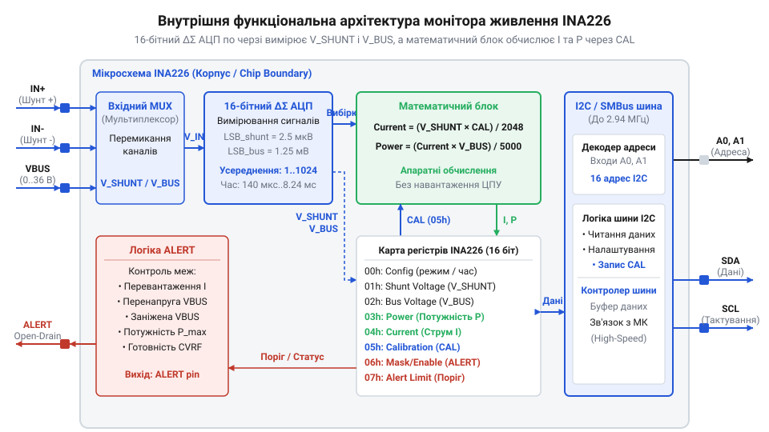
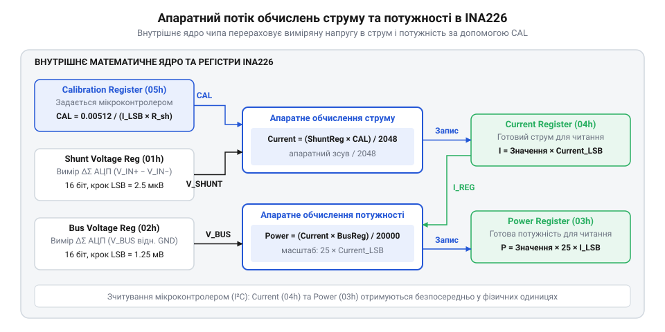
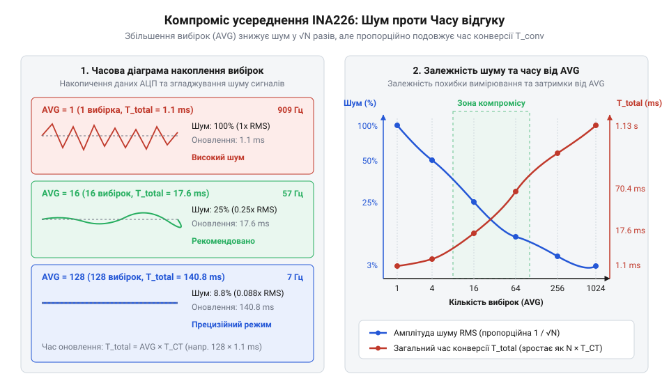
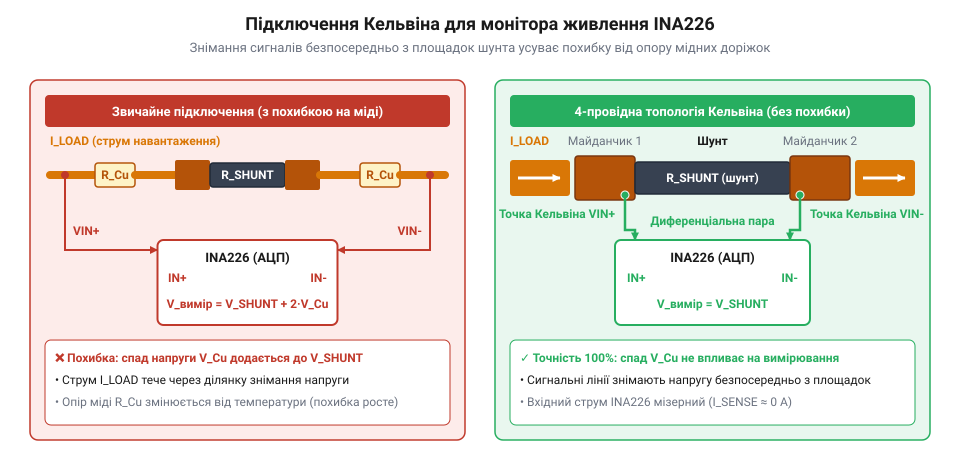

# Цифровий монітор живлення INA226

<preknowlist>
- [INA219 — монітор струму й напруги (I2C)](root:cat-hw-sensors/ina219-power-monitor) — Принцип вимірювання струму через шунт у high-side схемі та передача оцифрованих даних через I2C.
- [Конфігурація та усереднення вимірювань INA226](root:cat-hw-sensors/ina226-config-and-averaging) — Принципи налаштування режимів конверсії АЦП та цифрового усереднення вибірок.
</preknowlist>

## Проблема вимірювання струму та напруги

Вимірювання параметрів силової шини вбудованим АЦП мікроконтролера (@@en|ADC@@, англ. *Analog-to-Digital Converter*) обмежене діапазоном його опорної напруги (0–3.3 В). Підключення вимірювального @@en|shunt@@ (англ. *shunt* — відхиляти) у схемі високої сторони (@@en|high-side@@) подає високу синфазну напругу (@@en|common-mode voltage@@), що виводить з ладу вхідні каскади. Схема низької сторони (@@en|low-side@@) у розриві землі розв'язує це, але порушує цілісність спільної землі.

Низька розрядність АЦП (10–12 біт) створює високу похибку квантування: малий спад напруги на шунті втрачається в шумі. Дискретні операційні підсилювачі не допомагають через малий коефіцієнт придушення синфазного сигналу (@@en|CMRR@@) і температурний дрейф напруги зміщення (@@en|offset voltage@@). Для точного моніторингу потрібен спеціалізований цифровий монітор живлення з високовольтним фронтендом та прецизійним АЦП, як-от [INA219](root:cat-hw-sensors/ina219-power-monitor).

## Архітектура INA226 та дельта-сигма АЦП

Цифровий монітор живлення @@en|INA226@@ вимірює диференціальний спад напруги на шунті між виводами `IN+` та `IN-` у діапазоні до ±81.92 мВ і напругу шини `VBUS` до 36 В. Власне живлення `VCC` (2.7–5.5 В) незалежне від силової шини, а високий коефіцієнт @@en|CMRR@@ у 126 дБ забезпечує точне зчитування на боці високого потенціалу.


*Структурна схема внутрішніх вузлів INA226 та роздільне вимірювання струму й напруги шини.*

Вимірювальний тракт побудовано на 16-бітному дельта-сигма (@@en|delta-sigma@@, грец. *Δ* — різниця, *Σ* — сума) @@en|ADC@@. Передискретизація (@@en|oversampling@@) та децимаційна фільтрація (@@en|decimation@@) забезпечують високу роздільну здатність. Найменший значущий розряд (@@en|LSB@@) становить 2.5 мкВ для шунта та 1.25 мВ для `VBUS` (де шкала 40.96 В ділиться на 32768 рівнів).

## Апаратне обчислення струму й потужності

Внутрішнє математичне ядро @@en|INA226@@ обчислює струм та потужність у реальному часі, звільняючи мікроконтролер від дій з плаваючою комою. Результати записуються в 16-бітні регістри `CURRENT` та `POWER` на основі коефіцієнта з регістра калібрування @@en|CAL@@ (англ. *calibration*).


*Послідовність множення оцифрованих величин на калібрувальний коефіцієнт у внутрішньому ядрі.*

Коефіцієнт `CAL` обчислюється через обрану дискретність струму `Current_LSB` та опір шунта `R_shunt`:

```
Current_LSB = Max_Current ÷ 32768
CAL = 0.00512 ÷ (Current_LSB × R_shunt)
```

**Розрахунок калібрування для шунта 0.01 Ом при струмі 8 А:**

```
Current_LSB_min = 8 ÷ 32768
                = 0.00024414 А / LSB    [мінімальний крок розряду]

Current_LSB     = 0.00025 А / LSB       [округлення до 250 мкА]

CAL             = 0.00512 ÷ (0.00025 × 0.01)
                = 2048                  [значення для регістра CAL]
```

Запис 2048 (0x0800) у регістр `CAL` дозволяє ядру множити спад напруги на `CAL` для отримання струму в `CURRENT`. Потужність розраховується як добуток струму та напруги шини з масштабом `Power_LSB = 25 × Current_LSB` (6.25 мВт на розряд). Готові значення зчитуються по шині @@en|I2C@@.

## Усереднення вибірок та апаратний захист

Цифровий фільтр @@en|INA226@@ придушує завади налаштуванням часу конверсії @@en|ADC@@ та усередненням вибірок (від 1 до 1024). Більше усереднень зменшує шум, але уповільнює оновлення даних, про що детальніше йдеться в описі [конфігурації та усереднення вимірювань](root:cat-hw-sensors/ina226-config-and-averaging).


*Залежність амплітуди шумів і швидкості відгуку INA226 від кількості усереднених вибірок АЦП.*

Для звільнення мікроконтролера від опитування по шині @@en|I2C@@ вихід @@en|ALERT@@ з відкритим стоком (@@en|open-drain@@, англ. *open* — відкритий, *drain* — стік) генерує апаратне переривання при виході напруги, струму чи потужності за межі.

## Кельвінівське підключення та топологія плати

При вимірюванні мікровольтових спадів напруги на шунті паразитний опір мідних доріжок плати (близько 0.5 мОм/см) додається до сигналу. Підключення вимірювальних входів чипа прямо в силову лінію викривляє показання 16-бітного @@en|ADC@@ на десятки відсотків.


*Топологія друкованої плати з відокремленням сигнальних доріжок Кельвіна від силового контуру.*

Щоб усунути похибку, застосовують чотирипровідникове підключення Кельвіна (@@en|Kelvin connection@@). Силовий струм тече через зовнішні токовводи @@en|SMD@@-шунта, а сигнальні доріжки `IN+` та `IN-` підводять від внутрішніх точок під корпусом. Через високий вхідний опір виводів `IN+` / `IN-` мікросхеми @@en|INA226@@ струм ними не тече, тож падіння напруги на сигнальній лінії дорівнює нулю. Пару трасують короткою диференціальною лінією, а біля чипа ставлять симетричний RC-фільтр (10 Ом та 0.1 мкФ) для зрізу наведень. Докладніше про топологію трасування сигнальних доріжок та усунення похибок паразитного опору мідних провідників читайте у статті про [чотирипровідне підключення Кельвіна в друкованих платах](root:hw-pcb/kelvin-connection-pcb-layout).