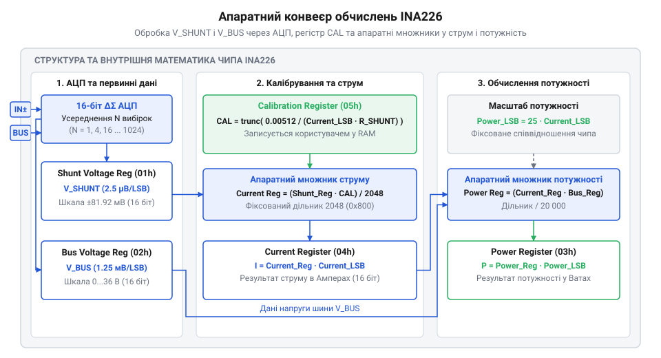

# Математичний розрахунок калібрування, дискретності та потужності в INA226

<preknowlist>
- [Конфігурація та усереднення вимірювань INA226](root:cat-hw-sensors/ina226-config-and-averaging) — призначення регістрів струму, напруги та калібрування, а також загальний порядок опитування чипа
</preknowlist>

## Проблема сирих вимірювань і дробового калібрування

Для вимірювання струму в розрив кола живлення вмикають прецизійний @@en|shunt resistor@@ — **шунт** (від англ. *shunt* — відгалуження). Монітор живлення @@en|INA226@@ зчитує спад напруги на ньому за допомогою вбудованого 16-бітного двознакового аналого-цифрового перетворювача (@@en|ADC@@, від англ. *Analog-to-Digital Converter*). Апаратна дискретність @@en|ADC@@ для напруги шунта є фіксованою й становить 2.5 мкВ на один відлік (`2.5 µV/LSB`), а повна шкала вимірювання обмежена діапазоном ±81.92 мВ.

Якщо зчитувати лише сирий вміст регістра напруги шунта `Shunt Voltage Register` (`01h`), головний мікроконтролер отримує відліки @@en|ADC@@ у мікровольтах. Щоб перетворити це число на реальний струм, обчислювач мусить поділити значення на опір шунта `R_SHUNT`. Звичайна цілочисельна арифметика тут ламається: ділення малих напруг на дробовий опір (наприклад, 10 мОм = 0.01 Ом) через відкидання дробової частини дає нуль або катастрофічну похибку. Множення перед діленням загрожує переповненням 32-бітних регістрів, а обчислення з плаваючою крапкою (@@en|floating-point arithmetic@@, від англ. *floating-point* — плаваюча крапка) вимагають залучення емулятора на мікроконтролерах без апаратного блоку @@en|FPU@@ (від англ. *Floating-Point Unit* — блок обчислень із плаваючою крапкою), що марнує цикли процесора та енергію.

Для усунення цієї проблеми в @@en|INA226@@ інтегровано власний @@en|hardware multiplier@@ — **апаратний множник** (від англ. *hardware multiplier*). Монітор живлення самостійно обчислює струм усередині чипа й записує результат у 16-бітний регістр струму `Current Register` (`04h`), використовуючи арифметику з фіксованою крапкою (@@en|fixed-point arithmetic@@, від англ. *fixed-point* — фіксована крапка).

Користувач один раз при ініціалізації пристрою задає цільову дискретність струму `Current_LSB` — вагу одного молодшого розряду (@@en|Least Significant Bit@@, @@en|LSB@@, від англ. *Least Significant Bit*) у фізичних одиницях (наприклад, 100 мкА/біт чи 1 мА/біт). Після цього чип автоматично перераховує кожне виміряне значення напруги шунта у відповідну кількість відліків струму. Розуміння зв'язку між опором шунта, дискретністю та внутрішнім коефіцієнтом масштабування відкриває можливість точного налаштування сенсора під довільні діапазони струму.

## Вибір шунта та розрахунок дискретності струму

Апаратне масштабування в @@en|INA226@@ вимагає узгодження двох параметрів: фізичного опору шунта `R_SHUNT` та програмної дискретності струму `Current_LSB`. Внутрішня схема АЦП @@en|INA226@@ обмежує максимальну диференційну напругу шунта `V_SHUNT_MAX` величиною ±81.92 мВ (0.08192 В).

Щоб спад напруги при піковому струмі навантаження `I_MAX` не перевищував межу АЦП, граничний опір шунта обчислюють за законом Ома:

```text
R_SHUNT_max = V_SHUNT_MAX ÷ I_MAX
            = 0.08192 ÷ I_MAX              [граничний опір шунта]
```

Опір, більший за `R_SHUNT_max`, вводить АЦП у насичення на позначці +32767 відліків. Занадто малий опір зменшує співвідношення сигнал/шум і точність вимірювання. Також вибір номіналу вимагає врахування потужності розсіювання та [термічного дрейфу шунта](root:hw-sensing/shunt-resistors-design).

Після вибору `R_SHUNT` розраховують дискретність `Current_LSB`. Для двознакового 16-бітного регістра струму (до +32767 відліків) найменша теоретична дискретність для покриття `I_MAX` становить:

```text
Current_LSB_min = I_MAX ÷ 32768            [найменша теоретична дискретність]
```

Дробове значення `Current_LSB_min` округлюють **у більший бік** до найближчого круглого числа (наприклад, 200 мкА/біт), що запобігає переповненню регістра струму при `I_MAX`. На відміну від [монітора струму INA219](root:cat-hw-sensors/ina219-power-monitor) з програмованими діапазонами, @@en|INA226@@ має фіксовану шкалу 81.92 мВ, тому вибір `Current_LSB` є вирішальним для розширення динамічного діапазону.

**Розрахунок шунта та дискретності струму для I_MAX = 5 А:**

```text
R_SHUNT_max = 0.08192 ÷ 5
            = 0.016384 Ом                  [максимальний опір шунта]

R_SHUNT = 0.01 Ом                          [вибір стандартного номіналу 10 мОм]

V_SHUNT_actual = 5 × 0.01
               = 0.05 В                    [падіння 50 мВ, що менше за 81.92 мВ]

Current_LSB_min = 5 ÷ 32768
                ≈ 0.000152588 А            [мінімальна дискретність 152.588 мкА/біт]

Current_LSB = 0.0002 А                     [округлення до круглого значення 200 мкА/біт]

CURRENT_max = 5 ÷ 0.0002
            = 25000 відліків               [перевірка: 25000 ≤ 32767, переповнення немає]
```

Опір шунта 10 мОм і дискретність 200 мкА/біт дозволяють вимірювати струм до 5 А без ризику переповнення регістра та зі зручним масштабуванням.

## Масштабувальний коефіцієнт та формула регістра калібрування

Для обчислення струму 16-бітний регістр калібрування `CAL` (`05h`) задає коефіцієнт, на який апаратний множник @@en|INA226@@ масштабує сирі відліки напруги шунта.

Виведемо математичне походження константи 0.00512. Внутрішній АЦП вимірює напругу шунта `V_SHUNT` з дискретністю 2.5 мкВ (2.5 × 10⁻⁶ В). Кількість відліків АЦП:

```text
SHUNT_VOLTAGE = V_SHUNT ÷ (2.5 × 10⁻⁶)    [сирі відліки АЦП]
```

За законом Ома струм `I = V_SHUNT ÷ R_SHUNT`. Значення в регістрі струму `CURRENT` має дорівнювати кількості відліків `Current_LSB`:

```text
CURRENT = I ÷ Current_LSB
        = V_SHUNT ÷ (R_SHUNT × Current_LSB) [цільове значення регістра струму]
```

Апаратний множник @@en|INA226@@ обчислює регістр струму за зашитою формулою:

```text
CURRENT = (SHUNT_VOLTAGE × CAL) ÷ 2048     [формула множника INA226]
```

Прирівнявши цільовий вираз `CURRENT` до апаратної формули, виразимо значення `CAL`:

```text
CAL = (2048 × 2.5 × 10⁻⁶) ÷ (Current_LSB × R_SHUNT)
    = 0.00512 ÷ (Current_LSB × R_SHUNT)   [оскільки 2048 × 2.5 × 10⁻⁶ = 0.00512]
```

Регістр `CAL` приймає цілі 16-бітні числа (1..65535), тому дробова частина відкидається функцією @@en|truncation@@ (від лат. *truncare* — урізати):

```text
CAL = trunc(0.00512 ÷ (Current_LSB × R_SHUNT)) [підсумкова формула калібрування]
```

Для `R_SHUNT` = 0.01 Ом та `Current_LSB` = 0.0002 А:

```text
CAL = trunc(0.00512 ÷ (0.0002 × 0.01))
    = trunc(0.00512 ÷ 0.000002)
    = 2560                                [значення для регістра CAL]
```

Для обчислення потужності в регістрі `POWER` (`03h`) АЦП вимірює напругу шини `V_BUS` з дискретністю 1.25 мВ (0.00125 В). Апаратна формула дорівнює:

```text
POWER = (CURRENT × BUS_VOLTAGE) ÷ 2048    [формула обчислення потужності]
```

Фізична потужність `P = V_BUS × I`. Підставивши `V_BUS = BUS_VOLTAGE × 0.00125` та `I = CURRENT × Current_LSB`, маємо:

```text
P = (BUS_VOLTAGE × 0.00125) × (CURRENT × Current_LSB)
  = (BUS_VOLTAGE × CURRENT) × (0.00125 × Current_LSB)
  = (POWER × 2048) × (0.00125 × Current_LSB)
  = POWER × (2048 × 0.00125 × Current_LSB)
  = POWER × (25 × Current_LSB)            [оскільки 2048 × 0.00125 = 25]
```

Звідси випливає дискретність регістра потужності `Power_LSB`:

```text
Power_LSB = 25 × Current_LSB              [дискретність потужності]
```

Для `Current_LSB` = 0.0002 А отримуємо `Power_LSB` = 25 × 0.0002 = 0.005 Вт (5 мВт/біт).

Логіку обробки даних усередині @@en|INA226@@ показує схема.


*Схема обробки даних усередині INA226: шлях виміряної напруги шунта через АЦП, множник із регістром CAL до регістра струму та апаратне обчислення потужності з напругою шини.*

Після запису `CAL` мікроконтролер зчитує струм і потужність напряму з регістрів. Порядок налаштування описує [конфігурація та усереднення INA226](root:cat-hw-sensors/ina226-config-and-averaging).

## Оцінка похибки округлення та граничні режими

Запис обчисленого значення у 16-бітний цілочисельний регістр `CAL` вимагає відсікання дробової частини (англ. @@en|truncation@@, від лат. @@la|truncare@@ — обрізати). Округлення точного значення `CAL_exact` до цілого `CAL` вносить методичну похибку масштабування `ε_CAL`, яка поширюється на вимірювання струму та потужності:

```text
CAL_exact = 0.00512 ÷ (Current_LSB × R_SHUNT)

ε_CAL = (CAL_exact - CAL) ÷ CAL_exact      [відносна похибка округлення]
```

При малих значеннях `CAL_exact` відкидання дробу дає високу відносну похибку. Для `CAL_exact` = 20.8 маємо `CAL` = 20:

```text
ε_CAL = (20.8 - 20) ÷ 20.8
      = 0.8 ÷ 20.8
      ≈ 0.0385                             [відносна похибка 3.85%]
```

Похибка 3.85% неприпустима для прецизійного вимірювання. Щоб мінімізувати `ε_CAL`, дискретність `Current_LSB` обирають так, щоб `CAL_exact` знаходилося у верхній частині 16-бітного діапазону (ближче до 65535).

Під час вибору `Current_LSB` контролюють дві граничні умови:

1. **Переповнення калібрування (`CAL` > 65535):** якщо `Current_LSB × R_SHUNT < 0.00512 ÷ 65535 ≈ 7.8125 × 10⁻⁸`, значення `CAL_exact` перевищує 65535. Запис у 16-бітний регістр спричиняє відсікання старших бітів (`CAL & 0xFFFF`), що спотворює обчислення. 2. **Переповнення струму (`CURRENT` > 32767):** якщо струм навантаження перевищує `32767 × Current_LSB`, регістр `CURRENT` зафіксується на верхній межі +32767 (насичення каналу).

Для шунта `R_SHUNT` = 0.005 Ом при виборі `Current_LSB` = 0.001 А маємо ціле `CAL_exact = 1024` (`ε_CAL = 0%`). Зменшення дискретності до `Current_LSB` = 0.0007 А дає:

```text
CAL_exact = 0.00512 ÷ (0.0007 × 0.005)
          ≈ 1462.857                       [дробове значення]

CAL = trunc(1462.857) = 1462               [ціле значення]

ε_CAL = (1462.857 - 1462) ÷ 1462.857
      ≈ 0.000586                           [похибка 0.0586%]
```

Збільшення `CAL` до кількох тисяч відліків знижує методичну похибку округлення до часток відсотка.

## Математика усереднення та компроміс швидкодії

Вимірювання струму й напруги у силовому колі супроводжуються пульсаціями імпульсних перетворювачів та тепловим шумом. Для пригнічення завад (@@en|noise suppression@@, від англ. *noise suppression* — пригнічення шуму) @@en|INA226@@ має апаратний блок **усереднення** (від англ. *averaging* — усереднення), який накопичує `N` вибірок АЦП перед оновленням вихідних регістрів.

За законом статистичного усереднення, якщо випадковий шум подиночної вибірки має середньоквадратичне відхилення `σ_single`, то усереднене значення `σ_avg` зменшується пропорційно до квадратного кореня з кількості вибірок `N`:

```text
σ_avg = σ_single ÷ √N                      [закон статистичного усереднення шуму]
```

Кількість вибірок задають у `Configuration Register` (`00h`) зі множини `N ∈ {1, 4, 16, 64, 128, 256, 512, 1024}`. Для `N` = 128 рівень шуму знижується в √128 ≈ 11.31 раза, що додає понад 3.5 біта ефективної розрядності АЦП.

Зменшення шуму потребує часу. Повний час оновлення регістрів `T_total` залежить від кількості вибірок `N` та часу інтегрування АЦП для каналів шунта `T_conv_shunt` і шини `T_conv_bus`:

```text
T_total = N × (T_conv_shunt + T_conv_bus)  [загальний час оновлення регістрів]
```

Час конверсії одного каналу `T_conv` налаштовується від 140 мкс до 8.244 мс.

**Розрахунок часу оновлення при стандартному `T_conv` = 1.1 мс:**

```text
T_conv_shunt = T_conv_bus = 1.1 мс        [стандартний час конверсії]

При N = 1 (без усереднення):
T_total = 1 × (1.1 мс + 1.1 мс) = 2.2 мс   [частота оновлення ~454 Гц]

При N = 128:
T_total = 128 × (1.1 мс + 1.1 мс) = 281.6 мс [частота оновлення ~3.55 Гц]
```

При `N` = 128 регістри оновлюються лише 3.55 раза на секунду, що підходить для високоточної телеметрії акумуляторів. Для аварійного захисту від переструму така затримка неприпустима — там обирають `N` = 1...4 із `T_conv` = 140–332 мкс для реакції за частки мілісекунди.