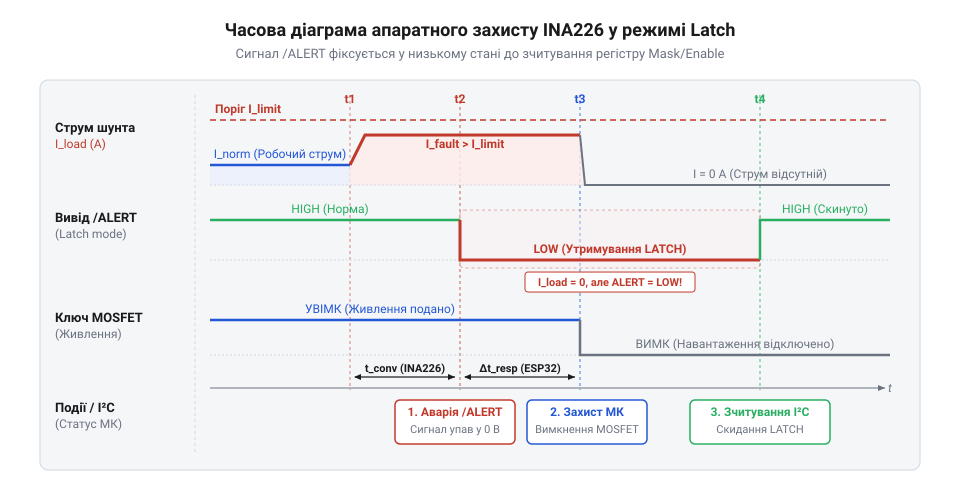
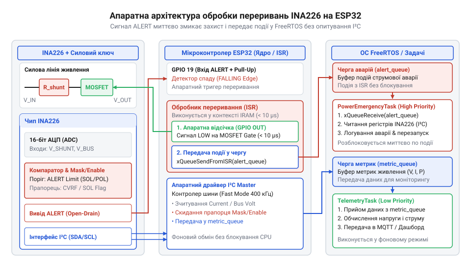

# Цифровий монітор живлення та апаратний захист на ESP32 і INA226

<preknowlist>
- [INA219 — монітор струму й напруги (I2C)](root:cat-hw-sensors/ina219-power-monitor) — базові принципи вимірювання струму через вимірювальний шунт та організацію I2C-інтерпретатора напруги
- [Конфігурація та усереднення вимірювань INA226](root:cat-hw-sensors/ina226-config-and-averaging) — режими опитування вимірювача INA226, налаштування часу конверсії та роботу режиму усереднення відліків
</preknowlist>

## Проблема затримок програмного опитування живлення

Уявіть ситуацію: мікроконтролер керує потужним навантаженням і періодично опитує сенсор струму через шину I2C, щоб виявити можливе перевантаження чи коротке замикання. Цей підхід, відомий як [програмне опитування живлення](root:cat-hw-sensors/ina219-power-monitor), працює добре для вимірювання середнього споживання. Проте, коли виникає коротке замикання, струм зростає миттєво. Якщо мікроконтролер саме в цей час зайнятий іншими задачами у своєму головному потоці або чекає на відповідь по I2C, він просто не встигне відреагувати. Затримка виникає із самої природи I2C: для читання одного значення мікроконтролер мусить послідовно передати адресу пристрою та адресу регістру, дочекатися підтверджень і прийняти самі дані, що навіть на швидкості 400 кбіт/с забирає сотні мікросекунд, а разом із програмним опитуванням у циклі легко сягає мілісекунд. Ці мілісекундні затримки коду та затримки самої шини є критичними: за цей час силові транзистори можуть зазнати термічного пошкодження або згоріти. Щоб захистити схему надійно, необхідно перенести функцію первинної діагностики аварійних станів на апаратний рівень — на вимірювач, який має лінію переривання і здатен миттєво сигналізувати про небезпеку.

## Математика калібрування та конфігураційні регістри

Щоб INA226 міг самостійно обчислювати струм і потужність, йому потрібно задати масштаб перетворення. Цей масштаб записується в регістр `Calibration`. Без калібрування мікросхема лише вимірює напругу, а регістри струму залишаються нульовими. Як наслідок, апаратний захист не може спиратися на струм, оскільки пороги відключення порівнюються саме з відкаліброваними значеннями.

Ключем до калібрування є @@en|найменший значущий розряд@@ струму `Current_LSB` (least significant bit). Він визначає, скільком амперам відповідає одиниця у внутрішньому цифровому регістрі. Цей параметр вибирають на основі максимального очікуваного струму `I_max`, який система здатна пропустити через шунт. Щоб уникнути переповнення 16-бітного регістра (де максимальне додатне значення — 32767), `Current_LSB` обчислюють за межею діапазону:

        Current_LSB
        = I_max ÷ 32768      [мінімальний крок вимірювання для заданого струму]

На практиці отримане значення часто округлюють до більшого круглого числа, щоб мікроконтролеру було простіше перетворювати цифрові дані на фізичні без операцій із рухомою комою.

Маючи `Current_LSB` та опір вимірювального шунта `R_shunt`, розраховують коефіцієнт для регістра `Calibration`. Внутрішня апаратна логіка INA226 використовує фіксовану константу 0.00512:

        Calibration
        = 0.00512 ÷ (Current_LSB × R_shunt)      [масштаб перетворення для шунта]

Після запису цього коефіцієнта пристрій автоматично множить виміряне падіння напруги на шунті на `Calibration`. Отриманий результат стає доступним у регістрі струму. 

Вибір `Current_LSB` прямо впливає на роботу захисту. Значення порогу для виводу ALERT задається в тих самих одиницях `Current_LSB`. Якщо крок надто великий, втрачається точність, і захист спрацьовуватиме грубо. Якщо крок надто малий (вибрано нереалістично малий `I_max`), регістр струму може переповнитися раніше, ніж струм досягне аварійної межі, і вивід ALERT не спрацює взагалі.

Баланс між швидкістю реакції на коротке замикання та точністю налаштовується через [конфігураційні регістри](root:cat-hw-sensors/ina226-config-and-averaging). Зменшення часу перетворення та кількості усереднень прискорює оновлення регістра струму, дозволяючи ALERT спрацювати миттєво. Проте це збільшує рівень шуму у вимірюваннях, що вимагає точнішого підбору порогу спрацювання, аби уникнути хибних тривог від короткочасних сплесків навантаження.

Розкрито математику розрахунку кроку вимірювання струму та значення калібрувального регістра, а також вплив цього кроку на точність порогів спрацювання ALERT. Введено терміни: найменший значущий розряд (Current_LSB), регістр Calibration.

## Конфігурування апаратного захисту через ALERT

Маючи обчислений коефіцієнт калібрування та налаштований вимірювальний тракт, можна перейти до механізму формування тривожних сигналів на фізичному виводі `ALERT`. Для цього потрібно запрограмувати регістри `Mask/Enable` та `Alert Limit`, щоб мікросхема могла виявити перевищення струму або вихід напруги за припустимі межі.

*Часова діаграма роботи апаратного захисту INA226 у режимі Latch при перевищенні порогового струму.*

Важливим кроком є [налаштування виводу ALERT](root:cat-hw-sensors/ina226-alert-pin-and-interrupts) з правильною полярністю і режимом фіксації стану `Latch`, що гарантує відключення силового ключа ще до втручання мікроконтролера. 

*Схема взаємодії виводу ALERT мікросхеми INA226 із сигнальною лінією GPIO мікроконтролера ESP32 та обробником переривань ISR.*

Це створює надійну апаратну базу для організації миттєвої обробки переривань на ESP32.

## Апаратна обробка переривань на ESP32

Система моніторингу втрачає сенс, якщо мікроконтролер не здатен миттєво відреагувати на критичне перевищення струму через повільне виконання інших завдань. Щоб розвантажити процесор і гарантувати швидкість реакції, ESP32 має обробляти сигнали від INA226 апаратно. Коли струм перевищує встановлений поріг, мікросхема змінює стан виводу @@en|ALERT@@, який підключається до одного з виводів загального призначення (GPIO) ESP32. Цей вивід налаштовується на генерацію зовнішнього переривання за зміною рівня. 

Щойно рівень на виводі падає, апаратний контролер переривань зупиняє виконання основного коду і миттєво передає керування обробнику переривань — @@en|ISR (Interrupt Service Routine)@@. У контексті ISR програма не повинна виконувати тривалих операцій чи очікувати на відповіді по шині I2C, оскільки це блокує всю систему. Головне завдання ISR при спрацьовуванні захисту — негайно знеструмити навантаження, перевівши відповідний керуючий вивід силового ключа у вимкнений стан. 

Для штатної роботи ESP32 може отримувати сигнал про готовність нових вимірювань — @@en|Conversion Ready@@. Він формується на тому ж виводі ALERT, якщо це налаштовано в регістрі Mask/Enable. Обробник переривання для цього сигналу діє інакше: замість відключення живлення він лише повідомляє основну програму про те, що дані готові до зчитування. Зчитувати дані по I2C всередині ISR не можна через низьку швидкість шини, тому обробник має лише встановлювати прапорець або надсилати повідомлення операційній системі. 

Після обробки тривоги INA226 продовжує утримувати лінію ALERT в активному стані (режим Latch), доки мікроконтролер не зчитає регістр Mask/Enable. Це скидає прапор тривоги всередині мікросхеми. Таке скидання виконується вже в основному циклі програми, після того, як аварійна ситуація була зафіксована, а живлення — відключено.

## Побудова підсистеми моніторингу та захисту

Поєднати переривання від INA226 із безперервним виконанням коду на ESP32 дозволяє операційна система реального часу FreeRTOS. Коли ISR фіксує готовність даних або аварію, він не обробляє їх самостійно, а передає сигнал у спеціальний об'єкт синхронізації — чергу або семафор. 

У разі події Conversion Ready обробник викликає швидку функцію відправки у чергу (наприклад, `xQueueSendFromISR`), передаючи короткий маркер події. Окреме завдання FreeRTOS, яке до цього перебувало у стані блокування і не споживало процесорного часу, прокидається. Воно зчитує виміряні значення струму й напруги по I2C, розраховує потужність і може передати їх далі — на екран чи сервер. Завдяки цьому повільне зчитування I2C виконується в звичайному потоці, не порушуючи детермінованості обробки переривань. Правила безпечного використання FromISR-функцій детально описані в темі про [черги FreeRTOS та обробку переривань](root:sf-devices/freertos-queues-and-isrs).

У випадку аварійного перевантаження ISR негайно вимикає силове реле чи транзистор, після чого також надсилає повідомлення про спрацювання захисту в чергу. Завдання-обробник аварій приймає це повідомлення, записує подію в журнал (лог), може увімкнути звукову індикацію і відправити команду на зчитування регістра Mask/Enable, щоб скинути тривогу INA226. 

Така архітектура розділяє систему на дві незалежні частини: миттєву реакцію в перериванні та повільну обробку в основних завданнях. Це створює надійний захист, де відключення живлення відбувається за мікросекунди апаратно, а всі подальші дії — вимірювання, логування і мережевий обмін — планомірно виконуються ресурсами FreeRTOS.