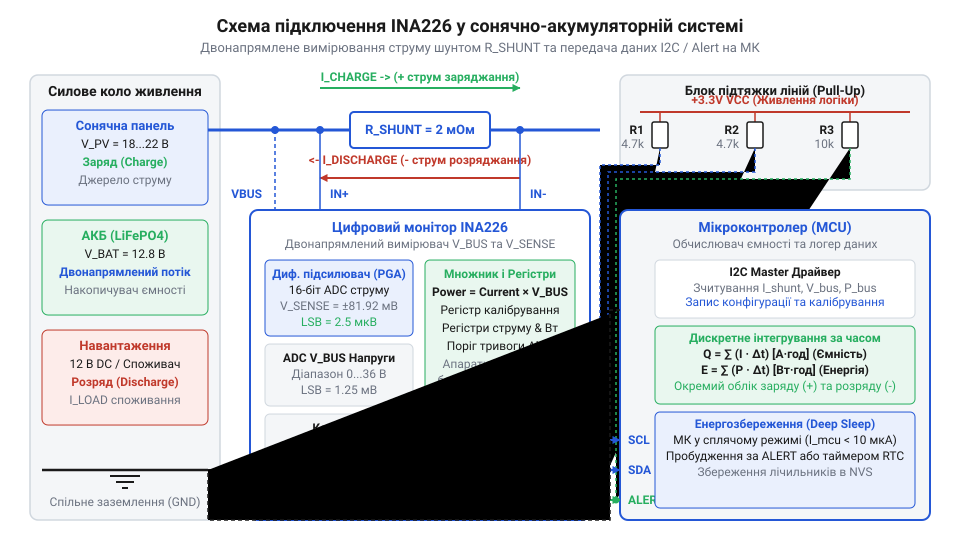
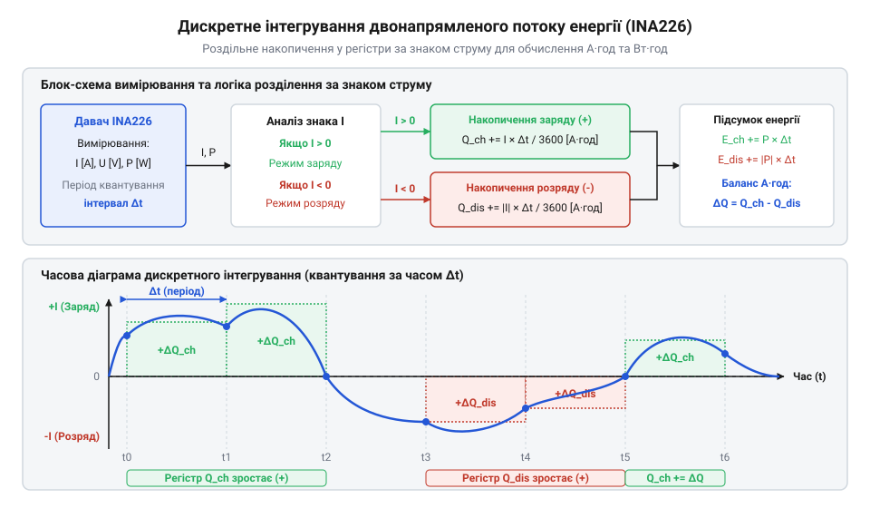

# Двонапрямлений логер енергоспоживання автономної системи на INA226

<preknowlist>
- [INA219 — монітор струму й напруги (I2C)](root:cat-hw-sensors/ina219-power-monitor) — Базовий принцип вимірювання падіння напруги на шунті та обчислення струму й потужності.
- [Конфігурація та усереднення вимірювань INA226](root:cat-hw-sensors/ina226-config-and-averaging) — Налаштування регістру конфігурації, режимів усереднення та часу конверсії для зменшення шумів вимірювань.
</preknowlist>

## Дисбаланс енергії в автономній системі

Просте вимірювання напруги на акумуляторі не дає повної картини стану автономної системи. Коли сонячна панель генерує енергію, а навантаження водночас її споживає, напруга на клемах може зростати або падати залежно від того, що переважає. Без вимірювання напрямку струму неможливо точно визначити, чи акумулятор зараз заряджається, чи віддає енергію. Щоб бачити реальний баланс, потрібен двонапрямлений моніторинг.

У сонячно-акумуляторних системах струм тече в обидва боки. Під час активного сонця генерація перевищує споживання, і надлишок енергії йде в акумулятор — струм заряду. Вночі або під час великих навантажень енергія забирається з акумулятора — струм розряду. Знати лише напругу недостатньо, адже напруга сильно залежить від внутрішнього опору акумулятора та величини струму, що через нього протікає.

Для точного відстеження стану заряду та розрахунку накопичених ампер-годин необхідно вимірювати не лише величину, а й напрямок струму. Двонапрямлений моніторинг дозволяє вести облік енергії, інтегруючи струм за часом. Це дає змогу точно знати, скільки енергії було накопичено і скільки витрачено.

## Апаратна схема вимірювального вузла INA226

Щоб вимірювати двонапрямлений струм, вимірювальний шунт ставиться в розрив кола живлення. Мікросхема INA226 вимірює падіння напруги на цьому шунті. Оскільки струм може текти в обидва боки, падіння напруги на шунті може бути додатним або від'ємним відносно виводів мікросхеми.

*Схема підключення показує, як шунт інтегрується у спільне коло, забезпечуючи вимірювання струму між акумулятором та навантаженням або джерелом заряду.*

Апаратна схема повинна враховувати захист від перенапруги та шумів, а також обґрунтований вибір номіналу вимірювального шунта. Критерієм вибору опору шунта є максимальний очікуваний струм системи: опір має бути достатньо малим, щоб мінімізувати втрати потужності та нагрів (згідно з P = I²R), але водночас достатнім для забезпечення високої роздільної здатності, при цьому падіння напруги на ньому не повинно перевищувати діапазон вимірювання INA226 (±81,92 мВ). Лінії I2C вимагають підтягувальних резисторів, а вимірювальні входи INA226 — фільтрувальних конденсаторів для згладжування пульсацій. Спільне коло має бути спроєктоване так, щоб шунт знаходився на шляху всього струму акумулятора, не оминаючи жодного джерела чи навантаження.

Підключення INA226 до мікроконтролера здійснюється двома лініями I2C: SDA та SCL, а також лінією Alert для переривань. Alert може використовуватись для виведення контролера зі сплячого режиму при досягненні певного порогу напруги або струму, що знижує загальне енергоспоживання системи.

## Обробка знакового струму та потужності

INA226 зберігає виміряне значення струму у вигляді 16-бітного знакового числа у форматі доповнення до двох (@@en|two's complement@@). Це означає, що старший біт вказує на знак числа. Додатне значення відповідає одному напрямку струму (наприклад, розряду), а від'ємне — протилежному (заряду).

Щоб коректно обробляти ці значення, програма має зчитувати регістр як знакове 16-бітне ціле (`int16_t`). Після цього сире значення множиться на крок дискретизації струму (`Current_LSB`), який обчислюється під час калібрування. 

*Блок-схема демонструє процес зчитування знакового струму, обчислення потужності та інтегрування цих значень за часом для розрахунку енергії.*

Обробка потужності також залежить від напрямку струму. Хоча регістр потужності INA226 завжди містить беззнакове значення, знак поточного струму визначає, чи ця потужність накопичується, чи витрачається. 

:::code proj-ina226-solar-battery-logger/c/src/ina226.c 160-176
:::code proj-ina226-solar-battery-logger/c/src/ina226.c 195-211

Програмне розділення потоку заряду та розряду дозволяє вести незалежні лічильники енергії. Наприклад, можна окремо рахувати ват-години, отримані від сонячної панелі, та ват-години, віддані навантаженню.

## Дискретне інтегрування ємності та енергії

Вимірювання струму й потужності давачем INA226 дає миттєві значення у конкретний момент часу. Щоб дізнатися загальну кількість накопиченої або витраченої енергії за певний період, миттєві показники потрібно проінтегрувати за часом. Оскільки мікроконтролер зчитує дані періодично, справжня безперервна крива зміни струму нам недоступна. Натомість застосовується чисельне дискретне інтегрування — наближення площі під кривою за допомогою скінченної суми фігур на кожному кроці вимірювання.

Для розрахунку електричної ємності ми беремо струм `I` та множимо його на тривалість часового інтервалу між вимірами `Δt`. Потужність, помножена на той самий інтервал `Δt`, дає виконану роботу — енергію у ват-годинах. Оскільки стандартною одиницею є ампер-година (А·год), тривалість кроку в секундах необхідно перевести в години, поділивши на 3600.

Найпростіший підхід — метод прямокутників. Він припускає, що впродовж усього інтервалу `Δt` струм залишався незмінним і дорівнював останньому виміряному значенню. Алгоритм накопичення у мові C працює саме так: він використовує глобальний акумулятор, до якого на кожному кроці додається добуток миттєвого струму на час. Щоб уникнути стану перегонів (@@en|race condition@@) між перериванням таймера та основним циклом, додавання захищають атомарним доступом.

:::code proj-ina226-solar-battery-logger/c/src/power_monitor.c 52-81

Цей метод швидкий, але дає відчутну похибку, якщо струм стрімко змінюється між вимірами. Точнішим розв'язком є метод трапецій. Замість того, щоб брати лише поточне значення струму, він обчислює середнє арифметичне між попереднім `I_prev` та поточним `I_curr` вимірами. Геометрично це означає, що вершини двох сусідніх точок на графіку з'єднуються прямою лінією, і площа під ними стає трапецією:

    ΔC
    = (I_prev + I_curr) / 2 × Δt     [площа трапеції]

Метод трапецій суттєво зменшує похибку дискретизації для сигналів із плавними змінами. В об'єктно-орієнтованій реалізації на C++ цей підхід є базовим:

:::code proj-ina226-solar-battery-logger/cpp/src/power_logger.cpp 21-76

Точність інтегрування прямо залежить від стабільності відліку `Δt`. Мікроконтролер повинен жорстко відстежувати часові проміжки. Найкращим джерелом бази часу є апаратний таймер: він викликає переривання через рівні проміжки, забезпечуючи ідеальний `Δt`. Якщо виміри виконуються асинхронно у головному циклі, `Δt` обчислюють через віднімання попередньої позначки часу від поточної.

Оскільки INA226 вимірює струм із врахуванням напрямку, він повертає знакове число. Додатне значення струму вказує на процес заряду акумулятора від сонячної панелі, а від'ємне — на споживання енергії навантаженням. Алгоритм інтегрування розділяє ці два потоки: додає площі додатних трапецій до лічильника накопиченої ємності, а модулі від'ємних площ — до лічильника витраченої. Завдяки цьому ми маємо точний двонапрямлений баланс без втрати даних про частку струму, що пішла на заряд або була одразу спожита.

## Збереження точності у сплячих режимах

Автономні логери часто працюють від акумулятора, тому мінімізація власного споживання є критичною. Мікроконтролер, який постійно перебуває в активному стані для опитування INA226, швидко вичерпає запас енергії. Рішенням є переведення процесора у режим сну між циклами вимірювання, з пробудженням лише за таймером або апаратним перериванням від давача.

Давач INA226 здатен працювати автономно, виконуючи вимірювання та усереднення значень, поки мікроконтролер спить. Проте, якщо сплячий режим триває надто довго і пропускаються цикли накопичення, точність інтегрування падає, оскільки різкі зміни струму між пробудженнями залишаться неврахованими. Щоб запобігти цьому, сам INA226 може бути переведений у режим зниженого енергоспоживання (@@en|Power-Down mode@@) на час глибокого сну пристрою.

У C++ драйвері переведення у сплячий режим зберігає поточні налаштування регістра конфігурації, щоб після пробудження відновити попередній стан:

:::code proj-ina226-solar-battery-logger/cpp/src/ina226_driver.cpp 161-181

Інтеграція керування сном у високорівневий логер передбачає перевірку стану перед оновленням метрик та скидання прапорців для запобігання хибним стрибкам інтегрування після пробудження:

:::code proj-ina226-solar-battery-logger/cpp/src/power_logger.cpp 78-89

Таким чином, баланс між частотою пробуджень і тривалістю сну визначає компроміс між точністю накопичення енергії та часом автономної роботи логера.