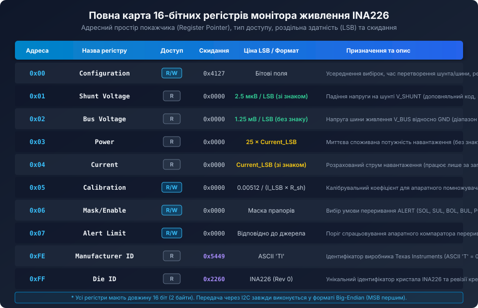
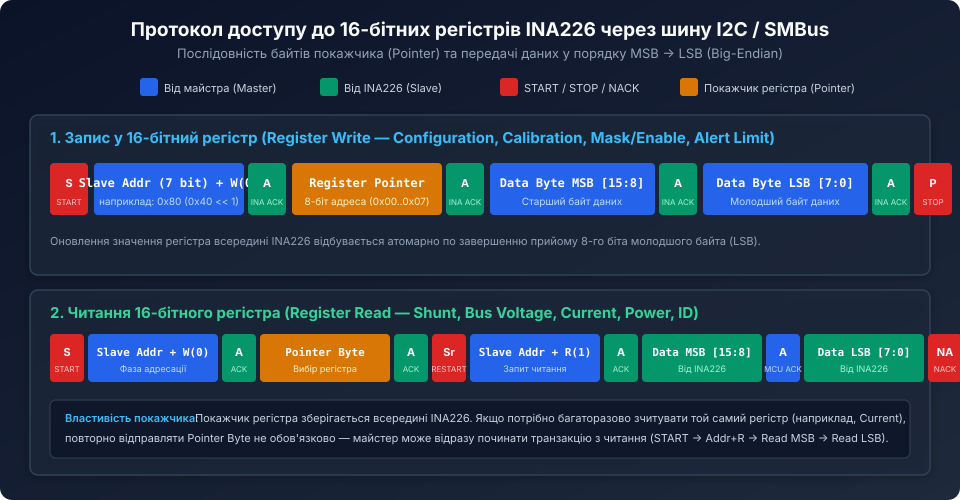
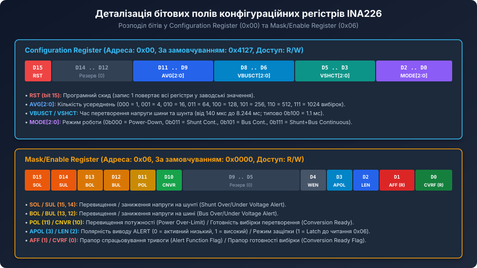

# Поглиблений аналіз карти регістрів та архітектури керування INA226

<preknowlist>
- [Карта регістрів та конфігурація INA226](root:cat-hw-sensors/ina226-register-map) — базовий огляд структури 16-бітних регістрів та протоколу I2C.
- [Конфігурація та усереднення вимірювань INA226](root:cat-hw-sensors/ina226-config-and-averaging) — фільтрація перешкод та часові параметри вибірок АЦП.
- [Налаштування виводу ALERT та обробка тривожних подій в INA226](root:cat-hw-sensors/ina226-alert-pin-and-interrupts) — програмування компаратора та режимів защіпки.
</preknowlist>

## Архітектура покажчика регістрів (Register Pointer) та дисципліна шини

Усі операції обміну даними між керуючим хост-контролером та мікросхемою INA226 здійснюються через 8-бітний внутрішній регістр-покажчик (`Register Pointer`). Оскільки фізичний адресний простір пристрою містить лише регістри з адресами від `0x00` до `0x07`, а також ідентифікатори `0xFE` та `0xFF`, старші розряди покажчика зарезервовані і повинні передаватися як нулі під час адресації стандартних комірок.



### Механізм збереження та автоутримання покажчика адреси

Пристрій реалізує енергонезалежне (у межах активного сеансу живлення) кешування адреси регістра. Якщо хост виконав передачу одного байта покажчика регістра `Pointer Byte` (наприклад, `0x04` для читання струму), цей покажчик залишається активним доти, доки не буде перезаписаний новим значенням або доки не станеться апаратний скид мікросхеми по живленню.

Це дає суттєву оптимізацію пропускної здатності шини I2C у високошвидкісних циклах опитування:
1. **Стандартне читання з установкою адреси:** 
   - `START` -> `[Slave_Addr + W]` (ACK) -> `[Pointer_Byte]` (ACK) -> `RESTART` -> `[Slave_Addr + R]` (ACK) -> `[MSB]` (ACK) -> `[LSB]` (NACK) -> `STOP`. Разом: 29 тактів I2C (без урахування пауз).
2. **Оптимізоване потокове читання з кешованим покажчиком:**
   - `START` -> `[Slave_Addr + R]` (ACK) -> `[MSB]` (ACK) -> `[LSB]` (NACK) -> `STOP`. Разом: 20 тактів I2C.
   - Економія пропускної здатності шини сягає 31%, що критично важливо при опитуванні декількох моніторів на одній шині з високою частотою.



### Атомарність оновлення даних та когерентність вибірок

Усі вимірювальні та обчислювальні регістри мають розрядність 16 біт і оновлюються апаратним обчислювальним ядром пристрою. Щоб уникнути читання частково оновленого значення (коли старший байт належить новому вимірюванню, а молодший — попередньому), INA226 фіксує значення всього 16-бітного регістра у внутрішньому вихідному буфері в момент генерації хостом сигналу ACK після прийому адреси читання `[Slave_Addr + R]`. 

Навіть якщо безпосередньо під час передачі байта MSB завершується новий цикл інтеграції сигма-дельта АЦП, поточне зчитування поверне повністю узгоджене 16-бітне слово.

## Детальна бітова карта та керування режимами



### Конфігураційний регістр 0x00: тонке налаштування аналогового тракту

Регістр `Configuration` визначає тривалість фази інтеграції внутрішнього сигма-дельта модулятора, глибину цифрового фільтра та споживання струму:

```text
 15    14   13   12   11   10   9    8    7    6    5    4    3    2    1    0
+----+----+----+----+----+----+----+----+----+----+----+----+----+----+----+----+
|RST |  Reserved (0)|    AVG[2:0]  |   VBUSCT[2:0]  |   VSHCT[2:0]  |  MODE[2:0] |
+----+----+----+----+----+----+----+----+----+----+----+----+----+----+----+----+
```

1. **RST (біт 15):** Запис логічної '1' генерує внутрішній імпульс скиду тривалістю кілька наносекунд. Усі внутрішні лічильники, регістри конфігурації, калібрування та маски скидаються у стан за замовчуванням (`0x4127` для конфігурації, `0x0000` для інших). Біт є самоочисним і завжди зчитується як '0'.
2. **AVG[2:0] (біти 11..9):** Кількість накопичених апаратних вибірок у кошику усереднення цифрового CIC-фільтра:
   - `000` — 1 вибірка (без усереднення; максимальна швидкодія, мінімальне придушення перешкод);
   - `001` — 4 вибірки;
   - `010` — 16 вибірок;
   - `011` — 64 вибірки;
   - `100` — 128 вибірок;
   - `101` — 256 вибірок;
   - `110` — 512 вибірок;
   - `111` — 1024 вибірки (максимальне придушення білого шуму, час перетворення зростає у 1024 рази).
3. **VBUSCT та VSHCT (біти 8..6 та 5..3):** Час інтеграції АЦП для напруги шини живлення та шунта:
   - `000` — 140 мкс;
   - `001` — 204 мкс;
   - `010` — 332 мкс;
   - `011` — 588 мкс;
   - `100` — 1.100 мс (заводське значення, оптимізоване для компенсації частот 50/60 Гц);
   - `101` — 2.116 мс;
   - `110` — 4.156 мс;
   - `111` — 8.244 мс.
4. **MODE[2:0] (біти 2..0):** Керування станом перетворювача:
   - `000` — Режим сну (Power-Down, споживання падає нижче 2 мкА);
   - `001` — Shunt Voltage, тригерний (одноразове перетворення за запитом);
   - `010` — Bus Voltage, тригерний;
   - `011` — Shunt та Bus Voltage, тригерний;
   - `100` — Режим сну (аналогічно 000);
   - `101` — Shunt Voltage, безперервний (Continuous);
   - `110` — Bus Voltage, безперервний;
   - `111` — Shunt та Bus Voltage, безперервний (за замовчуванням).

Загальний час оновлення пари вимірювань розраховується за формулою:

```text
T_update = AVG_samples * (VSHCT + VBUSCT)
```

При заводських установках (AVG = 1, VSHCT = 1.1 мс, VBUSCT = 1.1 мс) час оновлення становить 2.2 мс (частота вихідних даних приблизно 454 Гц). Якщо обрати AVG = 16 при 1.1 мс, період оновлення складе 35.2 мс (28.4 Гц), що забезпечує ефективне зниження середньоквадратичного шуму (RMS noise) вчетверо (корінь з 16).

## Математичне узгодження знакових чисел та форматів представлення

### Знакові вимірювання (доповняльний код)

Регістри `Shunt Voltage` (0x01) та `Current` (0x04) містять 16-бітні величини зі знаком у прямому доповняльному коді (Two's Complement).

У мікроконтролерах архітектури ARM Cortex-M (з порядком байтів Little-Endian) зчитані через I2C два байти `rx_buf[0]` (MSB) та `rx_buf[1]` (LSB) необхідно коректно зібрати з урахуванням розширення знаку:

```c
// Правильне збирання 16-бітного знакового значення
int16_t signed_raw = (int16_t)(((uint16_t)rx_buf[0] << 8) | (uint16_t)rx_buf[1]);
```

Якщо старший біт `rx_buf[0] & 0x80` дорівнює 1, компілятор мови C при явному приведенні до `int16_t` коректно трактуватиме число як від'ємне (від -1 до -32768). 

Зв'язок між кодом і фізичною напругою шунта описується співвідношенням:
- `0x7FFF` = +32767 відліків -> `+32767 * 2.5 мкВ = +81.9175 мВ`;
- `0x0001` = +1 відлік -> `+2.5 мкВ`;
- `0x0000` = 0 відліків -> `0.0 мВ`;
- `0xFFFF` = -1 відлік -> `-2.5 мкВ`;
- `0x8000` = -32768 відліків -> `-81.9200 мВ`.

### Беззнакові вимірювання напруги та потужності

Регістри `Bus Voltage` (0x02) та `Power` (0x03) завжди є суто беззнаковими (`uint16_t`). 
- Для `Bus Voltage` 1 LSB = 1.25 мВ. Значення `0x7080` відповідає 28800 відлікам: `28800 * 1.25 мВ = 36000 мВ = 36.00 В`.
- Для `Power` 1 LSB = 25 * Current_LSB. Значення розраховується внутрішнім помножувачем шляхом обчислення добутку модуля струму та напруги шини з відсіканням дробової частини.

## Повний регістровий драйвер для високопродуктивних вбудованих систем

Нижче наведено модульну реалізацію драйвера монітора INA226 для мікроконтролерів (STM32, ESP32, nRF52), що використовує чітко типізовані бітові структури та підтримує перевірку статусу прапорів тривоги й переповнення.

```c
#include <stdint.h>
#include <stdbool.h>

// I2C адреси (визначаються підключенням виводів A0/A1 до GND, VS, SDA, SCL)
typedef enum {
    INA226_ADDR_GND_GND = 0x40,
    INA226_ADDR_GND_VS  = 0x41,
    INA226_ADDR_GND_SDA = 0x42,
    INA226_ADDR_GND_SCL = 0x43,
    INA226_ADDR_VS_GND  = 0x44,
    INA226_ADDR_VS_VS   = 0x45
} ina226_i2c_addr_t;

// Адреси регістрів
#define INA226_REG_CONFIG       0x00
#define INA226_REG_SHUNTVOLT    0x01
#define INA226_REG_BUSVOLT      0x02
#define INA226_REG_POWER        0x03
#define INA226_REG_CURRENT      0x04
#define INA226_REG_CALIBRATION  0x05
#define INA226_REG_MASKENABLE   0x06
#define INA226_REG_ALERTLIMIT   0x07
#define INA226_REG_MANUF_ID     0xFE
#define INA226_REG_DIE_ID       0xFF

// Біти регістра Mask/Enable (0x06)
#define INA226_MASK_SOL         (1 << 15) // Shunt Over-Limit
#define INA226_MASK_SUL         (1 << 14) // Shunt Under-Limit
#define INA226_MASK_BOL         (1 << 13) // Bus Over-Limit
#define INA226_MASK_BUL         (1 << 12) // Bus Under-Limit
#define INA226_MASK_POL         (1 << 11) // Power Over-Limit
#define INA226_MASK_CNVR        (1 << 10) // Conversion Ready
#define INA226_MASK_APOL        (1 << 3)  // Alert Polarity (1 = Active-High)
#define INA226_MASK_LEN         (1 << 2)  // Latch Enable
#define INA226_MASK_AFF         (1 << 1)  // Alert Function Flag (Read-only)
#define INA226_MASK_CVRF        (1 << 0)  // Conversion Ready Flag (Read-only)

// Контекст пристрою
typedef struct {
    uint8_t i2c_addr;
    float current_lsb_a;
    float power_lsb_w;
    uint16_t cal_reg_val;
} ina226_t;

// Прототипи платформно-залежних функцій I2C
extern bool platform_i2c_write(uint8_t dev_addr, const uint8_t *data, uint16_t len);
extern bool platform_i2c_write_read(uint8_t dev_addr, const uint8_t *tx, uint16_t tx_len, uint8_t *rx, uint16_t rx_len);

static bool ina226_write_u16(ina226_t *dev, uint8_t reg, uint16_t val) {
    uint8_t packet[3] = { reg, (uint8_t)(val >> 8), (uint8_t)(val & 0xFF) };
    return platform_i2c_write(dev->i2c_addr, packet, 3);
}

static bool ina226_read_u16(ina226_t *dev, uint8_t reg, uint16_t *val) {
    uint8_t rx[2];
    if (!platform_i2c_write_read(dev->i2c_addr, &reg, 1, rx, 2)) return false;
    *val = (uint16_t)((rx[0] << 8) | rx[1]);
    return true;
}

// Ініціалізація датчика та калібрування
bool ina226_setup(ina226_t *dev, uint8_t addr, float r_shunt_ohms, float max_expected_current_a) {
    dev->i2c_addr = addr;

    // 1. Валідація ідентифікаторів
    uint16_t mid = 0, did = 0;
    if (!ina226_read_u16(dev, INA226_REG_MANUF_ID, &mid) || mid != 0x5449) return false;
    if (!ina226_read_u16(dev, INA226_REG_DIE_ID, &did) || (did & 0xFFF0) != 0x2260) return false;

    // 2. Програмне скидання
    ina226_write_u16(dev, INA226_REG_CONFIG, 0x8000);

    // 3. Розрахунок Current_LSB та коефіцієнта калібрування CAL
    // Current_LSB = Max_Expected_Current / 32768
    dev->current_lsb_a = max_expected_current_a / 32768.0f;
    dev->power_lsb_w = 25.0f * dev->current_lsb_a;

    // CAL = 0.00512 / (Current_LSB * R_shunt)
    float cal_float = 0.00512f / (dev->current_lsb_a * r_shunt_ohms);
    dev->cal_reg_val = (uint16_t)cal_float;

    // 4. Запис регістра конфігурації: AVG=16, VBUS=1.1мс, VSH=1.1мс, Cont Mode (0x4527)
    ina226_write_u16(dev, INA226_REG_CONFIG, 0x4527);

    // 5. Запис калібрування
    ina226_write_u16(dev, INA226_REG_CALIBRATION, dev->cal_reg_val);

    return true;
}

// Зчитування всіх електричних параметрів за одну функцію
bool ina226_get_telemetry(ina226_t *dev, float *v_bus_v, float *v_shunt_mv, float *current_a, float *power_w) {
    uint16_t raw_bus, raw_power;
    uint16_t raw_shunt_u16, raw_curr_u16;

    if (!ina226_read_u16(dev, INA226_REG_BUSVOLT, &raw_bus)) return false;
    if (!ina226_read_u16(dev, INA226_REG_SHUNTVOLT, &raw_shunt_u16)) return false;
    if (!ina226_read_u16(dev, INA226_REG_CURRENT, &raw_curr_u16)) return false;
    if (!ina226_read_u16(dev, INA226_REG_POWER, &raw_power)) return false;

    // Напруга шини: 1.25 мВ / LSB
    *v_bus_v = (float)raw_bus * 0.00125f;

    // Напруга шунта: 2.5 мкВ / LSB = 0.0025 мВ / LSB (зі знаком)
    int16_t raw_shunt = (int16_t)raw_shunt_u16;
    *v_shunt_mv = (float)raw_shunt * 0.0025f;

    // Струм: знаковий
    int16_t raw_curr = (int16_t)raw_curr_u16;
    *current_a = (float)raw_curr * dev->current_lsb_a;

    // Потужність: беззнакова
    *power_w = (float)raw_power * dev->power_lsb_w;

    return true;
}
```

Використання чіткої бітової декомпозиції регістрів, розуміння архітектури покажчика та коректної обробки знаків доповняльного коду дозволяє будувати на базі INA226 високонадійні вимірювальні канали для автоматизованого контролю живлення телекомунікаційного обладнання, сонячних інверторів та батарейних комплексів.
