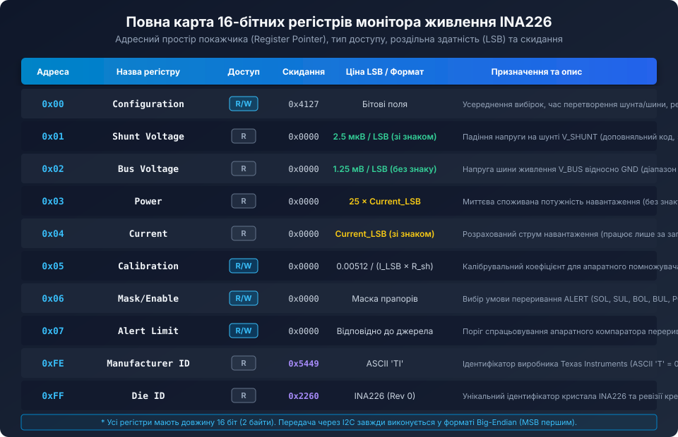
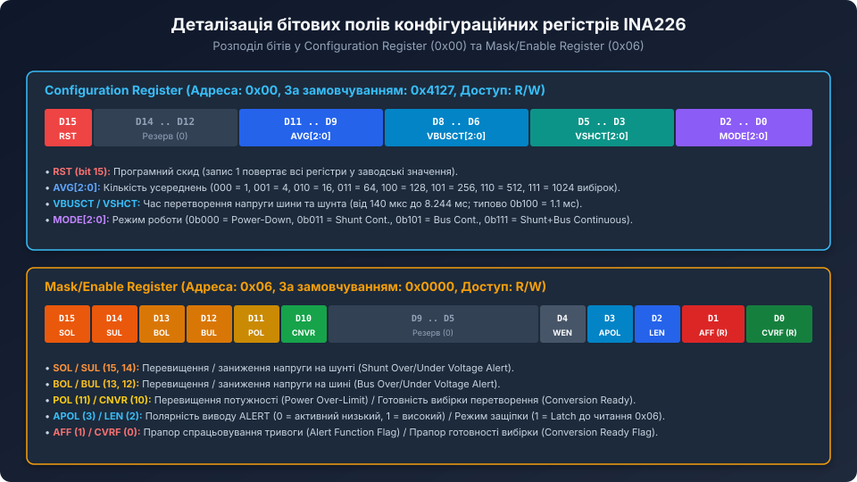

# Карта регістрів та конфігурація INA226

<preknowlist>
- [INA219 — монітор струму й напруги (I2C)](root:cat-hw-sensors/ina219-power-monitor) — базові принципи вимірювання струму через падіння напруги на шунті та протокол I2C.
- [Цифровий монітор живлення INA226](root:cat-hw-sensors/ina226-power-monitor) — загальна архітектура прецизійного вимірювача живлення та аналого-цифрового тракту.
- [Конфігурація та усереднення вимірювань INA226](root:cat-hw-sensors/ina226-config-and-averaging) — часові діаграми інтеграції АЦП та фільтрація шумів.
- [Налаштування виводу ALERT та обробка тривожних подій в INA226](root:cat-hw-sensors/ina226-alert-pin-and-interrupts) — схемотехніка відкритого стоку та умови генерації переривань.
</preknowlist>

## Призначення та організація 16-бітного адресного простору INA226

Мікросхема INA226 є високоточним цифровим монітором напруги, струму та споживаної потужності із вбудованим 16-бітним сигма-дельта АЦП та інтерфейсом I2C/SMBus. Вся внутрішня пам'ять пристрою організована у вигляді набору з десяти 16-бітних регістрів, доступ до яких здійснюється через 8-бітний покажчик адреси (Register Pointer).

На відміну від багатьох 8-бітних периферійних пристроїв, кожен логічний регістр INA226 складається з двох байтів (MSB — Most Significant Byte та LSB — Least Significant Byte). Обмін даними через шину I2C завжди ведеться у мережевому порядку байтів (Big-Endian): після відправлення адреси регістра першим передається старший байт даних (біти D15..D8), а другим — молодший байт (біти D7..D0).



Адресний простір INA226 чітко розмежовано на чотири функціональні групи:
1. **Керуючі та конфігураційні регістри:** `Configuration` (0x00), `Mask/Enable` (0x06), `Alert Limit` (0x07).
2. **Первинні регістри результатів АЦП:** `Shunt Voltage` (0x01) та `Bus Voltage` (0x02).
3. **Обчислювані цифрові регістри:** `Current` (0x04), `Power` (0x03) та регістр масштабного коефіцієнта `Calibration` (0x05).
4. **Службові ідентифікаційні регістри:** `Manufacturer ID` (0xFE) та `Die ID` (0xFF).

Оновлення значень вимірювальних регістрів виконується апаратним автоматом станів після кожного циклу перетворення АЦП. Оновлення 16-бітного слова є строго атомарним: читання з боку мікроконтролера гарантовано повертає узгоджені значення старшого та молодшого байтів без виникнення проміжних спотворень даних.

## Первинні регістри аналого-цифрового перетворення

Первинні результати перетворення формуються безпосередньо вбудованим АЦП і записуються у відповідні регістри незалежно від наявності запису в регістр калібрування.

### Регістр напруги шунта (Shunt Voltage Register, адреса 0x01)

Регістр `Shunt Voltage` містить оцифроване значення різниці потенціалів між входами IN+ та IN-. Значення зберігається як 16-бітне знакове ціле число у форматі доповняльного коду (two's complement):
- Квант квантування (ціна молодшого розряду, LSB): строго фіксований і становить 2.5 мкВ на відлік.
- Повний діапазон шкали (Full-Scale Range, FSR): від -81.9175 мВ (код 0x8001) до +81.9175 мВ (код 0x7FFF).
- Від'ємні значення напруги вказують на реверс напрямку протікання струму через шунт (наприклад, перехід від розряду акумулятора до його заряджання).

Для отримання фізичного значення напруги у мікровольтах чи мілівольтах зчитаний сирий 16-бітний код перетворюється на знакове число типу `int16_t` та множиться на 2.5:

```c
// Перетворення сирого коду напруги шунта
int16_t raw_shunt = (int16_t)((rx_buf[0] << 8) | rx_buf[1]);
float shunt_voltage_mv = (float)raw_shunt * 0.0025f; // в мілівольтах (2.5 мкВ = 0.0025 мВ)
```

### Регістр напруги шини (Bus Voltage Register, адреса 0x02)

Регістр `Bus Voltage` містить результат вимірювання напруги між виводом VBUS та спільним проводом GND. Оскільки напруга живлення шини завжди є додатньою відносно GND, результат зберігається у беззнаковому форматі:
- Квант квантування (LSB): фіксований і дорівнює 1.25 мВ на відлік.
- Повний діапазон шкали: від 0 В (код 0x0000) до 36.00 В (максимальний робочий діапазон, код 0x7080; теоретичний код 0xFFFF відповідає 81.91875 В, однак абсолютна гранична напруга мікросхеми обмежена 36 В).
- Біт D15 не використовується як знаковий, тому значення завжди трактується як `uint16_t`.

```c
// Перетворення коду напруги шини
uint16_t raw_bus = (uint16_t)((rx_buf[0] << 8) | rx_buf[1]);
float bus_voltage_v = (float)raw_bus * 0.00125f; // у вольтах (1.25 мВ = 0.00125 В)
```

## Вторинні обчислювані регістри: струм, калібрування та потужність

Головною архітектурною перевагою INA226 є наявність вбудованого апаратного блоку математичних обчислень. Якщо мікроконтролер записує правильний коефіцієнт у регістр калібрування `Calibration` (0x05), мікросхема самостійно виконує множення напруги на шунті на масштабний множник струму та формує готове значення струму й потужності.

### Регістр калібрування (Calibration Register, адреса 0x05)

Регістр `Calibration` є 16-бітним полем, куди мікроконтролер записує цілочисельний коефіцієнт `CAL`, розрахований на основі опору фізичного шунта R_shunt та бажаної ціни одного розряду струму `Current_LSB`:

```text
CAL = 0.00512 / (Current_LSB * R_shunt)
```

де 0.00512 — фіксована внутрішня константа множника INA226.
Якщо регістр `Calibration` залишається рівним 0x0000 (значення після апаратного чи програмного скиду), апаратний помножувач не активується: регістри струму (0x04) та потужності (0x03) постійно міститимуть нуль.

### Регістр струму (Current Register, адреса 0x04)

Регістр `Current` містить результат множення сирого коду напруги шунта на значення регістра калібрування:
- Формат представлення: знакове 16-бітне ціле число (`int16_t`) у доповняльному коді.
- Ціна молодшого розряду (LSB): в точності дорівнює обраному інженером значенню `Current_LSB` (наприклад, 1 мА, 0.5 мА або 0.1 мА).
- Розрахунок фізичного струму в прошивці вимагає лише одного множення:

```c
int16_t raw_current = (int16_t)((rx_buf[0] << 8) | rx_buf[1]);
float current_ma = (float)raw_current * current_lsb_ma;
```

### Регістр потужності (Power Register, адреса 0x03)

Регістр `Power` містить результат множення розрахованого значення струму на напругу шини VBUS. Значення є беззнаковим 16-бітним словом:
- Ціна молодшого розряду (Power_LSB): апаратно зафіксована у пропорції 25 до ціни розряду струму:

```text
Power_LSB = 25 * Current_LSB
```

- Якщо `Current_LSB` обрано рівним 1 мА/LSB, тоді `Power_LSB` становить 25 мВт/LSB.
- Завдяки апаратному обчисленню мікроконтролер отримує значення поточної споживаної потужності взагалі без витрат власних обчислювальних ресурсів на операції множення з рухомою комою.

## Керуючі регістри: конфігурація та система переривань ALERT



### Регістр конфігурації (Configuration Register, адреса 0x00)

Регістр конфігурації визначає параметри роботи аналогового тракту, час вибірки, фільтрацію та загальний стан енергоспоживання. За замовчуванням після скиду в регістрі встановлено значення `0x4127`:

| Біти | Назва поля | Опис та можливі значення |
| :--- | :--- | :--- |
| **D15** | `RST` | Програмний скид (Reset). Запис '1' відновлює дефолтні значення всіх регістрів. Біт автоматично скидається в '0'. |
| **D14..D12** | Резерв | Мають завжди записуватися як нулі ('000'). |
| **D11..D9** | `AVG[2:0]` | Кількість усереднень вибірок АЦП: 000 = 1, 001 = 4, 010 = 16, 011 = 64, 100 = 128, 101 = 256, 110 = 512, 111 = 1024. |
| **D8..D6** | `VBUSCT[2:0]` | Час інтеграції напруги шини VBUS: 000 = 140 мкс, 001 = 204 мкс, 010 = 332 мкс, 011 = 588 мкс, 100 = 1.1 мс (замовч.), 101 = 2.116 мс, 110 = 4.156 мс, 111 = 8.244 мс. |
| **D5..D3** | `VSHCT[2:0]` | Час інтеграції напруги шунта VSHUNT: ті самі вагові значення, що й для VBUSCT (за замовчуванням 0b100 = 1.1 мс). |
| **D2..D0** | `MODE[2:0]` | Режим роботи вимірювального тракту: 000 = Сон (Power-Down), 001 = Одноразовий шунт, 010 = Одноразова шина, 011 = Одноразовий шунт+шина, 101 = Неперервний шунт, 110 = Неперервна шина, 111 = Неперервний шунт і шина. |

### Регістр маски подій та дозволу (Mask/Enable Register, адреса 0x06)

Регістр `Mask/Enable` керує поведінкою виводу `ALERT` та фіксує джерела спрацьовування апаратної системи захисту:
- **SOL (біт 15) та SUL (біт 14):** перевищення (Over-Limit) або заниження (Under-Limit) напруги на шунті відносно значення у регістрі `Alert Limit`.
- **BOL (біт 13) та BUL (біт 12):** перевищення або заниження напруги шини живлення VBUS.
- **POL (біт 11):** перевищення порогу споживаної потужності.
- **CNVR (біт 10):** генерація імпульсу готовності нового перетворення (Conversion Ready) для синхронізації збору даних.
- **APOL (біт 3):** полярність виводу ALERT (0 — активний низький рівень з відкритим стоком, 1 — інвертований активний високий).
- **LEN (біт 2):** защіпка тривоги (Latch Enable). При `LEN = 1` аварійний стан утримується на виводі до моменту зчитування регістра `Mask/Enable` через I2C.
- **AFF (біт 1):** прапор виникнення тривоги (Alert Function Flag, тільки читання).
- **CVRF (біт 0):** прапор завершення перетворення (Conversion Ready Flag, тільки читання).

### Службові регістри ідентифікації (Manufacturer ID та Die ID)

Для валідації присутності мікросхеми на шині та контролю її автентичності передбачено два регістри тільки для читання:
- **Регістр 0xFE (Manufacturer ID):** завжди повертає `0x5449`, що є ASCII-кодом літер `'T'` (0x54) та `'I'` (0x49) компанії Texas Instruments.
- **Регістр 0xFF (Die ID):** повертає `0x2260` для мікросхеми INA226 ревізії 0.

## Протокол доступу до регістрів через шину I2C та драйвер на C

Обмін даними з INA226 реалізується через стандартний протокол I2C з підтримкою частот Fast Mode (до 400 кГц) та High-Speed Mode (до 2.94 МГц).


Для читання або запису будь-якого регістра застосовується наступна дисципліна:

```c
#include <stdint.h>
#include <stdbool.h>

#define INA226_I2C_ADDR         0x40  // Адреса при підключенні A0, A1 до GND

#define INA226_REG_CONFIG       0x00
#define INA226_REG_SHUNTVOLT    0x01
#define INA226_REG_BUSVOLT      0x02
#define INA226_REG_POWER        0x03
#define INA226_REG_CURRENT      0x04
#define INA226_REG_CALIBRATION  0x05
#define INA226_REG_MASKENABLE   0x06
#define INA226_REG_ALERTLIMIT   0x07
#define INA226_REG_MANUF_ID     0xFE
#define INA226_REG_DIE_ID       0xFF

// Зовнішня функція I2C платформи
extern bool i2c_write(uint8_t addr, const uint8_t *data, uint16_t len);
extern bool i2c_write_read(uint8_t addr, const uint8_t *wdata, uint16_t wlen, uint8_t *rdata, uint16_t rlen);

// Запис 16-бітного регістра (Big-Endian)
bool ina226_write_register(uint8_t reg, uint16_t value) {
    uint8_t buf[3];
    buf[0] = reg;
    buf[1] = (uint8_t)(value >> 8);   // MSB
    buf[2] = (uint8_t)(value & 0xFF); // LSB
    return i2c_write(INA226_I2C_ADDR, buf, 3);
}

// Читання 16-бітного регістра (Big-Endian)
bool ina226_read_register(uint8_t reg, uint16_t *value) {
    uint8_t rx[2];
    if (!i2c_write_read(INA226_I2C_ADDR, &reg, 1, rx, 2)) {
        return false;
    }
    *value = (uint16_t)((rx[0] << 8) | rx[1]);
    return true;
}

// Ініціалізація та перевірка автентичності
bool ina226_init(uint16_t cal_value) {
    uint16_t manuf_id = 0, die_id = 0;
    
    // Перевірка ID мікросхеми
    if (!ina226_read_register(INA226_REG_MANUF_ID, &manuf_id) || manuf_id != 0x5449) {
        return false; // Помилка: не знайдено Texas Instruments ID
    }
    if (!ina226_read_register(INA226_REG_DIE_ID, &die_id) || (die_id & 0xFFF0) != 0x2260) {
        return false; // Помилка: несумісна модель чіпа
    }

    // Програмний скид до заводських параметрів
    ina226_write_register(INA226_REG_CONFIG, 0x8000);
    
    // Конфігурація: AVG=16 (0b010), VBUSCT=1.1мс (0b100), VSHCT=1.1мс (0b100), MODE=Cont Shunt+Bus (0b111)
    // Бітова маска: (0 << 15) | (2 << 9) | (4 << 6) | (4 << 3) | 7 = 0x4527
    uint16_t config = (2 << 9) | (4 << 6) | (4 << 3) | 7;
    ina226_write_register(INA226_REG_CONFIG, config);

    // Запис розрахованого калібрувального коефіцієнта
    ina226_write_register(INA226_REG_CALIBRATION, cal_value);

    return true;
}
```

Використання наведеного драйвера забезпечує передбачуваний, безпечний доступ до всіх функціональних можливостей INA226, звільняючи центральний процесор мікроконтролера від зайвих аналогових розрахунків і забезпечуючи високу метрологічну надійність вимірювального вузла.
