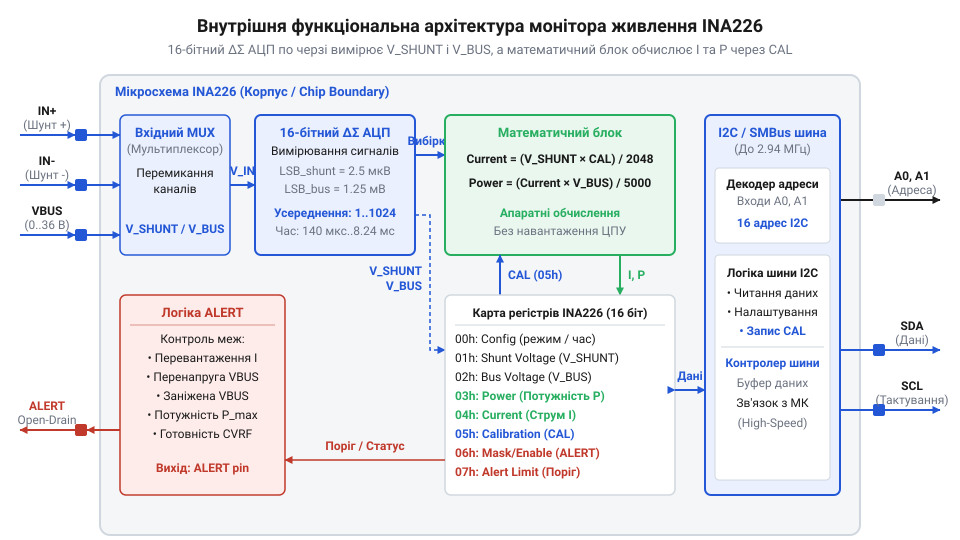
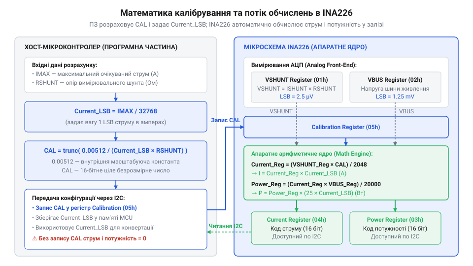
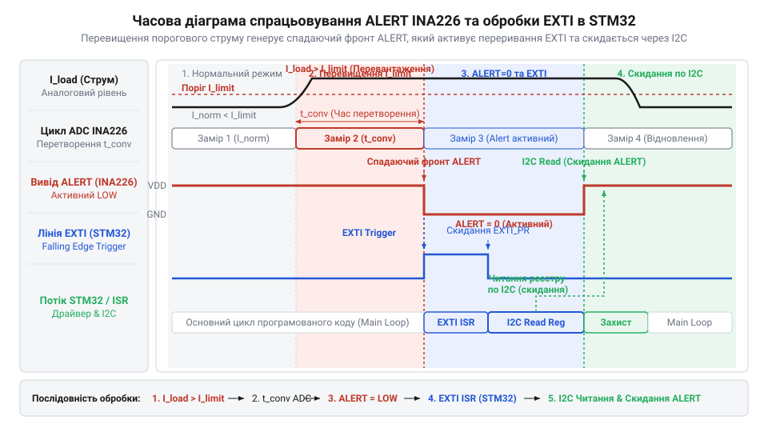
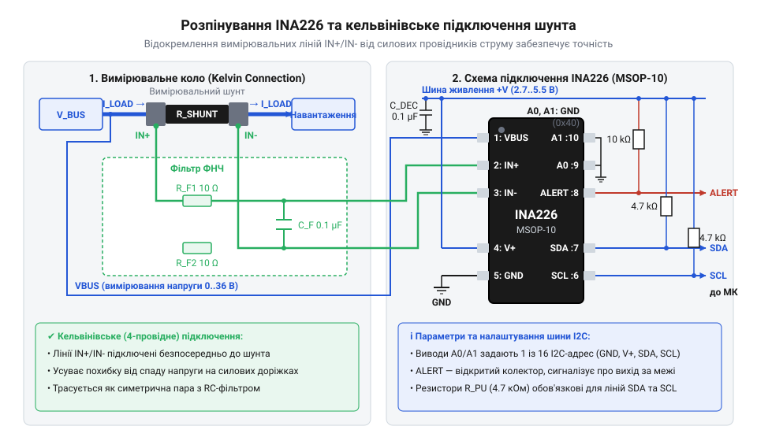
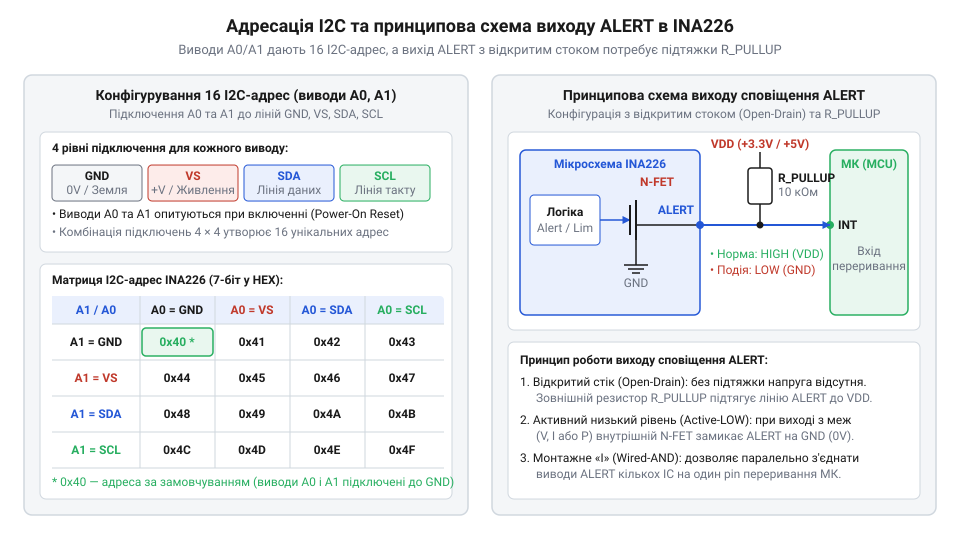

# Родина цифрових моніторів живлення INA2xx

<preknowlist>
- [INA219 — монітор струму й напруги (I2C)](root:cat-hw-sensors/ina219-power-monitor) — базовий досвід роботи з цифровими моніторами струму, розуміння принципу вимірювання напруги на шунті та протоколу I2C
- [Цифровий монітор живлення INA226](root:cat-hw-sensors/ina226-power-monitor) — розуміння архітектури 16-бітного прецизійного вимірювача струму та напруги з підвищеною точністю
- [Конфігурація та усереднення вимірювань INA226](root:cat-hw-sensors/ina226-config-and-averaging) — принципи програмування часу перетворення та вибору кількості вибірок фільтрації
- [Налаштування виводу ALERT та обробка тривожних подій в INA226](root:cat-hw-sensors/ina226-alert-pin-and-interrupts) — знання механізмів конфігурування порогів спрацьовування та обробки апаратних переривань
</preknowlist>

## Проблема точного моніторингу силіконового живлення

У сучасній мікроелектроніці — від автономних пристроїв та систем керування акумуляторами до високонавантажених серверних платоформ і сонячних інверторів — точний моніторинг струму, напруги та споживаної потужності є критичною умовою надійної роботи. Для вимірювання струму в колі традиційно використовують низькоомний токовимірювальний резистор — шунт (@@en|current-sense resistor@@), знімаючи з нього падіння напруги `V_shunt = I_load × R_shunt`. Однак спроба виміряти цей сигнал за допомогою звичайного аналого-цифрового перетворювача мікроконтролера впирається у фундаментальне схемотехнічне обмеження: вибір точки включення шунта в електричне коло.

При включенні шунта у вимірювальне коло по низькій стороні (@@en|low-side current sensing@@) резистор встановлюють між від'ємним виводом навантаження та загальною землею системи. Така схема схемотехнічно проста, оскільки потенціал на шунті відраховується безпосередньо від землі, проте вона створює критичну проблему: паразитний зсув потенціалу землі (@@en|ground bounce@@). Струм навантаження, протікаючи через шунт, утворює падіння напруги, яке піднімає потенціал «власної» землі навантаження відносно відправної точки системи. Це призводить до викривлення логічних рівнів цифрових інтерфейсів зв'язку (наприклад I2C, SPI або UART) між мікроконтролером та периферійним пристроєм, виклику збоїв синхронізації та виникнення завад. Крім того, вимірювання по низькій стороні не здатне виявити коротке замикання навантаження на корпус або шину живлення, оскільки аварійний струм протікає в обхід шунта.

Розв'язанням цих недоліків є перехід до вимірювання по високій стороні (@@en|high-side current sensing@@), де шунтовий резистор розміщується безпосередньо між позитивною шиною живлення (@@en|bus voltage@@) та навантаженням. У такій топології потенціал землі системи залишається незмінним, а коло захищене від неконтрольованого короткого замикання на землю. Проте тут виникає інша складна аналогова проблема: вхідні виводи вимірювача опиняються під високою спільною напругою шини (@@en|common-mode voltage@@), яка дорівнює повній напрузі живлення навантаження (наприклад, 12 В, 24 В або 36 В).

Спроба побудувати вимірювальний підсилювач по високій стороні на дискретних операційних підсилювачах (@@en|operational amplifier@@) зіштовхується з жорсткими фізичними обмеженнями. Якщо сам операційний підсилювач живиться від низьковольтної шини 3.3 В або 5 В, його вхідний каскад входить у насичення при виході вхідної напруги за межі рейок живлення. Застосування зовнішніх резистивних дільників для зниження спільної напруги катастрофічно погіршує коефіцієнт пригнічення спільної напруги (@@en|common-mode rejection ratio@@, CMRR). Навіть найменший розкид опору резисторів у 0.1% створює результуючу похибку, яка перевищує корисне падіння напруги на шунті у кілька разів. Додатково ситуацію ускладнюють температурний дрейф (@@en|temperature drift@@) дискретних компонентів, похибка підсилення (@@en|gain error@@) та зсув напруги (@@en|offset voltage@@) аналогового каскаду, що вимагає трудомісткого індивідуального калібрування кожного екземпляра плати.

Еволюційний шлях спеціалізованих напівпровідникових мікросхем для моніторингу параметрів живлення пролягав від дискретних аналогових підсилювачів струму серій INA138 та INA168 до високоінтегрованих цифрових систем родини INA2xx. Інженери компанії Burr-Brown (згодом Texas Instruments) розв'язали проблему вимірювання струму по високій стороні (@@en|high-side current sensing@@) в умовах високої спільної напруги шини (@@en|common-mode voltage@@), що суттєво перевищує напругу живлення самого давача, шляхом вбудовування високовольтного каскаду зсуву рівня (@@en|level shifter@@). Відбувся технологічний перехід від використання зовнішніх аналого-цифрових перетворювачів та вимірювальних операційних підсилювачів до вбудовування багатоканального дельта-сигма АЦП (@@en|delta-sigma ADC@@) та внутрішнього апаратного обчислювача потужності (@@en|power accumulator@@) безпосередньо на одному кристалі (@@en|single-chip solution@@). Це зумовило появу розбіжностей між поколіннями мікросхем — від базового [монітора живлення INA219](root:cat-hw-sensors/ina219-power-monitor) з напругою шини до 26 В та 12-бітною роздільною здатністю до більш прецизійного [цифрового монітора INA226](root:cat-hw-sensors/ina226-power-monitor) з підтримкою напруги до 36 В, 16-бітного АЦП та програмованого усереднення. Крім того, було створено спеціалізовані модифікації, такі як INA260 з вбудованим прецизійним шунтом (@@en|integrated shunt resistor@@), що забезпечили схемотехнічні переваги використання цифрового моніторингу у сучасних енергоефективних системах.

## Аналого-цифрова архітектура моніторів INA2xx

Внутрішня структура пристроїв родини INA2xx спроєктована для забезпечення високої точності вимірювання дрібних диференційних сигналів на тлі високої спільної напруги шини. Аналого-цифровий тракт мікросхеми складається з трьох ключових блоків: прецизійного диференційного вхідного підсилювача з регульованим або фіксованим коефіцієнтом підсилення (@@en|programmable gain amplifier@@, PGA), каскаду високовольтного зсуву рівня (@@en|level shifter@@) та багатоканального аналогового мультиплексора (@@en|multiplexer@@), що комутує сигнали на вхід дельта-сигма АЦП (@@en|delta-sigma ADC@@).

Диференційні входи `IN+` та `IN-` підключаються безпосередньо до токовимірювального шунта. Високовольтний каскад зсуву рівня трансформує диференційну напругу `V_shunt`, яка перебуває під потенціалом шини живлення `V_bus` (аж до 26 В для INA219 або 36 В для INA226), до низьковольтного діапазону внутрішніх аналогових кіл мікросхеми, що живляться від напруги `V_VS` (зазвичай 3.0 В – 5.5 В). 


*Функціональна блочна схема внутрішньої аналого-цифрової архітектури мікросхем серії INA2xx.*

Аналоговий мультиплексор послідовно подає на вхід дельта-сигма АЦП (@@en|delta-sigma ADC@@) два незалежні аналогові сигнали: малоамплітудну диференційну напругу на шунті `V_shunt = V_IN+ - V_IN-` та однополярну напругу шини `V_bus`, яка вимірюється відносно виводу землі `GND`. Використання єдиного аналого-цифрового тракту з формуванням спектра шуму (@@en|noise shaping@@) забезпечує високу лінійність і цифрове відфільтровування завад, проте вимагає часового поділу каналів (@@en|time-division multiplexing@@). Оскільки перетворення вибірок відбуваються не одночасно, а по черзі з часовим інтервалом між ними, виникає фазовий зсув (@@en|time offset@@). У стаціонарному режимі це не погіршує точність, однак при швидких транзитних процесах або пульсаціях струму навантаження перемножувач обчислює потужність зі значень `V_shunt` і `V_bus`, знятих у різні моменти часу. У результаті виникає динамічна похибка розсинхронізації, яку нівелюють через подальше [усереднення вимірювань INA226](root:cat-hw-sensors/ina226-config-and-averaging) по кількох вибірках або розширення вікна інтегрування перетворювача.

Після завершення аналого-цифрового перетворення цифрові коди зберігаються у відповідних регістрах: регістрі напруги шунта (@@en|shunt voltage register@@) та регістрі напруги шини (@@en|bus voltage register@@). Цифрова частина мікросхеми містить апаратний перемножувач. При завантаженні розрахованого користувачем значення у регістр калібрування (@@en|calibration register@@) внутрішній математичний блок автоматично обчислює струм у фізичних одиницях та передає його до регістра струму (@@en|current register@@), після чого множить струм на напругу шини й отримує значення потужності у регістрі потужності (@@en|power accumulator@@).

Роздільна здатність та параметри перетворення залежать від конкретної мікросхеми в родині. У базовому мікроконтролері INA219 застосовано 12-бітний АЦП з можливістю конфігурування PGA на діапазони ±40 мВ, ±80 мВ, ±160 мВ або ±320 мВ, що дає дискретність вимірювання напруги шунта в 10 мкВ (@@en|least significant bit@@, LSB). Напруга шини вимірюється в діапазоні 0–26 В з дискретністю 4 мВ.

У більш сучасному та прецизійному пристрої INA226 встановлено 16-бітний дельта-сигма АЦП із фіксованим вхідним діапазоном напруги шунта ±81.92 мВ. Це забезпечує рекордну дискретність вхідного сигналу 2.5 мкВ на один молодший розряд (LSB) при зсуві напруги підсилювача не більше ±10 мкВ. Напруга шини вимірюється в діапазоні 0–36 В з дискретністю 1.25 мВ.

| Параметр / Модель | INA219 | INA226 | INA230 | INA260 |
| :--- | :--- | :--- | :--- | :--- |
| **Розрядність АЦП** | 12 біт | 16 біт | 16 біт | 16 біт |
| **Макс. напруга шини (V_bus)** | 26 В | 36 В | 36 В | 36 В |
| **Діапазон V_shunt** | ±40 мВ ... ±320 мВ | ±81.92 мВ | ±81.92 мВ | Внутрішній (±15 А) |
| **Дискретність LSB (V_shunt)** | 10 мкВ | 2.5 мкВ | 2.5 мкВ | 1.25 мА (струм) |
| **Вбудований шунт** | Ні (зовнішній) | Ні (зовнішній) | Ні (зовнішній) | Так (2 мОм, 0.1%) |
| **Вивід тривоги ALERT** | Відсутній | Присутній | Присутній | Присутній |
| **Корпус** | SOT23-8, SOIC-8 | MSOP-10, DFN-10 | QFN-16 | TSSOP-16 |

Спеціалізована модифікація INA260 усуває одну з головних проблем проектування друкованих плат — паразитний опір пайкових з'єднань і контактних майданчиків. У корпус TSSOP-16 інтегровано прецизійний малоіндуктивний шунт опором 2 мОм із допустимим постійним струмом до 15 А та температурним коефіцієнтом не більше 15 ppm/°C. Це дає змогу проводити прямоточне вимірювання без необхідності калібрування зовнішніх провідників.

Деталізовану взаємодію між регістрами та виводами можна переглянути у матеріалі про [структуру регістрової карти](root:cat-hw-sensors/ina2xx-digital-power-monitors-overview/api-ina2xx-hardware-interface.md) пристрою. Точний алгоритм обчислення коефіцієнта калібрування описано в системі [алгоритм калібрування АЦП](root:cat-hw-sensors/ina2xx-digital-power-monitors-overview/math-ina2xx-calibration-math.md) для родини INA2xx. Для усунення шумів та пульсацій застосовують [усереднення вимірювань INA226](root:cat-hw-sensors/ina226-config-and-averaging) на рівні внутрішнього фільтра. Для аварійного сповіщення використовується програмований [вивід ALERT INA226](root:cat-hw-sensors/ina226-alert-pin-and-interrupts), який спрацьовує без участі центрального процесора.

## Калібрування, масштабування та обчислення потужності

Після завершення кожної аналого-цифрової дискретизації внутрішній дельта-сигма аналого-цифровий перетворювач (@@en|delta-sigma ADC@@) зберігає сирий результат вимірювання спаду напруги на шунті у регістрі спаду напруги на шунті (@@en|shunt voltage register@@). Однак для практичних задач керування живленням мікроконтролеру потрібні дані безпосередньо у фізичних одиницях — амперах та ватах. Виконання обчислень з плаваючою комою для кожного зчитування шини I2C створює суттєве обчислювальне навантаження на процесорне ядро та збільшує енергоспоживання системи. Для розв'язання цієї проблеми розробники родини INA2xx інтегрували у кристал апаратний математичний блок, до складу якого входять цифровий перемножувач та акумулятор потужності (англ. *power accumulator*, від лат. *accumulare* — накопичувати) — @@en|power accumulator@@. Щоб активувати апаратне масштабування, інженер повинен розрахувати та записати відповідний коефіцієнт у 16-бітний регістр калібрування (англ. *calibration register*, від араб. *qālib* — форма) — @@en|calibration register@@.

Математична модель апаратного обчислення базується на фіксованій ціні молодшого розряду струму (англ. *least significant bit*, від англ. *binary digit* — двійкова цифра) — @@en|Current_LSB@@. Ця величина визначає мінімальне значення струму, яке відповідає одиниці молодшого розряду в цифровому коді. Вибір @@en|Current_LSB@@ виконується розробником на основі максимально очікуваного струму в навантаженні з урахуванням 15-бітної шкали зі знаком (ціле значення від 0 до 32767).

```
Current_LSB = Maximum_Expected_Current ÷ 32768
```

Отримане значення @@en|Current_LSB@@ зазвичай округлюють у більшу сторону до найближчого зручного кратного числа (наприклад, 100 мкА/LSB або 1 мА/LSB), що значно спрощує подальший розрахунок у програмі мікроконтролера. 

Після вибору @@en|Current_LSB@@ та номіналу вимірювального шунта (англ. *current-sense resistor*, від давн.-англ. *schunten* — відхилятися) — @@en|current-sense resistor@@ `R_shunt`, розраховується значення, яке записується в @@en|calibration register@@ (`CAL`). Для прецизійного [цифрового монітора INA226](root:cat-hw-sensors/ina226-power-monitor) математична формула записується наступним чином:

```
CAL = trunc(0.00512 ÷ (Current_LSB × R_shunt))
= trunc(0.00512 ÷ (Current_LSB × R_shunt))    [апаратна формула калібрування INA226]
```

У цій формулі константа `0.00512` є внутрішнім масштабним коефіцієнтом апаратного множника INA226, який пов'язує дискретність вимірювання напруги шунта (2.5 мкВ на LSB) із внутрішньою арифметикою обчислювача. Математичне виведення цієї константи випливає з узгодження фізичного струму в навантаженні `I = V_shunt ÷ R_shunt` із цифровим кодом у регістрі струму. Оскільки вхідний дельта-сигма АЦП мікросхеми INA226 вимірює напругу на шунті з ціною молодшого розряду `V_shunt_LSB = 2.5 × 10⁻⁶ В` (2.5 мкВ), сирий код у регістрі напруги шунта дорівнює `Shunt_Voltage_Register = V_shunt ÷ (2.5 × 10⁻⁶ В)`. Апаратний цифровий перемножувач INA226 обчислює значення регістра струму через арифметичне ділення на розрядний зсув `4096` (`2¹²`), тобто `Current_Register = (Shunt_Voltage_Register × CAL) ÷ 4096`. Щоб розраховане значення точно відповідало фізичній величині `Current_Register = I ÷ Current_LSB`, підставимо вираз напруги шунта в арифметику множника:

```
CAL = (4096 × V_shunt_LSB) ÷ (Current_LSB × R_shunt)
= (4096 × 2.5 × 10⁻⁶) ÷ (Current_LSB × R_shunt)      [підстановка дискретності АЦП 2.5 мкВ]
= 0.00512 ÷ (Current_LSB × R_shunt)                  [множення зсуву 4096 на LSB вхідного АЦП]
```

Для більш ранніх пристроїв, таких як базовий [монітор живлення INA219](root:cat-hw-sensors/ina219-power-monitor), ця константа дорівнює `0.04096` через іншу дискретність вхідного АЦП (10 мкВ на LSB):

```
CAL_INA219 = (4096 × 10 × 10⁻⁶) ÷ (Current_LSB × R_shunt)
= (4096 × 10⁻⁵) ÷ (Current_LSB × R_shunt)             [підстановка дискретності АЦП 10 мкВ]
= 0.04096 ÷ (Current_LSB × R_shunt)                   [множення зсуву 4096 на LSB вхідного АЦП]
```

Таким чином, константи `0.00512` та `0.04096` є жорстко зафіксованими апаратними добутками внутрішнього 12-бітного зсуву регістра перемножувача (`2¹² = 4096`) та фізичної роздільної здатності вхідного АЦП для відповідного кристала.

Коли значення `CAL` записано у відповідний регістр, апаратний перемножувач мікросхеми починає автоматично обчислювати значення струму та потужності після кожного циклу перетворення АЦП без участі центрального процесора:

```
Current_Register = (Shunt_Voltage_Register × CAL) ÷ 4096
= (Shunt_Voltage_Register × CAL) ÷ 4096       [автоматичне обчислення струму]

Power_Register = (Current_Register × Bus_Voltage_Register) ÷ 20000
= (Current_Register × Bus_Voltage_Register) ÷ 20000   [автоматичне обчислення потужності]
```

Завдяки такій математичній структурі фіксованої коми (@@en|fixed-point math@@) ціна молодшого розряду для регістра потужності становить чітко визначену величину `Power_LSB = 25 × Current_LSB`. Фізичні значення струму в амперах та потужності у ватах отримуються звичайним множенням зчитаних цілих чисел з регістрів на відповідні константи `Current_LSB` та `Power_LSB`.


*Взаємозв'язок між виміряними значеннями напруги шунта, вмістом регістра калібрування, цифровим перемножувачем та акумулятором потужності.*

Розглянемо практичний приклад обчислення параметрів для системи моніторингу напруги 12 В та максимального струму навантаження 5 А з використанням мікросхеми INA226 та шунта номіналом 10 мОм.

**Обчислення калібрування для струму 5 А та шунта 10 мОм**

```
[1] Початковий розрахунок дискретності струму:
    Current_LSB_raw = 5.0 A ÷ 32768 = 0.00015258 A/LSB

[2] Вибір округленого значення Current_LSB:
    Current_LSB = 0.0002 A/LSB (200 мкА/LSB)

[3] Перевірка максимальної напруги на шунті:
    V_shunt_max = 5.0 A × 0.01 Ом = 0.05 В (50 мВ)
    [50 мВ не перевищує максимальну межу АЦП ±81.92 мВ]

[4] Обчислення вмісту регістра калібрування CAL:
    CAL = trunc(0.00512 ÷ (0.0002 × 0.01))
    = trunc(0.00512 ÷ 0.000002)
    = 2560 (0x0A00 у шістнадцятковому форматі)

[5] Обчислення ціни розряду потужності Power_LSB:
    Power_LSB = 25 × 0.0002 A/LSB = 0.005 Вт/LSB (5 мВт/LSB)

[6] Розрахунок теплового розсіювання на шунті:
    P_shunt = (5.0 A)² × 0.01 Ом = 0.25 Вт
```

При виборі фізичного компонента шунта необхідно враховувати температурний дрейф (англ. *temperature drift*, від англ. *drift* — відхилення) — @@en|temperature drift@@. Оскільки розсіювана потужність на шунті становить 0.25 Вт, робочий опір резистора зростатиме через самонагрівання. Для забезпечення високої точності слід обирати резистор з номінальною потужністю не менше 0.5 Вт або 1 Вт та низьким температурним коефіцієнтом опору (ТКО < 50 ppm/°C).

Нижче наведено приклад реалізації конфігурування регістра калібрування та зчитування фізичних величин мовою C для ESP-IDF та C++ для Arduino.

:::tabs
@tab C (ESP-IDF)
:::code ina2xx-digital-power-monitors-overview-d/c/esp-idf/ina226-write-register.c
@tab C++ (Arduino)
:::code ina2xx-digital-power-monitors-overview-d/cpp/arduino/writeregister16.cpp
:::

Виведення математичних формул та особливості їх застосування розкрито в [розрахунках калібрування INA2xx](root:cat-hw-sensors/ina2xx-digital-power-monitors-overview/math-ina2xx-calibration-math.md). Детальний опис адресації внутрішніх регістрів наведено в [описі апаратного інтерфейсу](root:cat-hw-sensors/ina2xx-digital-power-monitors-overview/api-ina2xx-hardware-interface.md). Крім того, мінімізація паразитного опору провідників при вимірюванні малих напруг на шунті досягається [проектуванням друкованої плати](root:cat-hw-sensors/ina2xx-digital-power-monitors-overview/proj-ina2xx-kelvin-pcb-layout.md) із чотирипровідною схемою Кельвіна.

## Цифрова фільтрація та апаратний інтерфейс ALERT

У реальних ланцюгах живлення електронних систем вимірювальний сигнал струму та напруги містить високочастотні імпульсні завади, які виникають під час роботи імпульсних перетворювачів напруги, ШІМ-регуляторів або комутації навантаження. Непосередня дискретизація таких сигналів без фільтрації спричиняє появу хибних вимірювань та вимагає від мікроконтролера постійного читання даних через шину I2C у режимі безперервного опитування (англ. *polling*, від англ. *poll* — опитування) — @@en|polling@@. Це даремно витрачає пропускну здатність цифрової шини та ресурси процесора.

Для захисту від завад та оптимізації взаємодії з хост-контролером монітори живлення родини INA2xx оснащено двома апаратними механізмами: програмованим цифровим фільтром усереднення вибірок АЦП та програмованим виводом апаратних переривань ALERT.

Цифрова фільтрація реалізована у внутрішній логіці АЦП шляхом накопичення та ковзного усереднення декількох послідовних дискретних вибірок (@@en|averaging mode@@). Користувач має можливість незалежно конфігурувати час перетворення для напруги шунта й напруги шини (від 140 мкс до 8.244 мс), а також кількість усереднюваних вибірок `N` (1, 4, 16, 64, 128, 256, 512 або 1024).

Збільшення кількості вибірок `N` знижує середньоквадратичний рівень шуму АЦП пропорційно до квадратного кореня з кількості вибірок (`√N`). Наприклад, при виборі `N = 128` рівень високочастотного шуму зменшується у `√128 ≈ 11.3` раза (приблизно на 21 дБ), що забезпечує високу стабільність показань навіть у зашумлених силових кола. Повний час оновлення регістрів даних обчислюється як сума часів перетворення каналів, помножена на кількість вибірок:

```
T_total = N × (T_conv_shunt + T_conv_bus)
= N × (T_conv_shunt + T_conv_bus)             [загальний період оновлення вимірювань]
```

Для збереження обчислювальних ресурсів мікроконтролера монітори INA2xx оснащені виводом ALERT з конфігурацією типу відкритий стік (англ. *open-drain*, від англ. *drain* — стік транзистора) — @@en|open-drain@@. Цей вивід підключається до лінії зовнішнього переривання мікроконтролера через підтягувальний резистор. Апаратний компаратор всередині INA2xx порівнює щойно обчислені усереднені значення напруги, струму або потужності з пороговим значенням, що записане в регістр межі тривоги (англ. *Alert Limit Register*, від фр. *alerte* — тривога) — @@en|Alert Limit Register@@.

Тип контрольованої аварійної події задається у регістрі маскування та дозволу переривань (@@en|Mask/Enable Register@@). Пристрій підтримує наступні режими спрацьовування:
- `SOL` (Shunt Voltage Over-Limit) — перевищення максимально допустимого струму. - `SUL` (Shunt Voltage Under-Limit) — падіння струму нижче встановленої межі. - `BOL` (Bus Voltage Over-Limit) — перенапруга на шині живлення. - `BUL` (Bus Voltage Under-Limit) — просідання напруги живлення нижче норми. - `POL` (Power Over-Limit) — перевищення допустимої споживаної потужності. - `CVRF` (Conversion Ready Flag) — сигнал завершення повного циклу усереднення вимірювань.

Логіка функціотивання виводу ALERT може налаштовуватися в одному з двох режимів: прозорому (@@en|transparent mode@@) або режимі засувки (англ. *latch mode*, від давн.-англ. *læccan* — замикати). *læccan* — зафіксувати) — @@en|latch mode@@. У прозорому режимі стан виводу ALERT автоматично повертається до високоімпедансного, щойно контрольований параметр повертається в норму. У режимі засувки вивід ALERT залишається у низькому логічному рівні навіть після зникання аварійного стрибка доти, доки мікроконтролер не прочитає зміст @@en|Mask/Enable Register@@ через I2C. Це унеможливлює пропуск коротких короткочасних сплесків струму чи напруги.


*Часова діаграма ковзного усереднення вибірок АЦП та моменту генерування переривання на виводі ALERT.*

Нижче наведено приклад конфігурування режиму усереднення 16 вибірок, встановлення межі максимального струму та обробки переривання ALERT.

:::tabs
@tab C (ESP-IDF)
:::code ina2xx-digital-power-monitors-overview-d/c/esp-idf/ina226-setup-alert.c
@tab C++ (Arduino)
:::code ina2xx-digital-power-monitors-overview-d/cpp/arduino/alertisr.cpp
:::

Алгоритми обробки сигналів детально розглянуто в [усереднення вимірювань INA226](root:cat-hw-sensors/ina226-config-and-averaging) та в [моделях цифрової фільтрації](root:cat-hw-sensors/ina2xx-digital-power-monitors-overview/math-ina2xx-filtering-and-averaging.md). Повні відомості про налаштування переривань наведено в описі [виводу ALERT INA226](root:cat-hw-sensors/ina226-alert-pin-and-interrupts). Практичну структуру низькорівневих викликів I2C включено до [програмному драйвері I2C](root:cat-hw-sensors/ina2xx-digital-power-monitors-overview/api-ina2xx-software-driver.md), а приклад комплексної інтеграції пристрою в реальну систему живлення представлено в [системі моніторингу акумулятора](root:cat-hw-sensors/ina2xx-digital-power-monitors-overview/proj-ina2xx-mcu-battery-management.md).

## Проєктування друкованої плати та схема Кельвіна

Вимірювання струму за допомогою малоомного шунта (від англ. @@en|current-sense resistor@@) спирається на точне зчитування мілівольтних перепадів напруги. Якщо через вимірювальний опір `R_shunt` номіналом `0.002` Ом (або `2` мОм) протікає силовий струм `I` величиною `10` А, падіння напруги `V_shunt` становить лише `20` мВ. За таких умов навіть незначний паразитний опір мідних доріжок друкованої плати спроможний повністю викривити результати вимірювання. Стандартна мідна доріжка плати з товщиною фольги `35` мкм (1 oz) та шириною `1` мм має власний опір приблизно `0.5` мОм на кожен сантиметр довжини. Якщо траса живлення підведена до шунта таким чином, що вимірювальний вхід підсилювача зчитує напругу разом із ділянкою силового провідника, паразитний опір додається послідовно до номіналу шунта, створюючи систематичну хибу вимірювання, яка може сягати `25%` і більше.

Для розв'язання цієї проблеми застосовують чотирипровідну схему підключення Кельвіна (від англ. @@en|Kelvin sensing connection@@, за ім'ям фізика Лорда Кельвіна). Фізична суть методу полягає у суворому відокремленні силового тракту струму від вимірювального тракту напруги. Силовий струм від джерела живлення до навантаження протікає через два зовнішні масивні контактні майданчики шунта. Водночас вимірювальні доріжки, які ведуть до високомпедансних входів `IN+` та `IN-` диференційного підсилювача мікросхеми, підключаються окремими тонкими провідниками безпосередньо до внутрішніх точок з'єднання резистивного елемента шунта з його контактними виводами. Оскільки вхідний струм вимірювального підсилювача (від англ. @@en|programmable gain amplifier@@, @@en|PGA@@) становить лише кілька мікроампер, падіння напруги на власній довжині вимірювальних доріжок дорівнює нулю. Детальні відмінності підключення для різних варіантів корпусів висвітлює окремий [проєкт розробки друкованої плати](root:cat-hw-sensors/ina2xx-digital-power-monitors-overview/proj-ina2xx-kelvin-pcb-layout.md).

Розглянемо математичну модель виникнення систематичної похибки без підключення Кельвіна. Повна вимірювана напруга `V_in` складається з падіння напруги на шунті та падіння напруги на двох ділянках мідного провідника між точкою пайки та входом АЦП:

```
V_in = V_shunt + V_trace
= I · R_shunt + I · (2 · R_trace)      [підстановка закону Ома для послідовного кола]
= I · (R_shunt + 2 · R_trace)          [винесення струму за дужки]
```

У цій формулі `V_in` позначає напругу на вхідних виводах мікросхеми у вольтах, `V_shunt` — реальне падіння напруги на вимірювальному резисторі у вольтах, `V_trace` — суммарну напругу на паразитних доріжках у вольтах, `I` — силовий струм навантаження в амперах, `R_shunt` — опір шунта в омах, а `R_trace` — паразитний опір однієї вимірювальної доріжки в омах. Коли застосовують підключення Кельвіна, струм через вимірювальні доріжки дорівнює вхідному струму витікання підсилювача `I_bias ≈ 10` мкА, завдяки чому `V_trace = I_bias · 2 · R_trace ≈ 0`, і мікросхема зчитує чисте значення `V_shunt`.

Трасування вимірювальної лінії потребує дотримання суворих геометричних правил. Доріжки `IN+` та `IN-` повинні прокладатися паралельно одна одній на мінімально можливій відстані у вигляді дифпари одинакової довжини. Це мінімізує площу контуру між ними й унеможливлює наведення синфазних електромагнітних завад (від англ. @@en|EMI@@). Недопустимо прокладати силові доріжки або імпульсні лінії комутації під вимірювальною петлею.


*Правильне трасування дифпари Кельвіна від внутрішніх країв майданчиків SMD-шунта до входів IN+ та IN- мікросхеми з розміщенням розв'язувального та фільтруючого конденсаторів.*

Крім паразитних опорів, на точність аналого-цифрового перетворювача (від англ. @@en|delta-sigma ADC@@) впливають високочастотні імпульсні перехідні процеси від силових ключів або DC-DC перетворювачів. Для їх придушення безпосередньо біля виводів `IN+` та `IN-` встановлюють вхідний симетричний низькочастотний RC-фільтр. Фільтр складається з двох послідовних резисторів `R_filt` номіналом від `1` до `10` Ом та диференційного конденсатора `C_diff` номіналом `100` нФ між лініями. Вибір `R_filt` обмежений вхідним опором PGA: занадто великі значення резисторів (понад `10` Ом) створюють додаткове падіння напруги від вхідних струмів зміщення, що призводить до зростання помилки підсилення (від англ. @@en|gain error@@). Загальні електричні характеристики та [топографію та опис виводів](root:cat-hw-sensors/ina2xx-digital-power-monitors-overview/api-ina2xx-hardware-interface.md) подано в описі апаратного інтерфейсу.

Окрему увагу приділяють розв'язці живлення та тепловому режиму. Для придушення завад по лінії живлення `V_S` необхідно розміщувати керамічний розв'язувальний конденсатор (від англ. @@en|decoupling capacitor@@) ємністю `100` нФ номіналу X7R якнайближче до виводу живлення мікросхеми, із коротким підключенням до суцільного шару землі (від англ. @@en|ground plane@@). Під час проходження великих струмів вимірювальний шунт розсіює потужність `P = I² · R_shunt`, що викликає його нагрівання й температурний дрейф опору (від англ. @@en|temperature drift@@). Щоб уникнути цього, силова мідна фольга довкола контактних майданчиків шунта забезпечується тепловими полігонами з великою кількістю металізованих отворів (від англ. @@en|via@@), які відводять тепло на внутрішні та нижній шари плати. Правильне поєднання теплового розрахунку та схемотехніки доповнюють [математичні розрахунки калібрування](root:cat-hw-sensors/ina2xx-digital-power-monitors-overview/math-ina2xx-calibration-math.md), що застосовуються при налаштуванні таких пристроїв як [цифровий монітор INA226](root:cat-hw-sensors/ina226-power-monitor).

## Системна інтеграція та автономний моніторинг живлення

Після завершення топологічного проєктування та виготовлення плат постає завдання об'єднання цифрових моніторів із центральним мікроконтролером у єдину інтелектуальну систему моніторингу й керування енергоспоживанням. У складних електронних пристроях часто виникає потреба вимірювати параметри кількох незалежних шин живлення — наприклад, вхідної напруги адаптера, акумуляторного блоку та внутрішніх виходів DC-DC перетворювачів. Переважна більшість мікросхем родини INA2xx обмінюється даними через двопровідний шинний інтерфейс I2C (від англ. @@en|Inter-Integrated Circuit@@). Щоб підключити декілька пристроїв до єдиної лінії SDA та SCL, кожному з них призначають унікальну адресу на шині.

Призначення адреси виконується конфігурацією виводів `A0` та `A1`. Завдяки чотирьохрівневій логіці підключення цих виводів — до землі (`GND`), до лінії живлення (`V_S`), до лінії даних (`SDA`) або лінії clock (`SCL`) — за допомогою двох ніжок можна задати до `16` унікальних I2C-адрес. Це усуває потребу у використанні додаткових мультиплексорів I2C і спрощує трасування плати.

Системна інтеграція передбачає не лише читання регістрів по шині I2C, а й апаратну реакцію на аварійні ситуації. Циклічне опитування регістрів мікроконтролером (від англ. @@en|polling@@) давачами є нераціональним: воно завантажує обчислювальне ядро та змушує мікроконтролер постійно перебувати в активному стані. Замість цього використовують вивід `ALERT` з відкритим стоком (від англ. @@en|open-drain output@@).


*Приєднання кількох сенсорів INA2xx до центрального мікроконтролера через шину I2C із використанням індивідуальних виводів переривань ALERT та спільних ліній живлення.*

Вивід `ALERT` підтягується до лінії живлення через зовнішній резистор і підключається до входу зовнішнього переривання (від англ. @@en|external interrupt@@) мікроконтролера. У внутрішніх регістрах `Mask/Enable` та `Alert Limit Register` програмуються порогові значення — наприклад, критичний струм короткого замикання або падіння напруги акумулятора нижче допустимого рівня. Якщо параметр виходить за межі заданого вікна, монітор INA2xx апаратно притягує лінію `ALERT` до землі, миттєво генеруючи переривання для мікроконтролера. Налаштувати реакцію на події допомагає конфігурування [виводу ALERT INA226](root:cat-hw-sensors/ina226-alert-pin-and-interrupts).

Особливо критичним автономне функціонування є для систем із батарейним живленням. У режимі енергозбереження (від англ. @@en|low-power mode@@) центральний процесор перебуває у глибокому сні (від англ. @@en|deep sleep@@), а монітор INA2xx переводиться у режим одиночного вимірювання за запитом (від англ. @@en|triggered mode@@). Пристрій здійснює один цикл аналого-цифрового перетворення, оновлює регістри, повідомляє про готовність через сигнал `Conversion Ready` на виводі `ALERT` і автоматично повертається у режим розсадження живлення із споживанням струму менше `2` мкА. Приклади таких систем містить практична [система моніторингу акумулятора](root:cat-hw-sensors/ina2xx-digital-power-monitors-overview/proj-ina2xx-mcu-battery-management.md).

Іншим важливим завданням є підрахунок спожитої або відданої акумулятором енергії — підрахунок кулонів (від англ. @@en|coulomb counting@@). Для обчислення накопиченого заряду `Q` в ампер-годинах або кулонах мікроконтролер зчитує значення з регістра струму через фіксовані інтервали часу `Δt` і здійснює чисельне інтегрування:

```
Q = ∫ I(t) dt
= ∑ (I_k · Δt)      [дискретизація безперервного інтеграла]
= I_1 · Δt + I_2 · Δt + ... + I_n · Δt      [покрокове накопичення вибірок]
```

У цій формулі `Q` означає електричний заряд у кулонах (або ампер-секундах), `I(t)` — миттєвий струм як функція часу, `I_k` — дискретне значення струму на `k`-му кроці вимірювання в амперах, а `Δt` — інтервал дискретизації у секундах. Аналогічно підраховується спожита енергія `E` у ват-годинах шляхом підсумовування добутків потужності `P_k` на час `Δt`.

Для забезпечення високої точності при тривалому підрахунку кулонів (від англ. @@en|coulomb counting@@) необхідно мінімізувати вплив випадкового шуму, а також систематичного зміщення. Якщо випадкові високочастотні пульсації вирівнюються апаратними алгоритмами внутрішньої цифрової фільтрації АЦП, що усереднюють від `4` до `1024` вибірок (налаштування яких описує [усереднення вимірювань INA226](root:cat-hw-sensors/ina226-config-and-averaging)), то постійна напруга зсуву (від англ. @@en|input offset voltage@@) `V_os` вхідного диференційного підсилювача створює незмінну похибку струму `I_offset = V_os ÷ R_shunt`. Оскільки ця похибка має постійний знак, вона не компенсується усередненням і призводить до монотонного накопичення помилки заряду `Q_error` пропорційно часу вимірювання `t`:

```
Q_measured = ∑ ((I_true_k + I_offset) · Δt)
= ∑ (I_true_k · Δt) + I_offset · ∑ Δt      [розподільний закон підсумовування]
= Q_true + (V_os ÷ R_shunt) · t            [лінійне накопичення похибки зсуву з часом]
```

Наприклад, для прецизійного [цифрового монітора INA226](root:cat-hw-sensors/ina226-power-monitor) з напругою зсуву `V_os = 10` мкВ та шунтом `R_shunt = 10` мОм величина `I_offset` становить `1` мА. За `24` години перебування пристрою у стані очікування це дає уявний дрейф накопиченого заряду `Q_error = 0.001 A × 86400 s = 86.4` Кл (або `24` мА·год), що істотно спотворює оцінку залишкової ємності акумулятора. Для усунення цієї систематичної похибки застосовують метод цифрової автокомпенсації нуля (від англ. @@en|auto-zeroing method@@): у режимі відсутнього навантаження мікроконтролер зчитує та фіксує значення систематичного зсуву `I_0 = I_offset`, після чого програмно віднімає його від кожного нового вимірювання `I_corrected_k = I_k - I_0`. Це залишає лише випадкову шумову складову з нульовим математичним сподіванням, яка далі ефективно пригнічується внутрішнім усередненням АЦП.

Розглянемо практичний приклад драйвера для роботи з INA2xx. Драйвер виконує ініціалізацію, запис регістру калібрування `CAL` та зчитування струму й напруги. Повний опис функцій містить [програмного інтерфейсу драйвера](root:cat-hw-sensors/ina2xx-digital-power-monitors-overview/api-ina2xx-software-driver.md). Пристрої на кшталт [монітора живлення INA219](root:cat-hw-sensors/ina219-power-monitor) мають сумісні регістрові структури.

:::tabs
:::code ina2xx-digital-power-monitors-overview-d/c/esp-idf/ina226-init.c
:::code ina2xx-digital-power-monitors-overview-d/cpp/arduino/ina226driver.cpp
:::