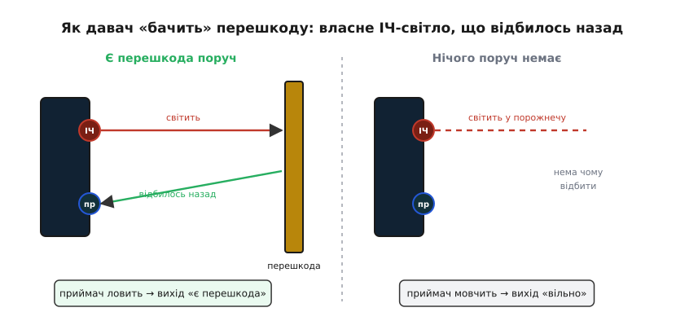
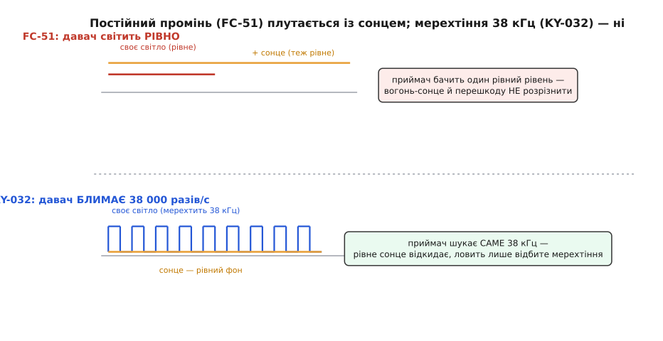
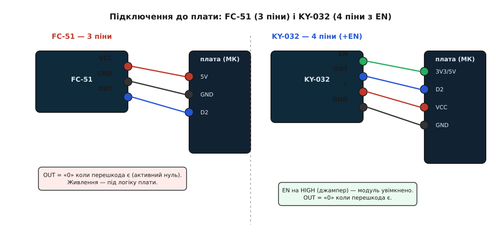

# IR-давачі перешкод (FC-51 / KY-032)

<preknowlist>
- [KY-серія (Keyes 37-в-1)](root:cat-hw-sensors/ky-series) — спільна конструкція та формати підключення сімейства навчальних модулів.
- [KY-010 — оптичний переривач](root:cat-hw-sensors/ky-010-interrupter) — принцип роботи оптичних наскрізних оптопар порівняно з відбивними сенсорами.
</preknowlist>

## Призначення та принцип безконтактного виявлення перешкод

Інфрачервоні давачі перешкод призначені для безконтактної фіксації наближення робототехнічних платформ до стін, предметів або країв поверхні на дистанціях від 2 до 30 см. Вони не вимірюють точну відстань у міліметрах, а діють як безконтактні кінцевики: сигналізують мікроконтролеру одним логічним бітом про появу перешкоди в зоні огляду для термінового виконання маневру ухилення.

Принцип дії базується на активній локації: інфрачервоний світлодіод випромінює пучок світла в невидимому для людського ока діапазоні (зазвичай 940–950 нм), а розташований поруч фотоприймач реєструє відбитий від поверхні потік:

*Принцип активної оптичної локації: відбиття власного інфрачервоного випромінювання від поверхні об'єкта до фотоприймача.*

Слід враховувати фундаментальне фізичне обмеження методу: сенсор детектує не саму наявність предмета, а **інтенсивність повернутого світла**. Білі глянцеві стіни відбивають до 90% випромінювання, тому виявляються на максимальній відстані. Чорні матові тканини або гума поглинають інфрачервоне світло, через що давач помічає їх лише впритул або не бачить зовсім, а дзеркальні поверхні відбивають промінь під кутом повз приймач.

## Модуль прямого випромінювання FC-51

Плата FC-51 — найпростіший триконтактний варіант відбивного давача. Її схемотехніка містить:
- Інфрачервоний світлодіод із постійним немодульованим світінням.
- Кремнієвий фотодіод у прозорому або затемненому корпусі.
- Здвоєний аналоговий компаратор напруги LM393.
- Багатооборотний підстроювальний потенціометр для регулювання порогу спрацьовування.

Підстроювальний резистор задає опорну напругу компаратора. Щойно фотострум відбитого світла перевищує цей поріг, вихід `OUT` перекидається в низький логічний рівень (**LOW**), а на платі спалахує сигнальний світлодіод.

Головний недолік FC-51 — висока чутливість до стороннього фонового освітлення. Оскільки світлодіод світить постійно, фотоприймач не здатний відрізнити власне відбите світло від потужного випромінювання сонця або ламп розжарювання. Прямий сонячний промінь засліплює компаратор і викликає безперервне хибне спрацьовування.

## Модуль із частотною модуляцією KY-032 (HW-488)

Модуль KY-032 позбавлений проблеми сонячного засліплення завдяки застосуванню методу частотної модуляції несучої, запозиченого з систем інфрачервоного дистанційного керування побутовою технікою.

*Частотна модуляція KY-032: таймер NE555 генерує пачки 38 кГц, а інтегрований приймач HS0038 відсікає постійний сонячний фон.*

Архітектура KY-032 включає два ключові вузли:
1. **Генератор імпульсів на мікросхемі NE555:** формує сигнал прямокутної форми з частотою 38 кГц. Світлодіод спалахує і гасне 38 000 разів на секунду, формуючи закодоване світлове поле.
2. **Спеціалізований ІЧ-приймач (типу HS0038/TSOP):** всередині металевого або пластикового екрана містить фотодіод, вхідний підсилювач, смуговий фільтр на 38 кГц та демодулятор. Рівномірне світло сонця чи звичайних ламп відсікається вхідним фільтром, і приймач реагує винятково на відбите мерехтіння власного випромінювача.

Крім того, плата KY-032 має чотири виводи: `VCC`, `GND`, `OUT` та `EN` (Enable). Зняття джампера на лінії `EN` дає змогу мікроконтролеру програмно вмикати й вимикати генератор модуляції для економії заряду батареї автономного робота.

## Підключення до мікроконтролера та програмна логіка

Обидва модулі виводять сигнал активного низького рівня:
- **Немає перешкоди:** вихід `OUT` перебуває в стані високого рівня (**HIGH**, 3.3 В або 5 В).
- **Перешкода виявлена:** вихід `OUT` притискається до землі (**LOW**, 0 В).

*Схема підключення датчика перешкод до цифрового входу мікроконтролера з індикацією спрацьовування.*

У керуючому коді стан давача зчитується звичайною функцією `digitalRead`. Для забезпечення надійності в умовах вібрацій та межових дистанцій рекомендується застосовувати просте програмне накопичення (підтвердження стану протягом 2–3 послідовних циклів опитування) перед подачею команди двигунам на поворот або зупинку.
