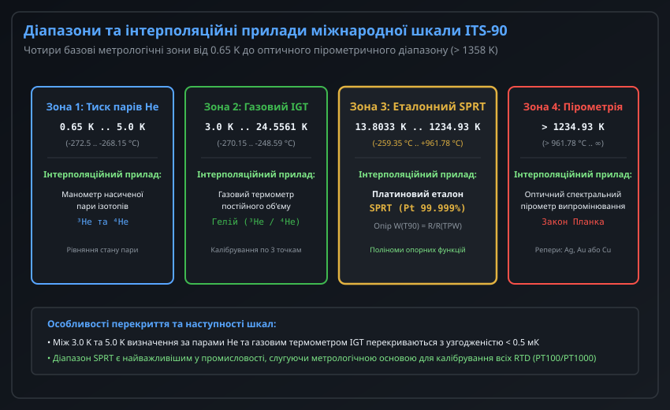
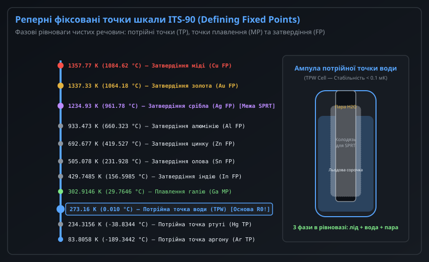
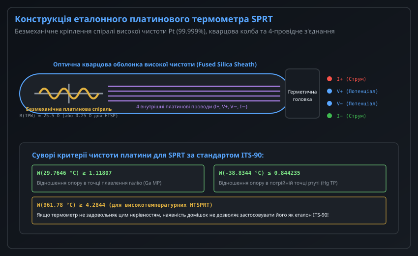
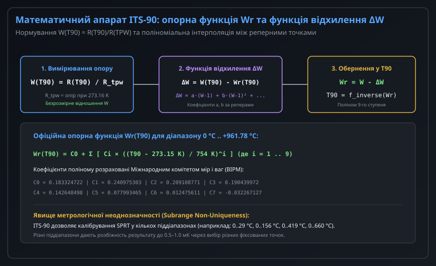
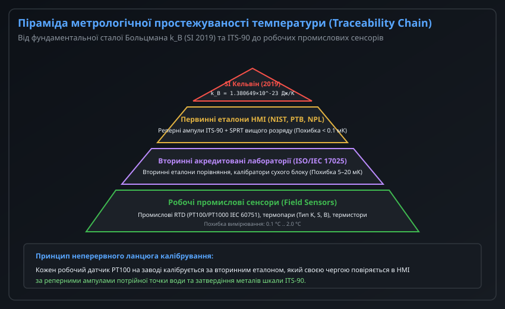

# Міжнародна температурна шкала ITS-90

Температура є однією з семи основних фізичних величин Міжнародної системи одиниць (SI). Проте пряме вимірювання фундаментальної термодинамічної температури `T` (у Кельвінах), що визначається через кінетичну енергію теплового руху частинок і закони статистичної термодинаміки, вимагає надзвичайно складних первинних приладів (акустичних газових термометрів, радіометричних пірометрів, шумових термометрів Джонсона) і є непридатним для практичного застосування в наукових лабораторіях та промисловості.

Для подолання цієї прірви Міжнародний комітет мір і ваг (CIPM) ухвалив **Міжнародну температурну шкалу 1990 року (ITS-90 — International Temperature Scale of 1990)**. Шкала ITS-90 є практичним узгодженим стандартом високої відтворюваності, що базується на наборі фіксованих реперних точок фазових рівноваг чистих речовин та високоточних математичних функціях інтерполяції, наближаючи термодинамічну температуру з точністю до десятих часток мілікельвіна.

---

## 1. Фундаментальні основи шкали ITS-90 та відмінність від термодинамічної шкали

Шкала ITS-90 визначає дві взаємопов'язані величини:
1. **Міжнародну температуру Кельвіна (позначається як `T_90`):** Вимірюється в кельвінах (K).
2. **Міжнародну температуру Цельсія (позначається як `t_90`):** Вимірюється у градусах Цельсія (°C) і строго пов'язана з `T_90` лінійним співвідношенням:
   ```
   t_90 = T_90 - 273.15 K
   ```

Шкала охоплює діапазон від **0.65 K** (температура рідкого гелію під вакуумом) до найвищих температур, що вимірюються спектральною оптичною пірометрією за законом випромінювання Планка.



### Чотири метрологічні зони ITS-90

Шкала не використовує єдиний сенсор для всього спектра температур. Вона розділена на 4 взаємоузгоджені температурні зони з закріпленими інтерполяційними інструментами:

| Діапазон температур | Принцип інтерполяційного приладу | Фізична основа вимірювання |
| :--- | :--- | :--- |
| **0.65 K .. 5.0 K** | Манометрія насиченої пари ізотопів гелію (3He та 4He) | Залежність тиску насиченої пари від температури P(T) |
| **3.0 K .. 24.5561 K** | Інтерполяційний газовий термометр (IGT) | Закон стану ідеального газу гелію постійного об'єму |
| **13.8033 K .. 1234.93 K (-259.35 °C .. +961.78 °C)** | **Еталонний платиновий термометр опору (SPRT)** | Опір надчистої платини, нормований за потрійною точкою води |
| **Вище 1234.93 K (+961.78 °C .. нескінченність)** | Оптичний монохроматичний пірометр спектрального випромінювання | Закон випромінювання абсолютно чорного тіла Планка |

---

## 2. Реперні фіксовані точки фазових рівноваг чистих речовин

Основою шкали ITS-90 є 17 первинних реперних фіксованих точок (Defining Fixed Points). Це температури термодинамічної фазової рівноваги високочистих ізотопних і хімічних речовин (чистота не гірше 99.9999% або "6 дев'яток").



### Типи фазових переходів у шкалі ITS-90

1. **Потрійна точка (Triple Point, TP):** Стан термодинамічної рівноваги твердої, рідкої та газоподібної фаз герметизованої речовини під власним тиском насиченої пари. Потрійні точки є найточнішими реперами, оскільки вони не залежать від коливань зовнішнього атмосферного тиску.
2. **Точка плавлення (Melting Point, MP):** Температура переходу твердої фази в рідку при нормальному атмосферному тиску p_0 = 101 325 Па.
3. **Точка затвердіння / кристалізації (Freezing Point, FP):** Температура переходу рідкої фази надчистого розплавленого металу у твердий стан при p_0 = 101 325 Па. Формує надстабільне температурне плато тривалістю від кількох годин до діб під час фазового переходу.

### Сходи первинних реперних точок ITS-90

| Речовина | Тип рівноваги | Температура T_90 (K) | Температура t_90 (°C) |
| :--- | :--- | :--- | :--- |
| **Гелій (³He, ⁴He)** | Тиск пари | 0.65 .. 5.0 | -272.5 .. -268.15 |
| **Водень (e-H2)** | Потрійна точка (TP) | 13.8033 | -259.3467 |
| **Неон (Ne)** | Потрійна точка (TP) | 24.5561 | -248.5939 |
| **Кисень (O2)** | Потрійна точка (TP) | 54.3584 | -218.7916 |
| **Аргон (Ar)** | Потрійна точка (TP) | 83.8058 | -189.3442 |
| **Ртуть (Hg)** | Потрійна точка (TP) | 234.3156 | -38.8344 |
| **Вода (H2O)** | **Потрійна точка (TPW)** | **273.1600** | **+0.0100** |
| **Галій (Ga)** | Точка плавлення (MP) | 302.9146 | +29.7646 |
| **Індій (In)** | Точка затвердіння (FP) | 429.7485 | +156.5985 |
| **Олово (Sn)** | Точка затвердіння (FP) | 505.0780 | +231.9280 |
| **Цинк (Zn)** | Точка затвердіння (FP) | 692.6770 | +419.5270 |
| **Алюміній (Al)** | Точка затвердіння (FP) | 933.4730 | +660.3230 |
| **Срібло (Ag)** | Точка затвердіння (FP) | 1234.9300 | +961.7800 |
| **Золото (Au)** | Точка затвердіння (FP) | 1337.3300 | +1064.1800 |
| **Мідь (Cu)** | Точка затвердіння (FP) | 1357.7700 | +1084.6200 |

### Ампула потрійної точки води (TPW Cell)

Потрійна точка води є найважливішим репером світової метрології:
- Ампула TPW є запаяною колбою з боросилікатного або кварцового скла, заповненою дегазованою водою суворого ізотопного складу океанічної води (стандарт VSMOW).
- Навколо центрального колодязя для термометра наморожують "льодово-водяну сорочку" (Ice Mantle).
- Термодинамічна рівновага льоду, води та насиченої пари всередині ампули відтворює температуру рівно **273.1600 K (+0.0100 °C)** з розширеною невизначеністю менше **0.05 мК (0.00005 °C)**.

---

## 3. Еталонний платиновий термометр опору SPRT: конструкція та критерії чистоти

У найширшому практичному діапазоні від -259.35 °C до +961.78 °C інтерполяційним приладом шкали ITS-90 є еталонний платиновий термометр опору (SPRT — Standard Platinum Resistance Thermometer).



### Конструктивні відмінності SPRT від промислових PT100

1. **Безмеханічне кріплення спіралі (Strain-Free Mounting):** У промислових термометрах (PT100/PT1000) платиновий шар жорстко зчеплений з керамікою або запечений у склі. Різниця теплового розширення викликає паразитичні механічні напруження, що деформують кристалічну решітку. В еталонному SPRT платинова спіраль вільно укладається в пази хрестоподібного кварцового або слюдяного каркаса без механічного натягу.
2. **Чистота платини:** Застосовується виключно платиновий дріт спектральної чистоти не нижче 99.999% ("5 дев'яток"). Будь-які сліди домішок (залізо, паладій, родій) спотворюють температурний коефіцієнт опору.
3. **Оболонка з плавленого кварцу:** Чутливий елемент запаяний у довгу трубку з оптичного кварцу високої чистоти, заповнену сумішшю гелію та сухого кисню під тиском близько 30 кПа для забезпечення швидкої теплопередачі та запобігання відновленню оксидів платини.
4. **Чотирипровідна схема:** Використовуються 4 внутрішні платинові або золоті провідники, виведені на герметичну головку, що виключає вплив опору проводів при мостових або логометричних вимірюваннях опору.

### Нормативні критерії придатності платини

Щоб термометр був офіційно допущений як еталонний прилад шкали ITS-90, відношення його опору `W(T_90) = R(T_90) / R(TPW)` має задовольняти обов'язковим нерівностям:

```
W(29.7646 °C, точка плавлення Ga) ≥ 1.11807
W(-38.8344 °C, потрійна точка Hg) ≤ 0.844235
```

Для високотемпературних еталонів HTSPRT (до точки срібла 961.78 °C):

```
W(961.78 °C, точка затвердіння Ag) ≥ 4.2844
```

Якщо дріт має мікродомішки, опір зростає повільніше, і ці нерівності не виконуються.

---

## 4. Математичний апарат інтерполяції: опорна функція Wr та поліноми відхилення

На відміну від промислового стандарту IEC 60751, де використовується просте квадратичне рівняння Календара-Ван Дюзена, шкала ITS-90 спирається на складний безперервний математичний апарат поліномів високого порядку.



### Безрозмірне нормування опору W(T_90)

Шкала ITS-90 оперує не абсолютним опором у омах, а нормованим безрозмірним відношенням:

```
W(T_90) = R(T_90) / R(273.16 K)
```

де `R(273.16 K)` — опір конкретного термометра, виміряний в ампулі потрійної точки води безпосередньо перед або після калібрувального сеансу. Це виключає похибки еталонів одиниці опору (Ом).

### Структура апроксимації: Опорна функція та Функція відхилення

Дійсне відношення опору термометра описується як сума ідеальної опорної функції та індивідуального відхилення:

```
W(T_90) = W_r(T_90) + Delta_W(T_90)
```

1. **Опорна функція W_r(T_90):** Це фіксований світовий математичний поліном, розрахований метрологами CIPM на базі усереднення десятків найкращих еталонів. Для діапазону від 0 °C до 961.78 °C опорна функція є поліномом 9-го ступеня:
   ```
   W_r(T_90) = C_0 + Sum [ C_i * ( (T_90 - 273.15 K) / 754 K )^i ]  (i = 1 .. 9)
   ```
2. **Функція відхилення Delta_W(T_90):** Індивідуальна для кожного окремого екземпляра SPRT. Вона обнуляється в потрійній точці води (`Delta_W = 0` при 273.16 K) і формується з кількох членів:
   ```
   Delta_W = a * (W - 1) + b * (W - 1)^2 + c * (W - 1)^3 + ...
   ```
   Коефіцієнти `a, b, c` обчислюються вирішенням системи лінійних алгебраїчних рівнянь за результатами вимірювань у реперних ампулах (наприклад, Sn, Zn, Al).

---

## 5. Метрологічна простежуваність (Traceability), калібрування промислових термометрів та реформа SI 2019 року

Усі прилади для вимірювання температури — від прецизійного термометра в хімічному реакторі до побутового датчика температури в мікроконтролері — метрологічно пов'язані з міжнародною шкалою ITS-90 через неперервний ланцюг калібрувань.



### Реформа SI 2019 року та перевизначення кельвіна

Історично до 2019 року кельвін визначався як `1 / 273.16` термодинамічної температури потрійної точки води. Це створювало фундаментальну залежність світового еталону від ізотопного складу води.

20 травня 2019 року набуло чинності історичне перевизначення одиниць SI:
- Кельвін тепер визначено через фіксоване чисельне значення **сталої Больцмана**:
  ```
  k = 1.380649 * 10^-23 Дж / К  (Дж = кг * м^2 * с^-2)
  ```
- Температура тепер напряму пов'язана з тепловою енергією частинок `E = k * T`.
- При цьому шкала ITS-90 залишилася основним **практичним міжнародним методом реалізації кельвіна** в усьому світі, оскільки її реперні точки та математичні методи гарантують стабільність, недосяжну для прямих первинних вимірювачів енергії.

### Ієрархія передачі одиниці температури в промисловість

1. **Рівень 1 (Первинні державні еталони НМІ):** Національні інститути метрології (NIST у США, PTB у Німеччині, NPL у Великобританії, ДП "Укрметртестстандарт" в Україні) підтримують набори реперних ампул і групові еталони SPRT вищого розряду з похибкою менше 0.1 мК.
2. **Рівень 2 (Вторинні акредитовані калібрувальні лабораторії ISO/IEC 17025):** Використовують вторинні еталони порівняння та рідинні або сухі термостатичні ванни. Їхня невизначеність становить 5–20 мК.
3. **Рівень 3 (Робочі промислові сенсори):** Датчики PT100/PT1000 калібруються за робочими еталонами лабораторії. Вихідні дані зводяться до стандартів IEC 60751 (для терморезисторів) або IEC 60584 (для термопар), де допустима похибка становить 0.15–1.5 °C.

Така ієрархічна структура забезпечує єдність вимірювань і гарантує, що 100.0 °C на заводі в Україні суворо дорівнюють 100.0 °C на виробничій лінії в будь-якій країні світу.
