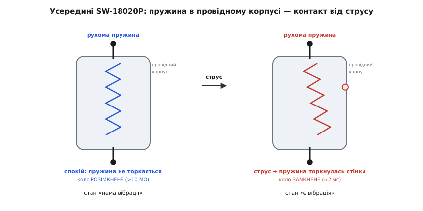
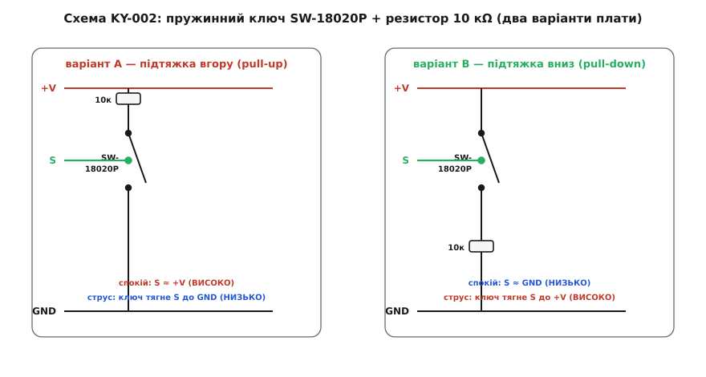
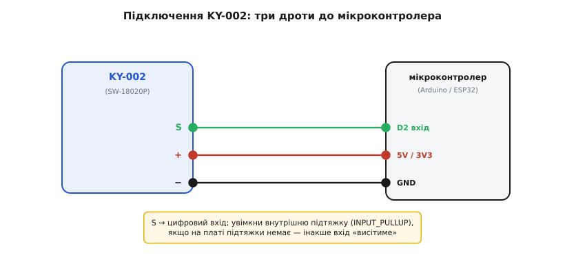

# KY-002 — давач вібрації (SW-18020P)

## Дискретний вимикач вібрації замість вимірювача

Визначення струсу пристрою за допомогою вимірювальних приладів вимагає складного оброблення сигналів. Коли потрібно лише зафіксувати факт поштовху без аналізу його сили, повноцінний [аналоговий п'єзоелектричний давач](root:cat-hw-sensors/piezo-sensor) створює надлишкову обчислювальну складність. Для такого завдання застосовують модуль @@en|KY-002@@ — дискретний механічний вимикач.

Головна особливість давача полягає у його двопозиційному вихідному сигналі. Він не має аналогового тракту, тому принципово не вимірює амплітуду поштовху чи частоту коливань. Модуль працює ненапрямлено: механічний контакт замикається від вектора сили з будь-якого боку, віддаючи мікроконтролеру просте двопозиційне значення про факт події.

## Будова SW-18020P та брязкіт контактів

Основним елементом плати є герметичний компонент @@en|SW-18020P@@. Усередині його провідного металевого циліндра проходить тонка гнучка пружина, яка у стані спокою не торкається внутрішніх стінок корпуса.


_Конструкція SW-18020P: при поштовху інерція змушує гнучку пружину торкатися зовнішньої стінки, замикаючи електричне коло._

Під час струсу інерція змушує пружину відхилятися й короткочасно торкатися центрального стрижня приблизно на 2 мілісекунди. Оскільки пружина пружна, після першого дотику вона пружинить і здійснює серію повторних мікродотиків. Цей ефект називають брязкотом контактів або @@en|contact bounce@@ (англ. *bounce* — відскок). За один струс давач генерує пачку імпульсів, тому мікроконтролер без програмного оброблення зафіксує десятки хибних спрацювань замість однієї події. Для усунення цього використовують програмне притлумлення — @@en|debouncing@@ (англ. *de-* — усунення, *bounce* — відскок), яке реалізують через часте опитування або переривання з часовою затримкою.

## Схемотехніка підтяжки та дві схеми

Коли пружина не торкається стінки корпуса, сигнальний вивід давача опиняється у плаваючому стані. Для формування чіткого логічного рівня на платі встановлено резистор номіналом 10 кОм.


_Схема KY-002: розводка плати визначає полярність вихідного сигналу у спокої та під час струсу._

На ринку існують два несумісні варіанти розводки модуля @@en|KY-002@@. У першому варіанті застосовано підтяжку вгору — @@en|pull-up@@ (англ. *pull* — тягнути, *up* — вгору), тому у спокої на виході присутній високий рівень, який при струсі падає до нуля. У другом варіанті розводки резистор підтягує лінію вниз — @@en|pull-down@@ (англ. *pull* — тягнути, *down* — вниз), забезпечуючи низький рівень у спокої та короткий високий імпульс при замиканні. З огляду на це необхідно обов'язково перевіряти рівень спокою конкретної плати перед написанням коду. Якщо ж вивід підтяжки на платі відсутній, слід увімкнути внутрішній резистор підтяжки мікроконтролера.

## Трипінове підключення та практичні обмеження

Модуль @@en|KY-002@@ має триконтактний роз'єм: вивід сигналу S, живлення 3.3–5 В та спільний провід GND.


_Підключення KY-002: три провідники забезпечують живлення, спільну землю та передачу дискретного сигналу S._

Для надійного ігнорування пачки хибних імпульсів тривалість часового вікна притлумлення `t_window` обчислюють на основі максимальної тривалості брязкоту `t_bounce` та захисного інтервалу `t_margin`.

```
t_window
= t_bounce + t_margin    [додавання захисного інтервалу]
= 2 + 10                 [значення в мілісекундах]
= 12 ms                  [мінімальне вікно притлумлення]
```

У цьому виразі `t_window` означає підсумковий час затримки, `t_bounce` — тривалість брязкоту контактів, а `t_margin` — додатковий часовий запас для компенсування нестабільності пружини. З отриманої величини видно, що ігнорування повторних сигналів упродовж 12-50 мілісекунд гарантує фіксацію лише одного справжнього поштовху.

Механічний ресурс пружини @@en|SW-18020P@@ обмежений втомою металу, а тонкі контакти не розраховані на значний струм, тому модуль не можна використовувати для прямого комутування силового навантаження. Якщо завдання вимагає контролю кутового положення в просторі, краще використати [модуль нахилу KY-020](root:cat-hw-sensors/ky-020-tilt) або кутовий [давач нахилу SW-520D](root:cat-hw-sensors/sw-520d), а для детектування ударів призначений [давач стуку KY-031](root:cat-hw-sensors/ky-031-knock).
