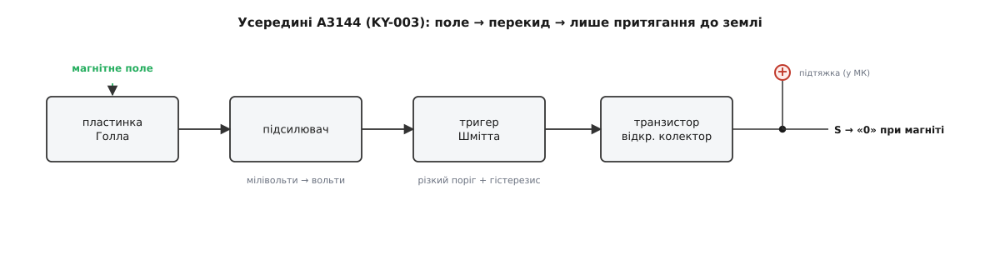
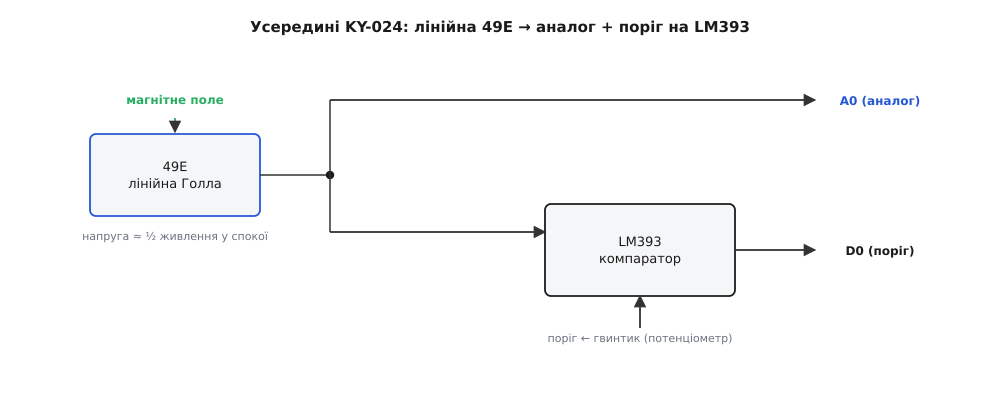
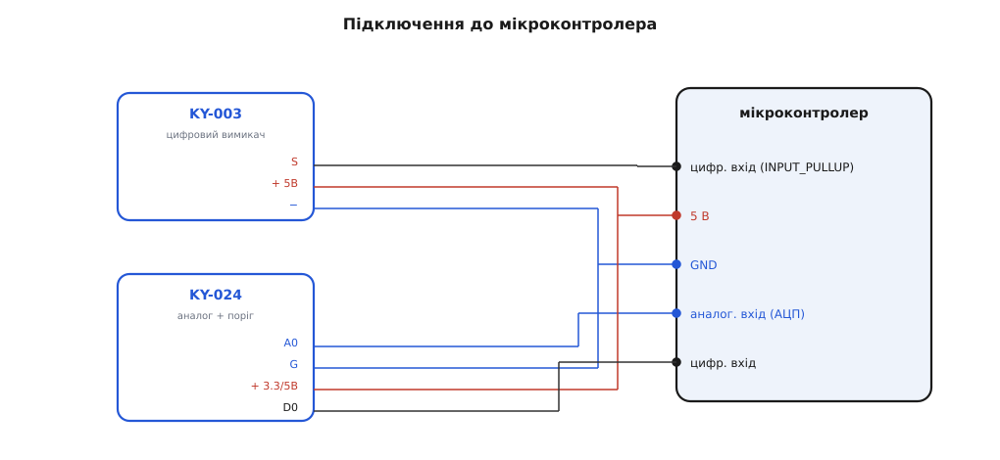

# KY-003 / KY-024 — давач Голла

<preknowlist>
- [KY-021 — міні герконовий давач](root:cat-hw-sensors/ky-021-reed) — Принцип замикання механічних контактів у магнітному полі та їхні обмеження через зношування і дребезг
- [A3144 — модуль давача Холла](root:cat-hw-sensors/a3144-hall-module) — Будова уніполярного цифрового перемикача Голла з тригером Шмітта та відкритим колектором
</preknowlist>

## Обмеження механічних контактів і ефект Голла

Механічні вимикачі та герконові сенсори спричиняють збої в автоматиці через фізичне зношування рухомих пластин. У [механічних @@uk|герконах@@](root:cat-hw-sensors/ky-021-reed) (від укр. *герметичний контакт*) контакти замкнені в колбі, але від постійних ударів вони зношуються, а під час перемикання виникає @@en|дребезг контактів@@ — серія хибних імпульсів. Твердотільні @@en|давачі Голла@@ (від англ. *Hall* — прізвище фізика Едвіна Голла) повністю позбавлені механічного тертя, оскільки сприймають поле безпосередньо структурою матеріалу.

Фізична суть цього явища полягає у виникненні поперечної різниці потенціалів у провіднику зі струмом, вміщеному в магнітне поле. На носії заряду, що рухаються вздовж напівпровідникової пластини, діє сила Лоренца і відхиляє їх до бічної грані. На краях пластини виникає поперечна @@uk|ЕРС@@ Голла `V_H`, яка залежить від струму `I` та індукції поля `B`:

```
V_H = R_H · (I · B) ÷ d      [формула ефекту Голла]
```

Тут `R_H` — коефіцієнт Голла, а `d` — товщина напівпровідника. Завдяки цьому @@en|ефект Голла@@ дає змогу зчитувати рух і положення об'єктів крізь будь-які неферомагнітні перепони (пластик, скло чи дерево), що забезпечує довговічність сенсора в забрудненому середовищі. Докладний розбір виникнення ЕРС Голла в напівпровідниках та її залежності від носіїв заряду висвітлено у матеріалі про [фізику ефекту Голла](root:ph-condensed/hall-effect).

## Цифровий вимикач KY-003 на чипі A3144

Модуль @@en|KY-003@@ побудований на уніполярному цифровому [чипі @@en|A3144@@](root:cat-hw-sensors/a3144-hall-module). Усередині сенсора інтегровано підсилювач та @@en|тригер Шмітта@@ (від англ. *trigger* — спусковий гачок та *Schmitt* — прізвище винахідника), який перетворює плавні зміни поля на чіткий дискретний сигнал. Чипу притаманна уніполярність: він реагує виключно на південний полюс магніту, ігноруючи північний.


*Будова цифрового модуля KY-003 та принцип формування активного нуля на виході.*

Вихідний каскад чипа @@en|A3144@@ виконано з @@en|відкритим колектором@@ (від англ. *open collector*). Внутрішній транзистор притягує лінію до землі (GND) лише при появі південного полюса, створюючи активний нуль. Коли магніту немає, транзистор закритий, а вихід перебуває в невизначеному стані. Для зчитування логічної одиниці в мікроконтролері необхідно обов'язково вмикати внутрішню підтяжку `` `INPUT_PULLUP` ``. На відміну від двополярних елементів на кшталт [давачів @@en|SS41F@@](root:cat-hw-sensors/ss41f-hall), модуль @@en|KY-003@@ є однополярним.

## Аналоговий давач KY-024 з компаратором LM393

Модуль @@en|KY-024@@ призначений для вимірювання сили магнітного поля та базується на лінійному чипі @@en|49E@@. На відміну від ключових давачів, його аналоговий вихід `A0` формує безперервний сигнал. Напруга на виході залежить від сили та полярності поля й обчислюється відносно половини живлення:

```
V_out = (V_CC ÷ 2) ± ΔV      [раціометричне зміщення напруги]
```

Де `V_CC` — напруга живлення, а `ΔV` — зміна напруги, пропорційна магнітній індукції. Вихідний сигнал є @@la|раціометричним@@ (від лат. *ratio* — відношення): за відсутності поля напруга дорівнює половині `V_CC`. Наближення південного полюса збільшує напругу до `V_CC`, а північного — зменшує її до нуля.


*Схема модуля KY-024 з двома виходами: аналоговим A0 та пороговим цифровим D0.*

Для дискретного спрацювання плата містить @@la|компаратор@@ (від лат. *comparare* — порівнювати) @@en|LM393@@. Вбудованим @@la|потенціометром@@ (від лат. *potentia* — сила) задають опорний поріг: коли напруга з чипа @@en|49E@@ перевищує встановлений рівень, цифровий вихід `D0` змінює стан на низький. Модуль @@en|KY-024@@ працює в діапазоні живлення від 2.7 до 6.5 В, що робить його сумісним із 3.3-вольтовою та 5-вольтовою логікою.

## Підключення, калібрування та вибір модуля

Підключення сенсорів до мікроконтролера вимагає врахування типів сигналів і робочої напруги. Аналоговий вихід `A0` модуля @@en|KY-024@@ подають на мікроконтролерний @@uk|АЦП@@. Оскільки значення у спокої може відхилятися від `V_CC ÷ 2` через технологічні допуски чи коливання живлення, програма повинна проводити калібрування нульової лінії під час старту системи.


*Схема зчитування сигналів: використання підтяжки для KY-003 та калібрування АЦП для KY-024.*

Вибір модуля залежить від завдання:
- Для підрахунку обертів або фіксації зачинення дверей обирають @@en|KY-003@@, оскільки його тригер забезпечує чітке перемикання без зайвих обчислень.
- Для вимірювання відстані, оцінки сили поля чи роботи з 3.3-вольтовими контролерами підходить @@en|KY-024@@.

Під час монтажу слід враховувати швидкоплинне згасання магнітного поля з відстанню та орієнтацію полюсів: піднесення неправильного полюса до @@en|KY-003@@ не викличе спрацювання.
