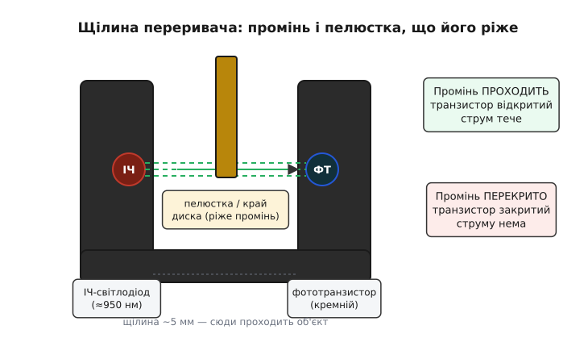
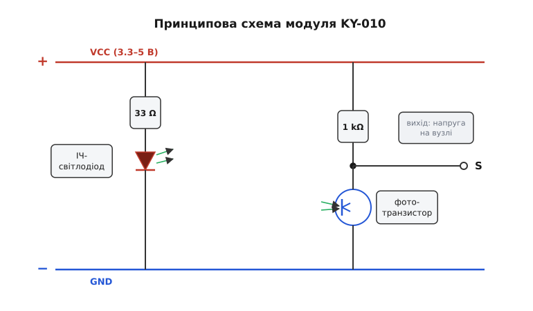
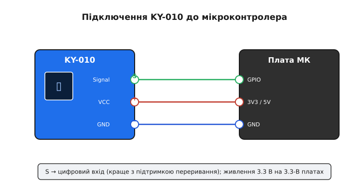

# KY-010 — оптичний переривач

<preknowlist>
- [KY-серія (Keyes 37-в-1)](root:cat-hw-sensors/ky-series) — огляд сімейства навчальних модулів з уніфікованим розташуванням виводів.
- [Інфрачервоний давач перешкод](root:cat-hw-sensors/ir-obstacle) — порівняння принципу роботи відбивних та щілинних оптичних датчиків.
</preknowlist>

## Призначення та фізична сутність оптичного переривача

Оптичний переривач KY-010 призначений для безконтактного детектування проходження непрозорих предметів крізь вимірювальну щілину датчика. На відміну від механічних перемикачів або кінцевих вимикачів, робота оптичного вузла не супроводжується механічним зносом, силами тертя або затримками перемикання. Завдяки цьому пристрій здатен фіксувати високошвидкісні події: проліт лопатей крильчатки, зубців шестерень або прорізів перфорованих дисків оптичних енкодерів.

Головні сфери застосування KY-010:
- Тахометри та вимірювачі швидкості обертання валів двигунів.
- Оптичні кінцевики нульового положення (Home position) кареток 3D-принтерів і верстатів з ЧПК.
- Лічильники кількості продукції, деталей або паперових аркушів на конвеєрних лініях.
- Давачі відкриття захисних стулок або наявності витратних матеріалів (нитки пластику, стрічки).

## Конструкція щілинного оптоелектронного вузла

Основою модуля є щілинна оптопара в U-подібному пластиковому корпусі (компонент ITR9606 або сумісний аналог). В один із виступів корпусу вбудовано інфрачервоний світлодіод із довжиною хвилі випромінювання близько 950 нм, а в протилежний виступ на відстані близько 5 мм навпроти випромінювача встановлено кремнієвий фототранзистор.

*Будова щілини переривача: світлодіод випромінює інфрачервоний промінь, що перекривається пелюсткою диска, блокуючи фототранзистор.*

Використання інфрачервоного діапазону зумовлене піком спектральної чутливості кремнію в області 900–950 нм, що забезпечує максимальний фотострум при помірному енергоспоживанні світлодіода. Чорний непрозорий матеріал корпусу захищає фотоприймач від бокових паразитних засвічень зовнішнім кімнатним освітленням чи сонцем.

## Схемотехніка модуля KY-010 та розпіновка

Модуль KY-010 містить усі необхідні пасивні компоненти для підключення до стандартних цифрових ліній мікроконтролерів:

*Принципова електрична схема модуля KY-010: струмообмежувальний резистор 33 Ом та колекторне навантаження 1 кОм.*

Схема складається з двох паралельних віток:
1. **Вітка живлення випромінювача:** послідовно з ІЧ-світлодіодом увімкнено резистор опором 33 Ом, який обмежує прямий струм через діод на безпечному робочому рівні (близько 20–30 мА при живленні 3.3 В або до 80–100 мА при 5 В).
2. **Вітка фотоприймача:** навантажувальний резистор опором 1 кОм підтягує колектор фототранзистора до шини живлення (+), а емітер транзистора з'єднано із загальною землею (-). Сигнальний вивід S знімається безпосередньо з точки з'єднання колектора та навантажувального резистора.

Розпіновка триконтактної гребінки модуля:
- `S` (Signal) — цифровий вихід стану датчика.
- `+` (VCC) — напруга живлення (від 3.3 В до 5 В).
- `-` (GND) — загальний провід схеми (земля).

## Логіка роботи вихідного сигналу

Робота цифрового виходу S підпорядкована стану оптичного каналу:

1. **Промінь вільний (перешкоди в щілині немає):**
   Інфрачервоне світло падає на відкриту базу фототранзистора. Транзистор насичується, відкривається і притискає вихід S до землі. На виході формується логічний нуль (**LOW**, напруга менше 0.3 В).

2. **Промінь перекритий (у щілину зайшов непрозорий предмет):**
   Світловий потік блокується. Базовий фотострум припиняється, фототранзистор надійно закривається. Навантажувальний резистор 1 кОм підтягує сигнальну лінію S до шини живлення. На виході формується логічна одиниця (**HIGH**, напруга, близька до VCC).

На відміну від механічних кнопок та герконів, фототранзистор перемикається без брязкоту контактів за час порядку 5–15 мікросекунд, що усуває потребу в складних часових фільтрах дебаунсу при лічбі швидких імпульсів.

## Підключення до мікроконтролера та експлуатаційні поради

Модуль KY-010 безпосередньо комутується з платами на базі AVR (Arduino), STM32 або ESP32:

*Підключення виводів живлення та сигнальної лінії S модуля KY-010 до мікроконтролера.*

Під час монтажу та написання коду враховують такі рекомендації:
- Для високошвидкісного підрахунку обертів сигнальний вивід підключають до піна з підтримкою апаратних переривань (`attachInterrupt`) за наростаючим фронтом (`RISING`) або спадним фронтом (`FALLING`).
- При роботі поблизу потужних джерел інфрачервоного тепла (паяльники, лампи розжарювання, сонячні промені) щілину датчика орієнтують так, щоб пряме світло не потрапляло на вхідне вікно фототранзистора.
- Для об'єктів перекриття використовують оптично непрозорі матеріали: чорний пластик, текстоліт, метал або цупкий картон. Прозорі або тонкі білі пластики можуть пропускати інфрачервоний промінь без надійного закриття транзистора.
