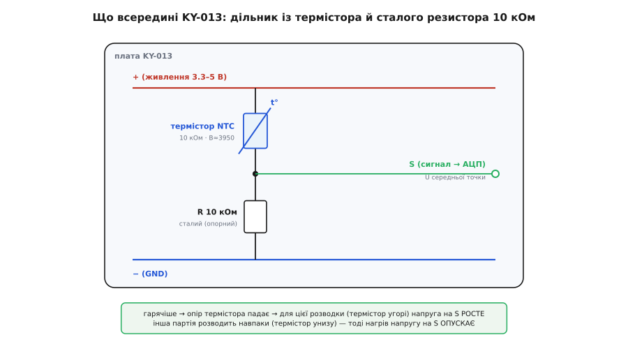
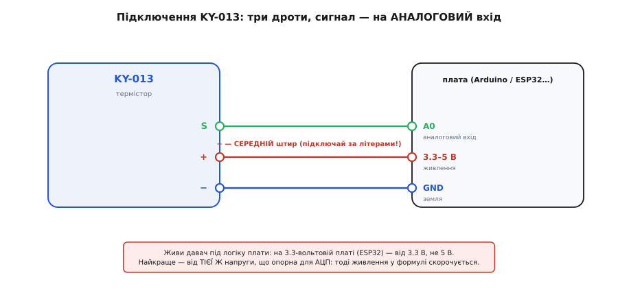

# KY-013 — аналоговий давач температури (термістор)

<preknowlist>
- [KY-серія (Keyes 37-в-1)](root:cat-hw-sensors/ky-series) — спільний формат модулів родини KY: живлення 3.3–5 В, розміщення живлення на середньому штирі та стандартизована гребінка
- [NTC-термістор](root:hw-sensing/ntc-thermistor) — принцип нелінійного падіння електричного опору напівпровідникового елемента при зростанні температури
- [Дільник напруги](root:hw-analog/voltage-divider) — формування вихідної напруги пропорційно до співвідношення опорів двох послідовних компонентів
- [АЦП мікроконтролера](root:hw-analog/adc) — перетворення неперервного аналогового сигналу напруги в дискретний числовий код
</preknowlist>

Модуль **KY-013** (часто маркований як HW-498) є одним із найпростіших і найдоступніших аналогових сенсорів температури в навчальних та аматорських наборах. На його друкованій платі розміщено мінімум компонентів: мініатюрний термістор у вигляді чорної краплі, фіксований балансувальний резистор і триконтактну штирьову гребінку. Модуль не має цифрових мікросхем чи інтерфейсних протоколів — він генерує неперервну аналогову напругу, що пропорційно залежить від температури середовища.

## Призначення та фізичний принцип NTC-термістора

Головним вимірювальним елементом модуля є напівпровідниковий резистор із від'ємним температурним коефіцієнтом — **NTC-термістор** (Negative Temperature Coefficient). На відміну від звичайних металевих провідників, опір яких зростає під час нагрівання через розсіювання електронів на коливаннях кристалічної ґратки, у напівпровідниковому оксидному матеріалі термістора теплова енергія генерує додаткові вільні носії заряду. Внаслідок цього зі зростанням температури електричний опір сенсора круто й нелінійно зменшується.

На платі встановлено поширений термістор серії MF52 з номінальним опором **10 кОм при температурі 25 °C** (опір R25) та температурним коефіцієнтом чутливості B у діапазоні 3950 K. Сенсор має високу чутливість у зоні кімнатних температур, забезпечуючи швидкий відгук на зміну теплового стану об'єкта.

## Схемотехніка модуля KY-013 та резистивний дільник

Оскільки мікроконтролер не здатний безпосередньо вимірювати електричний опір, схема модуля перетворює його на пропорційну напругу за допомогою класичного резистивного дільника. Термістор та постійний прецизійний резистор номіналом 10 кОм з'єднані послідовно між шинами живлення та спільної землі.


*Принципова електрична схема модуля KY-013. Сигнал S знімається з середньої точки послідовного кола.*

Вибір номіналу опорного резистора рівним 10 кОм зумовлений прагненням досягти максимальної крутості передавальної характеристики дільника при кімнатній температурі (25 °C), коли обидва плеча мають рівні опори. При підвищенні температури опір термістора зменшується, що змінює співвідношення напруг на плечах дільника та зміщує потенціал виводу S.

> Важлива особливість виробництва: у різних партіях модулів KY-013 дільник розведено по-різному. В одних версіях термістор встановлено у верхнє плече (між + і S), і тоді напруга при нагріванні зростає. В інших — у нижнє плече (між S і -), через що напруга при нагріванні падає. Перед написанням остаточного коду орієнтацію дільника слід перевірити дослідом: затиснути термістор пальцями та простежити напрямок зміни показів АЦП.

## Підключення до мікроконтролера та пастка середнього виводу

Модуль обладнано триконтактним роз'ємом із маркуванням виводів:
- **S (Signal):** вихід аналогової напруги дільника, підключається до аналогового входу АЦП мікроконтролера (наприклад, A0 на платі Arduino або GPIO34 на ESP32).
- **+ (VCC):** живлення схеми напругою 3.3 В або 5.0 В.
- **- (GND):** загальний провідник спільної землі.


*Підключення виводів модуля KY-013 до плати керування. Середній вивід обов'язково призначений для живлення VCC.*

Головна монтажна пастка сімейства плат KY полягає в тому, що позитивний контакт живлення (+) розташований посередині роз'єму, а не з краю. Помилкове підключення живлення до сигнального виводу S спотворює покази дільника та може вивести вхід АЦП з ладу. Крім того, на 3.3-вольтових мікроконтролерах (ESP32, STM32) модуль необхідно живити виключно від лінії 3.3 В, щоб уникнути електричного пробою цифрових входів напругою 5 В.

## Перетворення вихідної напруги в температуру

Програмний конвеєр обробки сигналу KY-013 складається з трьох послідовних математичних кроків:
1. Зчитування коду АЦП та розрахунок частки напруги:
```c
float ratio = (float)raw_adc / ADC_MAX;
```
2. Розрахунок поточного опору термістора через формулу дільника напруги (для схеми з термістором у верхньому плечі):
```c
float r_ntc = R_FIXED * (1.0f / ratio - 1.0f);
```
3. Обчислення температури в кельвінах за спрощеним рівнянням B-параметра з подальшим переведенням у градуси Цельсія:
```c
float temp_k = 1.0f / ( (1.0f / 298.15f) + (1.0f / B_COEFF) * log(r_ntc / R25) );
float temp_c = temp_k - 273.15f;
```

Якщо використовується мікроконтролер без апаратного модуля операцій з рухомою комою (FPU), обчислення логарифма замінюють таблицею пошуку (LUT) з лінійною інтерполяцією між сусідніми значеннями.

## Практичні обмеження, самонагрів та сфери застосування

Під час практичного використання KY-013 слід враховувати фізичні обмеження напівпровідникових сенсорів:
- **Власний самонагрів:** струм, що протікає крізь термістор від джерела живлення, розсіює потужність у вигляді тепла. Завдяки номіналу дільника 10 кОм струм обмежений сотнями мікроампер, проте в закритих корпусах тривале протікання струму може завищувати покази на частки градуса.
- **Теплова інерція:** мініатюрна намистинка вимірює власну локальну температуру. При різких змінах температури повітря теплообмін займає від 2 до 5 секунд.
- **Точність без калібрування:** через допуски дешевих компонентів (розкид постійного резистора ±5 % та відхилення параметра B) абсолютна похибка некаліброваного модуля може досягати 2-3 °C. Для точних вимірювань рекомендується виконати двоточкове калібрування в контрольних середовищах (суміш льоду з водою 0 °C та стабільна кімнатна температура).

Завдяки граничній простоті, високій швидкодії та низькій вартості модуль KY-013 успішно використовується в системах моніторингу перегріву радіаторів охолодження, побутових термостатах, захисті акумуляторних батарей та навчальних стендах автоматики.
