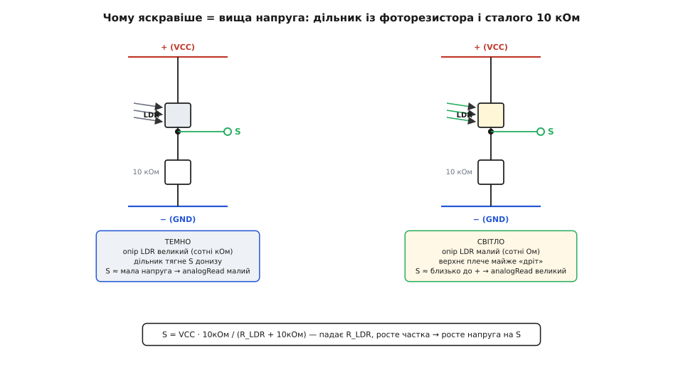
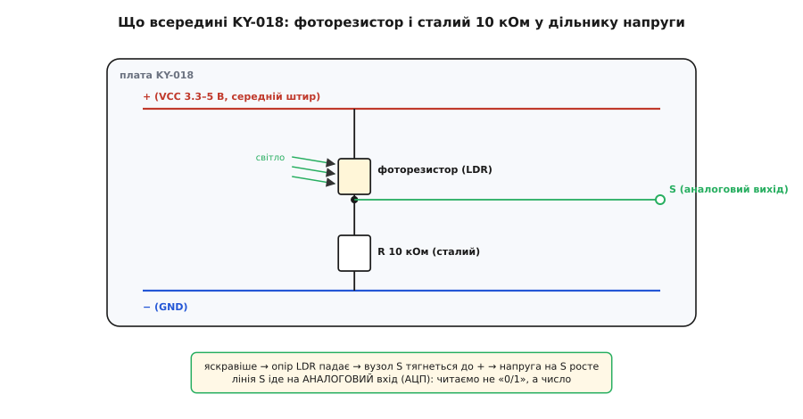
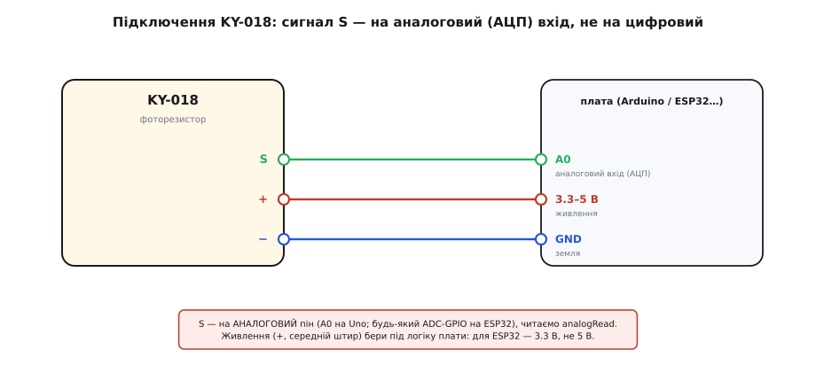
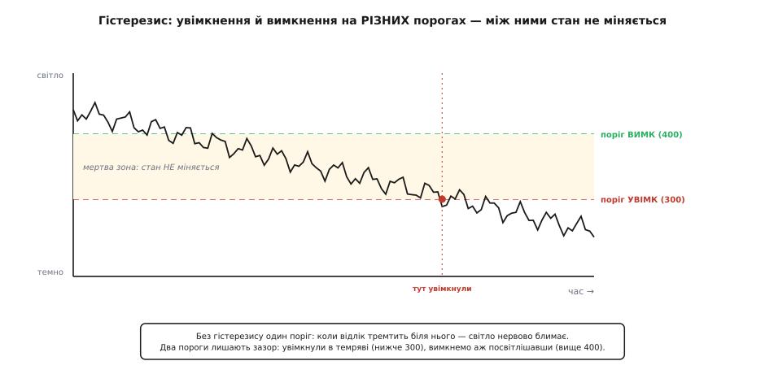

# KY-018 — фоторезистор

<preknowlist>
- [Фотодавачі](root:hw-sensing/photo-sensors) — будова фоторезистора (LDR) та явище внутрішнього фотоефекту в сульфіді кадмію (CdS).
- [Дільник напруги](root:hw-analog/voltage-divider) — схема перетворення змінного опору на напругу для аналогового входу.
- [АЦП](root:hw-analog/adc) — оцифрування аналогової напруги за допомогою функції analogRead.
</preknowlist>

## Призначення та фізичний принцип датчика світла

Модуль **KY-018** належить до набору датчиків Keyes 37-в-1 і являє собою найпростіший аналоговий вимірювач освітленості. Його призначення — оцінка відносного рівня світла в приміщенні або на вулиці для автоматичного керування освітленням (сутінкові вимикачі, «розумні» нічники), пошуку напрямку на джерело світла в робототехніці та контролю оптичних штор.

Головним робочим елементом модуля є **фоторезистор (LDR)**, виготовлений на основі напівпровідникового матеріалу — сульфіду кадмію (CdS):
1. **Внутрішній фотоефект:** кванти світла (фотони), падаючи на звивисту доріжку напівпровідника, вибивають електрони в зону провідності.
2. **Падіння електричного опору:** що більша кількість фотонів опромінює чутливе віконце, то більша концентрація вільних носіїв заряду виникає в кристалі, і тим легше крізь нього протікає струм.
3. **Діапазон опору:** у глибокій темряві опір фоторезистора становить сотні кілоомів або навіть кілька мегаомів, а при яскравому денному світлі він стрімко падає до кількох сотень омів.

## Схемотехніка модуля: резистивний дільник напруги

Оскільки вбудований аналогово-цифровий перетворювач (АЦП) мікроконтролера вимірює виключно електричну напругу, а не опір, на платі KY-018 реалізовано пасивний **дільник напруги**:

*Дільник напруги: зміна опору LDR зміщує потенціал вихідного вузла S між 0 В та напругою живлення.*

- **Верхнє плече:** утворене самим фоторезистором LDR, підключеним до лінії живлення (+).
- **Нижнє плече:** утворене постійним резистором опором 10 кОм (R2), підключеним до спільної землі (−).
- **Вихідний сигнал S:** знімається з середньої точки між фоторезистором та постійним резистором.

Формула вихідної напруги дільника має вигляд:
`V_out = VCC * R_10k / (R_LDR + R_10k)`

Поведінка сигналу залежно від освітленості:
- **У темряві:** опір `R_LDR` величезний (понад 100–200 кОм), тому майже вся напруга падає на ньому, а на виході S залишається низький потенціал, близький до 0 В (відлік АЦП малий).
- **На яскравому світлі:** опір `R_LDR` падає до часток кілоома, верхнє плече стає низькоомним, і напруга на контакті S зростає, наближаючись до напруги живлення VCC (відлік АЦП великий).

*Принципова схема KY-018: фоторезистор у верхньому плечі та резистор 10 кОм у нижньому.*

Постійний резистор 10 кОм обирає робочу точку системи під діапазон звичайного кімнатного освітлення, де опір фоторезистора приблизно дорівнює опору навантаження.

## Підключення модуля до мікроконтролера

Модуль KY-018 має стандартний триконтактний інтерфейс:

*Підключення модуля: живлення на центральний контакт, вихід сигналу S на аналоговий пін АЦП.*

- **S (Signal):** аналоговий вихід напруги дільника. Підключається до будь-якого входу АЦП мікроконтролера (наприклад, A0 на Arduino або GPIO36 / ADC1_CH0 на ESP32).
- **+ (VCC, центральний контакт):** живлення модуля від 3.3 В до 5 В. За правилами KY-серії лінія живлення завжди знаходиться по центру.
- **− (GND):** спільна земля мікроконтролера.

Рекомендується подавати на модуль ту напругу, від якої живиться аналогова підсистема мікроконтролера (3.3 В для ESP32 і STM32, 5 В для плат Arduino AVR), щоб динамічний діапазон виходу повністю збігався зі шкалою перетворення АЦП.

## Особливості обробки сигналу в коді

Під час розробки пристроїв на основі KY-018 необхідно враховувати специфіку аналогового сигналу:

1. **Нелінійність шкали:** залежність опору сульфіду кадмію від освітленості є логарифмічною, тому відліки АЦП відображають відносне сприйняття «темніше / світліше», а не абсолютне число в люксах.
2. **Шум та фільтрація:** сирі показники АЦП піддаються впливу електромагнітних наведень і мерехтіння кімнатних ламп освітлення (100 Гц). Для усунення тремтіння в прошивці застосовують ковзне середнє або рекурсивний фільтр експоненційного згладжування.
3. **Гістерезис перемикання:** для сутінкових реле або вмикання нічника обов'язково задають два роздільні пороги — поріг увімкнення та вищий поріг вимкнення (вікно гістерезису):

*Порогове перемикання з гістерезисом запобігає безперервному клацанню реле в зоні сутінків.*

Завдяки часовому та амплітудному гістерезису система не переходить у режим безперервного мерехтіння на межі порогу спрацьовування.
