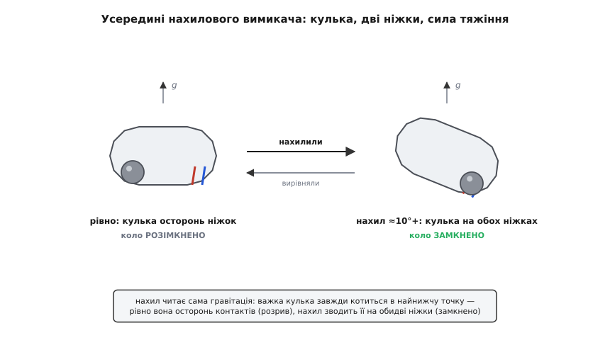
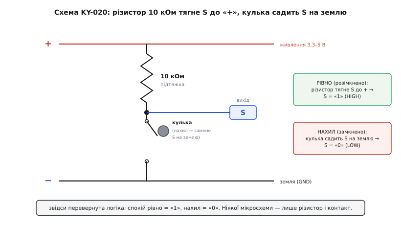
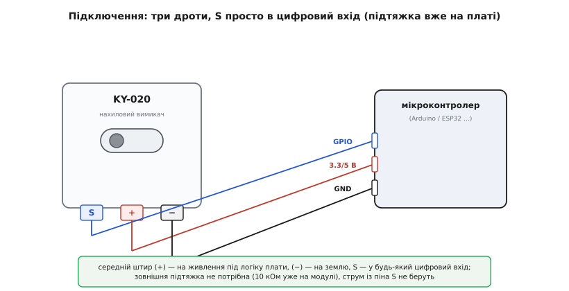
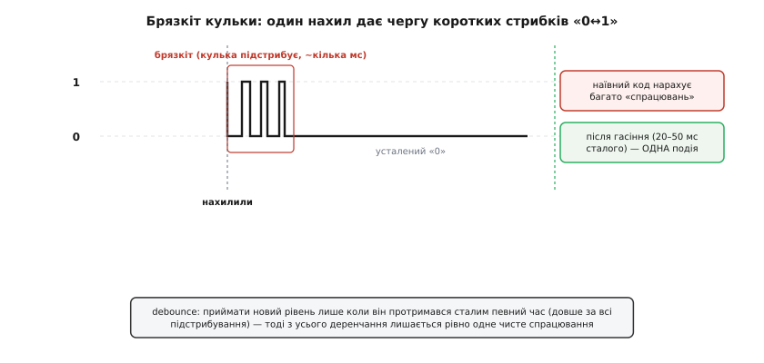

# KY-020 — давач нахилу

<preknowlist>
- [SW-520D — давач нахилу/вібрації](root:cat-hw-sensors/sw-520d) — будова герметичної капсули з металевою кулькою та принцип замикання контактів під дією гравітації.
</preknowlist>

## Двійковий вимикач нахилу замість вимірювача

Автоматичне вимикання обігрівача при падінні чи фіксація перекидання робота не вимагають знання точного кута в просторі. Використання триосьового акселерометра (від лат. *accelero* — прискорювати та грец. *metron* — міра; англ. @@en|accelerometer@@) у таких задачах надлишкове: він потребує складного цифрового шинного інтерфейсу та постійних обчислень. Модуль @@en|KY-020@@ вирішує цю проблему як механічний вимикач нахилу (англ. @@en|tilt switch@@). Він віддає спрощений двійковий сигнал: пристрій стоїть рівно чи похилився. Замикання відбувається однонапрямлено при нахилі понад 10° у бік виводів, тому модуль не здатний визначити вектор чи величину кута. На відміну від динамічного [давача вібрації](root:cat-hw-sensors/ky-002-vibration), який реагує на короткі удари, @@en|KY-020@@ фіксує саме стаціонарну зміну просторової орієнтації.

## Будова капсули SW-520D та гравітація

Основою модуля є [герметична капсула SW-520D](root:cat-hw-sensors/sw-520d) (від лат. *capsula* — скринька; англ. @@en|capsule@@), усередині якої розміщено дві контактні ніжки та дві вільні металеві кульки (англ. @@en|metallic balls@@).

*Будова капсули SW-520D: у горизонтальному стані кулька лежить осторонь, а при нахилі понад 10° скочується й замикає контакти.*

У горизонтальному положенні плати сила тяжіння утримує кульку на дні циліндра подалі від електродів, і електричне коло залишається розімкненим. Коли корпус похиляється на кут понад 10°, металеві кульки під дією гравітації скочуються до вихідних виводів, перекривають їх своїми тілами і замикають контакти. Повернення пристрою в горизонтальне положення змушує кульку скотитися назад, відновлюючи розрив кола. Цей механізм працює суто на фізичній механіці без жодних активних електронних компонентів.

## Підтяжка 10 кОм та інверсована логіка

Пряме підключення механічного контакту до цифрового входу мікроконтролера створювало б плаваючий стан при розімкненому колі. Щоб вихід мав чіткий електричний потенціал, на платі @@en|KY-020@@ встановлено резистор підтяжки (англ. @@en|pull-up resistor@@) номіналом 10 кОм.

*Принципова схема KY-020: резистор 10 кОм тримає високий рівень у спокої та захищає лінію від короткого замикання.*

Коли модуль лежить горизонтально і контакти розімкнені, резистор підтягує сигнальну лінію `S` до напруги живлення, формуючи високий логічний рівень (`1`). Під час нахилу металеві кульки замикають вивід `S` на спільний провід `GND`, опускаючи сигнал до нуля (`0`). Це створює інвертовану логіку (від лат. *inversio* — перевертання; англ. @@en|inverted logic@@), де спокій відповідає одиниці, а спрацювання — нулю.

*Схема підключення модуля KY-020 до плат з логікою 3.3 В або 5 В.*

Для підключення модуль має три виводи: `−` під'єднують до `GND`, `+` — до лінії живлення 3.3 В або 5 В відповідно до логіки контролера, а `S` — до цифрового входу.

## Брязкіт кульки та часова витримка

Металева кулька під час скочування не зупиняється миттєво, а підстрибує на контактах. Це явище викликає брязкіт контактів (англ. @@en|contact bounce@@), через який сигнальний вихід швидко перемикається між нулем та одиницею протягом кількох мілісекунд.

*Контактний брязкіт: фізичне підстрибування кульки створює серію хибних переключень на виході.*

Мікроконтролер сприймає ці швидкі сплески як серію окремих нахилів. Для отримання одного чистого сигналу застосовують програмну часову витримку (англ. @@en|debouncing delay@@) тривалістю 20–50 мілісекунд: після першої зміни стану програма ігнорує подальші коливання, поки кульки не заспокояться. Завдяки такій обробці @@en|KY-020@@ надійно працює в системах захисту від перекидання приладів, розпізнаванні жестів струшування та датчиках відкриття кришки.
