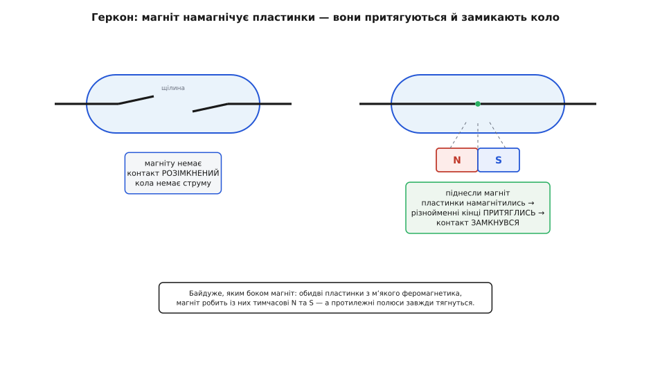
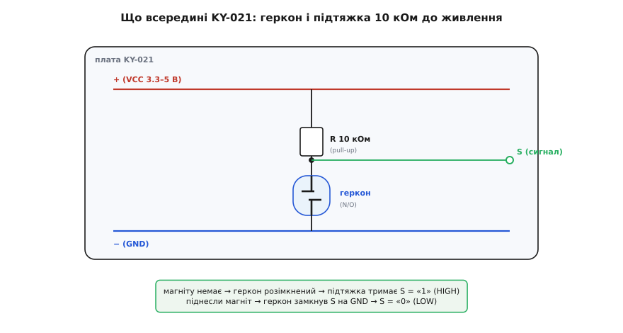
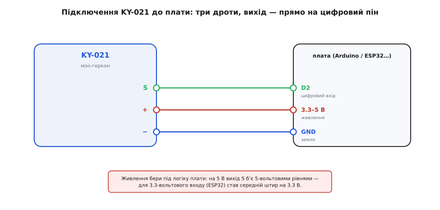

# KY-021 — міні герконовий давач

<preknowlist>
- [KY-003 / KY-024 — давач Голла](root:cat-hw-sensors/ky-003-hall) — відмінності напівпровідникових давачів від механічного геркона
- [KY-025 — геркон у скляній колбі](root:cat-hw-sensors/ky-025-reed) — порівняльні особливості герконових модулів зі старшої серії
</preknowlist>

## Принцип роботи герконового контакту

В автономних пристроях виявлення наближення магніту має відбуватися без постійних витрат енергії живлення. Цю задачу вирішує @@uk|геркон@@ (скорочення від *герметичний контакт*). Усередині герметичної скляної колби з інертним газом розміщено два гнучкі феромагнітні язички. З появою зовнішнього магнітного поля магнітні лінії проходять крізь язички й намагнічують їх протилежними полюсами на перекритих кінцях. Різнойменні магнітні полюси притягуються, тому язички вигинаються, з'єднуються й замикають електричне коло.

Оскільки магнітна індукція намагнічує обидва контакти одночасно, геркон замикається за будь-якої орієнтації північного чи південного полюса магніту. Коли магніт відводять, поле зникає, язички розмагнічуються й під дією власної пружності повертаються у початковий стан, розмикаючи коло.

За відсутності магніту струм через давач взагалі не тече, що забезпечує нульове споживання в спокої. Це дає механічному геркону ключову перевагу перед @@en|давач Голла@@ (названий на честь фізика Едвіна Голла, англ. *Hall*): на відміну від [напівпровідникових давачів Голла](root:cat-hw-sensors/ky-003-hall), які потребують постійного живлення кристала, геркон не витрачає енергію батареї в режимі очікування.

*Магнітне поле намагнічує контакти протилежними полюсами, що викликає їхнє взаємне притягання та замикання кола.*

## Схемотехніка модуля та інверсна логіка

Якщо геркон просто замикає дві лінії, пряме підключення до цифрового входу мікроконтролера залишить його в невизначеному стані під час розмикання. Вхід із високим імпедансом збирає наводки й довільно змінює логічний рівень.

Модуль @@en|KY-021@@ усуває це за допомогою схемної обв'язки. На платі розпаяно @@en|підтягувальний резистор@@ (англ. *pull-up resistor*, від *pull* — тягти, *up* — вгору) номіналом 10 кОм між сигнальним виводом і лінією живлення. За відсутності магніту геркон розімкнений, і резистор тримає на сигнальному виході високий логічний рівень @@en|HIGH@@. Оскільки на платі @@en|KY-021@@ немає компаратора, як у [повнорозмірних герконових модулях](root:cat-hw-sensors/ky-025-reed), схема залишається максимально простою.

Піднесення магніту замикає контакти геркона й з'єднує сигнальну лінію із землею. Оскільки опір замкнених язичків близький до нуля, струм стікає в землю, а напруга на виході падає до нуля, формуючи низький логічний рівень @@en|LOW@@.

Утворюється @@en|інверсна логіка@@ (лат. *inversio* — перевертання): виявлення магніту відповідає рівню @@en|LOW@@, а спокій — @@en|HIGH@@. Вбудований резистор дозволяє підключати модуль без зовнішніх підтяжок.

*Підтягувальний резистор тримає вихідний рівень HIGH, поки замикання геркона не з'єднає сигнальну лінію з землею.*

## Підключення до плати та брязкіт

Модуль @@en|KY-021@@ підключають до мікроконтролера через трипінову гребінку: GND — до спільної землі, VCC — до живлення 3.3 В або 5 В, а сигнальний вивід S — до цифрового входу. Напруга живлення VCC має відповідати логічному рівню входу плати, оскільки у спокої на виході присутня саме напруга VCC.

Під час зчитування стану через функцію @@en|digitalRead@@ виявляється особливість механічних контактів — @@en|брязкіт контактів@@ (англ. *contact bounce* — відскок). У момент замикання пружні язички геркона кілька разів відскочують протягом кількох мілісекунд, викликаючи серію швидких переключень між @@en|HIGH@@ та @@en|LOW@@. Для підрахунку подій це призводить до хибних спрацьовувань, тому в коді застосовують [програмне пригнічення брязкоту](root:hw-digital/contact-debounce), ігноруючи повторні імпульси впродовж короткого інтервалу.

*Сигнальний вивід модуля підключається до цифрового входу плати із дотриманням узгодження логічних рівнів.*

:::tabs
@tab Arduino (C++)
:::code ky-021-reed/cpp/arduino/setup.cpp
@tab ESP-IDF (C)
:::code ky-021-reed/c/esp-idf/app-main.c
:::
