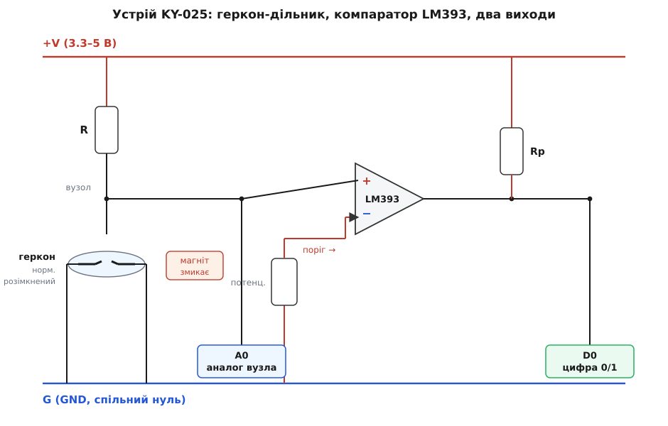
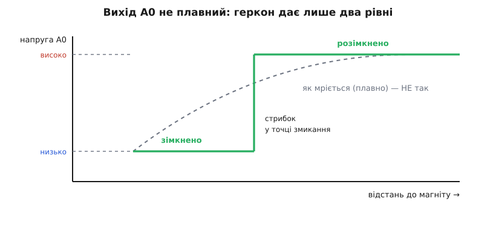
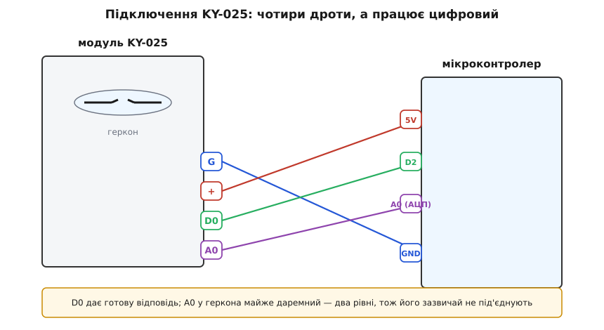

# KY-025 — геркон у скляній колбі

<preknowlist>
- [KY-021 — міні герконовий давач](root:cat-hw-sensors/ky-021-reed) — Принцип роботи базового герконового контакту з підтяжкою та його відмінності від модуля з компаратором
- [KY-003 / KY-024 — давач Голла](root:cat-hw-sensors/ky-003-hall) — Відмінності між напівпровідниковими давачами Холла та механічним герконовим перемикачем
</preknowlist>

## Фізика геркона та безконтактне змикання

У промислових та побутових приладах звичайні механічні кнопки швидко стають непридатними через знос та окиснення контактів у вологому чи пиловому середовищі. Вирішенням є безконтактне перемикання за допомогою магнітного поля.

Усередині скляної колби геркона (скорочення від *герметичний контакт*) @@ukr|геркон@@, заповненої інертним газом, розташовані два гнучкі язички з феромагнітного сплаву із зазором у частки міліметра. Під дією зовнішнього магнітного поля язички намагнічуються протилежними полюсами, притягуються й замикають коло.

*Модуль KY-025 поєднує скляний геркон та електронну обв'язку для формування чистих сигналів.*

@@ukr|Геркон@@ є суто двійковим перемикачем без проміжних станів: він замкнеться при перевищенні порога поля та розімкнеться після його зникнення. Повна герметичність контакту робить @@en|KY-025@@ надійним для побудови [датчиків зачинення дверей](root:cat-hw-sensors/ky-021-reed) чи лічильників.

## Схемотехніка модуля та компаратор LM393

Модуль @@en|KY-025@@ містить дільник напруги на @@ukr|герконі@@ та мікросхему компаратора (лат. *comparare* — порівнювати) @@la|компаратор@@ @@en|LM393@@. Змінний потенціометр (лат. *potentia* — сила, грец. *metron* — вимір) @@la|потенціометр@@ задає опорну напругу для порівняння зі станом дільника.

Оскільки @@ukr|геркон@@ є механічним ключем, його опір змінюється миттєво від нескінченності до нуля. Через це аналоговий вихід `A0` видає не плавну зміну, а стрибок напруги.

*Вихід A0 змінює рівень напруги стрибкоподібно через бінарну природу контакту геркона.*

Цифровий вихід `D0` працює через каскад із відкритим колектором (англ. *open collector*) @@en|відкритий колектор@@ та підтягувальним резистором (англ. *pull-up resistor*) @@en|підтягувальний резистор@@. Коли @@ukr|геркон@@ замкнено, @@la|компаратор@@ @@en|LM393@@ формує чіткий логічний рівень без плаваючих станів.

## Підключення модуля та обробка брязкоту

Плату модуля підключають через чотирипінову гребінку: вивід `G` — до землі `GND`, `+` — до живлення `VCC` (3.3–5 В), а `D0` — до цифрового входу мікроконтролера. Вихід `A0` підключають до аналогового входу за потреби фіксації стрибка.

На деяких платах-клонах можлива інверсія активного рівня: вихід `D0` видає низький рівень замість високого при змиканні. Активний стан перевіряють тестером або зчитуванням сигналу в коді.

*Вивід D0 підключають до цифрового порту мікроконтролера для фіксації подій наближення магніту.*

Під час змикання пружних язичків виникає брязкіт контактів (англ. *contact bounce*) @@en|брязкіт контактів@@ — серія швидких розмикань за перші мілісекунди. Для коректного зчитування через `digitalRead` застосовують програмну затримку чи таймер пригнічення деренчання.

## Налаштування порогу та типові помилки

Якщо вихід `D0` постійно залипає у високому чи низькому стані, @@la|потенціометр@@ повертають викруткою до моменту, коли світлодіод індикації спрацьовує саме при піднесенні магніту на потрібну відстань.

Дальність спрацьовування залежить від сили магніту та його орієнтації: максимальна чутливість досягається, коли магніт розташований паралельно осі скляної колби. Якщо магніт повернутий перпендикулярно, язички можуть не намагнітитися.

Через бінарну природу @@ukr|геркон@@ непридатний для вимірювання напруженості поля — для плавної величини використовують [напівпровідникові давачі Холла](root:cat-hw-sensors/ky-003-hall). Хибні спрацьовування @@en|KY-025@@ у проєктах зазвичай спричинені зовнішніми магнітними завадами або поганим контактом у гребінці.
