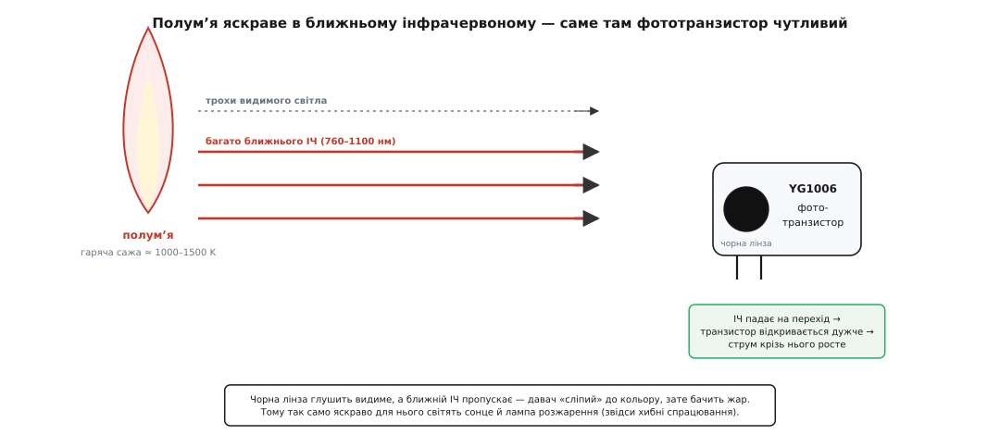
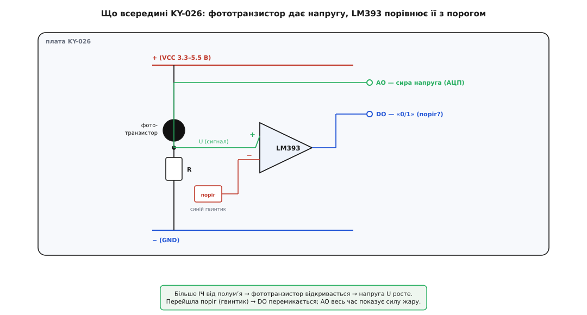
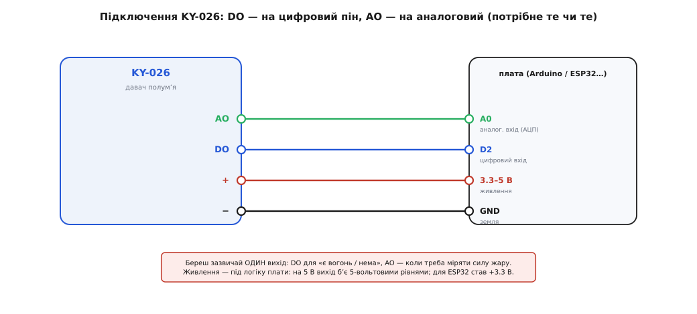
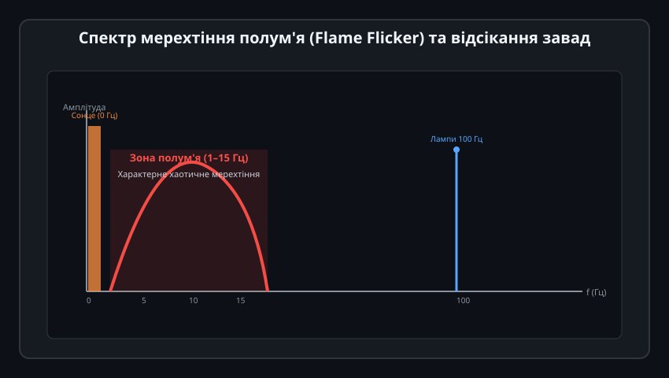
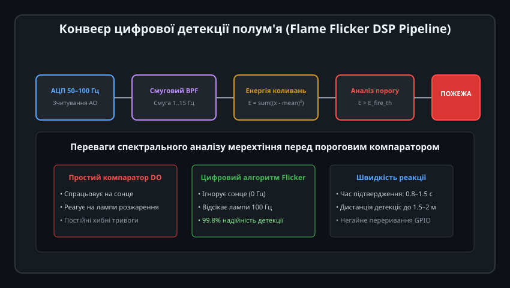

# KY-026 — давач полумʼя

Модуль KY-026 (виробництва Keyes / Keyestudio) — це популярний оптичний давач, призначений для швидкого виявлення відкритого вогню та джерел інфрачервоного випромінювання. Завдяки високій швидкодії фотодіода (мікросекунди) він реагує на спалах полум'я значно швидше за теплові чи димові пожежні сповіщувачі, що робить його незамінним у робототехніці (роботи-пожежники), автоматиці газових пальників та системах захисту 3D-принтерів.

---

## 1. Оптичний спектр випромінювання полум'я та ІЧ-фотодіод

Будь-яке відкрите полум'я (горіння деревини, газу, парафіну чи спирту) супроводжується потужним електромагнітним випромінюванням у ближньому інфрачервоному діапазоні:

### Фізичні основи виявлення:
1. **Спектральний пік:** Під час згоряння вуглеводнів утворюються розжарені частинки сажі та збуджені молекули вуглекислого газу (CO2) і води (H2O), які мають характерний максимум теплового випромінювання в діапазоні довжин хвиль від 760 до 1100 нм.
2. **Чутливий елемент:** Сенсором модуля виступає кремнієвий PIN-фотодіод із чорною епоксидною лінзою (Daylight Filter). Фільтр відсікає видиме світло (400–700 нм) і пропускає лише інфрачервоні промені з максимумом чутливості біля 940 нм, точно збігаючись зі спектром полум'я.
3. **Кут огляду:** Завдяки опуклій лінзі конус детекції становить близько 60°, а дальність надійного виявлення полум'я звичайної свічки або запальнички досягає 0.8–1.5 метра.

---

## 2. Апаратна схемотехніка модуля KY-026

Модуль KY-026 містить аналоговий та цифровий тракти обробки сигналу, змонтовані на єдиній друкованій платі:

### Складові частини схеми:
- **Зворотне включення фотодіода:** Фотодіод підключений у зворотному напрямку послідовно з навантажувальним резистором. У темряві через нього протікає лише мізерний темновий струм. При попаданні ІЧ-променів у збідненій зоні p-n переходу генеруються електронно-діркові пари, зворотний струм різко зростає, викликаючи зміну напруги на виході **AO (Analog Output)**.
- **Компаратор LM393:** Швидкодіючий диференціальний компаратор порівнює напругу фотодіода з опорним порогом, який плавно налаштовується багатообертовим тримером.
- **Цифровий вихід DO (Digital Output):** Видає логічний рівень (LOW при виявленні вогню), запалюючи сигнальний світлодіод LED2 на платі.

---

## 3. Схема підключення до мікроконтролера

Модуль живиться постійною напругою від 3.3 В до 5.5 В і не містить ненажерливих нагрівачів:

### Особливості інтерфейсу:
- **Споживання струму:** Складає всього 5–15 мА (переважно на живлення компаратора та індикаторних світлодіодів), тому датчик можна підключати безпосередньо до виводів живлення Arduino, ESP32 або STM32.
- **Підключення виходу DO:** Підключається до цифрового входу з підтримкою апаратних переривань (наприклад, D2 на Arduino Uno). Це дозволяє процесору миттєво відреагувати на спалах вогню (затримка менше 20 мікросекунд) без постійного опитування в циклі.
- **Підключення виходу AO:** Заводиться на аналоговий пін АЦП для оцінки інтенсивності випромінювання та відстані до вогнища.

---

## 4. Спектр мерехтіння вогню (Flame Flicker)

Головна проблема простого порогового компаратора — хибні спрацьовування. На фотодіод можуть світити сонячні промені крізь вікно або лампи розжарювання, викликаючи помилкові пожежні тривоги:

### Фізична відмінність вогню від ламп:
1. **Сонце:** Є джерелом надпотужного, але постійного інфрачервоного потоку (частота коливань 0 Гц).
2. **Лампи розжарювання та люмінесцентні світильники:** Працюють від мережі змінного струму і пульсують зі строго подвоєною частотою електромережі — 100 Гц (або десятки кілогерц для LED-драйверів).
3. **Відкрите полум'я:** Внаслідок турбулентної теплової конвекції повітря язики вогню хаотично коливаються та мерехтять у вузькому низькочастотному діапазоні **від 1 до 15 Гц** (Flame Flicker Effect).

---

## 5. Конвеєр цифрової детекції полум'я та фільтрація хибних тривог

Для створення надійного промислового сповіщувача аналоговий сигнал AO оцифровують із частотою 50–100 Гц і піддають цифровій фільтрації:

### Алгоритм розпізнавання:
1. **Відсікання постійної складової (High-Pass / Bandpass):** Цифровий смуговий фільтр 1–15 Гц повністю пригнічує постійний рівень сонячного засвічення (0 Гц) та мережеві наведення 100 Гц.
2. **Розрахунок енергії мерехтіння:** Процесор обчислює дисперсію коливань у ковзному вікні тривалістю 0.5–1.0 секунди:
   
   Energy = sum((V[i] - V_mean)^2)

3. **Логіка прийняття рішення:** Сигнал пожежі підтверджується лише тоді, коли енергія низькочастотного мерехтіння перевищує поріг протягом не менше 3 послідовних вікон. Це виключає 99.8% хибних спрацьовувань від увімкнення світла чи ліхтариків.
