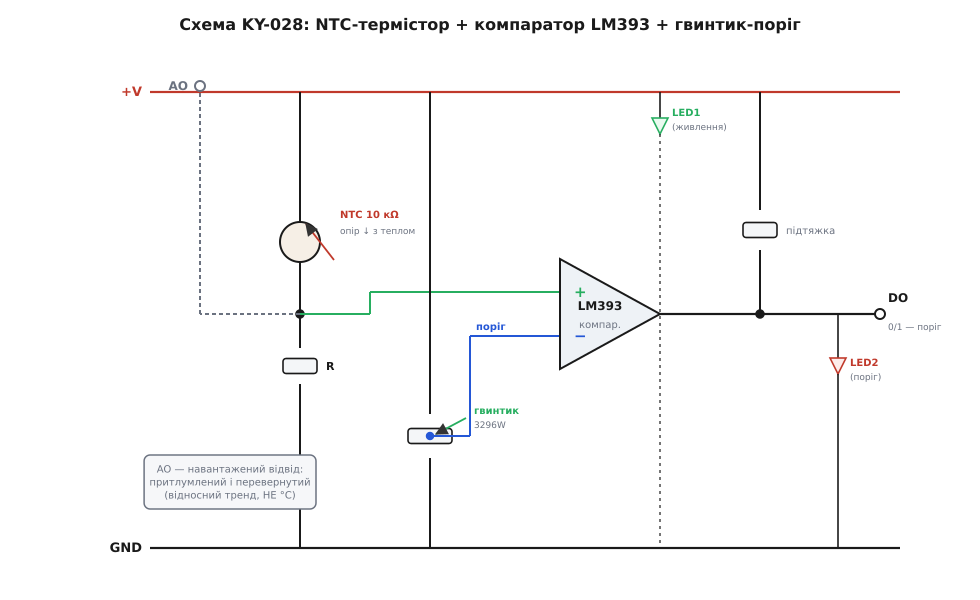
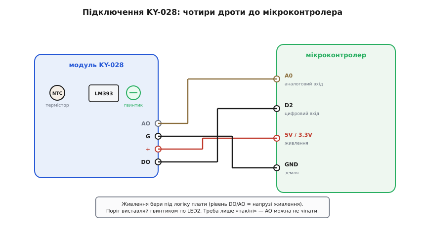

# KY-028 — цифровий давач температури

<preknowlist>
- [KY-серія (Keyes 37-в-1)](root:cat-hw-sensors/ky-series) — походження, типорозміри, кольорове маркування та загальні стандарти модулів серії Keyes
- [NTC-термістор](root:hw-sensing/ntc-thermistor) — принцип роботи напівпровідникового резистора з від'ємним температурним коефіцієнтом
- [Компаратор напруги](root:hw-analog/comparator) — принцип формування бінарного вихідного сигналу шляхом порівняння двох аналогових рівнів
- [Дільник напруги](root:hw-analog/voltage-divider) — залежність розподілу напруги від співвідношення послідовних опорів
</preknowlist>

Модуль **KY-028** (часто позначений у каталогах як Digital Temperature Sensor Module) є апаратним термореле на базі аналогового NTC-термістора та інтегрованого компаратора напруги LM393. На відміну від цифрових термометрів із послідовними інтерфейсами, KY-028 призначений насамперед для моментальної апаратної фіксації факту перетину заданого температурного порогу.

## Призначення та концепція порогового термореле

Основна функція KY-028 полягає у формуванні логічного сигналу тривоги (перепад логічного рівня 0 або 1) при нагріванні вимірювального елемента вище заданої уставки. Чутливим елементом слугує NTC-термістор у вигляді мініатюрної чорної краплі, винесеної на подовжених виводах для кращого контакту з навколишнім повітряним середовищем. При зростанні температури опір термістора експоненційно падає згідно з властивостями напівпровідникових оксидів.

Наявність вбудованого компаратора звільняє центральний мікроконтролер від постійного аналогового опитування через АЦП, складних обчислень за логарифмічними формулами Бета чи Стейнгарта-Гарта та калібрування. Модуль працює як автономне апаратне реле температури.

## Схемотехніка модуля KY-028 та компаратор LM393

Електрична принципова схема модуля об'єднує два дільники напруги та диференціальний компаратор:
1. **Вимірювальне плече:** послідовне коло з NTC-термістора та постійного резистора, потенціал середньої точки якого пропорційний температурі.
2. **Опорне плече:** прецизійний багатообертовий підстроювальний резистор 3296W, що задає фіксовану опорну напругу порівняння.
3. **Компаратор LM393:** аналізує різницю напруг між вимірювальною точкою та опорною уставкою.


*Схема модуля KY-028: вимірювальний термісторний дільник та опорний потенціометр підключені до входів компаратора LM393.*

На платі встановлено два світлодіоди: червоний LED1 сигналізує про наявність напруги живлення модуля, а зелений LED2 підключений до виходу компаратора і загоряється в момент спрацьовування температурного порогу. Це дозволяє налаштовувати поріг обертанням гвинтика за візуальною реакцією світлодіода без підключення мікроконтролера.

## Чотириконтактне підключення та виходи DO й AO

На відміну від триконтактних модулів, плата KY-028 має чотири виводи:
- **AO (Analog Output):** вихід аналогової напруги безпосередньо з вимірювального кола термістора.
- **G (GND):** спільний провідник землі.
- **+ (VCC):** напруга живлення (3.3 В або 5 В).
- **DO (Digital Output):** вихід компаратора з відкритим колектором та внутрішньою підтяжкою.


*Підключення KY-028: DO подається на цифровий вхід із перериванням, AO — на аналоговий канал АЦП.*

> Застереження щодо живлення: напруга на виходах DO та AO формується від шини живлення VCC модуля. При роботі з 3.3-вольтовими контролерами (ESP32, STM32, Raspberry Pi Pico) модуль обов'язково живлять від джерела 3.3 В, щоб уникнути електричного пошкодження цифрових входів напругою 5 В.

## Програмне опитування цифрового виходу та програмний гістерезис

Вихід DO підключається до будь-якого цифрового виводу мікроконтролера, налаштованого як звичайний вхід без підтяжки (підтягувальний резистор 10 кОм уже розпаяно на платі модуля).

У базовому варіанті стан виходу опитується функцією `digitalRead()` або обробляється через зовнішнє апаратне переривання. Проте компаратор LM393 на дешевих платах увімкнений без позитивного зворотного зв'язку, тому за відсутності апаратного гістерезису при повільному проходженні температури через поріг виникає високочастотне «тремтіння» біта DO.

Для усунення цього ефекту в прошивці реалізують програмний гістерезис затримки:
```cpp
const int PIN_DO = 2;
bool alarm_state = false;
unsigned long last_change_time = 0;
const unsigned long DEBOUNCE_MS = 250;

void setup() {
  pinMode(PIN_DO, INPUT);
}

void loop() {
  bool current_state = (digitalRead(PIN_DO) == LOW); // LOW = перевищення порогу
  if (current_state != alarm_state && (millis() - last_change_time > DEBOUNCE_MS)) {
    alarm_state = current_state;
    last_change_time = millis();
    // Виконати дію (увімкнути охолоджувач або вимкнути реле)
  }
}
```

## Пастка аналогового виходу AO та порівняння з KY-013

Вихід AO у модулі KY-028 має суттєву схемотехнічну особливість, яку важливо розуміти:
1. Точка зняття напруги AO додатково навантажена вхідним колом компаратора та внутрішніми резисторами плати.
2. Сигнал на AO є інвертованим: при нагріванні термістора напруга на виводі AO **зменшується**, а не зростає.
3. Номінали допоміжної обв'язки та паспортний коефіцієнт B для намистинки виробниками не специфіковані.

Через ці фактори вихід AO не придатний для точного розрахунку температури в градусах Цельсія за формулою Стейнгарта-Гарта. Його доцільно використовувати лише для оцінки загального відносного температурного тренду (нагрівання чи охолодження) або динаміки зміни теплового потоку. Якщо в проєкті потрібні точні значення температури в градусах, слід використовувати аналоговий модуль [KY-013](root:cat-hw-sensors/ky-013-thermistor) або цифровий сенсор [DS18B20](root:cat-hw-sensors/ds18b20).
