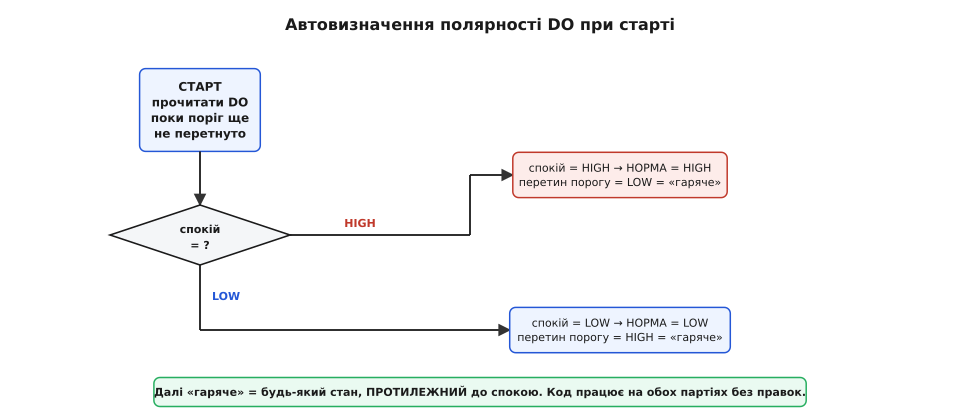
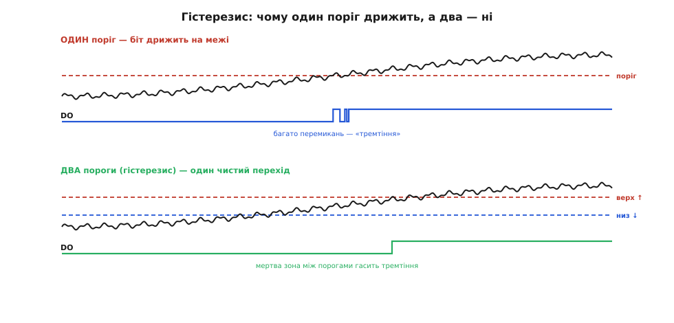

# ⚙️ KY-028 у коді: термостат, що сам знаходить свою полярність і не дрижить

<preknowlist>
- [NTC-термістор](root:hw-sensing/ntc-thermistor) — резистор, опір якого падає з нагріванням; це те, що всередині модуля відчуває тепло.
- [Компаратор](root:hw-analog/comparator) — схема «більше/менше за поріг» одним бітом; вихід DO модуля — це її рішення.
- [Рівні «0» і «1»](root:hw-digital/logic-levels-as-ranges) — логічні високо/низько як діапазони напруги; від цього залежить, як прочитати DO.
- [АЦП](root:hw-analog/adc) — перетворення напруги на число; потрібне лише для читання AO як тренду.
- [GPIO](root:hw-digital/gpio) — вивід загального призначення; DO читаємо як цифровий вхід (`pinMode(INPUT)` + `digitalRead`), тим самим прийомом, що й кнопку.
</preknowlist>

Написати прошивку під KY-028 здавалося б неважко: читай ногу, дивись біт. Але щойно ти хочеш зробити це **надійно** — так, щоб той самий скетч запрацював на будь-якій платі KY-028, куплений сьогодні чи через рік, підключений до Arduino Uno чи до ESP32, — вилазять три несподіванки, і кожна ламає наївний код. По-перше, полярність цифрового виходу на різних партіях **протилежна**: на одній платі спокій — це «1», на іншій — «0», і код, зашитий під один варіант, на другому спрацьовує навпаки. По-друге, на самій межі порогу біт **дрижить**: температура зависає рівно на точці спрацювання, найменший шум перекидає компаратор туди-сюди, і твій вентилятор клацає реле десять разів на секунду. По-третє, аналоговий вихід AO спокушає «дати градуси», але дати їх **не може** — і код, який пробує, бреше числами.

Ця вставка — про те, як обійти всі три пастки одним акуратним скетчем. Ми збудуємо термостат, який на старті **сам визначає**, у який бік дивиться його DO, глушить тремтіння **програмним гістерезисом** (двома порогами замість одного) і використовує AO чесно — лише як напрям і швидкість зміни, не як температуру. Код буде справжній і компільований: кожен приклад дано вкладками — під Arduino, під ESP-IDF і під STM32 HAL, — а окремо розібрано ESP32, де додаються свої тонкощі з АЦП і напругою логіки. Кожен рядок — з поясненням, чому він саме такий, бо диявол тут увесь у дрібницях.

## Задача

Сформулюймо чітко, що будуємо. Є модуль KY-028: намистина-[термістор](root:hw-sensing/ntc-thermistor) відчуває тепло, [компаратор](root:hw-analog/comparator) LM393 порівнює температурну напругу з порогом, який виставлено гвинтиком на платі, і віддає результат одним бітом на вивід DO. Ще є AO — притлумлена й перевернута напруга з термістора. Наше завдання прошивки:

1. **Читати DO як порогове рішення** — «гаряче / не гаряче» — незалежно від того, якої полярності конкретна плата.
2. **Не смикати виконавчий пристрій** (вентилятор, нагрівач, сигнал), коли температура застрягла на межі порогу: перемикати чисто, один раз угору й один раз униз, а не тремтіти.
3. **За бажання — стежити за трендом через AO**: бачити, куди й наскільки різко хитнулася температура, не претендуючи на градуси.
4. Працювати **однаково** на 5-вольтовій платі (Arduino Uno) і на 3.3-вольтовій (ESP32, STM32), не спаливши вхід останньої.

Кожна з цих вимог народжена реальною поведінкою модуля, і кожну треба закрити в коді свідомо. Розберімо їх по черзі — спершу ідею, тоді код.

## Ідея

Три пастки — три прийоми, і всі три прості, коли зрозумів причину.

**Полярність визначаємо на старті.** Корінь проблеми — у тому, що вихід LM393 [відкритий колектор](root:hw-digital/open-drain-bus-pullup-sizing) (англ. *open collector*): мікросхема вміє лише **притягувати** вивід до землі, а «1» на ньому тримає зовнішня підтяжка. Який стан буде «спокоєм», а який «спрацюванням», залежить від того, на який вхід компаратора (прямий чи інверсний) розвели термістор, а на який — гвинтик; на різних партіях це розведено по-різному, тому й полярність гуляє. Замість вгадувати, ми зробимо хитро: **при увімкненні, поки поріг завідомо ще не перетнуто** (модуль щойно ввімкнувся, температура кімнатна, а поріг зазвичай виставляють вище), прочитаємо DO і оголосимо цей стан «нормою». Тоді «гаряче» — це просто **протилежний** до виміряного спокою рівень, хай там «0» він чи «1». Код перестає залежати від партії: він підлаштовується під ту плату, що перед ним.

*При увімкненні модуль читає DO, поки поріг ще не перетнуто, і запам'ятовує цей рівень як «спокій». Далі «гаряче» = будь-який стан, протилежний до спокою. На партії, де спокій = HIGH, спрацюванням стає LOW; де спокій = LOW — навпаки. Один скетч працює на обох без правок у коді.*

Тут є чесне застереження, і його треба знати: прийом працює, **якщо на старті модуль справді в спокої**. Якщо ти ввімкнув пристрій уже в спекотній кімнаті або торкаючись намистини пальцем, «спокій» виміряється неправильно, і полярність визначиться навпаки. Тому правило: **вмикай у нормальних умовах** (нижче порогу), або дай користувачу кнопку «перекалібрувати». Для термостата, що стежить за перегрівом, стартова кімнатна температура — типова, і прийом надійний. Для випадків, де на старті може бути «гаряче», полярність доведеться задати вручну константою — і ми залишимо для цього гачок.

**Тремтіння глушимо гістерезисом.** LM393 у цих модулях увімкнено **без петлі позитивного зворотного зв'язку**, тож власного гістерезису він майже не має — поріг угору й поріг униз у нього збігаються в одну точку. Через це, коли температура завмерла рівно на порозі, теплові й електричні флуктуації по кілька мілівольтів перекидають вихід туди-сюди. Апаратно це лікується резистором зворотного зв'язку на платі, але його там немає й припаяти його ми не можемо (не наша плата). Зате те саме легко зробити **в коді**: тримати не один поріг, а **два** — верхній і нижній. Стан стає «гаряче», лише коли сигнал піднявся **вище верхнього**; повертається в «норму», лише коли впав **нижче нижнього**. Між ними — «мертва зона», у якій стан **не міняється**. Дрібний шум гуляє в цій зоні й нікого не турбує.

*Угорі — один поріг: коли температурний сигнал повзе через нього з дрібним шумом, DO перемикається багато разів («тремтіння»). Унизу — два пороги: стан стає «гаряче» лише вище верхнього й повертається в норму лише нижче нижнього; шум гуляє в мертвій зоні між ними, і DO дає один чистий перехід замість пачки.*

Тонкість: сам біт DO — уже цифровий, у ньому «мілівольтів» нема, є тільки «0» чи «1». То над **чим** робити гістерезис? Над двома різними джерелами, і обидва варіанти корисні. Якщо покладаємося на апаратний поріг гвинтика (читаємо DO), гістерезис виходить **часовий**: після зміни біта ми на короткий час **забороняємо наступну зміну** — даємо сигналу вийти з зони невизначеності, перш ніж знову слухати. Якщо ж читаємо AO самі (аналогово), гістерезис виходить **справжній, за напругою**: два числові пороги на сирому показі АЦП. Перший спосіб простіший і не вимагає AO; другий точніший, бо межу задаємо ми, а не гвинтик. Покажемо обидва.

**AO читаємо лише як тренд.** Тут ідея коротка: [аналоговий вихід KY-028 понівечений навантаженням](root:cat-hw-sensors/ky-028-temp) — сигнал перевернутий (гарячіше → менше вольтів) і стиснутий, а Beta-стала намистини виробником не публікується, тож у градуси його не перевести. Але **напрям** і **швидкість** зміни він передає чесно: якщо число на AO падає — теплішає; падає різко — теплішає швидко. На цьому й будуємо: читаємо АЦП, **інвертуємо знак** (щоб «більше = тепліше» було інтуїтивним), згладжуємо дрібний шум і дивимося на **різницю** між сусідніми замірами як на швидкість. Жодного `map()` у °C — це була б брехня.

Тепер — код. Від мікроконтролера всі три прийоми вимагають зовсім небагато: один цифровий вхід без внутрішньої підтяжки, один цифровий вихід, вільний лічильник мілісекунд і — для двох останніх кроків — канал АЦП. Це є на будь-якій платформі, тож кожен приклад даємо трьома вкладками: Arduino, ESP-IDF, STM32 HAL. Починаємо з Arduino, бо там запис найкоротший і механіка видніша.

## Крок 1: читати DO як кнопку

Найпростіше, з чого варто почати, — переконатися, що ми взагалі правильно читаємо біт. DO — це логічний вхід, читається як звичайна кнопка: налаштувати [вивід](root:hw-digital/gpio) на вхід і питати його рівень (`pinMode(INPUT)` + `digitalRead` в Arduino, `gpio_config` з `GPIO_MODE_INPUT` + `gpio_get_level` в ESP-IDF, ніжка в режимі `GPIO_Input` + `HAL_GPIO_ReadPin` у STM32). Підтяжка на DO вже стоїть на модулі (той самий відкритий колектор), тож внутрішню підтяжку мікроконтролера вмикати **не треба** — беремо вхід без підтяжки: `INPUT` замість `INPUT_PULLUP`, `GPIO_PULLUP_DISABLE`, `GPIO_NOPULL`.

**Умова.** DO модуля під'єднано до звичайного цифрового виводу (в Arduino-прикладі це D2, в ESP-IDF — GPIO32, у STM32 — ніжка `DO_Pin`). Треба у циклі читати біт і друкувати сирий рівень у монітор, щоб очима побачити, який стан у спокої, а який — коли гріємо намистину пальцем.

:::tabs
:::code proj-ky028-thermostat/c/arduino/krok-1-chytaty-do-iak.ino
:::code proj-ky028-thermostat/c/esp-idf/krok-1-chytaty-do-iak.c
:::code proj-ky028-thermostat/c/stm32/krok-1-chytaty-do-iak.c
:::

Запусти це, лиши намистину в спокої на кілька секунд — запиши, що друкується (скажімо, `HIGH`). Тоді піднеси палець, погрій намистину — рівень має **перекинутися** (на `LOW`), а гвинтиком можна довести поріг так, щоб він перемикався саме там, де тобі треба. Цей крихітний скетч — не іграшка, а **діагностика**: він показує тобі полярність **твоєї** плати наживо. Але вписувати цю полярність у код константою було б крихко (наступна плата — інша), тож зробімо, щоб код визначав її сам.

## Крок 2: автовизначення полярності на старті

Тепер головний прийом. У `setup()`, коли модуль щойно ввімкнено й температура ще нижча за поріг, читаємо DO і запам'ятовуємо цей рівень як `restLevel` — «спокій». Далі всюди в програмі «гаряче» означає «рівень **не** дорівнює `restLevel`».

Один нюанс робить це надійним: читати спокій варто **не одним пострілом**, а кількома замірами поспіль, і взяти найчастіший. Якщо перший-єдиний `digitalRead` випадково спіймає модуль у момент електричної завади, полярність визначиться навпаки на весь сеанс. Кілька замірів із голосуванням цю випадковість прибирають.

:::tabs
:::code proj-ky028-thermostat/c/arduino/krok-2-avtovyznachennia.ino
:::code proj-ky028-thermostat/c/esp-idf/krok-2-avtovyznachennia.c
:::code proj-ky028-thermostat/c/stm32/krok-2-avtovyznachennia.c
:::

Розберемо ключові місця.

**`readRestLevel()` з голосуванням.** П'ятнадцять замірів по 5 мс — це близько 75 мілісекунд, за які ми надійно ловимо усталений спокій, а не випадкову шпильку. Повертаємо `HIGH` або `LOW` — той рівень, що траплявся частіше. Це наш «нуль відліку».

**`restLevel` вимірюється один раз у стартовій ініціалізації — і саме тому важлива стартова умова.** (Це `setup()` в Arduino, початок `app_main()` в ESP-IDF, `main()` до головного циклу в STM32 — суть та сама: до першого робочого оберту.) Уся конструкція тримається на припущенні, що на момент увімкнення температура **нижча за поріг**. Для термостата проти перегріву це майже завжди так: вмикаєш пристрій у кімнаті, поріг виставлено на «гаряче». Якщо ж у твоєму сценарії на старті може бути жарко, познач це і задай полярність вручну — про це нижче, у пастках.

**`isHot()` — одне-єдине місце, де вирішується полярність.** Уся решта програми питає `isHot()` і не знає ні про `HIGH`, ні про `LOW`. Захотів перевернути логіку під якийсь особливий випадок — правиш **один** метод, не полюєш за `LOW`-ами по всьому коду. Ця дисципліна — «одне рішення в одному місці» — рятує від найпідступніших багів полярності.

Цей скетч уже полярність-незалежний. Але він ще дрижатиме на межі — додамо гістерезис.

## Крок 3: часовий гістерезис — глушимо тремтіння без AO

Коли ми покладаємося на апаратний поріг гвинтика (читаємо тільки DO), найпростіший гістерезис — **часовий**: щойно стан змінився, ми на короткий проміжок **не приймаємо** наступну зміну. Ідея така: перехід через поріг — момент, коли сигнал перебуває в зоні невизначеності й може кілька разів «клацнути»; ми пропускаємо цей неспокійний проміжок, зафіксувавши перший перехід, і слухаємо знову лише коли сигнал напевно вийшов з межі.

Реалізуємо без блокувальної паузи — на вільному лічильнику мілісекунд (`millis()` в Arduino, `esp_timer_get_time()` в ESP-IDF, `HAL_GetTick()` у STM32), щоб цикл лишався живим і міг робити інші справи (це важливо, бо в справжньому пристрої термостат не єдина турбота).

**Умова.** DO на цифровому вході, виконавчий вихід (реле/вентилятор, тут — світлодіод плати) на цифровому виході. Треба вмикати навантаження, коли «гаряче», вимикати, коли «норма», і **не смикати** його частіше ніж раз на, скажімо, 2 секунди — навіть якщо біт дрижить.

:::tabs
:::code proj-ky028-thermostat/c/arduino/krok-3-chasovyi-histerezys.ino
:::code proj-ky028-thermostat/c/esp-idf/krok-3-chasovyi-histerezys.c
:::code proj-ky028-thermostat/c/stm32/krok-3-chasovyi-histerezys.c
:::

Чому саме так.

**`LOCKOUT_MS` — карантин, а не пауза всієї програми.** Ми не спимо в `delay()` — ми лише **ігноруємо** зміни біта, доки з моменту останнього перемикання не минуло 2 секунди. Дрижання відбувається саме в перші частки секунди після перетину; за 2 секунди сигнал або впевнено «гарячий», або впевнено «холодний», і наступне перемикання буде справжнім. Виконавчий пристрій за цей час клацне **один** раз.

**`state` окремо від `rawHot()`.** `rawHot()` — це сира миттєва відповідь модуля, вона може дрижати. `state` — це наше **зважене** рішення, яке міняється лише коли карантин минув. Навантаженням керує `state`, не `rawHot()`. Розділення сирого входу й фільтрованого стану — той самий прийом, що з полярністю: одне чисте джерело правди для решти коду.

**Обмеження часового гістерезису чесно назвемо.** Якщо температура **справді** коливається навколо порогу повільно (наприклад, кімната то трохи тепліє, то холоне з періодом у хвилини), карантин у 2 секунди її не втримає — стан ітиме за температурою, як і має. Часовий гістерезис глушить **швидке** дрижання на межі, не повільні реальні коливання. Для останніх потрібен гістерезис **за рівнем** — а його дає лише читання AO, до якого й переходимо.

## Крок 4: гістерезис за рівнем через AO — коли гвинтик замало

Якщо хочеться, щоб поріг задавала **програма**, а не гвинтик, і щоб гістерезис був справжній (два різні рівні напруги, а не часовий трюк), — читаємо AO самі й порівнюємо з двома числовими порогами. Тут ми більше не залежимо від апаратного порогу компаратора взагалі: DO можна навіть не під'єднувати. Гвинтик у цьому режимі ролі не грає.

Пам'ятаємо головне про AO: [сигнал перевернутий](root:cat-hw-sensors/ky-028-temp) — гарячіше дає **менше** вольтів, тобто **менше** число з АЦП. Щоб думати в звичних термінах «більше = тепліше», одразу інвертуємо: `warm = FULL - сире`, де `FULL` — верх шкали АЦП (1023 на 10-бітному АЦП класичного Arduino, 4095 на 12-бітних АЦП ESP32 і STM32). Тепер `warm` росте з теплом, і два пороги читаються природно.

**Умова.** AO на аналоговому вході (Arduino — A0; ESP32 — GPIO34, канал ADC1; STM32 — канал, заведений у `hadc1`), навантаження на цифровому виході. Пороги задаємо в коді: вмикати навантаження, коли `warm` перетнув **верхній** поріг, вимикати — коли впав нижче **нижнього**. Між ними — мертва зона, у якій стан тримається. Числа порогів підбирають один раз під конкретну намистину й місце, спостерігаючи `warm` у моніторі.

:::tabs
:::code proj-ky028-thermostat/c/arduino/krok-4-histerezys-za.ino
:::code proj-ky028-thermostat/c/esp-idf/krok-4-histerezys-za.c
:::code proj-ky028-thermostat/c/stm32/krok-4-histerezys-za.c
:::

Що тут важить.

**Інверсія `1023 - analogRead` — не косметика, а суть.** Без неї пороги довелося б задавати «навпаки» (менше число — тепліше), і кожне порівняння читалося б проти інтуїції — джерело помилок. Інвертувавши раз, ми звели всю решту логіки до природного «більше = тепліше».

**Згладжувальна ланка `warmS += (warm - warmS) / 4`.** Це найпростіший цифровий фільтр нижніх частот: нове згладжене значення — це старе плюс чверть різниці до свіжого заміру. Він гасить дрібний шум АЦП (одиниці-двійки молодших розрядів), не даючи йому імітувати перетин порогу. Ділення на 4 — компроміс: сильніше згладжування (ділити на 8, 16) — плавніше, але повільніше реагує. Для теплового сигналу, який і сам змінюється неспішно, це саме те.

**Два пороги `WARM_ON` і `WARM_OFF` — це і є гістерезис за рівнем.** Зазор між ними (тут 40 одиниць) — ширина мертвої зони. Ширший зазор — надійніше проти дрижання, але грубіша реакція; вужчий — чутливіше, але ризик знову впіймати шум. Числа підбирають раз, дивлячись на друк `warm`: нагріваєш до бажаної точки спрацювання, записуєш `warm`, ставиш трохи нижче — `WARM_ON`; охолоджуєш до точки відпускання, ставиш трохи вище — `WARM_OFF`.

**AO тут — тренд, зведений у поріг, а не °C.** Ми жодного разу не назвали `warm` температурою в градусах. Це відносне число, прив'язане до конкретної намистини й місця; переніс модуль в інше середовище — пороги, можливо, доведеться підправити. Але для «увімкни, коли тепліше за оцю-от точку» цього досить, і воно чесне.

## Крок 5: AO як чистий тренд — напрям і швидкість

Іноді поріг не потрібен зовсім — потрібно **стежити за зміною**: тепліє чи холоне, і як швидко. AO для цього годиться саме тим, чим не годиться для градусів: він **чутливий до зміни**, хай і в перекручених одиницях. Витягнемо з нього напрям і швидкість, не претендуючи на абсолют.

:::tabs
:::code proj-ky028-thermostat/c/arduino/krok-5-ao-iak-chystyi.ino
:::code proj-ky028-thermostat/c/esp-idf/krok-5-ao-iak-chystyi.c
:::code proj-ky028-thermostat/c/stm32/krok-5-ao-iak-chystyi.c
:::

Тут `rate` — **різниця** згладженого «тепла» за пів секунди. Знак каже напрям (додатний — тепліє, від'ємний — холоне), величина — наскільки різко. Поріг `±2` навколо нуля прибирає дрібне тремтіння, щоб «стабільно» не миготіло. Числа `rate` — **відносні**: це не «градуси за секунду», а «одиниці АЦП за пів секунди на цій намистині». Але як індикатор «щось гріється — і швидко» це працює бездоганно й дешево.

> 🔧 **Навіщо це.** Тренд через AO — недооцінений режим KY-028. Для сигналізації «раптовий нагрів» (перегрів двигуна, коротке замикання, що гріє провід) абсолютна температура часто й не потрібна — важливий **різкий підйом**. KY-028 ловить його чутливо й за копійки, тоді як точний цифровий давач тут був би зайвим. Головне — не плутати цей режим із вимірюванням: він каже «стало гарячіше на стільки-то одиниць», а не «зараз стільки-то градусів».

## ESP32: те саме, але обережніше з напругою й АЦП

Перенести цей код на [ESP32](root:cat-hw-boards/esp32-family) майже тривіально для DO — і має кілька важливих застережень для живлення й AO. Розберемо відмінності, бо саме на них тут ламаються найчастіше.

**Живлення й рівні — 3.3 В, і крапка.** ESP32 — [3.3-вольтова логіка](root:hw-digital/logic-levels-as-ranges), і його входи **не толерантні до 5 В**. Рівень виходів KY-028 дорівнює його живленню: нагодуєш модуль п'ятьма вольтами — на DO/AO будуть 5-вольтові рівні, і вони псують вхід ESP32. Тому **живи KY-028 від 3.3 В** ESP32 (вивід `3V3`), а не від `VIN`/`5V`. Тоді DO/AO не перевищать 3.3 В, і все безпечно. Це найчастіша й найдорожча пастка з цим модулем на ESP32 — вона тихо деградує пін.

**Вибір GPIO для DO — уникай «особливих» ніжок.** DO читається будь-яким звичайним входом, але кілька виводів ESP32 мають примхи: [strapping-піни](root:hw-arch/bootloader/comp-strapping.md) (GPIO0, 2, 12, 15) керують режимом завантаження й не люблять зовнішнього рівня на старті; GPIO34–39 — **лише вхід**, без внутрішньої підтяжки (для DO це не біда, бо підтяжка є на модулі). Безпечний вибір під DO — GPIO32 або GPIO33 (чи будь-який «нейтральний» на кшталт GPIO25/26/27), не strapping. Ми беремо GPIO32.

**Вибір GPIO для AO — тільки ADC1, якщо є Wi-Fi.** У ESP32 два блоки АЦП, і **ADC2 не працює, поки ввімкнено Wi-Fi** (його займає радіо). Тому AO веди на пін **ADC1**: це GPIO32–39. Якщо повісиш AO на пін ADC2 (наприклад, GPIO25/26 у ролі АЦП) і ввімкнеш Wi-Fi — `analogRead` віддаватиме сміття. Ми беремо GPIO34 під AO (ADC1, лише вхід — для аналогового входу якраз добре).

**Роздільність АЦП інша — 12 біт, 0..4095.** На відміну від 10-бітного Arduino (0..1023), у ESP32 [АЦП](root:hw-analog/adc) стандартно 12-бітний: `analogRead` дає 0..4095. Тому інверсія тепер `warm = 4095 - analogRead(pin)`, і пороги — в іншому масштабі. Ще одна дрібниця: вхідний діапазон АЦП ESP32 за замовчуванням покриває приблизно 0..3.1 В з ослабленням 11 dB (`ADC_11db`) — його Arduino-обгортка вмикає сама, тож для нашого відносного тренду окремо чіпати ослаблення не треба. Абсолютної точності ми й так не шукаємо.

Ось той самий термостат із гістерезисом за рівнем — під ESP32, зі згаданими поправками, у двох звичних для цієї плати виглядах: Arduino-ядро для ESP32 і рідний ESP-IDF.

:::tabs
:::code proj-ky028-thermostat/c/arduino/esp32-te-same-ale.ino
:::code proj-ky028-thermostat/c/esp-idf/esp32-te-same-ale.c
:::

Логіка — та сама, що на Arduino; змінилися лише **числа масштабу** (4095 замість 1023, інші пороги), **вибір ніжок** (не-strapping для DO, ADC1 для AO) і **джерело живлення модуля** (3.3 В). Прийом полярності `restLevel`/`readRestLevel` переноситься дослівно, гістерезис — теж. Це й приємно: розібравши механіку раз, ти переносиш її між платформами майже механічно, змінюючи периферійні дрібниці, а не суть.

> 🔧 **Навіщо це.** Три ESP32-поправки — 3.3 В на модуль, не-strapping пін під DO, ADC1 під AO — це не педантизм, а різниця між «працює роками» і «то працює, то ні, і пін потроху вмирає». Кожна з них ловить тиху, незриму ваду: спалений вхід не димить, а strapping-пін чи ADC2-конфлікт дають плаваючий баг, який годинами не піддається. Знаєш причину — обходиш за секунду.

## Складність і пастки

Зберемо докупи все, на чому спотикаються з KY-028 у коді, — кожну пастку з механізмом, бо без розуміння причини обхід не запам'ятовується.

**Полярність DO зашита константою під одну плату.** Найчастіша структурна помилка. Код на кшталт `bool hot = (digitalRead(DO_PIN) == LOW);` працює рівно доти, доки в руках та сама партія. Наступний модуль з іншою розводкою входів LM393 має спокій `LOW` — і твій термостат вмикає нагрівач у холоді. Ліки — **автовизначення на старті** (`restLevel`) або, якщо старт може бути «гарячим», єдина константа `restLevel`, яку правиш в одному місці. Ніколи не розкидай порівняння з `LOW`/`HIGH` по всьому коду.

**Автовизначення на «гарячому» старті визначає полярність навпаки.** Зворотний бік прийому: `readRestLevel()` вірить, що на старті холодно. Увімкнув пристрій, коли намистина вже гаряча (спека, палець на давачі, гарячий корпус) — «спокоєм» запишеться стан спрацювання, і далі все навпаки. Обхід: вмикай у нормі; або дай кнопку перекалібрування; або, коли старт завідомо буває гарячим, **не вгадуй** — задай `restLevel` константою під відому плату.

**Біт DO дрижить на межі, а виконавчий пристрій клацає.** LM393 у модулі майже без апаратного гістерезису, тож на порозі найменший шум перекидає вихід. Без фільтра реле торохтить, вентилятор смикається, ресурс контактів тане. Ліки — **гістерезис**: часовий (карантин `LOCKOUT_MS` після зміни, найпростіше, тільки DO) або за рівнем (два пороги `WARM_ON`/`WARM_OFF` на AO, точніше, поріг задає код). Один поріг без гістерезису на реальному тепловому сигналі майже завжди дрижить.

**Спроба перевести AO в °C.** Головна концептуальна пастка. AO — [навантажений і перевернутий](root:cat-hw-sensors/ky-028-temp): напруга з термістора спотворена підтяжкою й входом компаратора, Beta-стала намистини не опублікована. `map(analogRead(AO), ...)` у градуси дасть **вигадані** числа, що збігаються з реальністю хіба випадково в одній точці. Правильно — читати AO як **відносний тренд** (напрям і швидкість) або як **власний поріг** у сирих одиницях; за справжніми градусами йти до [KY-013](root:cat-hw-sensors/ky-013-thermistor) (чистий дільник, працює Стейнгарт-Гарт) чи цифрового [DS18B20](root:cat-hw-sensors/ds18b20).

**Забув про інверсію знаку AO.** Дрібніша, але підступна: AO віддає **менше** вольтів, коли **тепліше**. Читаєш `analogRead(AO)` без інверсії — і твоя логіка «більше = тепліше» працює навпаки: термостат вмикає нагрів на холоді. Ліки прості й дисципліновані: **одразу** інвертуй (`warm = MAX - analogRead(AO)`, де MAX = 1023 на Arduino, 4095 на ESP32) і далі мисли лише в термінах `warm`, який росте з теплом.

**5 В на 3.3-вольтовий вхід (ESP32/STM32).** Не програмна, а електрична пастка, але вбиває код разом із піном. Рівень DO/AO = напрузі живлення модуля; 5 В на вхід 3.3-вольтової плати тихо деградує його. Ліки — **живи модуль напругою логіки плати**: 3.3-вольтовому МК давай KY-028 3.3 В. Тоді й виходи будуть 3.3-вольтові.

**AO на ADC2 при ввімкненому Wi-Fi (ESP32).** Специфічна для ESP32: блок ADC2 займає радіо, тож `analogRead` з ADC2-піна під Wi-Fi віддає сміття. Симптом — «AO читається, поки Wi-Fi вимкнено, і ламається, щойно з'єднався». Ліки — **вести AO на ADC1** (GPIO32–39).

**Strapping-пін під DO (ESP32).** Повісив DO на GPIO0/2/12/15 — і зовнішній рівень на старті може збити режим завантаження (плата не стартує або йде не в той режим). Симптом — «з під'єднаним модулем не прошивається / не завантажується». Ліки — **бери під DO не-strapping GPIO** (32, 33, 25, 26, 27…).

**Теплова інерція намистини — не програмна вада, але впливає на алгоритм.** Термістор у пластиковій краплі прогрівається за секунди; він показує температуру не миттєво. Якщо твій цикл чекає **швидкої** реакції на зміну тепла, він її не дістане — не через код, а через фізику намистини. Не став карантин чи згладжування настільки агресивними, щоб додати до інерції давача ще й програмну затримку, коли потрібна жвавість; і навпаки, не жени опитування частіше, ніж намистина здатна реагувати, — швидше воно однаково не стане. І пам'ятай: винесений термістор міряє **повітря біля себе**, тож для контакту з поверхнею його треба туди притиснути.

Головне, що варто винести з усього коду: KY-028 у прошивці — це **не давач температури, а порогова кнопка з примхами**, і всі три примхи закриваються трьома дисциплінами. Полярність — визначай на старті, тримай рішення в одному `isHot()`. Тремтіння — глуши гістерезисом, часовим на DO чи рівневим на AO. AO — читай лише як тренд або власний поріг, ніколи як градуси, і завжди з інверсією знаку. Зроби ці три речі свідомо — і той самий алгоритм працюватиме на будь-якій платі KY-028 — під Arduino, під ESP-IDF, під STM32 HAL — роками й без сюрпризів.
