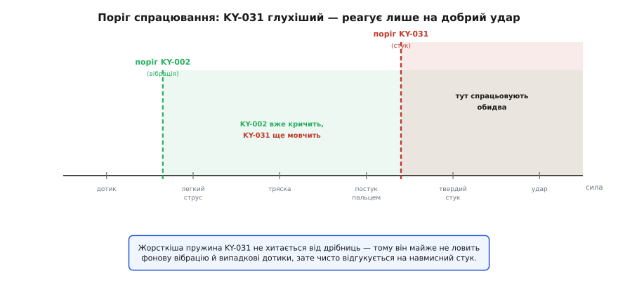
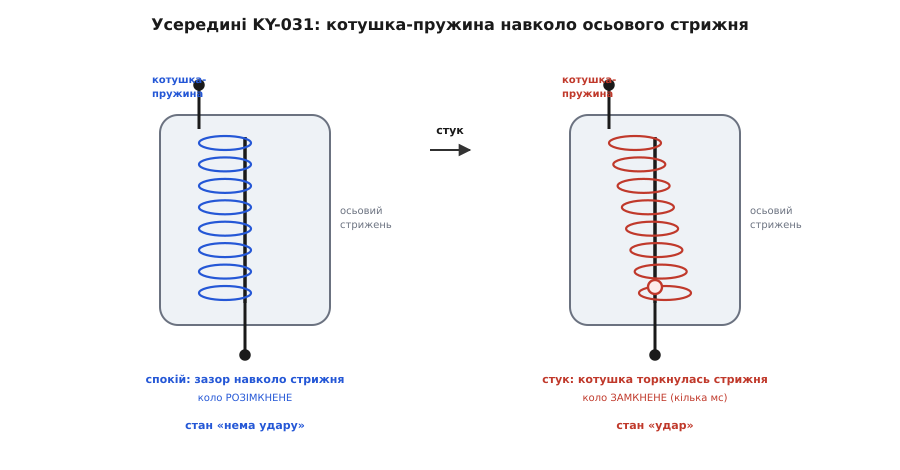
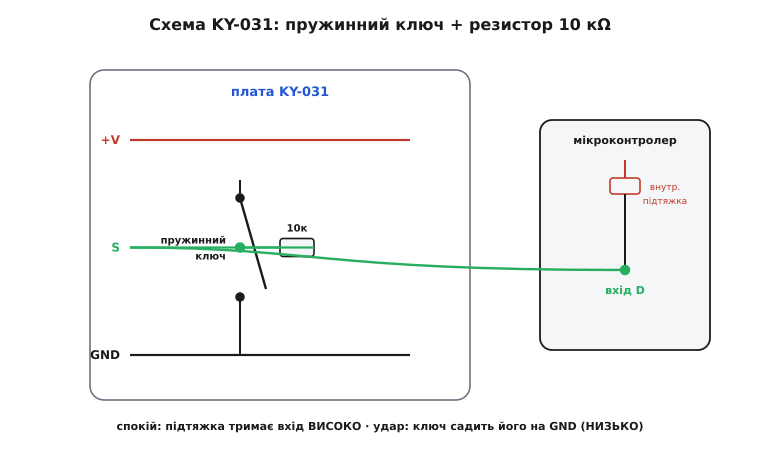
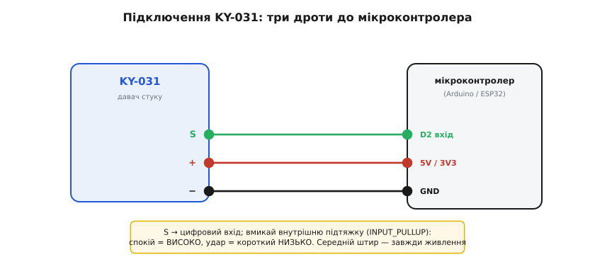

# KY-031 — давач стуку

<preknowlist>
- [KY-002 — давач вібрації (SW-18020P)](root:cat-hw-sensors/ky-002-vibration) — принцип дії чутливого пружинного вимикача для порівняння з вищим порогом чутливості KY-031
- [Аналоговий п'єзоелектричний давач](root:cat-hw-sensors/piezo-sensor) — роботу п'єзоелемента як генератора аналогової напруги для відрізнення від дискретного вимикача KY-031
</preknowlist>

## Проблема хибних тривог від вібрації

У системах охорони та кодових замках використання високочутливих елементів створює проблему хибних спрацювань. Якщо встановити на вхідні двері або корпус приладу [чутливий давач вібрації KY-002](root:cat-hw-sensors/ky-002-vibration), коло реагуватиме на найменше фонове тремтіння — кроки поруч, проїзд транспорту чи роботу вентилятора. Для фіксації саме навмисного удару потрібен дискретний перемикач із вищим порогом спрацьовування (англ. @@en|trigger threshold@@).

*Графік порогу спрацьовування показує відсікання дрібних вібрацій та фіксацію лише чіткого механічного стуку.*

Модуль KY-031 (англ. @@en|Keyes 37-in-1 knock sensor module@@, від англ. @@en|knock@@ — стук) розроблено саме для виокремлення виразних поштовхів. Він діє як бінарний вимикач (від лат. *binarius* — подвійний): пристрій видає цифровий сигнал про сам факт події, але принципово не вимірює амплітуду чи силу зсуву. На відміну від ситуації, де застосовують [аналоговий п'єзоелектричний давач](root:cat-hw-sensors/piezo-sensor) для визначення енергії удару, KY-031 лише підтверджує механічний контакт. Це робить його простим і надійним вузлом для створення кодових стукальних замків чи сигналізацій сміттєвих баків і поштових скриньок.

## Принцип дії жорсткої внутрішньої пружини

Усередині герметичного металевого корпусу модуля розміщено центральний осьовий стрижень, навколо якого з невеликим повітряним зазором закручено тугу спіральну пружину. Завдяки такій коаксіальній будові давач має кругову спрямованість: поштовх з будь-якого боку в перпендикулярній площині змушує пружину відхилятися.

*Конструкція з осьовим стрижнем і жорсткою пружиною забезпечує короткочасне замикання зазору під дією інерції.*

Під час поштовху інерція (від лат. *inertia* — бездіяльність) долає жорсткість пружини та згинає її до торкання центрального контакту. Пружина миттєво повертається назад, тому замикання триває частки мілісекунди. Через пружні відскоки металу в момент удару виникає серія повторних торкань — брязкіт контакту (англ. @@en|contact bounce@@). Замість одного чистого спаду мікроконтролер отримує чергу швидких імпульсів. Для точного відліку стуків у кодових замках цей брязкіт обов'язково притлумлюють програмною затримкою або апаратним фільтром.

## Схема підключення та логіка виходу

Модуль KY-031 оснащено трьома штирями для комутації з мікроконтролером: сигнальним виходом `S` (англ. @@en|Signal@@), контактом живлення `VCC` та спільною землею `GND`. На друкованій платі між лініями `S` і `VCC` розпаяно підтягувальний резистор (англ. @@en|pull-up resistor@@) номіналом 10 кОм.

*Електрична схема демонструє фіксацію високого рівня в спокої та короткочасне замикання виходу на землю при стуку.*

У стані спокою внутрішній контакт розімкнений, а резистор утримує на виході `S` високий логічний рівень (напругу живлення). Під час поштовху пружина коротить лінію `S` на штир `GND`, утворюючи коротку активну нульову фазу (англ. @@en|active-low logic@@).

*Монтажна схема показує з'єднання виходів давача з цифровим портом та шинами живлення плат розробки.*

Для підключення вивід `S` з'єднують із цифровим портом, а `VCC` і `GND` — з відповідними шинами живлення. Якщо модуль використовується без власної плати підтяжки, на мікроконтролері вмикають внутрішню підтяжку `INPUT_PULLUP`. Оскільки тривалість провалу сигналу в нуль становить лише кілька мілісекунд, опитування в циклі може пропустити подію. Для надійної фіксації імпульсу в прошивці налаштовують зовнішнє переривання (англ. @@en|external interrupt@@, від лат. *interruptus* — перерваний) за спадним фронтом сигнала `FALLING`.
