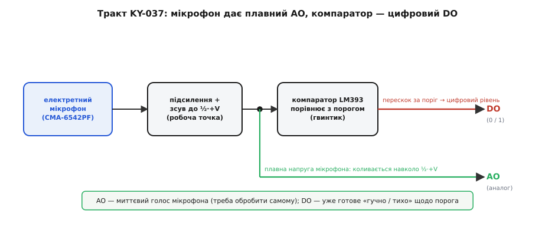
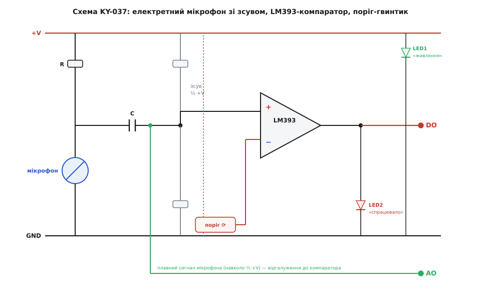
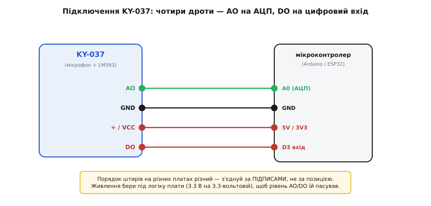
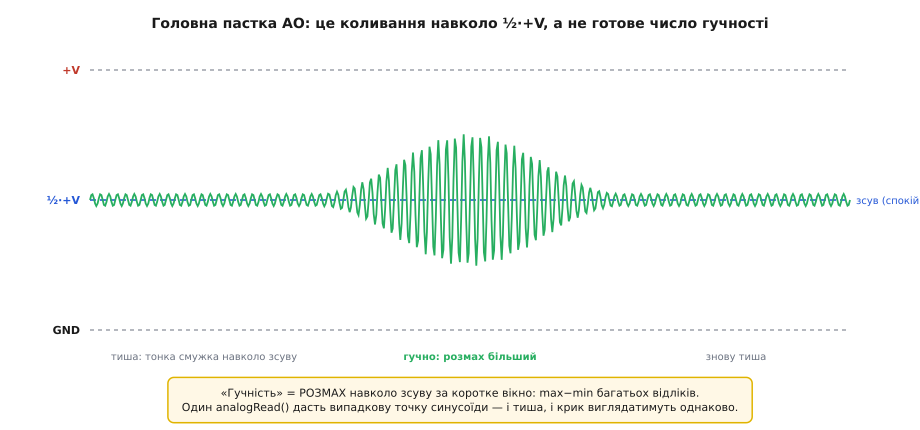

# KY-037 — давач звуку (великий мікрофон)

<preknowlist>
- [KY-серія (Keyes 37-в-1)](root:cat-hw-sensors/ky-series) — спільна архітектура компараторних модулів із живленням 3.3–5 В.
- [Компаратор](root:hw-analog/comparator) — принцип формування логічного перепаду мікросхемою LM393.
- [АЦП](root:hw-analog/adc) — оцифрування аналогової напруги мікроконтролером.
</preknowlist>

## Призначення та особливості модуля

Модуль **KY-037** — це звуковий сенсор із великим електретним мікрофоном, що входить до набору датчиків Keyes 37-в-1. Його ключове призначення — реєстрація акустичних коливань повітря та виявлення гучних звукових подій: сплесків, оплесків у долоні, кроків, голосу, стуку або дзенькоту. Давач застосовується в схемах акустичних вимикачів, охоронних сигналізаціях, системах підсвічування за звуком та інтерактивних пристроях.

Головна відмінність KY-037 від його спорідненого модуля [KY-038](root:cat-hw-sensors/ky-038-mic) полягає в розмірі чутливого елемента: на KY-037 встановлено капсуль збільшеного діаметра (зазвичай типу CMA-6542PF). Завдяки більшій площі мембрани цей модуль має значно вищу чутливість до слабких коливань повітря, проте зберігає загальну схемотехнічну архітектуру компараторного класу давачів.

При цьому важливо пам'ятати: **KY-037 не є лабораторним шумоміром**. Модуль містить два незалежні виходи — цифровий детектор порогу (DO) та аналоговий вихід миттєвої хвилі (AO).

## Внутрішній тракт сигналу та постійний зсув

Вхідною ланкою датчика є електретний конденсаторний капсуль. Тонка металізована полімерна плівка коливається від змін тиску повітря відносно нерухомого електрода. Оскільки плівка несе зафіксований електростатичний заряд, зміна відстані викликає коливання електричної напруги:

*Тракт обробки: формування сигналу з постійним зсувом напруги та поділ на аналоговий і цифровий виходи.*

1. **Вбудований JFET-транзистор:** узгоджує гігаомний опір конденсатора й перетворює коливання заряду на змінний струм.
2. **Постійний зсув напруги (DC bias):** акустична хвиля є знакозмінною величиною, проте аналогово-цифровий перетворювач мікроконтролера здатен вимірювати лише додатну напругу від 0 до напруги живлення. Тому внутрішній каскад зміщує середню робочу точку сигналу на половину напруги живлення (приблизно 1.65 В при живленні 3.3 В або 2.5 В при живленні 5 В).
3. **Сигнал у стані спокою:** у повній тиші напруга на виході мікрофона не дорівнює нулю, а коливається біля цієї половинної точки. Звукові коливання зміщують напругу вгору та вниз від встановленого зсуву.

## Схемотехніка компаратора LM393 та органи керування

На платі розміщено інтегральний компаратор **LM393**, багатообертовий підстроювальний резистор (тример) та індикаторні світлодіоди:

*Схема KY-037: вхідний підсилювальний каскад, пороговий подільник напруги та вихідний компаратор.*

- **Підстроювальний резистор (тример):** задає опорну порогову напругу на інвертувальному вході компаратора. Обертанням гвинта користувач налаштовує чутливість давача під рівень фонового шуму приміщення.
- **Цифровий вихід (DO):** реалізований на базі компаратора з відкритим колектором і підтяжкою до живлення. Коли розмах звукової хвилі перевищує виставлений поріг, компаратор спрацьовує, змінюючи логічний рівень на лінії.
- **Світлодіоди на платі:**
  - **LED1 (живлення):** горить постійно, коли на плату подано живлення.
  - **LED2 (поріг спрацьовування):** спалахує синхронно з появою події на виході DO. Це дозволяє точно налаштувати поріг чутливості викруткою за візуальним відгуком у тиші приміщення.

## Підключення модуля та інтерфейсні контакти

Модуль KY-037 підключається за допомогою 4-контактної штирьової гребінки:

*Підключення модуля: чотири провідники для живлення та передачі сигналів AO і DO.*

- **VCC (+):** живлення модуля від 3.3 В до 5 В. Рекомендується підключати до тієї шини живлення, яку використовує логіка мікроконтролера.
- **GND (−):** спільна земля схеми.
- **DO (Digital Out):** цифровий вихід порогу. Підключається до дискретного виводу мікроконтролера з підтримкою переривань.
- **AO (Analog Out):** аналоговий вихід миттєвої амплітуди звукової хвилі. Підключається до каналу АЦП мікроконтролера.

## Специфіка читання аналогового виходу AO

Головна пастка під час роботи з контактом AO полягає в тому, що **одиничне зчитування АЦП не дозволяє оцінити гучність звуку**:

*Форма сигналу на аналоговому виході: випадковий одиничний відлік потрапляє в довільну точку синусоїди.*

Оскільки звуковий сигнал коливається зі звуковою частотою навколо постійної напруги зсуву, одиничний вимір повертає випадкову точку синусоїди. І під час гучного крику, і в тиші значення може виявитися рівним напрузі зміщення.

Для коректного вимірювання гучності застосовують метод **часового вікна розмаху (peak-to-peak)**:
1. Протягом фіксованого вікна (наприклад, 20–50 мілісекунд) мікроконтролер виконує серію швидких послідовних зчитувань АЦП.
2. У межах вікна обчислюються мінімальне та максимальне зареєстровані значення.
3. Різниця між максимумом і мінімумом (розмах амплітуди) є достовірною мірою фактичної гучності звуку, очищеною від впливу постійного зсуву.
