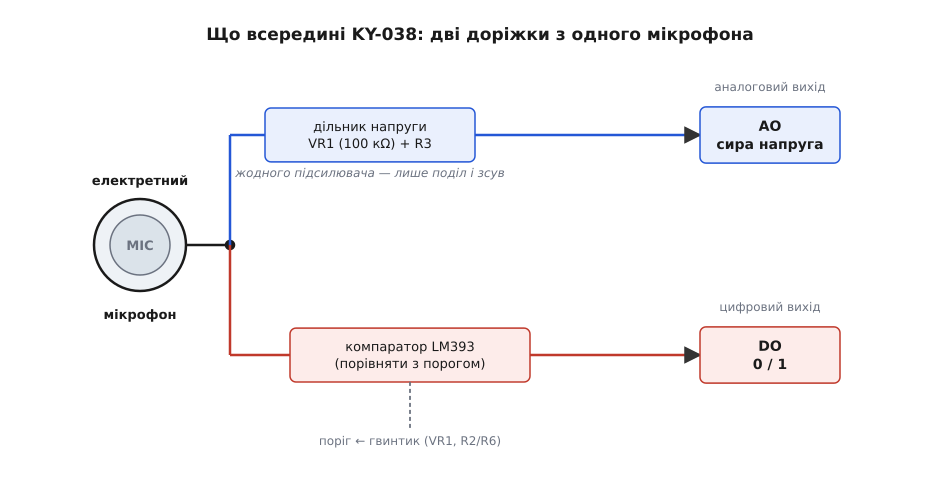
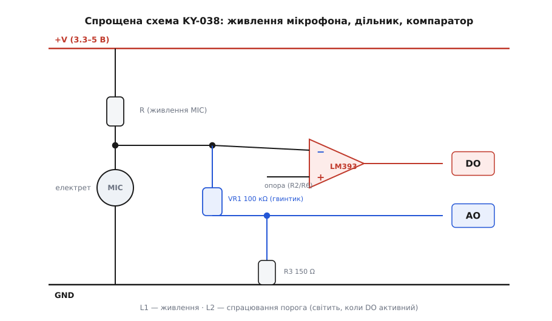
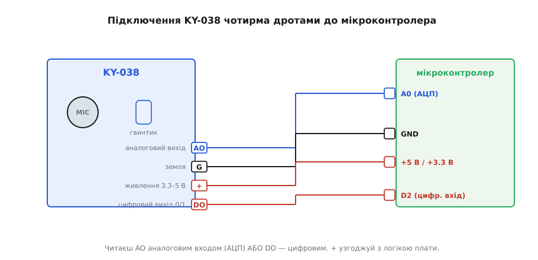
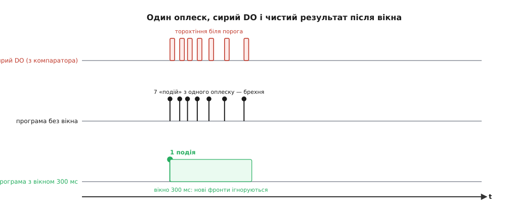

# KY-038 — мікрофонний давач звуку

<preknowlist>
- [KY-серія (Keyes 37-в-1)](root:cat-hw-sensors/ky-series) — спільна архітектура модулів Keyes, три типи плат і живлення 3.3–5 В.
- [Компаратор](root:hw-analog/comparator) — принцип формування порогового цифрового сигналу мікросхемою LM393.
- [Електретний мікрофон](root:hw-sensing/electret-microphone) — будова чутливого елемента з постійним зарядом та JFET-транзистором.
</preknowlist>

## Призначення та базовий принцип порогового давача

Модуль **KY-038** належить до популярної серії датчиків Keyes 37-в-1 і являє собою звуковий сенсорний модуль з електретним мікрофоном. Його призначення — детекція різких акустичних подій у приміщенні: плескотів у долоні, ударів по столу, стуку у двері чи гучних розмов. Завдяки низькій вартості та простоті підключення модуль широко застосовують в акустичних реле («плесни, щоб увімкнути світло»), датчиках присутності для будильників і робототехнічних платформах.

Головна концептуальна особливість KY-038: **у типовому застосуванні це пороговий датчик шуму, а не вимірювач гучності чи студійний рекордер**. Він не вимірює рівень звукового тиску в децибелах (dBSPL) і не призначений для запису розбірливого звукового сигналу. Його базове завдання — зафіксувати момент, коли амплітуда коливань повітря перетинає налаштований поріг.

## Будова капсули та поділ сигналу на дві доріжки

Чутливим елементом на платі є електретний конденсаторний мікрофон. Усередині сріблястого металевого циліндра розміщено дві пластини, одна з яких — тонка полімерна мембрана з постійним електростатичним зарядом. Під дією звукового тиску відстань між пластинами коливається, що змінює ємність конденсатора та викликає зміну напруги. Вбудований малошумний польовий транзистор (JFET) перетворює цей слабкий потенціал на струм, який живиться від шини живлення через баластний резистор.

Сигнал з електретного мікрофона розгалужується на дві незалежні апаратні доріжки:

*Розгалуження сигналу: аналоговий канал AO веде прямо до роз'єму, а цифровий канал DO обробляється компаратором.*

1. **Аналоговий вихід (AO):** знімається безпосередньо з виводу мікрофона через пасивний дільник напруги. Оскільки на платі **немає окремого лінійного операційного підсилювача**, коливання сигналу на AO мають дуже малу амплітуду (одиниці або десятки мілівольтів) на тлі постійної напруги зсуву (близько половини напруги живлення).
2. **Цифровий вихід (DO):** сигнал мікрофона подається на інтегральний компаратор LM393, який порівнює його з пороговим рівнем і генерує чіткий логічний перепад (0 або 1).

## Схема модуля та органи керування

На платі встановлено здвоєний диференційний компаратор **LM393**, багатообертовий потенціометр (тример) та допоміжну обв'язку:

*Принципова схема KY-038: живлення мікрофона, подільник опорної напруги на тримері, компаратор LM393 та індикатори.*

- **Підстроювальний тример (VR1):** регулює опорну напругу компаратора, тобто поріг чутливості до звуку. Обертання гвинта дозволяє підлаштувати сенсор під тиху кімнату або галасливе середовище.
- **Компаратор LM393:** коли миттєва амплітуда коливань на виході мікрофона перевищує опорну напругу, вихідний транзистор компаратора перемикається.
- **Світлодіодні індикатори:**
  - **L1 (живлення):** світиться безперервно при подачі напруги на контакти VCC та GND.
  - **L2 (поріг спрацьовування):** спалахує синхронно з появою активного сигналу на цифровому виході DO, що дозволяє налаштовувати поріг чутливості без осцилографа чи комп'ютера.

## Підключення модуля та інтерфейсні виводи

Модуль KY-038 оснащений стандартним 4-контактним штирьовим роз'ємом:

*Підключення модуля: контакти AO, GND, VCC та DO з'єднуються з відповідними виводами плати.*

- **AO (Analog Output):** аналоговий вихід. Підключається до каналу вбудованого АЦП мікроконтролера для оцінки розмаху коливань або побудови грубого індикатора гучності.
- **GND (−):** загальний нульовий провід живлення.
- **VCC (+):** живлення модуля від 3.3 В до 5 В. Рекомендується подавати ту напругу, яка відповідає логічним рівням обраного мікроконтролера (3.3 В для ESP32 чи STM32, 5 В для Arduino Uno).
- **DO (Digital Output):** цифровий пороговий вихід. Підключається до дискретного входу GPIO (бажано з підтримкою апаратних переривань за фронтом).

## Особливості сигналу: акустичний брязкіт і програмний дебаунс

Коли людина плескає в долоні або стукає по поверхні, утворюється серія швидко загасаючих пружних коливань повітря. Через це сигнал на мікрофоні багаторазово перетинає поріг чутливості компаратора в обидва боки протягом 20–100 мілісекунд:

*Одиничний сплеск викликає пачку імпульсів на виході DO. Програмне вікно дебаунсу відсікає фальшиві спрацьовування.*

Якщо в коді програми наївно рахувати кожен перепад рівня, один-єдиний плескіт буде зафіксовано як 5–10 окремих подій. Для надійної роботи застосовують:
1. **Фіксацію події за переходом (фронтом):** обробляють перехід «спокій → звук», а не статичний рівень сигналу.
2. **Неблокуюче часове вікно (дебаунс):** після першого спрацьовування засікають час і протягом 150–300 мс ігнорують усі наступні імпульси.
3. **Автовизначення полярності:** на старті програми зчитують стан спокою, щоб коректно працювати як з прямими, так і з інверсними версіями плати.
