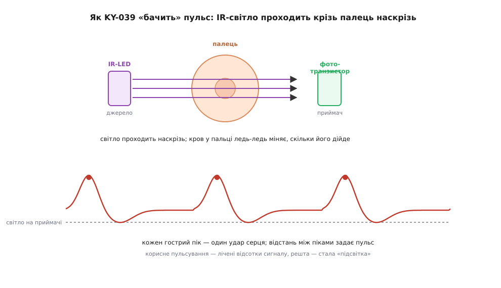
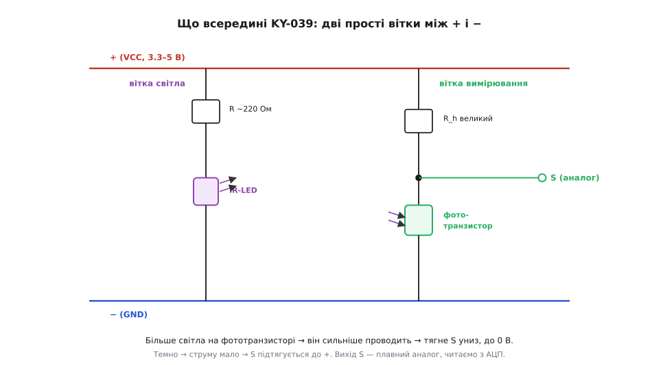
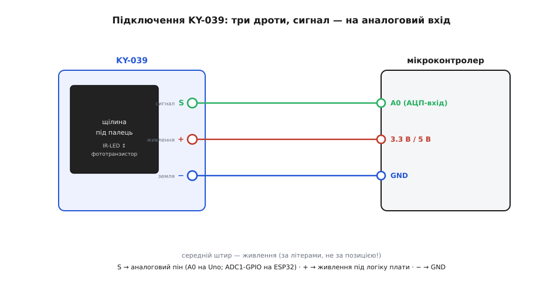
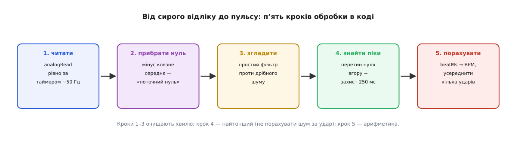

# KY-039 — давач пульсу

<preknowlist>
- [Фотодавачі](root:hw-sensing/photo-sensors) — будова та фізика фототранзистора як оптично керованого струмового ключа.
- [Світлодіод](root:hw-motion/led) — принцип роботи інфрачервоного випромінювача на довжині хвилі 940 нм.
- [Дільник напруги](root:hw-analog/voltage-divider) — схема перетворення змінного опору фотоелемента на напругу.
- [АЦП](root:hw-analog/adc) — оцифрування аналогового сигналу мікроконтролером.
</preknowlist>

## Призначення та базовий принцип вимірювання пульсу

Модуль **KY-039** — це найпростіший аналоговий сенсор вимірювання частоти серцевих скорочень із популярного набору Keyes 37-в-1. Його призначення — демонстрація фундаментальних принципів оптичної біометрії та реєстрація серцевого ритму людини. На відміну від складних цифрових медичних сенсорів, модуль не містить інтегральних мікросхем чи вбудованих обчислювачів і побудований лише на дискретних напівпровідникових елементах.

В основі роботи датчика лежить метод **просвітної фотоплетизмографії (PPG)**:

*Принцип просвічування: зміна оптичної щільності тканин пальця модулює світловий потік під час кожного серцевого скорочення.*

1. **Проходження світла крізь палець:** випромінювач та приймач встановлені на платі один навпроти одного, утворюючи вузьку щілину для розміщення подушечки пальця. Світло від світлодіода пронизує м'які тканини наскрізь.
2. **Пульсація артеріального русла:** під час систоли артеріальні капіляри наповнюються порцією крові, збільшуючи загальне поглинання оптичного випромінювання. Під час діастоли судини спадають, і тканини стають прозорішими.
3. **Хвиля фотоструму:** фототранзистор на протилежному боці реєструє коливання інтенсивності минулого світла, формуючи синхронну пульсову хвилю.

## Схемотехніка модуля: дві незалежні вітки

Електрична схема KY-039 гранично лаконічна і складається лише з двох паралельних ланцюгів між лініями живлення (+) та землі (−):

*Схема KY-039: вітка живлення ІЧ-світлодіода та вимірювальний дільник напруги з фототранзистором.*

- **Вітка випромінювання (ліворуч):** інфрачервоний світлодіод з довжиною хвилі близько 940 нм увімкнений послідовно зі струмообмежувальним резистором. Ця довжина хвилі обрана тому, що інфрачервоне випромінювання значно глибше проникає крізь живу біологічну тканину порівняно з видимим світлом.
- **Вітка вимірювання (праворуч):** являє собою класичний аналоговий дільник напруги. Верхнє плече утворене високоомним навантажувальним резистором (зазвичай сотні кілоомів), а нижнє плече — кремнієвим фототранзистором.
- **Логіка вихідної напруги S:**
  - Коли світла падає багато, фототранзистор відкривається і притягує вузол S до землі (близько 0 В).
  - Коли палець перекриває світло або кров сильніше поглинає фотони, фототранзистор прикривається, і напруга на виході S підтягується вгору до напруги живлення.
  - Кожен серцевий удар формує крихітний додатний сплеск напруги на лінії S.

## Інтерфейс підключення та живлення

Модуль має триконтактний штирьовий роз'єм стандарту KY-серії:

*Підключення датчика: живлення на середній штир, вихід сигналу S на аналоговий вхід АЦП.*

- **S (Signal):** аналоговий вихід вимірювального дільника. Підключається виключно до аналогового входу мікроконтролера (наприклад, A0 на Arduino або вхід ADC1 на ESP32).
- **+ (VCC, центральний штир):** живлення модуля від 3.3 В до 5 В. Зверніть увагу: лінія живлення завжди розташована по центру гребінки.
- **− (GND):** спільна земля мікроконтролера.

## Програмний конвеєр обробки сигналу

Головна складність роботи з KY-039 полягає в тому, що корисна амплітуда пульсової хвилі становить лише 1–3 % від загального рівня напруги на виході S. Решта сигналу — це масивна постійна оптична засвітка пальця та повільний дрейф робочої точки при нагріванні або легкому ворушінні руки.

Для надійного обчислення пульсу в прошивці мікроконтролера організовують багаторівневий конвеєр цифрової обробки сигналу:

*Конвеєр перетворення: від сирих відліків АЦП до стабільного значення пульсу в BPM.*

1. **Рівномірне опитування за таймером:** зчитування сигналу АЦП виконують із фіксованим кроком у часі (зазвичай 20–50 мс, тобто 20–50 Гц) без використання блокуючих затримок delay.
2. **Відсікання постійної складової (DC removal):** повільний дрейф базової лінії усувають відніманням ковзного середнього з широким вікном (близько 1–2 секунд) або застосуванням фільтра високих частот (ФВЧ).
3. **Згладжування високочастотного шуму:** дрібне тремтіння квантування АЦП та наведення від ламп освітлення приглушують легким фільтром низьких частот (ФНЧ) або експоненційним згладжуванням.
4. **Пошук піків із періодом рефрактерності:** моменти серцевих ударів визначають за перетином динамічного порогу, блокуючи повторні спрацьовування на час не менше 250–300 мс (захист від вторинної дикротичної хвилі).
5. **Розрахунок частоти (BPM):** час між сусідніми валідними ударами перетворюється на частоту серцевих скорочень за формулою `BPM = 60000 / delta_ms` з подальшим усередненням.
