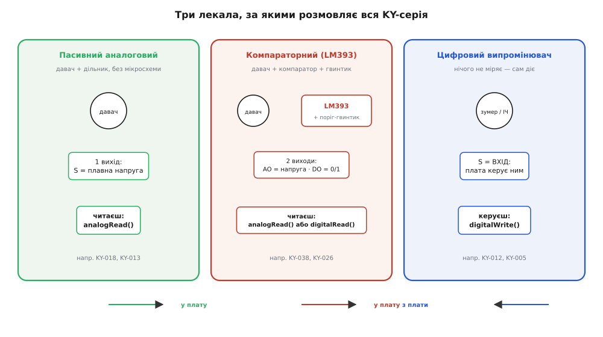
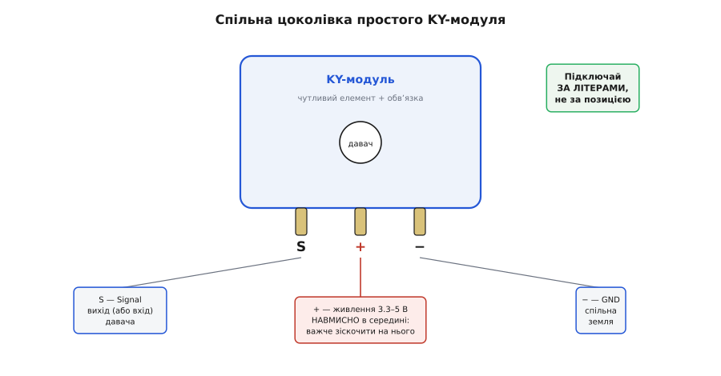

# KY-серія (Keyes 37-в-1)

<preknowlist>
- [GY-серія (брейкаут-модулі)](root:cat-hw-sensors/gy-series) — відмінності між простими навчальними платами KY та складнішими I2C/SPI брейкаут-модулями GY-серії
</preknowlist>

## Хаос макетування та народження 37-в-1

Світанок аматорської мікроконтролерної електроніки наприкінці 2000-х років, пов'язаний із поширенням платформи Arduino, зіштовхнувся з гострою інженерною проблемою макетування. Швидка збірка схеми на безпайковій макетній платі (англ. @@en|breadboard@@, від англ. *bread* — хліб та *board* — дошка — дошка для хліба) вимагала від розробника самостійного паяння або складання дискретної обв'язки для кожного сенсора. Фоторезистори, кнопкові вимикачі, термістори та геркони не мали власних друкованих плат і виводів під стандартний крок `2.54 мм`. Спроба підключити звичайний п'єзоелемент чи аналоговий датчик температури вимагала розгортання цілої павутини з підтягувальних резисторів (англ. @@en|pull-up resistor@@), шунтувальних конденсаторів та гнучких перемичок.

Такий підхід спричиняв масу ненадійних контактів, виникнення висячих входів (англ. @@en|floating input@@, від англ. *floating* — плаваючий та *input* — вхід — вхід у плаваючому стані) через відсутність підтяжки до шини живлення або землі, а також регулярні короткі замикання (англ. @@en|short circuit@@) при випадковому висмикуванні провідників. Будь-яка навчальна чи дослідницька схема перетворювалася на крихку конструкцію, яку було складно транспортувати чи демонструвати.

Відповіддю на цей виклик стало виникнення в екосистемі китайського технологічного хабу Шеньчжень (район Хуацянбей) уніфікованого стандарту навчальних модулів, який отримав назву «набір 37-в-1» (англ. @@en|37-in-1 sensor kit@@). Склад із 37 елементів сформували шляхом відбору компонентів під базові навчальні завдання лабораторних практикумів із мікроконтролерів: до набору включили найпростіші засоби введення (кнопки, важелі джойстиків, енкодери), датчики фізичних величин (фоторезистори, термістори, геркони, звукові й інфрачервоні приймачі) та виконавчі випромінювачі (світлодіоди, лазерні модулі, п'єзодинаміки та реле). Піонер цього напряму, бренд Keyes, жорстко уніфікував не лише схемотехніку з мінімальною обв'язкою, а й механічні габарити плат (переважно `18.5 × 15 мм` для пасивних модулів та `15 × 25 мм` для плашок із додатковими компонентами) з єдиним монтажним отвором діаметром `3 мм` під гвинти M3. Це дозволило розпаяти кожен первинний перетворювач на стандартну 3-контактну або 4-контактну гребінку штирових з'єднувачів із кроком `2.54 мм`, забезпечивши як зручне підключення провідниками, так і надійне кріплення плат на шасі чи у корпусі. На відміну від складніших [брейкаут-модулів GY-серії](root:cat-hw-sensors/gy-series), призначених для точних цифрових шин I2C чи SPI, набір KY-серії орієнтувався на найпростіші аналогові й дискретні сигнали, надавши початківцям змогу збирати працюючі прототипи за хвилини без паяльника. Повний огляд складу компонентів та їхньої сумісності подано в матеріалі про [набір сенсорів 37-в-1](root:cat-hw-sensors/keyes-37-in-1-sensor-kit).

## Трьохкомпонентна схемотехнічна архітектура плат

Незважаючи на різноманіття вимірюваних величин у наборі 37-в-1 — від температури й магнітного поля до інфрачервоного випромінювання й вібрацій — з погляду електричної топології всі плати KY-серії поділяються на три базові схемотехнічні шаблони.


*Три основні схемотехнічні шаблони модулів KY-серії: пасивний дискретний елемент із підтяжкою, аналого-цифрові компараторні вузли на LM393 та активний транзисторний модуль.*

Першим шаблоном є пасивний дискретний модуль (англ. @@en|passive sensor module@@). Він містить лише первинний сенсор (наприклад, фоторезистор, термістор або п'єзодиск) та один поверхнево-монтований резистор підтяжки (англ. @@en|pull-up resistor@@) опором `10 кОм` або `1 кОм`. Така плата формує дільник напруги, перетворюючи зміну опору чи стану датчика на аналоговий рівень або логічний перепад, який подається безпосередньо на вхід аналогово-цифрового перетворювача чи цифровий порт мікроконтролера.

Другим шаблоном виступає компараторний модуль (англ. @@en|comparator-based module@@), побудований на базі подвійного диференціального компаратора напруги LM393 (англ. @@en|voltage comparator@@, розробка National Semiconductor). Цей вузол містить підстроювальний багатооборотний потенціометр (англ. @@en|potentiometer@@, від латин. potentia — сила та грец. metron — міра), яким задають поріг спрацьовування. Модуль формує два паралельні виходи: аналоговий вихід `AO` (англ. @@en|analog output@@ — аналоговий вихід), що знімає сигнал безпосередньо з сенсора, та цифровий вихід `DO` (англ. @@en|digital output@@ — цифровий вихід), що міняє логічний стан при перевищенні порогової напруги. Проте спрощена схемотехніка KY-модулів не містить кола позитивного зворотного зв'язку (англ. @@en|positive feedback loop@@) між виходом і неінвертуючим входом компаратора, через що у схеми повністю відсутній гістерезис (англ. @@en|hysteresis@@, від грец. hysteresis — запізнення, відставання) — рознесення між порогом увімкнення та вимкнення. Коли аналогова напруга повільно наближається до порогового рівня, навіть мікроскопічний електричний шум на аналоговій лінії змушує компаратор із високим коефіцієнтом підсилення хаотично перемикатися між логічним нулем і одиницею. Це породжує брязкіт цифрового сигналу (англ. @@en|output chatter@@) на виході `DO`, створюючи серію хибних спрацьовувань при підключенні до переривань мікроконтролера. Через це, на відміну від точних вимірювачів струму на зразок [вимірювачів живлення INA226](root:cat-hw-sensors/ina226-power-monitor-module), компараторні KY-модулі призначені не для метрологічних вимірювань, а для швидкої бінарної фіксації граничних подій.

Третім шаблоном є активний драйверний модуль (англ. @@en|active driver module@@), призначений для керування випромінювачами та виконавчими елементами (бузерами, лазерними діодами, реле чи RGB-світлодіодами). Оскільки виходи мікроконтролера обмежені за струмом (зазвичай до `20 мА`), плата містить біполярний NPN або PNP транзисторний ключ (англ. @@en|transistor switch@@, найчастіше серій S8050 чи S8550), який підсилює керуючий сигнал і забезпечує необхідний струм комутації навантаження.

## Феномен каталогу та правило маркування

Початкова номенклатура `KY-xxx`, розроблена брендом Keyes для набору «37-в-1», швидко вийшла за межі одного підприємства й перетворилася на відкритий міжнародний стандарт (англ. @@en|de facto standard@@, від лат. *de facto* — за фактом) у китайському екосистемному центрі Шеньчжень (кит. @@zh|Shenzhen@@). Відсутність патентних обмежень та проста схемотехніка призвели до того, що десятки сторонніх фабрик почали копіювати друковані плати. Деякі виробники зберігали оригінальний індекс `KY`, а інші впроваджували власні фабричні позначення, як-от серію HW-xxx (англ. @@en|HW series@@, від англ. *hardware* — апаратне забезпечення).

У цій різноманітності виникло фундаментальне інженерне правило: номер важливіший за виробника. Функціональне призначення модуля та його електрична топологія визначаються цифровим індексом, а не логотипом чи маскою платформи. Наприклад, плата лазерного випромінювача `KY-008` та її аналог `HW-477`, або модуль фоторезистора `KY-018` та `HW-480` будуються на абсолютно однакових схемах дільника напруги чи транзисторного ключа. Для розробника це означає можливість безперешкодної взаємозамінності модулів у проєктах прототипування, оскільки керування платою лишається ідентичним незалежно від бренду. На відміну від складніших [модулів GY-серії](root:cat-hw-sensors/gy-series), де сумісність визначається адресацією цифрових чипів, у KY-серії достатньо звірити цифровий номер. Однак функціональна тотожність не гарантує механічної та електричної ідентичності розведення контактів: децентралізоване виробництво створює ризик неспівпадання розташування виводів (англ. @@en|pinout@@, від англ. *pin* — штир та *out* — вихід — цокольовка) у клонів з однаковим цифровим індексом. Різні фабрики можуть змінювати порядок штирів у гребінці — наприклад, міняти місцями сигнальний вихід `S` та лінію живлення `VCC` або виводити землю `-` на середній контакт. Сліпе підключення модуля за пам'яттю чи за аналогією з виробом іншого бренду загрожує подачею напруги живлення безпосередньо на логічний порт мікроконтролера або викличе коротке замикання (англ. @@en|short circuit@@), що призведе до термічного пошкодження вхідного каскаду. Щоб запобігти виходу обладнання з ладу, розробник мусить застосовувати метод двоетапної перевірки: спочатку візуально звірити позначення на шовкотрафареті (англ. @@en|silkscreen@@, від англ. *silk* — шовк та *screen* — сітка — шовкотрафаретне маркування) друкованої плати (символи `-`, `+`, `S` або `GND`, `VCC`, `OUT`), а за їх відсутності або суперечливості виконати перевірку неперервності кола (англ. @@en|continuity test@@) мультиметром між штирями та спільним полігоном заземлення.

## Міфи, цоколівка та безпека підключення

Поширення KY-серії породило декілька стійких оман серед розробників-початківців. Першим міфом стала уява про наявність пропрієтарних чипів (англ. @@en|proprietary IC@@, від англ. *property* — власність) або спеціалізованих мікроконтролерів на платах. Насправді всі модулі родини побудовані виключно на загальнодоступній дискретній елементній базі — стандартних компараторах `LM393`, біполярних транзисторах `S8050` чи базових пасивних компонентах. Друга помилка стосується нібито наявності підсилювачів чи активної фільтрації на пасивних платах на зразок `KY-013` (термістор) або `KY-018` (фоторезистор). Звичайний пасивний модуль містить лише первинний сенсор та один підтягувальний резистор без жодних операційних підсилювачів чи активної обробки сигналу. Нарешті, міф про ексклюзивність розробок спростовується тим, що схемотехніка плат є прямим перенесенням стандартних референсних схем (англ. @@en|reference design@@) із документації до електронних компонентів на компактні друковані плати.

Головна апаратна пастка KY-модулів криється в їхній цоколівці (англ. @@en|pinout@@, від англ. *pin* — штир та *out* — вихід — розташування виводів). Більшість 3-контактних плат серії мають стандартне маркування: сигнальний вивід `S` (англ. @@en|signal@@), вивід живлення `+` (англ. @@en|VCC@@) та заземлення `-` (англ. @@en|GND@@).


*Розташування виводів 3-контактної гребінки KY-модуля та варіант узгодження 5-вольтового сигнального виходу з 3.3-вольтовим входом мікроконтролера за допомогою дільника напруги.*

Критична особливість полягає в тому, що позитивний полюс живлення `+` розташований на середньому штирі гребінки. У багатьох інших периферійних модулях середній контакт відводять під землю чи сигнал. Помилкове підключення живлення без перевірки шовкографії (англ. @@en|silkscreen@@) на звороті плати призводить до зворотної полярності та виходу з ладу світлодіодів індикації або короткого замикання шини живлення мікроконтролера.

Другим ризиком підключення є несумісність логічних рівнів напруги (англ. @@en|logic level mismatch@@). Більшість компараторних модулів на базі `LM393` та активних ключів розраховані на живлення від напруги `5 В`. У разі прямого підключення цифрового виходу `DO` такого модуля до мікроконтролерів із `3.3-вольтовою` логікою (наприклад, ESP32, STM32 чи Raspberry Pi Pico) високий логічний рівень `5 В` подається безпосередньо на вхідний порт `GPIO`, що загрожує пошкодженням внутрішніх захисних діодів чи пробоєм порту.

Для безпечного узгодження сигналу застосовують резистивний дільник напруги (англ. @@en|voltage divider@@). Вхідну напругу `U_in` зменшують за допомогою двох резисторів: верхнього `R1` (плече сигналу) та нижнього `R2` (плече землі). Однак вибір конкретних номіналів визначається компромісом між струмовим навантаженням і швидкодією кола. Надто малі опори `R1` та `R2` (порядку сотень ом) пропускають через дільник значний струм на землю, що призводить до надмірного енергоспоживання (англ. @@en|power consumption@@) та загрожує перевантаженням вихідного каскаду сенсора. Натомість надто великі опори (порядку сотень кілоом) формують високий еквівалентний вихідний опір дільника `R_eq`, який визначається паралельним з'єднанням `R1` та `R2`. Разом із паразитною ємністю (англ. @@en|parasitic capacitance@@) вхідного порту мікроконтролера та друкованих провідників цей опір утворює RC-фільтр низьких частот (англ. @@en|low-pass filter@@, від англ. *low* — низький, *pass* — проходити та *filter* — фільтр). Велике значення `R_eq` сповільнює заряджання та розряджання вхідної ємності, спричиняючи завал фронтів (англ. @@en|edge rounding@@) та затримку поширення сигналу. Це звужує смугу пропускання (англ. @@en|bandwidth@@), через що високочастотні цифрові імпульси спотворюються, а мікроконтролер пропускає або хибно зчитує швидкозмінні сигнали. З цієї причини для модулів KY-серії оптимальним є вибір номіналів у межах від одиниць до десятків кілоом (наприклад, `R1 = 10 кОм` та `R2 = 20 кОм`), що утримує струм споживання на рівні часток міліампера й не спотворює фронти сигналів помірної частоти. Вихідну напругу `U_out` обчислюють за формулою:

```
U_out = U_in × R2 ÷ (R1 + R2)
= 5 × 20 ÷ (10 + 20)           [підстановка U_in = 5 В, R1 = 10 кОм, R2 = 20 кОм]
= 100 ÷ 30                     [обчислення чисельника та знаменника]
≈ 3.33 В                       [ділення]
```

Отримане значення `3.33 В` є абсолютно безпечним для входів `3.3-вольтових` мікроконтролерів. Альтернативним розв'язком для високочастотних сигналів є використання спеціальних [схем узгодження рівнів](root:hw-digital/level-shifter), які запобігають спотворенню фронтів імпульсів. Ретельне вивчення шовкографії та узгодження напруги перед першим увімкненням гарантує надійну роботу суміщених компонентів.
