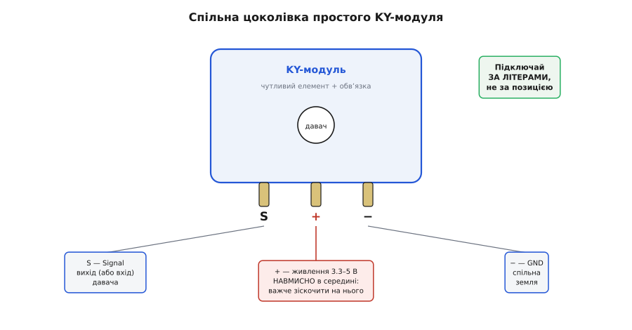
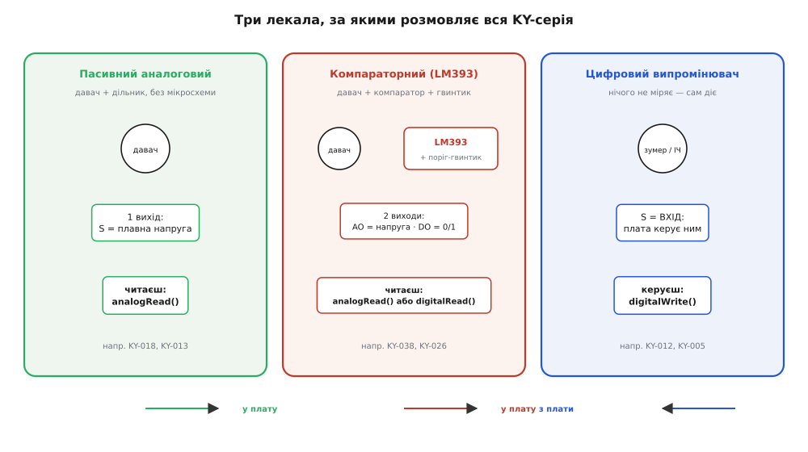

# KY-серія (Keyes 37-в-1)

## Одна порода: що таке KY-модуль

KY-модуль — це чутливий або виконавчий елемент, посаджений на платню з мінімальною допоміжною обв'язкою та стандартною трипіновою гребінкою. Літери «KY» походять від назви бренду @@en|Keyes@@ (від англ. *key* — ключ) та позначають навчальну серію плат де-факто стандарту. На відміну від брейкаут-модулів [GY-серії](root:cat-hw-sensors/gy-series) зі складними мікросхемами, початковий успіх китайських навчальних наборів «37-в-1» від Keyes призвів до масового копіювання схемотехніки сторонніми фабриками. Через це оригінальний порядковий номер плати перетворився на де-факто стандарт маркування, а сторонні виробники клонів зберегли наскрізну нумерацію для повної сумісності з наявними навчальними матеріалами. У цій серії номер плати є головним ідентифікатором: номер визначає функцію модуля незалежно від того, яка саме фабрика його виготовила.

## Три штирі гребінки: безпечне підключення

Основою підключення модуля є трипінова гребінка з літерним маркуванням `S` (сигнал), `+` (живлення @@en|VCC@@) та `−` (земля @@en|GND@@). Слід дивитися виключно на літери: на більшості плат живлення `+` навмисно виведено на середній штир, щоб випадкова зміна полярності крайніх дротів не вивела модуль з ладу. Напругу живлення 3.3 В або 5 В обирають відповідно до логічних рівнів мікроконтролера, оскільки напруга на сигнальному виході дорівнює напрузі живлення. Подача 5-вольтового сигналу на вхід із рівнем 3.3 В створює надлишок напруги, що перевищує внутрішню напругу живлення плати. Через це відкриваються вбудовані захисні @@el|діоди@@ (від грец. *dis* — двічі, *hodos* — шлях), що з'єднують вхідний пін із шиною 3.3 В. Вони розраховані лише на короткі сплески статики, тому тривалий струм від джерела 5 В перегріває й випалює діод або піднімає напругу всієї шини живлення, виводячи з ладу вхідні кола мікроконтролера.

*Цоколівка трипінової гребінки KY-модуля. Сигнал S і земля − розташовані по краях, а живлення + виведено на середній штир для безпеки.*

## Три лекала взаємодії з платою

Усі модулі серії взаємодіють із мікроконтролером за трьома базовими лекалами. Перше лекало — пасивні аналогові давачі (фоторезистор, термістор), які змінюють напругу на виході `S` пропорційно фізичній величині та потребують зчитування через аналого-цифровий перетворювач (АЦП). Друге лекало — @@la|компараторні@@ (від лат. *comparare* — порівнювати) модулі на мікросхемі LM393 з підстроювальним резистором, які мають аналоговий вихід `AO` та цифровий вихід `DO` для фіксації перевищення порогу; цифровий вихід `DO` при цьому нерідко інвертований. Третє лекало — цифрові випромінювачі (активний зумер, світлодіод), де пін `S` слугує входом для керування через @@en|GPIO@@ (від англ. *General Purpose Input/Output* — ввід-вивід загального призначення).

*Три архетипи KY-модулів. Ліворуч — пасивний аналоговий вихід на АЦП, у центрі — компаратор LM393 з аналоговим AO та цифровим DO виходами, праворуч — цифровий випромінювач під керуванням GPIO.*

## Як обрати варіант із коробки

Вибір модуля з набору починається з визначення фізичної величини та потрібного формату даних. Якщо потрібне точне числове значення величини, обирають аналоговий модуль і підключають його до АЦП, тоді як для фіксації події «так/ні» зручніший компараторний модуль із виходом `DO`. При плануванні схеми враховують кількість вільних пінів плати та обов'язкове початкове калібрування аналогових давачів у прошивці через можливий розкид параметрів дешевих компонентів. На відміну від складніших [модулів GY-серії](root:cat-hw-sensors/gy-series), KY-плати орієнтовані на просту дискретну або аналогову обв'язку без використання шинних інтерфейсів на кшталт [монітора живлення INA226](root:cat-hw-sensors/ina226-power-monitor-module).
