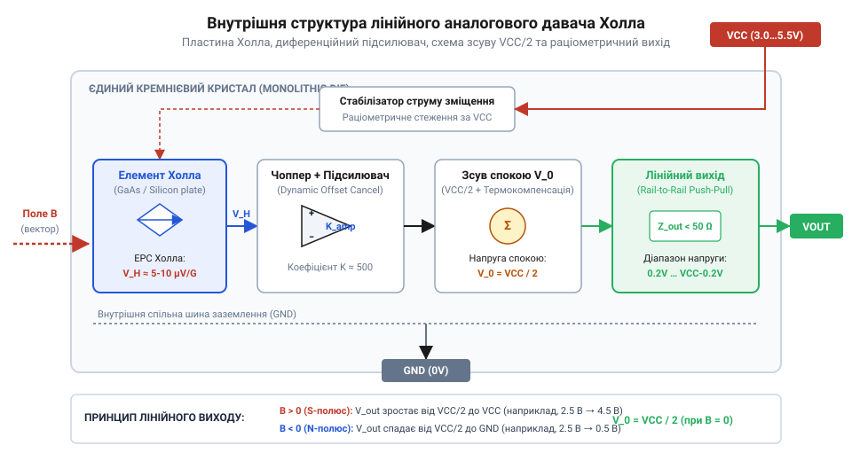
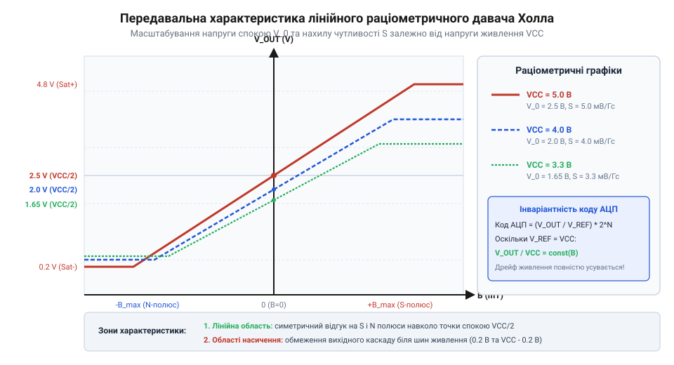
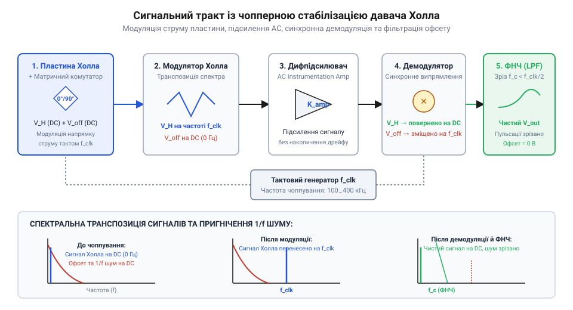
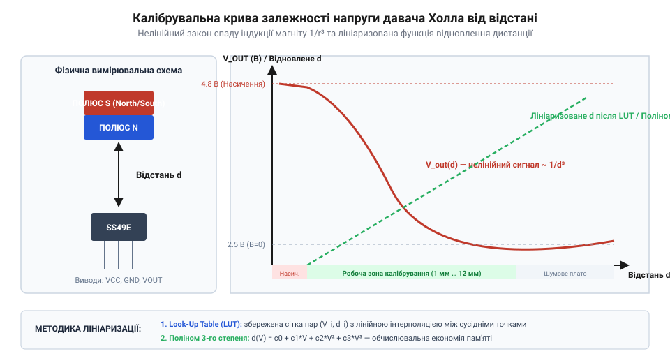
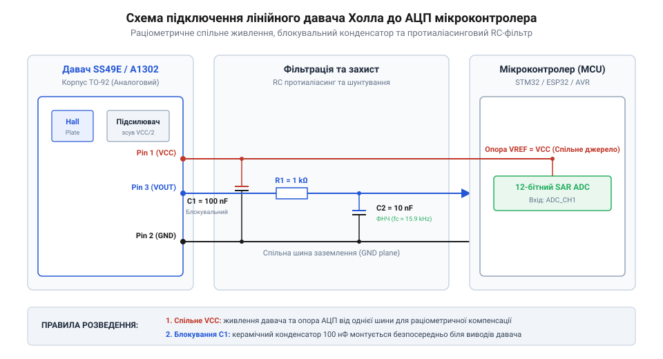
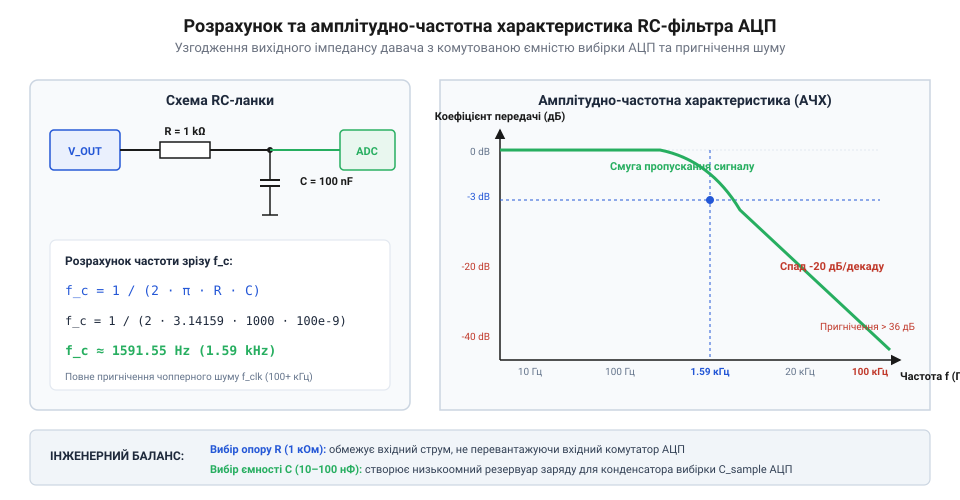
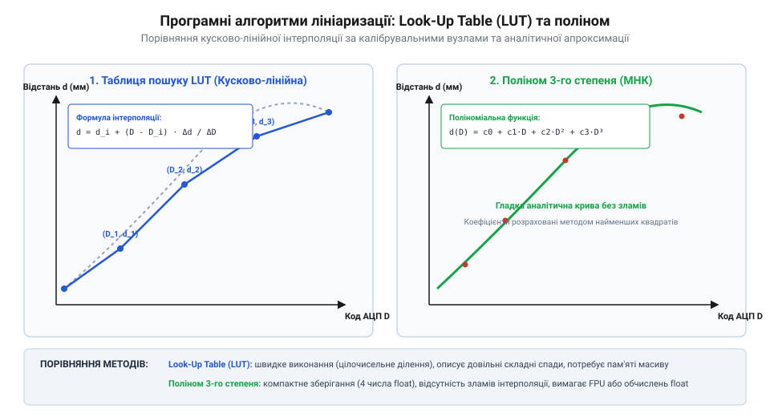

# Аналогові та лінійні давачі Холла

<preknowlist>
- [Цифрові давачі Холла: однополярні, біполярні та омніполярні](root:cat-hw-sensors/hall-effect-digital-sensors-family) — Принципи порогового тригерного перемикання та відмінності дискретного стану від неперервного аналогового сигналу.
- [Чопперна стабілізація в давачах Холла](root:cat-hw-sensors/hall-effect-chopper-stabilization) — Механізм мостової комутування струму пластини для усунення низькочастотного флікер-шуму та температурного офсету.
- [Модуль давача струму Холла ACS712 (GY-712)](root:cat-hw-sensors/acs712-current-sensor-module) — Практична концепція вимірювання безконтактного струму через первинний провідник за допомогою лінійного елемента Холла.
</preknowlist>

## Обмеження дискретного комутування у неперервних вимірюваннях

У багатьох задачах автоматики, робототехніки та промислового вимірювання первинне визначення механічного положення або наявності магнітного поля починається з дискретних давачів. Механічні контактні елементи, такі як герконові вимикачі на [герконових вимикачах KY-021](root:cat-hw-sensors/ky-021-reed) або у скляній колбі на [геркона KY-025](root:cat-hw-sensors/ky-025-reed), реагують на наближення постійного магніту замкненням металевих контактів. Твердотільні напівпровідникові аналоги, зокрема [цифрових давачах Холла](root:cat-hw-sensors/hall-effect-digital-sensors-family) — від однополярних модулів на [давачах KY-003](root:cat-hw-sensors/ky-003-hall) та [модулі A3144](root:cat-hw-sensors/a3144-hall-module) до тригерних моделей на [давачі SS41F](root:cat-hw-sensors/ss41f-hall) — змінюють свій вихідний дискретний стан із відкритого колектора на низький рівень лише тоді, коли перпендикулярна складова магнітної індукції перевищує фіксований поріг спрацьовування `B_OP`, і повертаються у вихідний стан при зниженні індукції нижче порогу відпускання `B_RP`. Така порогова комутація ідеально підходить для бінарних операцій: фіксації зачинення дверей, підрахунку обертів вала або визначення крайніх положень пневмоциліндра. Однак дискретний сигнал принципово не здатний надати інформацію про те, на яку саме відстань перемістився об'єкт у межах робочої зони чи з якою швидкістю відбувається це переміщення.

Розглянемо практичні системи, що вимагають плавного стеження за динамікою об'єкта: електронну педаль акселератора автомобіля, промисловий джойстик безконтактного керування, давач кута повороту дросельної заслінки або безконтактний вимірювач струму у провіднику на зразок [модуля давача ACS712](root:cat-hw-sensors/acs712-current-sensor-module). У кожній із цих задач простий факт перетину магнітним полем певного порогу не дає корисної інформації про поточний стан системи. Керуючому контролеру необхідно неперервно знати точну координату, кут чи ампертраж у будь-який момент часу з високою роздільною здатністю. Використання дискретного давача у подібних вузлах створює «сліпу зону»: поки індукція перебуває між нулем та порогом `B_OP`, вихідний транзистор залишається закритим, а при перевищенні порогу вихід миттєво стрибає в логічний нуль, приховуючи будь-яку амплітудну градацію. Спроба побудувати неперервне вимірювання шляхом розміщення масиву з десятків цифрових тригерів Холла призводить до невиправданого ускладнення схеми, зростання габаритів та низької дискретності.

Для подолання цього фундаментального обмеження дискретної комутації розробники застосовують напівпровідникові аналогові та лінійні давачі Холла (@@en|linear Hall-effect sensor@@). На відміну від цифрових ІС, аналоговий датчик не містить внутрішнього тригера Шмітта з фіксованими порогами. Замість бінарного переключення його внутрішній сигнальний тракт безпосередньо масштабує первинну електрорушійну силу Холла і формує неперервну вихідну напругу, пропорційну векторній величині перпендикулярної магнітної індукції (від лат. @@en|magnetic flux density@@, де flux означає потік). Завдяки цьому мікроконтролер отримує можливість оцифровувати плавні зміни магнітного поля, перераховуючи напругу у лінійне переміщення, кут повороту або силу струму. Детальні схеми підключення та вимоги до електричного обв'язування таких пристроїв наведено у [довіднику апаратного підключення](root:cat-hw-sensors/linear-hall-effect-sensors/api-linear-hall-hardware-interface.md).

Історичний шлях від відкриття гальваномагнітного ефекту фізиком Едвіном Холлом (@@en|Edwin Hall@@) у 1879 році до розробки сучасних лінійних датчиків охоплює майже століття розвитку фізики твердого тіла. Первинні лабораторні досліди проводилися на тонких металевих пластинах золотої чи мідної фольги, де вихідна ЕРС Холла вимірювалася ліченими мікровольтами і вимагала громіздкого лабораторного обладнання. Справжній технологічний прорив відбувся у другій половині XX століття з розквітом кремнієвої мікроелектроніки. Науковці навчилися інтегрувати на одному напівпровідниковому кристалі не лише тонку високооднорідну пластину Холла, але й мостові схеми струмового живлення, прецизійний інструментальний підсилювач (@@en|instrumentation amplifier@@) та спеціалізовані кола температурної компенсації. Цей еволюційний стрибок дав змогу перейти від нестабільних дискретних гальваномагнітних елементів з мілівольтовими виходами до монолітних лінійних ІС із раціометричним виходом (@@en|ratiometric output@@), які забезпечують високу чутливість (@@en|sensitivity@@), пригнічення низькочастотного флікер-шуму та захист від електромагнітних завад у промислових умовах.

Сучасний лінійний давач Холла перетворює магнітне поле у зручний аналоговий електричний сигнал без механічного зносу, тертя чи контактного дребезгу. Пригнічення власного флікер-шуму та температурного дрейфу нуля у сучасних ІС досягається завдяки застосуванню таких технологій, як [чопперну стабілізацію давачів](root:cat-hw-sensors/hall-effect-chopper-stabilization). Це робить лінійні давачі Холла базовими елементами прецизійної мехатроніки. Для програмного аналізу та фільтрації вихідного сигналу у вбудованих системах розробники спираються на алгоритми, описані у [програмній обробці сигналу](root:cat-hw-sensors/linear-hall-effect-sensors/api-linear-hall-signal-processing-software-interface.md), а практичні приклади створення вимірювальних систем висвітлено у [вимірюванні струму та переміщення](root:cat-hw-sensors/linear-hall-effect-sensors/proj-hall-current-and-position-sensing.md).

## Внутрішня архітектура та вихідний сигнал

В основі монолітної структури аналогового лінійного давача Холла лежить тонка напівпровідникова пластина (@@en|semiconductor plate@@), виготовлена з легованого кремнію або високорухливих сполук елементів III та V груп, таких як арсенід галію (`GaAs`) чи антимонід індію (`InSb`). Коли внутрішнє джерело струму пропускає через пластину поздовжній струм живлення `I`, а перпендикулярно до її площини діє зовнішнє магнітне поле з індукцією `B`, на рухомі носії заряду (електрони або дірки) діє сила Лоренца. Вона відхиляє носії до однієї з бічних граней пластини, створюючи просторове розділення зарядів та поперечну електричну напругу — первинну ЕРС Холла (@@en|Hall voltage@@) `V_H`.

Величина первинної напруги Холла описується співвідношенням:
```
V_H = (R_H / d) * I * B
```
де `R_H` — коефіцієнт Холла матеріалу (обернено пропорційний концентрації носіїв заряду `n` та заряду електрона `e`), `d` — ефективна товщина активного напівпровідникового шару, `I` — струм живлення пластини, а `B` — перпендикулярна складова магнітної індукції.

Оскільки первинна напруга `V_H` на виводах пластини становить лише кілька мікровольтів чи мілівольтів на Гаус, вона не може бути безпосередньо виміряна аналогово-цифровим перетворювачем мікроконтролера. Тому внутрішня архітектура лінійного давача містить цілісний сигнальний тракт. Інтегрований стабілізатор живлення підтримує чітко нормований струм пластини. Сигнал `V_H` надходить на дифпідсилювач (@@en|differential amplifier@@) або прецизійний інструментальний підсилювач (@@en|instrumentation amplifier@@) із коефіцієнтом підсилення у кілька сотень. Одночасно із цим внутрішня схема температурної компенсації (@@en|temperature compensation circuit@@) корегує струм живлення або коефіцієнт підсилення, компенсуючи природну зміну рухливості носіїв заряду в напівпровіднику при коливаннях температури навколишнього середовища.


*Внутрішня напівпровідникова структура лінійного давача Холла, що містить стабілізатор живлення, елемент Холла, підсилювач та схему створення напруги спокою.*

Головною відмінністю аналогового давача Холла від цифрового є наявність схеми внутрішнього початкового зсуву, яка формує напругу спокою (@@en|quiescent voltage@@) `V_0`. За відсутності зовнішнього магнітного поля (`B = 0` Гаус) вихідний каскад давача встановлює напругу рівно на половині напруги живлення:
```
V_0 = VCC / 2
```
Це дає змогу давачу вимірювати магнітні поля обох полярностей при використанні єдиного однополярного джерела живлення. Коли до лицьового боку корпусу наближається північний магнітний полюс (позитивний напрямок вектора індукції `B > 0`), вихідна напруга плавно зростає вище рівноважного значення `VCC / 2` в напрямку верхньої шини живлення `VCC`. Якщо ж до давача наближається південний полюс (негативний напрямок вектора `B < 0`), вихідна напруга плавно знижується нижче `VCC / 2` в напрямку заземлення `GND`.

Ключовою фізичною та схемотехнічною властивістю сучасних аналогових датчиків є раціометричний вихід (від лат. @@en|ratiometric output@@, де ratio означає співвідношення). Раціометричність означає, що як напруга спокою `V_0`, так і чутливість (@@en|sensitivity@@) `S` (яка вимірюється у `мВ/Гс` або `мВ/мТл`) пропорційно масштабуються відносно поточної напруги живлення `VCC`.

Математично залежність вихідної напруги `V_out` від індукції `B` та живлення `VCC` виражається рівнянням:
```
V_out = (VCC / 2) + S_nom * (VCC / VCC_nom) * B
```
де `VCC` — поточна напруга живлення давача, `VCC_nom` — номінальна напруга живлення (зазвичай `5.0 В`), `S_nom` — паспортна чутливість при номінальному живленні, а `B` — перпендикулярна магнітна індукція.

У чому полягає практична цінність раціометричного масштабування? У мікроконтролерних системах АЦП найчастіше використовує напругу живлення `VCC` як опорну напругу (@@en|reference voltage@@) `V_ref`. Якщо напруга шини живлення дрейфує або просідає на 3%, то опорна напруга АЦП також знижується на 3%, що за звичайних умов призвело б до помилки оцифрування. Проте у раціометричного давача вихідна напруга `V_out` просідає на ті ж самі 3%. У результаті цифровий код АЦП, який обчислюється як співвідношення `V_out / V_ref`, залишається абсолютно незмінним. Це фундаментально усуває вплив пульсацій та нестабільності джерела живлення на точність вимірювання. Повний математичний розбір та приклади обчислень наведено у [розрахунку раціометричного виходу](root:cat-hw-sensors/linear-hall-effect-sensors/math-hall-ratiometric-and-magnetic-field-calculation.md).


*Передавальна характеристика лінійного давача Холла при різних напругах живлення VCC, що ілюструє масштабування напруги спокою та нахилу чутливості.*

Незважаючи на високу лінійність, реальний сигнальний тракт має фізичні обмеження. Область магнітних полів, у якій зберігається сувора пропорційність між `B` та `V_out`, називається лінійним динамічним діапазоном (@@en|dynamic range@@). При наближенні вихідного сигналу до шин живлення — зазвичай на відстань `0.2 В`–`0.4 В` від `VCC` та `GND` — вихідний підсилювач заходить у режим насичення (@@en|saturation@@). При цьому подальше зростання магнітної індукції вище граничного значення `B_max` більше не викликає зміни напруги, а характеристика горизонтально виположнується на рівні `VCC - V_sat` або `V_sat`.

Оцінка меж лінійного діапазону, урахування температурного дрейфу нуля (@@en|quiescent voltage drift@@) та методи розрахунку `RC`-фільтрів для пригнічення високочастотних завад детально розібрані у [аналізі дрейфу нуля](root:cat-hw-sensors/linear-hall-effect-sensors/math-hall-noise-drift-and-filter-analysis.md). Своєю чергою, алгоритми вимірювання та обробки сигналів для поширеного лінійного давача `SS49E` представлено у [інтерфейсі оцифрування SS49E](root:cat-hw-sensors/linear-hall-effect-sensors/proj-ss49e-linear-hall-adc-interface.md).

## Чопперна стабілізація та пригнічення дрейфу

Первинний сигнал, що виникає на електродах кремнієвої пластини аналогового давача Холла (@@en|linear Hall-effect sensor@@), має надзвичайно малу амплітуду — зазвичай декілька мікровольт на гаус магнітної індукції. Щоб сформувати здатну до нормального оцифрування аналогову напругу у діапазоні від `0.5 V` до `4.5 V`, внутрішній сигнальний тракт ІС підсилює цей первинний потенціал у сотні або тисячі разів за допомогою інструментального підсилювача (від англійського *instrumentation amplifier*, @@en|instrumentation amplifier@@). Однак саме на цьому етапі виникає критична фізична проблема напівпровідникових матеріалів: власна напруга зсуву нуля та її температурна нестабільність.

Напівпровідникова пластина сенсора схильна до механічних напружень у кристалічній ґратці, виникаючих під час розварювання виводів та герметизації корпусу пластиком. Через п'єзорезистивний ефект (від грецького *piezo* — тиснути, @@en|piezoresistive effect@@) ці мікродеформації створюють електричну асиметрію мостової структури пластини. У результаті навіть за повної відсутності зовнішнього магнітного поля на виході підсилювача формується паразитна напруга офсету. Понад те, при зміні температури навколишнього середовища рухливість носіїв заряду та механічний натяг кристала динамічно змінюються, викликаючи температурний дрейф напруги спокою (від англійського *quiescent voltage drift*, @@en|quiescent voltage drift@@). Додатковим джерелом спотворень виступає флікер-шум (від англійського *flicker* — мерехтіння, @@en|flicker noise@@) або `1/f`-шум, зумовлений спонтанним захопленням та рекомбінацією носіїв заряду на дефектах поверхні кремнію. У класичних аналогових давачах із постійним підстроюванням зсуву стаціонарна похибка компенсується під час виготовлення, але такий підхід абсолютно безсилий проти динамічного температурного дрейфу під час роботи пристрою.

Щоб подолати обмеження статичного підстроювання, у сучасних лінійних ІС застосовують чопперну стабілізацію (від англійського *chopper* — переривач, @@en|chopper stabilization@@). Як детально розглянуто у матеріалі про [чопперну стабілізацію давачів](root:cat-hw-sensors/hall-effect-chopper-stabilization), цей метод базується на періодичній ортогональній комутації напрямку струму живлення через пластину Холла. Чотири контактні електроди пластини з'єднуються з мостовим матричним перемикачем (@@en|chopping switches@@), який керується внутрішнім генератором тактової частоти `f_clk` (зазвичай від 50 кГц до 500 кГц).

Робота схеми ділиться на дві послідовні фази тактового сигналу:
1. У фазі A (кутова фаза 0°) струм живлення `I_bias` подається між першою та третьою клемами, а дифнапруга знімається з другої та четвертої клем. Вихідний сигнал дорівнює сумі корисної напруги Холла `V_Hall` та паразитного офсету пластини `V_offset`. 2. У фазі B (кутова фаза 90°) електронний перемикач повертає вектор струму живлення на 90 градусів, інжектуючи `I_bias` між другою та четвертою клемами. Завдяки симетрії ефекту Холла напрямок корисної напруги Холла `V_Hall` зберігає свій знак відносно переключених клем, тоді як конструктивний офсет `V_offset` залишається нерухомим відносно кристала.

Розглянемо математичне віднімання та усереднення сигналів двох фаз чоппування. Означимо символи розрахунку:
- `V_net` — підсумкова відфільтрована різнична напруга;
- `V_out,A` — напруга, знята з пластини у першій фазі чоппування;
- `V_out,B` — напруга, знята з пластини у другій фазі чоппування;
- `V_Hall` — корисна потенціальна різниця ЕРС Холла;
- `V_offset` — паразитна напруга структурного зсуву та флікер-шуму.

```
V_net
= (V_out,A - V_out,B) / 2          [різниця вихідних напруг двох фаз]
= ((V_Hall + V_offset) - (-V_Hall + V_offset)) / 2      [підстановка складових напруги]
= (2 · V_Hall) / 2                 [взаємне знищення стаціонарного офсету]
= V_Hall                           [виділення чистого сигналу Холла]
```

Цей математичний перегляд показує, що періодичне обертання вектора струму транспонує (модулює) постійний та низькочастотний паразитарний офсет `V_offset` і `1/f`-шум на високу тактову частоту `f_clk`. У той самий час корисний сигнал магнітного поля `V_Hall` після демодуляції повертається в область постійного струму.


*Діаграма сигнального тракту давача Холла з чопперною стабілізацією, що висвітлює перетворення низькочастотного офсету у високочастотну заваду з подальшою фільтрацією.*

На діаграмі сигнального тракту чітко видно послідовний шлях обробки: первинний модуль пластини із матричним перемикачем струму перетворює повільний дрейф нуля у високочастотні коливання з частотою `f_clk`. Диференційний інструментальний підсилювач збільшує амплітуду модульованого сумарного сигналу. Далі синхронний демодулятор (від англійського *demodulator*, @@en|demodulator@@), керований тим самим тактовим генератором `f_clk`, випрямляє корисний сигнал назад у постійну напругу, перетворюючи офсет на змінну пульсацію з частотою чоппування. Вбудований фільтр низьких частот (від англійського *low-pass filter*, @@en|low-pass filter@@) повністю зрізає високочастотні пульсації `f_clk`, залишаючи на вихідному каскаді сенсора гладку аналогову напругу, в якій дрейф нуля пригнічено у десятки разів.

Незважаючи на високу точність, чопперна стабілізація накладає інженерні компроміси, які необхідно враховувати при розробці швидкісних систем:
- **Обмеження смуги пропускання (@@en|bandwidth@@)**: Згідно з теоремою Найквіста-Котельникова, частота зрізу вбудованого фільтра низьких частот повинна бути суттєво нижчою за півчастоту чоппування (`f_c < f_clk / 2`). У більшості лінійних сенсорів (наприклад, `SS49E` або `A1302`) смуга пропускання обмежена діапазоном від 10 кГц до 80 кГц. Вимірювати магнітні поля з частотою зміни, що перевищує цю межу, неможливо. - **Групова затримка сигналу (від англійського *group delay*, @@en|group delay@@)**: Апаратна фільтрація високочастотного пульсуючого офсету вносить часовий зсув (зазвичай від 10 до 50 мікросекунд) між реальним стрибком магнітного поля та відповідною зміною напруги на аналоговому виході `VOUT`. У контурах швидкого векторного керування електродвигунами це може спричинити фазове запізнення. - **Залишковий пульсуючий шум (@@en|clock feedthrough@@)**: На аналоговому виході сенсора завжди присутнє мікровольтне високочастотне пролезання тактового сигналу `f_clk`. Для його усунення перед оцифруванням зазвичай додають зовнішній апаратний `RC`-фільтр.

Для вивчення глибоких математичних формулювань розрахунку спектральної щільності шуму, рівнянь температурного дрейфу та передавальних функцій фільтрів зверніться до спеціалізованого [аналізу дрейфу та шуму](root:cat-hw-sensors/linear-hall-effect-sensors/math-hall-noise-drift-and-filter-analysis.md).

## Порівняння дискретних ІС та вимірювальних модулів

Опанувавши внутрішні механізми стабілізації та фільтрації, розробник постає перед практичним вибором елементної бази: застосовувати окремі дискретні аналогові ІС (такі як `SS49E` чи `A1302`) або використовувати повністю інтегровані вимірювальні модулі на кшталт [модуль давача ACS712](root:cat-hw-sensors/acs712-current-sensor-module). На відміну від ситуацій, де використовуються [цифрові давачі Холла](root:cat-hw-sensors/hall-effect-digital-sensors-family) або [дискретний давач A3144](root:cat-hw-sensors/a3144-hall-module) лише для фіксації крайніх положень, аналогові системи вимагають обґрунтованого співвідношення між геометричною гнучкістю, чутливістю та завадозахищеністю.

Дискретні лінійні сенсори випускаються у компактних трьохвиводних корпусах (TO-92 або SOT-23) з виводами живлення `VCC`, заземлення `GND` та аналогового виходу `VOUT`. Всередині кристала реалізовано пластину Холла, чопперну стабілізацію та вихідний каскад з раціометричним масштабуванням (від латинського *ratio* — співвідношення, @@en|ratiometric output@@). Дискретний сенсор чутливий виключно до векторної складової магнітної індукції `B`, що перпендикулярна до пласкої грані його корпусу.

Основні сфери застосування дискретних ІС:
1. **Вимірювання лінійного переміщення та кута**: Безконтактні потенціометри, електронні педалі газу, важелі керування (джойстики), датчики ходу пневматичних та гідравлічних циліндрів. 2. **Конструювання спеціалізованих вимірювачів струму**: Встановлення сенсора у вузький повітряний зазор зовнішнього феритового осердя, що охоплює високострумову шину.

При вимірюванні переміщення за допомогою дискретного давача розробник стикається з фізичною нелінійністю розподілу магнітного поля постійного магніту. Магнітна індукція `B` спадає з відстанню `r` за кубічним законом `1/r³` у дальній зоні або за складними експоненційними залежностями у ближній зоні.


*Крива вихідної напруги давача Холла залежно від відстані до магніту, що ілюструє первинну нелінійність спаду поля та лініаризовану вихідну характеристику після калібрування.*

Як показано на кривій залежності напруги від відстані, первинний аналоговий сигнал безпосередньо біля магніту входить у режим насичення вихідного підсилювача, а при віддаленні стрімко спадає за нелінійним законом. Щоб перетворити цю вихідну напругу у лінійне значення переміщення в міліметрах, необхідне програмне калібрування з використанням поліноміальної інтерполяції або таблиць пошуку (@@en|lookup table@@). Детальні алгоритми первинного підключення та лініаризації описано у матеріалах щодо [підключення давача SS49E](root:cat-hw-sensors/proj-ss49e-linear-hall-adc-interface.md) та [програмного інтерфейсу обробки](root:cat-hw-sensors/linear-hall-effect-sensors/api-linear-hall-signal-processing-software-interface.md).

Спеціалізовані інтегральні вимірювальні модулі (наприклад, родини `ACS712`, `ACS724`) вирішують зовсім іншу інженерну задачу. Вони об'єднують в єдиному корпусі SOIC-8 кремнієву ІС Холла, первинний мідний провідник з низьким внутрішнім опором (клеми `IP+` та `IP-`) і внутрішній магнітний концентрат (від англійського *magnetic concentrator*, @@en|magnetic concentrator@@).

Ключові технологічні переваги інтегрованих модулів:
- **Висока гальванічна розв'язка (від прізвища Гальвані, @@en|galvanic isolation@@)**: Первинний силовий провідник електрично повністю ізольований від кремнієвого кристала сенсора та низьковольтної вимірювальної електроніки (напруга пробою ізоляції сягає `2.1 kV RMS`). Це дозволяє безпечно вимірювати струм у мережах 220 В безпосередньо мікроконтролером. - **Вбудований магнітопровід та захист від завад**: Внутрішній феритовий екран концентрує магнітні лінії силового струму безпосередньо на пластину Холла та одночасно екранує її від зовнішніх паразиних магнітних полів (@@en|stray magnetic field@@). - **Заводське калібрування чутливості (@@en|sensitivity@@)**: Виробник точно нормує коефіціент передачі у мілівольтах на ампер (наприклад, 185 мВ/А для модифікації на 5 А), що позбавляє потреби складного ручного калібрування.

Для правильного оцифрування аналогового сигналу як дискретних сенсорів, так і модулів, їх необхідно належним чином підключити до аналогово-цифрового перетворювача (АЦП) мікроконтролера (STM32, ESP32, AVR).


*Схема апаратного підключення аналогового давача Холла до АЦП мікроконтролера з додаванням RC-фільтра низьких частот для пригнічення високочастотних завад.*

Принципова схема підключення ілюструє три критичні вимоги апаратного інтерфейсу:
1. **Спільне опорне живлення**: Оскільки вихід сенсора є раціометричним, виводи живлення `VCC` давача та опорна напруга АЦП `V_REF` мікроконтролера повинні живитися від одного джерела. При просіданні живлення на 5% вихідна напруга давача та шкала вимірювання АЦП зменшаться на однакову пропорцію, що повністю скасує похибку оцифрування. 2. **Апаратна `RC`-фільтрація**: Між виходом `VOUT` та входом АЦП ставиться резистор `R` (наприклад, `1 kΩ`) та керамічний конденсатор `C` (наприклад, `10 nF`). Це утворює протиаліасинговий фільтр низьких частот з частотою зрізу близько `15.9 kHz`, який пригнічує залишковий тактовий шум чоппування. 3. **Блокувальні конденсатори**: Поруч із виводами живлення давача обов'язково встановлюється керамічний конденсатор ємністю `0.1 µF` для шунтування високочастотних завад по шині живлення.

Детальні вимоги до трасування друкованих плат, вибору компонентів фільтрації та розводки заземлення дивіться у спеціалізованому довіднику з [опису апаратного інтерфейсу](root:cat-hw-sensors/linear-hall-effect-sensors/api-linear-hall-hardware-interface.md). Формульні залежності розрахунку співвідношення напруги та індукції наведено у розділі з [розрахунку раціометричного виходу](root:cat-hw-sensors/linear-hall-effect-sensors/math-hall-ratiometric-and-magnetic-field-calculation.md), а практичні схемотехнічні рішення з розробки пристроїв зібрані у керівництві з побудови [систем вимірювання струму](root:cat-hw-sensors/linear-hall-effect-sensors/proj-hall-current-and-position-sensing.md).

Для підсумкового порівняння дискретних ІС та готових інтегрованих модулів зведемо їхні ключові характеристики у таблицю:

| Параметрична характеристика | Дискретна ІС (`SS49E`) | Інтегрований модуль (`ACS712`) |
| :--- | :--- | :--- |
| **Основне цільове призначення** | Вимірювання лінійного та кутового переміщення, створення джойстиків | Вимірювання постійного та змінного струму (AC/DC) |
| **Джерело магнітного поля** | Зовнішній постійний магніт або зовнішній магнітопровід | Вбудована первинна мідна шина (`IP+` / `IP-`) |
| **Гальванічна розв'язка** | Відсутня (вимагає механічної ізоляції магніту від сенсора) | Вбудована високовольтна ізоляція (до `2.1 kV RMS`) |
| **Калібрування чутливості** | Вимагає програмної лініаризації та калібрування розробником | Заводське нормоване калібрування (`mV/A`) |
| **Захист від зовнішніх полів** | Низький (потребує зовнішнього феритового екрана при потребі) | Середній/Високий (завдяки внутрішньому концентранту) |
| **Конструктивна гнучкість** | Висока (довільна геометрія магнітної системи) | Фіксована (лише проходження струму через первинну шину) |
| **Габарити та монтаж** | Мініатюрний корпус TO-92/SOT-23 | Корпус SOIC-8 або готова плата з терміналами |

Таким чином, вибір між дискретною ІС та вимірювальним модулем визначається специфікою задачі: для позиціонування та гнучких магнітних конфігурацій вибирають дискретні сенсори типу `SS49E`, а для безпечного вимірювання струму в силових колах — інтегровані модулі типу `ACS712`.

## Оцифрування та фільтрація аналогового сигналу

Вихідна напруга лінійного аналогового давача Холла змінюється неперервно відповідно до величини та напрямку магнітного поля. Для використання цієї інформації у цифрових обчисленнях напругу необхідно перетворити на дискретний числовий код за допомогою аналогово-цифрового перетворювача (від англ. @@en|analog-to-digital converter@@, ADC) мікроконтролера. Проте прямолінійне оцифрування без урахування природи джерела опорної напруги та високочастотних завад призводить до значних похибок вимірювання.

Головна перевага лінійних сенсорів полягає у формуванні раціометричного виходу (від англ. @@en|ratiometric output@@). Це означає, що напруга спокою (від англ. @@en|quiescent voltage@@) `V_0` за відсутності магнітного поля та чутливість (від англ. @@en|sensitivity@@) `S` не є фіксованими абсолютними величинами, а строго пропорційні напрузі живлення `VCC`. При номінальному живленні `VCC = 5.0 V` напруга спокою становить `VCC / 2 = 2.5 V`. Якщо напруга живлення внаслідок коливань у колі осідає до `4.8 V`, напруга спокою сенсора автоматично зменшується до `2.4 V`.

Якщо @@en|analog-to-digital converter@@ мікроконтролера використовує вимірювання відносно абсолютного джерела опорної напруги (наприклад, внутрішньої високоточної опорної напруги `3.3 V`), таке падіння живлення буде помилково витлумачено як зміна магнітного поля. Якщо ж як опорну напругу АЦП `V_REF` обрано ту саму лінію живлення `VCC`, відношення вихідного сигналу до опорної напруги залишається незмінним. Числовий код АЦП `D` розраховують за виразом:

```
D = (V_out / V_REF) · (2ⁿ - 1)
  = (VCC · (0.5 + S_rel · B) / VCC) · (2ⁿ - 1)      [підстановка V_out та V_REF = VCC]
  = (0.5 + S_rel · B) · (2ⁿ - 1)                     [скорочення VCC]
```

Тут `S_rel` позначає відносну чутливість сенсора у відсотках від `VCC` на один Тесла, `B` — магнітну індукцію, а `n` — розрядність АЦП. Завдяки скороченню `VCC` підсумковий цифровий код абсолютно не залежить від нестабільності чи пульсацій шини живлення. Детальніше принцип раціометричного масштабування розкрито у [розрахунках раціометричного виходу](root:cat-hw-sensors/linear-hall-effect-sensors/math-hall-ratiometric-and-magnetic-field-calculation.md).

Крім дрейфу живлення, вихідний аналоговий сигнал містить високочастотні завади. Вони виникають через електромагнітні наводки, імпульсні перемикання силових кіл та роботу внутрішньої схеми [чопперну стабілізацію давачів](root:cat-hw-sensors/hall-effect-chopper-stabilization). При дискретизації сигналу за часом виникає небезпечний фізичний ефект накладання спектрів (від англ. @@en|aliasing@@): будь-які високочастотні шуми з частотами, що перевищують половину частоти дискретизації (від англ. @@en|Nyquist frequency@@), дзеркально відображаються у низькочастотну область і сприймаються алгоритмом як реальні коливання магнітного поля.

Для усунення @@en|aliasing@@ безпосередньо перед аналоговим входом АЦП встановлюють пасивний апаратний фільтр низьких частот (від англ. @@en|low-pass filter@@) першого порядку. Він складається з послідовно увімкненого резистора `R` та конденсатора `C`, підключеного між входом АЦП і спільною шиною `GND`. Частоту зрізу фільтра `f_c` визначають з рівності:

```
f_c = 1 / (2 · π · R · C)
```

При виборі номіналів необхідно враховувати специфіку внутрішньої структури АЦП послідовного наближення. Вхідний каскад АЦП містить вимірювальний конденсатор вибірки та зберігання. Якщо опір резистора `R` занадто великий (понад `10 kΩ`), вхідна ємність АЦП не встигає повністю зарядитися за короткий час вибірки, що створює похибку підсилення. З іншого боку, занадто малий опір не забезпечує достатньої фільтрації. Практичним вибором для більшості застосувань є номінали `R = 1 kΩ` та `C = 100 nF`.

Розрахуємо частоту зрізу `f_c` для цього `RC`-ланцюга:

**Розрахунок частоти зрізу апаратного фільтра низьких частот:**

```
f_c = 1 / (2 · 3.14159 · 1000 · 100 · 10⁻⁹)
    = 1 / (6.28318 · 10⁻⁴)                      [обчислення знаменника]
    ≈ 1591.55 Hz                                [підсумкова частота зрізу у герцах]
```

Отримана частота зрізу біля `1.59 kHz` ефективно пригнічує високочастотний шум комутації та мережеві завади, зберігаючи смугу пропускання для відстеження швидких механічних переміщень чи зміни струму. Повний апаратний розрахунок параметрів кіл фільтрації наведено в [аналізі шуму та фільтрації](root:cat-hw-sensors/linear-hall-effect-sensors/math-hall-noise-drift-and-filter-analysis.md). Конструктивні вимоги до друкованих плат та розводки земляного провідника зібрані в [апаратному інтерфейсі підключення](root:cat-hw-sensors/linear-hall-effect-sensors/api-linear-hall-hardware-interface.md).


*Схема підключення аналогового давача Холла до АЦП мікроконтролера з раціометричним живленням та апаратним RC-фільтром низьких частот.*

Залишкові низькочастотні пульсації після апаратного фільтра згладжують програмно. Найпростішим способом є застосування фільтра ковзного середнього (від англ. @@en|moving average@@). Проте він вимагає виділення буферної пам’яті для зберігання останніх `N` відліків. Більш ефективним для вбудованих систем є алгоритм експоненційного ковзного середнього (від англ. @@en|exponential moving average@@, EMA). Він обчислює поточне згладжене значення `y[n]` на основі нового вимірювання `x[n]` та попереднього виходу `y[n-1]`:

```
y[n] = α · x[n] + (1 - α) · y[n-1]
```

Коефіцієнт згладжування `α` обирають у діапазоні від `0` до `1`. Менше значення `α` забезпечує сильніше пригнічення шуму, але збільшує затримку відгуку на зміну поля.

Розглянемо практичну реалізацію зчитування та програмної фільтрації сигналу з аналогового давача Холла.

:::tabs
:::code linear-hall-effect-sensors-d/c/esp-idf/init-hall-adc.c
:::code linear-hall-effect-sensors-d/cpp/arduino/setup.cpp
:::

Практичні приклади сполучення сенсора `SS49E` із різними типами мікроконтролерів детально описані в [оцифруванні давача SS49E](root:cat-hw-sensors/linear-hall-effect-sensors/proj-ss49e-linear-hall-adc-interface.md).

## Калібрування та компенсація нелінійності поля

Отримання стабільного числового значення напруги з АЦП є лише першим кроком вимірювального тракту. Щоб перетворити напругу у фізичні величини — індукцію магнітного поля в теслах, струм в амперах чи лінійне переміщення в міліметрах, — необхідно врахувати індивідуальний розкид параметрів давача та нелінійну природу магнітних явищ.

У даташитах зазначають номінальні значення напруги спокою `V_0` та чутливості `S`. Наприклад, для популярного елемента `SS49E` @@en|quiescent voltage@@ за відсутності магнітного поля становить `2.5 V`, а @@en|sensitivity@@ — `1.4 mV/G` (мілівольт на Ґаус). Проте через технологічний розкид при виготовленні напівпровідникового кристала реальна напруга спокою конкретного екземпляра може становити `2.43 V` або `2.57 V`, а чутливість — відхилятися на `±10%`.

Для усунення цієї похибки застосовують двоточкове калібрування. Перша точка вимірює значення напруги спокою `V_zero` (або відповідний код АЦП `D_zero`) у нульовому магнітному полі `B = 0`. Для цього давач ізолюють від зовнішніх магнітів та феромагнітних деталей. Друга точка вимірює напругу `V_ref` (код `D_ref`) при дії еталонного магнітного поля `B_ref` або відомого калібрувального струму `I_ref`.

Розрахунок каліброваної чутливості `S_adc` та виміряної індукції `B` виконують за рівняннями:

```
D_zero = D(B = 0)
S_adc = (D_ref - D_zero) / B_ref       [розрахунок каліброваної чутливості на одиницю поля]
B = (D - D_zero) / S_adc               [обчислення магнітної індукції для довільного відліку D]
```

**Приклад розрахунку індукції після двоточкового калібрування:**

Маємо 10-бітний АЦП (`0..1023`). При `B = 0` отримано код `D_zero = 508`. При внесенні калібрувального поля `B_ref = 50 mT` отримано код `D_ref = 828`. Визначимо індукцію при поточному коді АЦП `D = 700`:

```
S_adc = (828 - 508) / 50
      = 320 / 50                        [різниця кодів поділена на значення поля]
      = 6.4 LSB/mT                      [чутливість у відліках АЦП на мілітеслу]

B = (700 - 508) / 6.4
  = 192 / 6.4                           [зсув від нуля поділений на чутливість]
  = 30.0 mT                             [підсумкова індукція магнітного поля]
```

Проте при вимірюванні лінійного або кутового переміщення виникає інша, складніша проблема: індукція магнітного поля `B` падає з збільшенням відстані `d` від магніту нелінійно. Для постійного магніту дипольної форми на великих відстанях індукція спадає пропорційно кубу відстані (`1 / d³`), а на малих відстанях — за складною просторовою кривою. Оцифрована напруга пропорційна полю, але нелінійна відносно відстані.

Для перетворення виміряного поля в точну лінійну координату застосовують два програмні методи:
1. **Таблиці пошуку (від англ. @@en|look-up table@@, LUT)** з лінійною інтерполяцією. 2. **Поліноміальну апроксимацію (від англ. @@en|polynomial approximation@@)**.

Метод таблиць пошуку полягає у попередньому знятті калібрувальної сітки: у контрольних точках з фіксованим кроком переміщення `d_i` вимірюють значення індукції `B_i`. Усі пари `(B_i, d_i)` записують у пам’ять мікроконтролера. При виконанні програми алгоритм знаходить інтервал `[B_i, B_{i+1}]`, у який потрапляє виміряне значення `B`, та розраховує координату `d` за формулою лінійної інтерполяції:

```
d = d_i + (B - B_i) · (d_{i+1} - d_i) / (B_{i+1} - B_i)
```

При використанні @@en|polynomial approximation@@ калібрувальну залежність `d(B)` описують поліномом другого або третього степеня, коефіцієнти якого розраховують заздалегідь через метод найменших квадратів (від англ. @@en|least squares method@@):

```
d(B) = c₀ + c₁ · B + c₂ · B² + c₃ · B³
```


*Характеристика нелінійного спаду магнітного поля від відстані та її програмна лініаризація за допомогою Look-Up Table та полінома.*

Вибір між @@en|look-up table@@ та поліномом залежить від обчислювальних ресурсів. Таблиці LUT з лінійною інтерполяцією вимагають мінімум процесорного часу та точного опису будь-якої складної форми кривої, проте потребують пам'яті для таблиці. Поліном вимагає лише зберігання кількох коефіцієнтів, але збільшує навантаження на процесор через множення чисел із плаваючою крапкою.

Крім геометричної нелінійності, на точність впливає температурний дрейф нуля (від англ. @@en|quiescent voltage drift@@) та зміна властивостей самих магнітів. Постійні неодимові магніти (NdFeB) мають від'ємний температурний коефіцієнт (від англ. @@en|temperature coefficient@@) індукції біля `-0.11% / °C`. При нагріванні системи на `50 °C` індукція магніту падає на `5.5%`, що без температурної компенсації створює відчутну похибку вимірювання позиції. Якщо у систему інтегровано давач температури, похибку компенсують коригувальним множником `K_T = 1 + α_T · (T - T_ref)`.

У вимірювачах струму на базі [модуля давача струму ACS712](root:cat-hw-sensors/acs712-current-sensor-module) додатковим джерелом похибки є явища гістерезису (від грец. @@en|hysteresis@@) у феромагнітному осерді-концентраторі: після проходження великого імпульсу струму осердя зберігає залишкову намагніченість, що зміщує нульову точку.

Нижче наведено програмний модуль лініаризації переміщення за допомогою таблиці LUT та поліноміальної функції.

:::tabs
:::code linear-hall-effect-sensors-d/c/esp-idf/interpolate-lut-distance.c
:::code linear-hall-effect-sensors-d/cpp/arduino/lutpoint.cpp
:::

Алгоритми комплексної обробки сигналів для вимірювання позиції та струму в реальних умовах запропоновані у [вимірювачі струму та переміщення](root:cat-hw-sensors/linear-hall-effect-sensors/proj-hall-current-and-position-sensing.md). Загальна структура програмних драйверів вимірювального тракту сформована в [програмному інтерфейсі обробки](root:cat-hw-sensors/linear-hall-effect-sensors/api-linear-hall-signal-processing-software-interface.md).