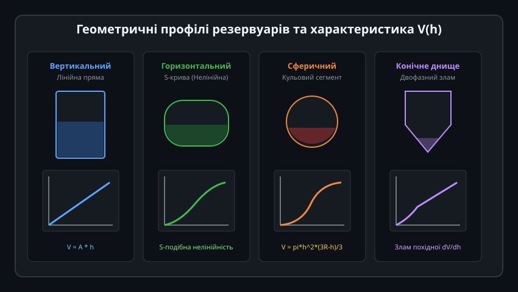
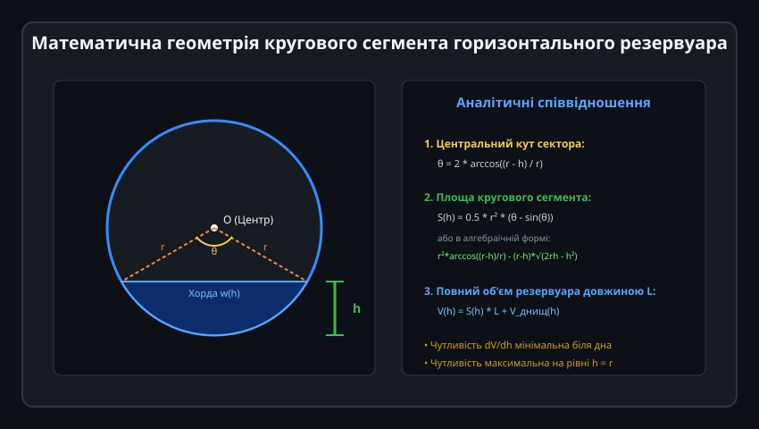
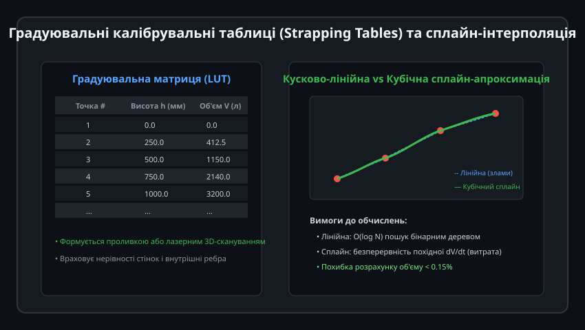
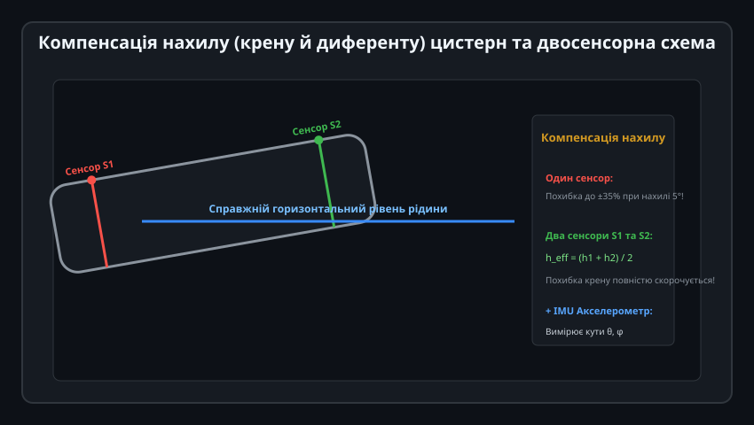
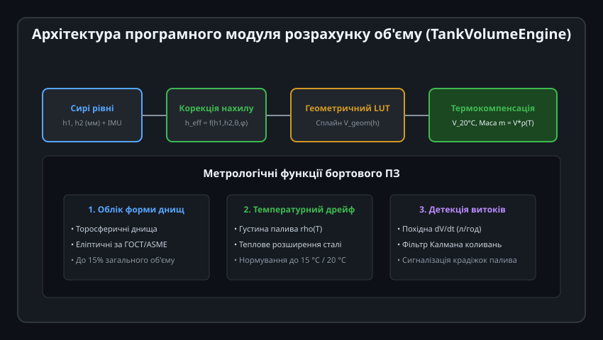

# Алгоритми калібрування та геометрії резервуарів

Визначення фізичного рівня рідини `h` (у міліметрах або відсотках висоти) є лише першим кроком у системах автоматизованого обліку. Кінцевого користувача та технологічні алгоритми цікавить фактичний залишок об'єму (у літрах або кубічних метрах) та маса речовини (у кілограмах або тоннах). Перехід від лінійного рівня до дійсного об'єму вимагає врахування складної нелінійної геометрії ємності, форми опуклих днищ, калібрувальних похибок монтажу, нахилу резервуара та температурного розширення.

---

## 1. Геометричні профілі резервуарів та характеристика V(h)

Залежність накопиченого об'єму рідини `V` від поточної висоти рівня `h` принципово відрізняється для різних типів ємностей:

### Порівняння основних форм:
1. **Вертикальний циліндр або прямокутна призма:**
   - Площа горизонтального перерізу є константою на всій висоті: `A(h) = const`.
   - Залежність суто лінійна: `V(h) = A * h`. Чутливість `dV/dh` незмінна від 0% до 100%.
2. **Горизонтальний циліндр (цистерни АЗС, залізничні та автоцистерни):**
   - Площа дзеркала рідини безперервно змінюється: вона близька до нуля біля дна і склепіння, а максимальна на рівні радіуса `h = r`.
   - Крива `V(h)` має виражену S-подібну форму. Похибка вимірювання рівня на рівні 5 мм біля дна відповідає зовсім іншому об'єму, ніж ті самі 5 мм посередині бака.
3. **Сферичний резервуар (газгольдери, зріджені гази під тиском):**
   - Об'єм визначається формулою кульового сегмента:
     
     V(h) = (pi * h^2 * (3 * R - h)) / 3

4. **Резервуари з конічним або пірамідальним днищем (силоси, реактори, ферментери):**
   - Мають злам похідної на стику циліндричної та конічної частин, що вимагає шматочково-неперервного моделювання.

---

## 2. Математичний розрахунок горизонтального циліндра

Горизонтальні циліндричні резервуари є найпоширенішим типом нафтових та паливних сховищ:

### Геометричний вивід:
1. **Центральний кут кругового сегмента:**
   Якщо `r` — внутрішній радіус циліндра, а `h` — виміряна висота стовпа рідини від нижньої точки (0 <= h <= 2r):
   
   theta = 2 * arccos((r - h) / r)  (у радіанах)

2. **Площа кругового сегмента:**
   Площа сектора мінус площа трикутника під хордою дзеркала рідини:
   
   S(h) = 0.5 * r^2 * (theta - sin(theta))

   Або в чисто алгебраїчному вигляді без обчислення синуса:
   
   S(h) = r^2 * arccos((r - h) / r) - (r - h) * sqrt(2 * r * h - h^2)

3. **Об'єм рідини в циліндричній частині довжиною L:**
   
   V_cyl(h) = S(h) * L

4. **Внесок опуклих днищ (еліптичних або торосферичних):**
   Справжні промислові резервуари мають опуклі торцеві кришки за стандартами DIN 28011 (Klöpper) або ГОСТ, які додають до 5–15% загального об'єму. Для еліптичних днищ із глибиною опуклості `c`:
   
   V_heads(h) = pi * c * h^2 * (1 - (h / (3 * r)))

---

## 3. Градуювальні таблиці (Strapping Tables) та методи інтерполяції

На практиці геометричні розміри ємностей відхиляються від ідеальних креслень через зварні шви, внутрішні ребра жорсткості, підігрівачі, трубопроводи та деформацію стінок від гідростатичного тиску («бочковість»).

### Формування градуювальної матриці:
- **Об'ємний метод:** Резервуар заповнюють прецизійними дозами рідини через еталонний лічильник 1-го класу точності, записуючи пари значень `(h_i, V_i)`.
- **Геодезичний метод (3D лазерне сканування):** Внутрішню поверхню порожнього резервуара сканують лідаром із точністю до 1 мм, після чого комп'ютерна модель автоматично генерує калібрувальну таблицю (Strapping Table) із кроком 10 мм або 1 мм.

### Алгоритми інтерполяції в контролері:
1. **Кусково-лінійна інтерполяція (Piecewise Linear LUT):**
   Швидкий бінарний пошук сусіднього інтервалу з лінійною інтерполяцією між опорними точками. Забезпечує мінімальне навантаження на процесор, проте похідна `dV/dt` має сходинкові розриви.
2. **Кубічна сплайн-апроксимація (Cubic Spline):**
   Побудова гладких поліномів 3-го ступеня, які гарантують неперервність як об'єму `V(h)`, так і миттєвої витрати `dV/dh`. Застосовується в комерційних вузлах обліку та системах виявлення витоків.

---

## 4. Компенсація нахилу цистерн та двосенсорна схема

На транспортних засобах (автоцистерни-бензовози, суднові танки, локомотиви) або при просіданні фундаменту стаціонарного бака рідина нахиляється під дією сили тяжіння:

### Проблема одиночного датчика:
Якщо єдиний датчик рівня встановлений біля передньої або задньої стінки, нахил цистерни всього на 3°–5° призводить до колосальної похибки вимірювання об'єму (до 25–40%!), оскільки ватерлінія рідини зміщується відносно датчика.

### Інженерні методи компенсації:
1. **Центральне розміщення:** Одиночний датчик, встановлений строго в геометричному центрі ваги дзеркала рідини (центроїді), частково нівелює нахил, оскільки вісь обертання площини проходить через точку вимірювання.
2. **Двосенсорна схема (Dual Sensor):**
   - Встановлення двох однакових давачів на протилежних кінцях резервуара (передній `S1` і задній `S2` на відстані `D`).
   - Ефективний рівень по осі:
     
     h_eff = (h_1 + h_2) / 2

   - Похибки кутового перекосу взаємно компенсуються з точністю до 0.5% навіть за великих кутів коливань.
3. **IMU-компенсація:** Використання 6-осьового акселерометра/гіроскопа для прямого розрахунку тривимірного рівняння площини рідини відносно похилої системи координат резервуара.

---

## 5. Архітектура обчислювального модуля та температурна компенсація

Для фінального розрахунку маси палива або хімікату об'єм необхідно скоригувати на температуру середовища та температурне розширення металу резервуара:

### Термодинамічна модель обліку маси:
1. **Теплове розширення стінок сталевого резервуара:**
   Зі зростанням температури стінки бака розширюються, збільшуючи геометричний об'єм:
   
   V_geom(T) = V_geom_20 * (1 + 2 * alpha_steel * (T - 20) + beta_steel * (T - 20))

   де `alpha_steel ≈ 12 * 10^-6 1/°C` для вуглецевої сталі.
2. **Температурна зміна густини рідини:**
   Для бензинів та дизельного пального густина суттєво падає з нагріванням (коефіцієнт об'ємного розширення `gamma ≈ 0.00085...0.00100 1/°C`):
   
   rho(T) = rho_15 / (1 + gamma * (T - 15))

3. **Розрахунок комерційної маси:**
   
   m = V(h_eff, T) * rho(T)

Усі ці етапи інтегруються в бортове ПЗ контролера, гарантуючи відповідність вимогам метрологічного контролю та виключаючи несанкціоновані втрати чи похибки обліку паливно-мастильних матеріалів.
