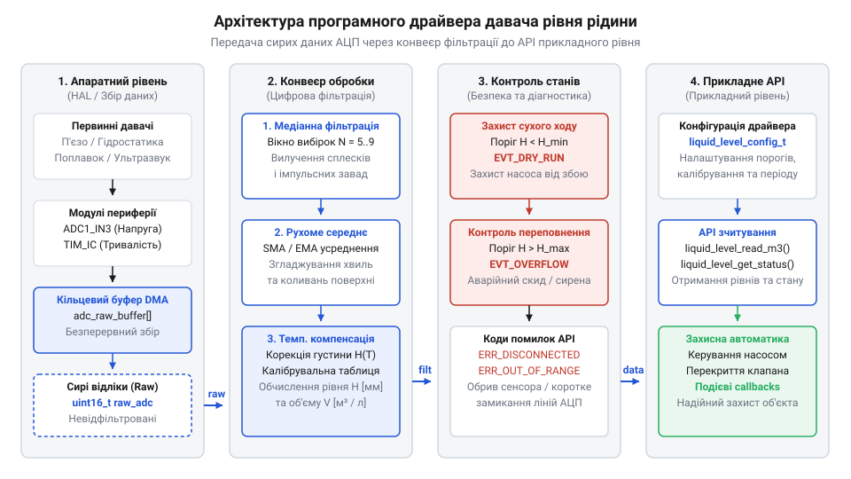
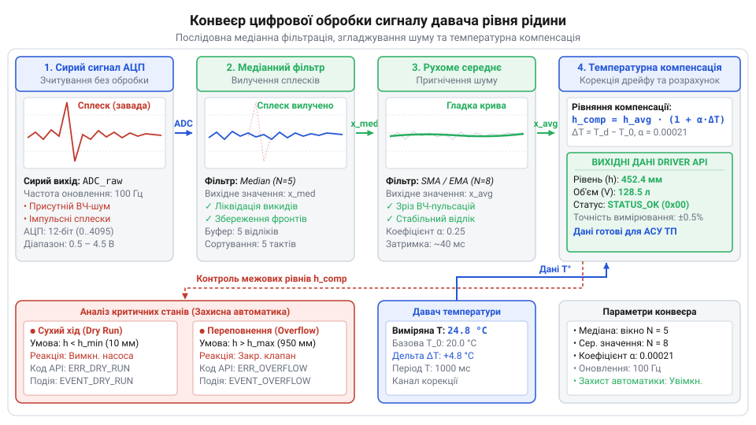

# Програмний інтерфейс драйвера та алгоритмів обробки рівня рідини

<preknowlist>
- [HW-038 — давач рівня води](root:cat-hw-sensors/hw-038-water-level) — принцип формування резистивного сигналу залежно від занурення контактних доріжок у рідину
</preknowlist>

## Проблема сирих даних і архітектура драйвера

Безпосереднє підключення аналогово-цифрового перетворювача (від @@en|analog-to-digital converter@@ — аналогово-цифровий перетворювач, @@en|ADC@@) до первинного давача рівня рідини створює ілюзію простоти: достатньо зчитати числове значення з аналогового входу мікроконтролера та зіставити його з висотою рідини. На практиці первинні відліки виявляються вкрай нестабільними. У реальному резервуварі виникає поверхневе хвилювання від роботи занурювального насоса чи вхідного потоку, електромагнітні завади від електродвигунів та силових реле, а також температурний дрейф провідності рідини або ємності електродів. Якщо використовується [резистивний сенсор води](root:cat-hw-sensors/hw-038-water-level), зміна солоності рідини чи окиснення доріжок додатково спотворюють амплітуду сигналу.

Якщо керуюча автоматика приймає рішення про вмикання або вимикання помпажного обладнання на основі поодиноких сирих відліків @@en|ADC@@, виникає явище брязкання силових контактів. Випадковий сплеск напруги від хвилі на поверхні рідини спричиняє швидке серійне перемикання реле. Це призводить до передчасного зношування механічних контактів, перегріву обмоток електродвигуна або помилкового спрацьовування тривоги про переповнення ємності. Подібні проблеми виникають і тоді, коли застосовують [аналогові сенсори вологості](root:cat-hw-sensors/soil-moisture) або [контактні сенсори дощу](root:cat-hw-sensors/funduino-rain), де нестабільність контактного середовища вимагає цифрового усереднення.

Для усунення цих ризиків програмний драйвер будують за двошаровою архітектурою з чітким розділенням відповідальності між апаратно-залежним збором даних та високорівневою цифровою обробкою.


*Низькорівневий шар зчитує АЦП і заповнює буфер, а модуль обробки видає очищені дані застосовному коду.*

Нижній шар — шар абстракції апаратного забезпечення (від @@en|hardware abstraction layer@@ — шар абстракції апаратного забезпечення, @@en|HAL@@) — відповідає за взаємодію з периферією мікроконтролера. Він налаштовує таймери для періодичного опитування (від @@en|polling@@ — опитування) або прямого доступу до пам'яті (від @@en|direct memory access@@ — прямий доступ до пам'яті, @@en|DMA@@), зчитує значення аналогових входів чи цифрових шин і накопичує первинні виміри у сирому кільцевому буфері (від @@en|circular buffer@@ — кільцевий буфер). Цей шар не виконує жодних обчислень фізичних величин і прагне мінімізувати час перебування в обробниках переривань.

Верхній шар — модуль цифрової обробки та високорівневого програмного інтерфейсу (від @@en|application programming interface@@ — програмний інтерфейс застосунку, @@en|API@@) — витягує сирі дані з буфера, застосовує алгоритми фільтрації, температурної корекції та геометричного перерахунку, а також контролює аварійні межі. Застосовний код взаємодіє виключно з високорівневим @@en|API@@, отримуючи повністю відфільтровані й відкалібровані показники у фізичних одиницях (міліметрах, відсотках чи літерах).

## Конфігурація та ініціалізація програмного інтерфейсу

Гнучкість та повторне використання драйвера у різних проектах забезпечуються відмовою від жорстко прописаних констант у коді на користь конфігураційних структур. Фізичні параметри резервуара, бітність @@en|ADC@@, розміри вікон фільтрації та калібрувальні константи передаються в драйвер під час його запуску.

Конфігураційна структура містить кілька системних блоків параметрів:
- **Апаратні параметри АЦП**: роздільна здатність у бітах (наприклад, 10 або 12 біт) та опорна напруга живлення V_ref у мілівольтах. - **Калібрувальні точки**: значення сирого відліку @@en|ADC@@ для сухого давача (ADC_empty, відповідає 0% рівня) та значення для повністю зануреного давача (ADC_full, відповідає 100% рівня), а також максимальна фізична висота стовпа рідини H_max у міліметрах. - **Налаштування фільтрів**: розмір вікна медіанного фільтра (непарне число відліків, наприклад 5 або 7) та довжина вікна рухомого середнього (наприклад, 16 відліків). - **Температурна компенсація**: температурний коефіцієнт дрейфу alpha (%/°C) та референсна температура калібрування T_calib (°C). - **Аварійні пороги**: відсоткові межі для сухого ходу (P_dry) та переповнення (P_overflow).

Ініціалізація драйвера виконується функцією стартапу, яка приймає вказану структуру конфігурації. Під час ініціалізації драйвер перевіряє коректність наданих параметрів: ADC_empty не повинно дорівнювати ADC_full, вікна фільтрів мають перебувати у допустимих межах буфера, а вказівники на буфери не повинні бути нульовими (від @@en|null pointer@@ — нульовий вказівник). Якщо перевірка успішна, драйвер виділяє або обнуляє внутрішні буфери, скидає стани фільтрів та переводить драйвер у готовність до роботи.

Для ілюстрації розглянемо реалізацію програмного інтерфейсу ініціалізації мовами C та C++.

:::tabs
:::code api-liquid-level-sensor-driver-software-interface/c/snippet-1.c
:::code api-liquid-level-sensor-driver-software-interface/cpp/sensorstatus.cpp
:::

## Конвеєр цифрової обробки та компенсації

Після зчитування сирих значень з @@en|ADC@@ вони потрапляють у триетапний конвеєр обробки сигналу. Кожен етап вирішує свій клас завад і готує дані для подальших обчислень.


*Імпульсні завади відсікаються медіаною, високочастотний шум згладжується середнім, а температурний дрейф компенсується за даними термодатчика.*

Перший етап конвеєра — медіанний фільтр (від @@en|median filter@@ — медіанний фільтр). Його головна мета — повне вилучення поодиноких аномальних імпульсів та сплесків, що виникають через електромагнітні наводки або різкі сплески рідини. Лінійне усереднення не здатне пригнітити сильний короткий імпульс, бо він зміщує середнє значення всієї вибірки. Медіанний фільтр зберігає N останніх відліків, сортує їх за зростанням і обирає значення в середині відсортованого масиву. Крайні аномальні відхилення опиняються на початку або в кінці масиву й повністю ігноруються.

Другий етап — рухоме середнє (від @@en|moving average@@ — рухоме середнє). Після видалення імпульсних сплесків залишається високочастотний шум @@en|ADC@@ та дрібне коливання води. Алгоритм рухомого середнього обчислює арифметичне середнє значення для ковзного вікна з M останніх оновлених відліків. Це забезпечує плавну траєкторію зміни рівня без затримок, критичних для динаміки автоматики.

Третій етап — температурна компенсація (від @@la|compensātiō@@ — зрівноваження). Провідність рідкого середовища та параметри аналогового ланцюга залежать від температури (наприклад, питомий опір води зменшується приблизно на 2% при зростанні температури на кожні 1°C). Якщо вимірювання проводиться за температури T_current, яка відрізняється від референсної температури калібрування T_calib, виникає температурний дрейф показників. Для збереження точності драйвер коригує значення @@en|ADC@@ за допомогою температурного коефіцієнта alpha.

Розрахунок температурно компенсованого відліку ADC_comp з сирого відліку ADC_raw здійснюється за формулою:

```text
ADC_comp = ADC_raw / (1 + alpha * (T_current - T_calib))
         = 2048 / (1 + 0.002 * (35 - 25))        [підстановка параметрів вимірювання]
         = 2048 / (1 + 0.002 * 10)              [різниця температур 10 °C]
         = 2048 / 1.02                           [знаходження температурного дільника]
         = 2007.84                               [скориговане значення АЦП для нульового дрейфу]
```

Отримане скориговане значення ADC_comp відображає дійсну висоту стовпа рідини незалежно від температурного режиму середовища.

## Обчислення об'єму та зчитування показників

Після проходження конвеєра обробки відфільтроване значення ADC_comp перераховується у відсотковий рівень заповнення P (від 0% до 100%) та фізичну висоту стовпа рідини H у міліметрах. Відсотковий рівень обчислюється за формулою:

```text
P = ((ADC_comp - ADC_empty) / (ADC_full - ADC_empty)) * 100
  = ((2007.84 - 500) / (3500 - 500)) * 100       [підстановка виміряного та калібрувальних відліків]
  = (1507.84 / 3000) * 100                       [нормування у діапазоні калібрування]
  = 50.26                                        [поточний рівень у відсотках]
```

Висота стовпа рідини в міліметрах обчислюється як H = H_max * (P / 100).

Для визначення об'єму рідини V у баку драйвер враховує геометричну форму резервуара. Для прямокутного або вертикального циліндричного бака зі сталою площею перерізу A об'єм прямо пропорційний висоті H: V = A * H. У випадку складних несиметричних ємностей (наприклад, сферичних чи конічних резервуарів) драйвер використовує таблицю пошуку (від @@en|lookup table@@ — таблиця пошуку) з кусочно-лінійною інтерполяцією (від @@la|interpolatiō@@ — підстановка), яка зіставляє висоту стовпа H із точним об'ємом у літерах. Детальніший опис обчислень та практичні методи побудови калібрувальних таблиць висвітлено у статті про [алгоритми калібрування та геометрії резервуарів](root:cat-hw-sensors/liquid-level-sensor-geometry-calibration).

Щоб контролювати баланс між надходженням і витратою рідини, корисно поєднувати вимірювання з [давачем витрати води](root:cat-hw-sensors/water-flow-sensor), що дає змогу виявляти приховані витоки в трубопроводі.

У високорівневому @@en|API@@ передбачені функції для зчитування показників у потрібних одиницях вимірювання. Поданий нижче код демонструє функції зчитування для C та C++.

:::tabs
:::code api-liquid-level-sensor-driver-software-interface/c/liquid-level-get-percent.c
:::code api-liquid-level-sensor-driver-software-interface/cpp/snippet-4.cpp
:::

## Діагностика помилок та аварійні події

Надійність роботи системи контролю рідини залежить від здатності драйвера діагностувати апаратні несправності та миттєво реагувати на критичні стани.

Апаратна діагностика заснована на контролі виходу сирого сигналу @@en|ADC@@ за межі фізично можливого електричного діапазону:
- **Обрив лінії (лінійний обрив)**: Якщо значення @@en|ADC@@ падає нижче від мінімального допустимого рівня (наприклад, ADC_raw < 50 відліків при робочому діапазоні 500...3500), драйвер фіксує обрив з'єднувального кабелю або пошкодження сенсора й повертає код помилки LIQUID_LEVEL_ERR_LINE_BREAK. Аналогічна діагностика використовується й тоді, коли застосовують [ємнісні сенсори рідини](root:cat-hw-sensors/capacitive-soil) при втраті контакту із заземленням. - **Коротке замикання**: Якщо значення @@en|ADC@@ перевищує верхню межу насичення (наприклад, ADC_raw > 4045 для 12-бітного АЦП з насиченням біля VCC), фіксується коротке замикання сигнальної лінії на шину живлення з кодом LIQUID_LEVEL_ERR_SHORT_CIRCUIT.

Окрім апаратних помилок, драйвер виявляє дві аварійні технологічні події:
- **Сухий хід (від @@en|dry run@@ — сухий хід)**: Зниження рівня рідини нижче безпечного мінімуму (P < P_dry, наприклад < 5%). Робота відцентрового насоса в режимі сухого ходу призводить до перегріву й руйнування сальникових ущільнень протягом кількох секунд. - **Переповнення резервуара**: Зростання рівня вище критичної межі (P > P_overflow, наприклад > 95%), що загрожує затопленням приміщення чи витоком агресивних речовин.

Для негайного захисту обладнання очікування чергового циклу опитування в головному циклі програми (від @@en|main loop@@ — головний цикл) є неприпустимим через затримки. Драйвер підтримує механізм зворотних викликів (від @@en|callback@@ — зворотний виклик). Застосовний код реєструє функцію обробника події, яку драйвер викликає безпосередньо з контексту оновлення вимірів при виявленні сухого ходу або переповнення.

Нижче наведено приклад реєстрації зворотних викликів та обробки аварійних станів C та C++.

:::tabs
:::code api-liquid-level-sensor-driver-software-interface/c/liquid-level-register-callback.c
:::code api-liquid-level-sensor-driver-software-interface/cpp/liquidlevelsensoradv.cpp
:::