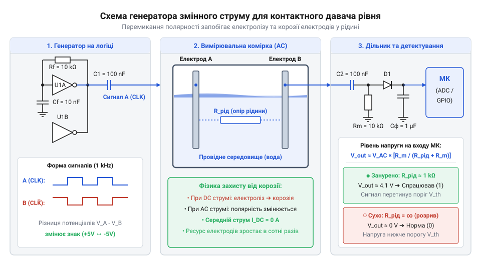
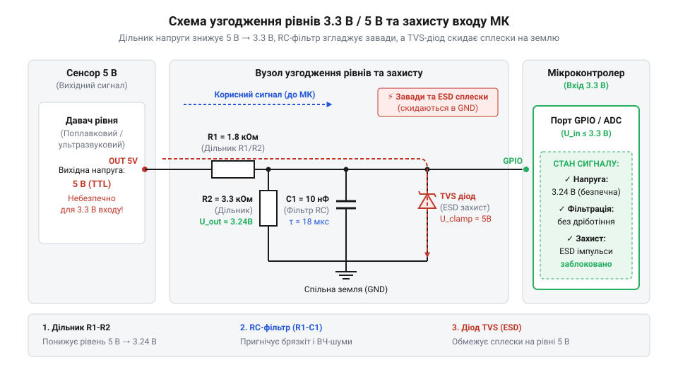

# Апаратне підключення та схемотехніка давачів рівня рідини

<preknowlist>
- [HW-038 — давач рівня води](root:cat-hw-sensors/hw-038-water-level) — конструктивне влаштування резистивних контактних доріжок та базове аналогове зчитування рівня
- [Ємнісний давач вологості ґрунту (v1.2)](root:cat-hw-sensors/capacitive-soil) — принцип ємнісного вимірювання середовища без прямого гальванічного контакту з рідиною
- [Давач вологості ґрунту (+LM393)](root:cat-hw-sensors/soil-moisture) — використання аналогового компаратора LM393 для порогової дискретизації сигналу
</preknowlist>

## Руйнування контактів та завади вимірювання

Уявіть типову ситуацію під час проектування системи автоматизації: до аналогового входу мікроконтролера підключають занурені у резервуар з водою металеві електроди, на які подається постійна напруга живлення 5 В. У перші години система працює бездоганно і чітко реєструє зміну рівня рідини за зміною опору між контактами. Однак уже через добу поверхня мідних доріжок вкривається темним нальотом, металевий шар вимірювальних електродів повністю розчиняється у воді, а покази аналогово-цифрового перетворювача хаотично плавають або фіксують повний обрив кола. Намагання подавати постійну напругу безпосередньо на занурені електроди неминуче призводить до швидкого апаратного виходу давача з ладу.

Головна фізична причина цього явища полягає в електрохімічному процесі, що зветься @@en|electrolysis@@ (від грец. *електро* — електрика та *люсис* — розчин, розклад). Звичайна водопровідна або технічна вода є електролітом, оскільки містить розчинені солі та дисоційовані йони. Коли через такий розчин протікає постійний струм (@@en|Direct Current@@, від англ. *Direct Current* — постійний струм), утворене між електродами електричне поле спричиняє напрямлений рух йонів. На позитивному електроді — @@en|anodic oxidation@@ (від грец. *анодос* — шлях угору) — відбувається реакція окиснення: атоми міді чи заліза віддають електрони й переходять у розчин у вигляді йонів. Присутність розчиненого кислороду та хлорид-йонів істотно прискорює корозію, через що [прості контактні плати](root:cat-hw-sensors/hw-038-water-level) або [подібні сенсори дощу](root:cat-hw-sensors/funduino-rain) повністю руйнуються за лічені дні постійної експлуатації.

На негативному електроді — @@en|cathode@@ (від грец. *катодос* — шлях вниз) — відбувається зворотний процес окисно-відновної реакції: @@en|cathodic reduction@@. Йони водню приймають електрони з утворенням бульбашок газу. Накопичені на поверхні контакту мікробульбашки газу створюють шар, відомий як @@en|polarization@@ (від грец. *полос* — вісь). Цей газовий бар'єр штучно збільшує електричний опір контакту, спричиняючи монотонне дрейфування виміряних значень навіть за незмінного рівня рідини в резервуарі.

Суттєві апаратні завади виникають і при використанні механічних поплавкових давачів. Дискретний @@en|float switch@@ (від англ. *float switch* — поплавковий вимикач) містить усередині герметичний язичковий перемикач — @@en|reed switch@@ (геркон) — та рухомий магніт у поплавку. При коливаннях поверхні рідини, хвилях від роботи насосів чи вібрації резервуара поплавок багаторазово перетинає точку спрацьовування. Металеві контакти герконів при замиканні фізично пружинять, породжуючи @@en|contact bounce@@ (від англ. *bounce* — відскок, дріботіння контактів) тривалістю від 1 до 10 мілісекунд. Без апаратного придушення дріботіння кожен перехід рівня генерує серію високочастотних імпульсів, які переривають робочий цикл мікроконтролера через @@en|interrupt@@ (від лат. *interruptus* — перерваний) і призводять до помилкових багаторазових спрацьовувань автоматики.

Аналогові лінії вимірювання рівня зазнають впливу ще одного джерела деградації сигналу — електромагнітних наводок. Коли аналоговий вихід давача підключається до периферійного блоку @@en|ADC@@ (від англ. *Analog-to-Digital Converter* — аналого-цифровий перетворювач), сигнальний кабель великої довжини працює як антена. Промислові частоти 50 Гц, імпульсні завади від перемикання силових реле, комутації електродвигунів та силових ліній створюють високочастотні наводки (@@en|EMI@@, від англ. *Electromagnetic Interference* — електромагнітна завада). Оскільки вхідний опір каналу @@en|ADC@@ є високим, ці напруги накладаються на корисний сигнал, викликаючи хаотичний числовий шум у молодших розрядах вимірювання.

Для забезпечення тривалої та стабільної роботи апаратного вузла необхідно усунути першопричини цих деструктивних чинників. Електрохімічний електроліз контактних електродів зупиняють шляхом переходу від постійного струму до змінного струму високої частоти (@@en|Alternating Current@@). Механічне дріботіння поплавкових контактів та високочастотний шум аналогового каналу @@en|ADC@@ вимагають обов'язкового застосування апаратних пасивних фільтрів та кіл формування сигналу.

## Захист і генерація змінного струму

Для захисту занурених металевих електродів від електрохімічної корозії та поляризації застосовують живлення змінним струмом (@@en|Alternating Current@@). Коли напрямок струму між електродами періодично змінюється з частотою від 500 Гц до 10 кГц, атоми металу, що окислилися під час першої напівхвилі, відновлюються під час другої. В результаті сумарний результуючий масоперенос напівйонів прямує до нуля, і руйнування контактів повністю припиняється.

Генерацію змінного струму реалізують за допомогою апаратної схеми автогенератора на цифрових логічних елементах (наприклад, CMOS-інверторах чи елементах І-НЕ), зібраного за схемою релаксаційного @@en|multivibrator@@ (від лат. *multus* — багато та *vibro* — коливаюсь). Обов'язковим елементом такої схеми є розділові конденсатори (@@en|decoupling capacitor@@), увімкнені послідовно з кожним електродом. Конденсатори не пропускають постійну складову напруги, гарантуючи чисто змінну форму струму в рідині навіть у випадку програмного зависання мікроконтролера.


*Принципова схема генератора змінного струму на логічних елементах та дільника напруги для контактного давача рівня з перемиканням полярності на електродах.*

Змінний струм від генератора проходить через вимірювальний резистивний дільник, де одним із плечей є опір рідини між електродами. Амплітуда вихідного змінного сигналу змінюється пропорційно глибині занурення електродів. Щоб подати цей сигнал на аналоговий вхід @@en|ADC@@ мікроконтролера, змінну напругу необхідно випрямити та згладити. Для цього застосовують амплітудний детектор — @@en|peak detector@@ (від англ. *peak detector* — амплітудний детектор), виконаний на діоді Шотткі з низьким прямим падінням напруги та згладжувальному конденсаторі.

Для поплавкових герконових давачів основним захисним заходом проти дріботіння є побудова апаратного RC-фільтра дебаунсингу. Розглянемо покроковий математичний розрахунок параметрів такого фільтра.

**Розрахунок сталі часу RC-фільтра дебаунсингу:**
Для герконованого поплавкового давача з тривалістю дріботіння контактів `T_bounce = 5 мс` обираємо підтягувальний резистор `R_pullup = 10 кОм` та фільтруючий конденсатор `C_debounce = 1 мкФ`. Сталя часу `tau` розраховується за формулою:

```
tau = R_pullup × C_debounce
    = 10000 × 0.000001           [підстановка опору 10 кОм та ємності 1 мкФ]
    = 0.01 с                     [обчислення сталі часу в секундах]
    = 10 мс                      [переведення сталі часу в мілісекунди]
```

Оскільки отримана сталя часу `tau = 10 мс` перевищує тривалість дріботіння `T_bounce = 5 мс`, конденсатор повністю поглинає високочастотні сплески напруги під час комутації, видаючи на вихід плавну зміну логічного рівня.

Для контактного аналогового давача розрахуємо параметри вимірювального дільника напруги.

**Розрахунок аналогового вимірювального дільника напруги:**
При зануренні електродів у провідну рідину опір рідкого середовища становить `R_liquid = 5 кОм`. Еталонний резистор дільника `R_ref = 10 кОм`, напруга живлення генератора `V_CC = 5 В`. Вихідна напруга `V_out` до амплітудного детектора розраховується так:

```
V_out = V_CC × (R_ref ÷ (R_liquid + R_ref))
      = 5 × (10000 ÷ (5000 + 10000))     [підстановка опорів R_liquid та R_ref]
      = 5 × (10000 ÷ 15000)              [додавання опорів у знаменнику]
      = 5 × 0.667                        [обчислення коефіцієнта ділення]
      ≈ 3.33 В                           [амплітудне значення вихідної напруги]
```

Щоб запобігти невизначеним проміжним станам цифрового входу мікроконтролера при повільному заряджанні RC-конденсатора, після фільтра обов'язково встановлюють логічний буфер із тригером Шмітта — @@en|Schmitt trigger@@ (від імені винахідника *Otto Schmitt*). Тригер Шмітта має вроджений гістерезис верхнього та нижнього порогів спрацьовування, що остаточно усуває будь-яку нестабільність цифрового сигналу.

## Підключення аналогових і цифрових давачів

Безконтактні та інтелектуальні давачі рівня рідини усувають проблему электролізу завдяки повній фізичній ізоляції вимірювальних елементів або використанню цифрових протоколів обміну. Проте їхнє підключення вимагає дотримання специфічних апаратних вимог до узгодження аналогових і цифрових інтерфейсів.

Конструктивно [ємнісні давачі вологості](root:cat-hw-sensors/capacitive-soil) та рівня мають захисне лакове покриття друкованої плати, що запобігає гальванічному контакту мідних доріжок із рідиною. Пластина давача разом із навколишнім середовищем утворює конденсатор, ємність якого змінюється залежно від висоти стовпа рідини завдяки високій діелектричній проникності води. Внутрішній високочастотний генератор модуля перетворює цю ємність на аналогову напругу. Для захисту входу @@en|ADC@@ від високочастотних пульсацій внутрішнього генератора аналоговий вихід давача підключають через низькочастотний RC-фільтр (`R = 1 кОм`, `C = 100 нФ`), розташований у безпосередній близькості до ніжки мікроконтролера. У простих дискретних схемах пороговий рівень може додатково оброблятися [сплатованим компаратором LM393](root:cat-hw-sensors/soil-moisture).

Ультразвукові давачі рівня (зокрема HC-SR04 та його захищений промисловий аналог JSN-SR04T) працюють за принципом вимірювання часу проходження акустичної хвилі — @@en|time-of-flight@@ (від англ. *Time-of-Flight* — час польоту). Випромінювач посилає короткий ультразвуковий імпульс частотою 40 кГц у напрямку межі розділу "повітря-рідина" і фіксує відбиту луну. Інтерфейс підключення складається з чотирьох виводів: `VCC`, `GND`, `Trig` (цифровий вхід запуску зондування) та `Echo` (цифровий вихід, тривалість високого рівня якого пропорційна відстані).

При монтажі ультразвукових давачів у закритих резервуарах виникають апаратні завади у вигляді хибних відбиттів — @@en|spurious reflections@@ (паразитні акустичні луни від стінок бака, внутрішніх трубок або бурхливої поверхні). Для усунення цих завад застосовують апаратну заспокійливу трубу — @@en|still well@@ (від англ. *still well* — заспокійлива колона). Труба перфорується знизу для вільного проходу рідини і спрямовує ультразвуковий промінь суворо вертикально, ізолюючи його від перешкод на стінках резервуара.

Цифрові давачі рівня передають дані через послідовні шини @@en|I2C@@ (від англ. *Inter-Integrated Circuit*) або @@en|UART@@ (від англ. *Universal Asynchronous Receiver-Transmitter*).

Шина @@en|I2C@@ використовує дві сигнальні лінії: `SDA` (дані) та `SCL` (тактування). Обидві лінії виконані за схемою з відкритим стоком — @@en|open-drain@@ (від англ. *open-drain* — відкритий стік) і потребують зовнішніх підтягувальних резисторів `R_pullup` до лінії живлення.

**Розрахунок граничного опору підтяжки шини I2C:**
Максимальний опір `R_pullup(max)` обмежується паразитною ємністю шини `C_bus` та допустимим часом наростання фронту сигналу `t_r` (за стандартом I2C `t_r = 1 мкс`). Для ємності лінії `C_bus = 200 пФ`:

```
R_pullup(max) = t_r ÷ (0.8473 × C_bus)
              = 0.000001 ÷ (0.8473 × 0.0000000002)   [підстановка t_r = 1 мкс та C_bus = 200 пФ]
              = 0.000001 ÷ 0.00000016946             [обчислення знаменника]
              ≈ 5900 Ом                              [максимальне значення опору підтяжки]
```

Типовим вибором для надійної роботи на частотах 100–400 кГц є номінали підтяжки `R_pullup` у діапазоні від 2.2 кОм до 4.7 кОм.

Послідовний інтерфейс @@en|UART@@ реалізує точку-точку підключення через лінії `TXD` та `RXD`. Для запобігання відбиттям сигнальних фронтів у довгих кабелях послідовно в лінію `TXD` впаюють узгоджувальні резистори номіналом 22–100 Ом. Якщо відстань між давачем та мікроконтролером перевищує 5 метрів, для запобігання різниці заземлювальних потенціалів — @@en|ground loop@@ (земляна петля) — TTL-рівні @@en|UART@@ перетворюють у диференційний промисловий інтерфейс @@en|RS-485@@. Часто комплексний облік рідини в резервуарах додатково комбінується з [турбінним давачем витрати](root:cat-hw-sensors/water-flow-sensor), де швидкісний імпульсний вихід також вимагає узгодження.

## Бар'єри захисту та узгодження рівнів

Більшість промислових і захищених давачів рівня (зокрема ультразвукові модулі JSN-SR04T та оптичні вимикачі) вимагають живлення напругою 5 В або 12 В та формують вихідні сигнали відповідного рівня. Сучасні мікроконтролери (ESP32, STM32, ARM) працюють із логічною напругою 3.3 В. Пряме підключення п'ятивольтового сигналу (наприклад, лінії `Echo` або `TXD`) до входу мікроконтролера 3.3 В спричинить відкриття внутрішніх захисних діодів портів, їхнє перегрівання та неминуче вигорання вхідного каскаду @@en|GPIO@@.

Для односпрямованих сигналів від давача до мікроконтролера найпростішим і найдійнішим рішенням узгодження є пасивний резистивний дільник напруги.

**Розрахунок резистивного дільника узгодження 5 В → 3.3 В:**
Вхідна напруга від давача `V_in = 5 В`. Обираємо резистори дільника `R_1 = 1.8 кОм` (у верхньому плечі) та `R_2 = 3.3 кОм` (у нижньому плечі, підключеному до землі):

```
V_out = V_in × (R_2 ÷ (R_1 + R_2))
      = 5 × (3300 ÷ (1800 + 3300))       [підстановка номіналів R_1 = 1.8 кОм, R_2 = 3.3 кОм]
      = 5 × (3300 ÷ 5100)                [додавання опорів у знаменнику]
      = 5 × 0.647                        [обчислення коефіцієнта ділення]
      ≈ 3.23 В                           [підсумкова напруга для входу 3.3 В GPIO]
```

Для двоспрямованих ліній з відкритим стоком (таких як `SDA` та `SCL` шини @@en|I2C@@) резистивний дільник непридатний. Для них застосовують активний транслятор рівнів на N-канальному польовому транзисторі (MOSFET). Затвор транзистора підключається до джерела живлення 3.3 В, витік (Source) — до сигнальної лінії 3.3 В, а стік (Drain) — до сигнальної лінії 5 В. Обидві сторони підтягуються резисторами до відповідних шин живлення. Коли сторона 3.3 В передає логічний нуль, транзистор відкривається і підтягує лінію 5 В до землі. Коли сторона 5 В передає логічний нуль, спрацьовує паразитний діод підкладки — @@en|body diode@@, знижуючи напругу на витоку і змушуючи транзистор відкритися.


*Схема узгодження логічних рівнів за допомогою резистивного дільника та MOSFET-транслятора з TVS-діодами захисту портів.*

У реальних умовах експлуатації давачі рівня з'єднані довгими кабелями, які піддаються впливу статичної електрики — @@en|ESD@@ (від англ. *Electrostatic Discharge* — електростатичний розряд), та індуктивних наводок від комутації потужних насосів. Для захисту входів мікроконтролера паралельно сигнальним лініям встановлюють захисні супресори — @@en|TVS diode@@ (від англ. *Transient Voltage Suppression* — подавлення транзієнтних перенапруг). Супресор виступає в ролі надшвидкісного стабілітрона: при появі високовольтного імпульсу напруги він за пікосекунди відкривається й скидає струм завади на лінію заземлення, обмежуючи напругу на вході безпечним рівнем.

Для додаткового захисту від виходу напруги за межі рейок живлення застосовують схему діодного обмежувача на двох діодах Шотткі (наприклад, BAT54S). Один діод вмикається між сигнальною лінією та `VCC`, другий — між `GND` та сигнальною лінією, зрізаючи будь-які сплески перенапруги.

У найскладніших промислових умовах з високим рівнем завад або при загрозі виникнення потенціалу між землями застосовують повну гальванічну ізоляцію — @@en|galvanic isolation@@ (від імені *Luigi Galvani*). Сигнали передаються через оптичну розв'язку — @@en|optocoupler@@ (від грец. *оптос* — зоровий та англ. *coupler* — з'єднувач), де світлодіод первинного кола передає фотони на фототранзистор вторинного кола. Оптичний бар'єр повністю розриває електричний контакт між довгим кабелем давача та чутливою платою мікроконтролера, забезпечуючи електричний захист до декількох кіловольт.

Поєднання генератора змінного струму для контактів, пасивних RC-фільтрів, трансляторів рівнів та супресорів @@en|TVS diode@@ дозволяє зібрати повністю завадозахищений апаратний вузол вимірювання рівня рідини, готовий до довготривалої надійної експлуатації.