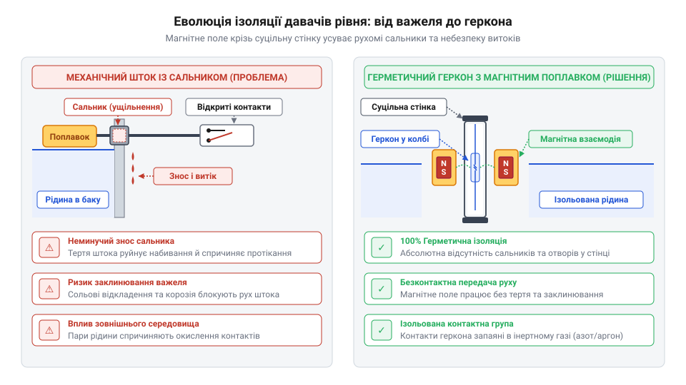
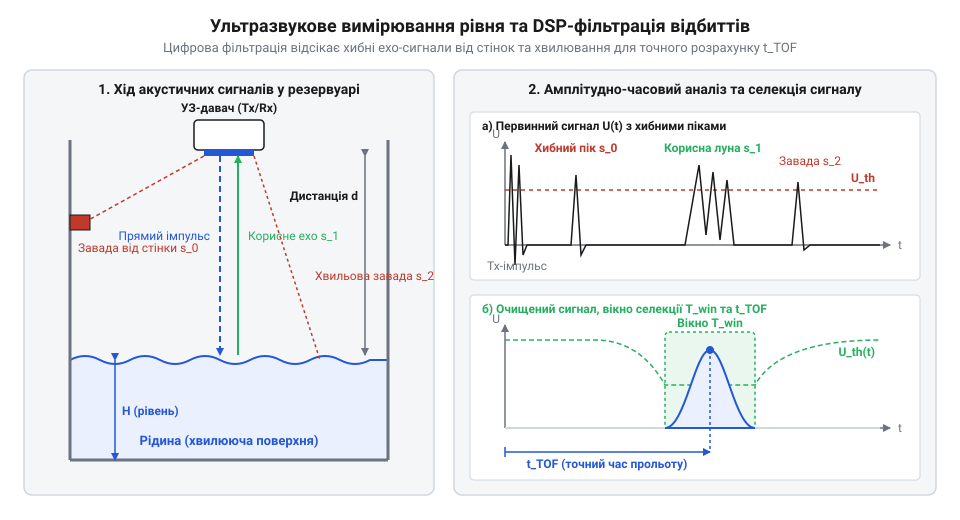

# Еволюція технологій вимірювання рівня рідини

<preknowlist>
- [HW-038 — давач рівня води](root:cat-hw-sensors/hw-038-water-level) — базовий резистивний контактний вимірювач та його чутливість до електролітичної корозії струмопровідних доріжок.
- [Ємнісний давач вологості ґрунту (v1.2)](root:cat-hw-sensors/capacitive-soil) — принцип зміни ємності між електродами в діелектричному середовищі без прямого гальванічного контакту з рідиною.
</preknowlist>

## Небезпека вибухів парових котлів

На початку XIX століття промисловий переворот спирався на енергію пари. Серцем кожної парової машини був котел — металевий резервуар під тиском, у якому межа між водою та парою визначала безпеку роботи. Якщо рівень води падав нижче безпечної позначки, полум'я топки нагрівало оголені стінки. Вода має високу питому теплоємність і ефективно відводить тепло, тоді як пара проводила його набагато гірше. Внаслідок цього оголений корпус розжарювався понад 500 °C, втрачав міцність і деформувався під тиском. Спроба накачати холодну воду в перегрітий котел призводила до вибухового випаровування та розриву резервуара.

Перші спроби контролю спиралися на непрямі вимірювання. Оператори намагалися орієнтуватися на манометри (від грец. @@grc|manos@@ — нещільний та @@grc|metron@@ — міра). Однак @@grc|манометр@@ показує лише тиск газової фази, а не об'єм рідкої води на дні. Високий тиск пари зберігався, коли води залишалося на денці, а при інтенсивному відборі пари тиск падав у повному котлі. Тиск і рівень виявилися незалежними фізичними величинами, тому оцінка рівня за тиском коштувала життя сотням операторів.

Іншим методом були пробні крани (англ. @@en|try cocks@@), врізані в стінку котла на різній висоті. Для перевірки рівня оператор уручну відкривав кран: вихід рідкого струменя означав воду вище цього рівня, а шипіння пари свідчило про сухостій. Це давало лише дискретний точковий зріз замість неперервного спостереження. Відкриття кранів під тиском спричиняло важкі опіки персоналу, а між перевірками рівень міг стрімко впасти під навантаженням двигуна.

Перші спроби створити поплавок (від дієслова плавати) із важільним покажчиком наразилися на проблему прохідного отвору. Металева куля плавала на поверхні води й через жорсткий шток повертала стрілку. Щоб шток вийшов крізь стінку під тиском у десятки атмосфер, застосовували сальник (від слова сало) з пеньковим або шкіряним ущільненням. Висока температура швидко обвуглювала набивку, а тертя заклинювало шток. У результаті @@de|поплавок@@ зависав в одному положенні, створюючи хибні показання, або ж ущільнення розгерметизовувалося з викидом пари. Систематичні аварії змусили шукати спосіб прямого візуального спостереження без рухомих ущільнень.

## Від водомірних стекол до магнітних герконів

Розв'язанням проблеми безпосереднього спостереження стало водомірне скло (від нім. @@de|Wasserstandsglas@@ — скло рівня води) — прозора вертикальна трубка, підключена до котла за принципом сполучених посудин. Однак під тиском перші трубки тріскалися від вібрацій і термічних напруг, а гаряче лужне середовище розчиняло силікати, роблячи скло каламутним. У 1886–1888 роках австрійський інженер Ріхард Клінгер (@@de|Richard Klinger@@) винайшов рефлексійне @@de|водомірне скло@@ з призматичними канавками: парова фаза відбивала світло й здавалася яскраво-сріблястою, а рідка — поглинала його й виглядала темно-чорною. Це усунуло оптичну невизначеність, але скло залишалося лише зоровим індикатором і не могло автоматично керувати живильним насосом. Докладніше про конструкцію та оптичний принцип роботи таких індикаторів читайте у матеріалі про [рефлексійне водомірне скло Клінгера](root:cat-hw-sensors/reflex-sight-glass).

Спроби оснастити поплавкові важелі електричними контактами впиралися в бар'єр прямого механічного зв'язку. Прохідний @@de|сальник@@ залишався найслабшою ланкою: під дією тиску, температури та хімічної корозії (від лат. @@la|corrosio@@ — роз'їдання) ущільнення витікало або заклинювало шток. Вимірювання рівня вимагало повного розриву фізичного контакту між середовищем і електричним колом — аналогічно тому, як ізолювати рухомі частини намагалися [витратоміри з турбіною](root:cat-hw-sensors/water-flow-sensor).

У 1936 році американський інженер Волтер Б. Еллвуд (@@en|Walter B. Ellwood@@) у лабораторіях Bell (@@en|Bell Telephone Laboratories@@) винайшов геркон (від герметичний контакт; патент US2264746A) — герметичний перемикач із феромагнітними контактами у скляній колбі з інертним газом, що замикалися під дією зовнішнього магнітного поля.

Це дозволило створити герметичні давачі рівня. Усередину резервуара монтували глуху трубку з немагнітного матеріалу (нержавіючої сталі чи латуні) з @@en|герконами@@ всередині, а ззовні по ній ковзав кільцевий @@de|поплавок@@ із постійним магнітом.


*Розріз механічного штока із сальником та суцільного герметичного корпусу з внутрішнім герконом і зовнішнім магнітним поплавком показує усунення місця потенційного витоку за рахунок магнітної розв'язки.*

Коли рідина піднімала @@de|поплавок@@ до рівня @@en|геркона@@, магнітне поле крізь немагнітну стінку замикало контакти. Магнітна розв'язка усунула рухомі сальники, забезпечивши ізоляцію рідини та надійне перемикання електричних сигналів без ризику протікання чи заклинювання. Детальніше про різновиди конструкцій та інженерні схеми таких датчиків читайте у статті про [герконовий магнітний давач рівня](root:cat-hw-sensors/magnetic-reed-level-sensor).

## Безконтактні ємнісні та оптичні методи

Магнітні герконові давачі розв'язали проблему герметизації, але залишили рухомий @@de|поплавок@@. У в'язких рідинах чи розчинах, що кристалізуються, відкладення вкривали напрямну трубку, і @@de|поплавок@@ заклинював. А під час хвилювання й вібрації механічні контакти хаотично деренчали. Це змусило відмовитися від рухомих деталей на користь суцільнотілих фізичних перетворювачів, першим із яких стало ємнісне вимірювання.

Ємнісний давач розглядає простір між електродами як конденсатор, ємність (від лат. @@la|capacitas@@ — місткість) якого залежить від діелектричних властивостей середовища. Повітря має відносну діелектричну проникність ε ≈ 1, вода — ε ≈ 80, а мастила — ε ≈ 2...4. Коли рідина піднімається вздовж ізольованого стержня сенсора, розташованого паралельно до металевої стінки бака, загальна @@la|ємність@@ системи зростає пропорційно висоті занурення.

На відміну від ранніх контактних датчиків, де прості [резистивні контактні доріжки](root:cat-hw-sensors/hw-038-water-level) руйнувалися через електролітичну корозію, ємнісний електрод покривають суцільним шаром стійкого полімеру (наприклад, фторопласту). Як і в [ємнісному вимірюванні вологості](root:cat-hw-sensors/capacitive-soil), захищений зонд рівня працює без прямого електричного контакту з середовищем.

Для точкового порогового контролю у компактних резервуарах поширення набули оптичні давачі рівня. Сенсор складається з прозорого конуса або призми (від грец. @@grc|prisma@@ — відпиляне), виготовленого з оптичного скла або полісульфону, всередині якого розміщено інфрачервоний світлодіод і фототранзистор.

Коли @@grc|призма@@ перебуває в повітрі, промінь світлодіода падає на внутрішню грань під кутом, більшим за критичний. Через різницю показників заломлення скла та повітря відбувається повне внутрішнє відбиття (від лат. @@la|reflectio@@ — відгинання назад) на фототранзистор («сухо»). Коли ж рідина вкриває конічну вершину, її показник заломлення наближається до показника скла. Умови для повного внутрішнього @@la|відбиття@@ зникають: світло заломлюється в рідину, а потік на фототранзистор різко падає. Детальніший аналіз конструкції оптичних елементів та порогового контролю наведено в матеріалі про [оптичний призматичний давач рівня](root:cat-hw-sensors/optical-prism-level-sensor).

Твердотільні сенсори без рухомих елементів позбулися механічного зносу й заклинювання. Проте вони принесли власні фізичні обмеження. Ємнісні давачі вимагають калібрування при зміні складу або температури рідини через хибний зсув показань. Оптичні — чутливі до піни, високої каламутності чи в'язких плівок на склі після зливу. Ці обмеження підготували ґрунт для наступного еволюційного кроку — безконтактного хвильового вимірювання.

## Ультразвукові хвилі та мікроконтролерний інтелект

Коли середовище руйнує електроди у [контактному вимірювачі HW-038](root:cat-hw-sensors/hw-038-water-level), а зміна складу спотворює показники [ємнісного давача вологості](root:cat-hw-sensors/capacitive-soil), потрібне безконтактне вимірювання. Оптичні давачі працюють лише у прозорих рідинах і сліпнуть від бруду чи піни. У другій половині XX століття виходом стало поєднання акустичного зондування із цифровою обробкою даних.

У верхній частині резервуара встановлюють @@en|ультразвуковий давач@@ (від латинського *ultra* — понад та *sonus* — звук). Його @@en|п'єзоелектричний перетворювач@@ (від грецького *πιέζειν* — тиснути) випромінює короткий акустичний імпульс у бік рідини. Через різницю @@en|акустичного імпедансу@@ повітря та рідини хвиля відбивається від межі поділу середовищ і повертається — це @@en|ехолокація@@ (від грецького *ἠχώ* — відгомін та латинського *locus* — місце).

Визначальним параметром є @@en|час прольоту імпульсу@@ `t`. Відстань `d` від давача до поверхні рідини розраховують за виразом:

```
d = (v · t) / 2
```

Тут `v` — швидкість звуку в повітрі (приблизно 343 м/с при 20 °C). Оскільки імпульс долає шлях двічі, добуток ділять навпіл. За відомої висоти резервуара `H` рівень рідини дорівнює `h = H - d`.

У реальних резервуарах хвилювання поверхні, піна та внутрішні конструкції створюють безліч хибних відбиттів. Імпульс повертається кількома хаотичними піками, на які аналоговий компаратор реагує помилково.

Перелом у технології відбувся у 1970–1980-х роках із появою цифрових обчислювачів. Вбудований @@en|мікроконтролер@@ (від грецького *μικρός* — малий та латинського *contrarotulus* — перевірочний список) дав змогу застосувати @@en|цифрову обробку сигналів@@: замість фіксації одного порогу обчислювач аналізує увесь оцифрований часовий профіль відбитого сигналу.


*Принцип акустичної ехолокації рівнеміра: мікроконтролер відсікає завади від стінок і хвилювання поверхні за часовим профілем та амплітудою відбитого імпульсу.*

Алгоритм відсікає завади за часом та амплітудою й обчислює ковзне середнє значення. Додатково прилад враховує залежність швидкості звуку від температури повітря `T` у резервуарі:

```
v(T) = 331.3 · √(1 + T / 273.15)
```

Автоматична термокомпенсація та цифровий аналіз відлуння перетворили @@en|ультразвуковий давач@@ з індикатора на високоточний вимірювальний комплекс для агресивних, в'язких і брудних рідин.

## Міф про цілковите застаріння поплавків

Поява безконтактних ультразвукових та ємнісних рівнемірів породила міф: механічна поплавкова техніка нібито остаточно відійшла в минуле. Справді, цифрова @@en|ехолокація@@ зручна тим, що вимірює рівень неперервно без контакту з рідиною. Проте впевненість у повній перевазі електроніки зникає під час проєктування відповідальних промислових об'єктів.

Головна пастка складних електронних давачів — залежність від обчислювального ланцюга та фізики середовища. Щільна піна згашує акустичну хвилю, конденсат викривляє оптику, а будь-який цифровий @@en|мікроконтролер@@ чи підсилювач потребує електроживлення й може зависнути через програмний збій або електромагнітну заваду. Коли помилка загрожує катастрофою — переповненням резервуара з кислотою чи зневодненням реактора, — ключовою вимогою стає не точність неперервного графіка, а абсолютна надійність граничного сигналу.

Тут свій еталонний статус зберігає @@en|поплавок@@. Він спирається на @@en|закон Архімеда@@: виштовхувальна сила залежить виключно від густини рідини й об'єму зануреного тіла, а не від її прозорості, діелектричних властивостей, пари чи піни. У поєднанні з герметичною магнітною розв'язкою магніт у поплавку замикає @@de|геркон@@ крізь глуху стінку трубки. Цей сухий контакт володіє енергонезалежністю й здатен знеструмити клапан або увімкнути сирену навіть за повного знеструмлення чи збою керівного комп'ютера.

Міжнародні стандарти промислової безпеки визначають @@en|рівень цілісності безпеки SIL@@ (від англійського *Safety Integrity Level*). Згідно з ними, контури аварійного захисту мусять мати мінімум складних електронних компонентів і найвищу повноту охоплення відмов. Еволюція вимірювання рівня створила не цілковите заміщення, а чіткий баланс: безконтактні системи беруть на себе оперативний моніторинг, тоді як пасивна поплавкова механіка залишається незамінним останнім рубежем безпеки. Щоб детальніше ознайомитися з вимогами до відмовостійкості апаратних компонентів у системах аварійного захисту, перегляньте статтю про [рівні цілісності безпеки SIL](root:cat-hw-sensors/sil-safety-levels).