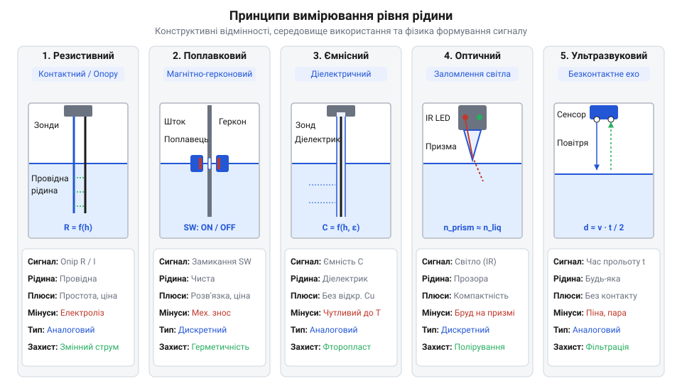
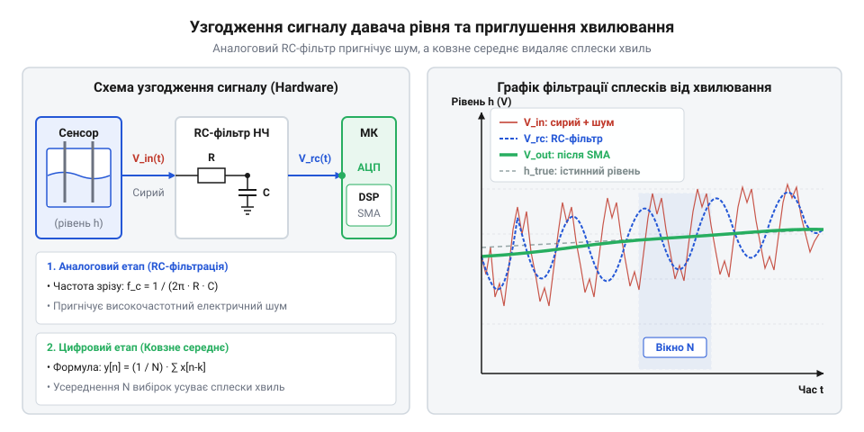
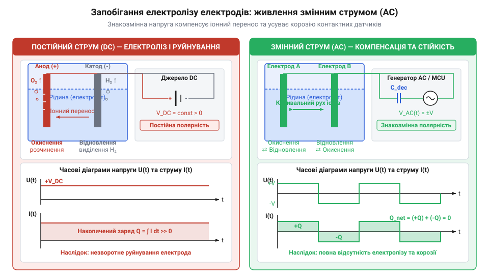
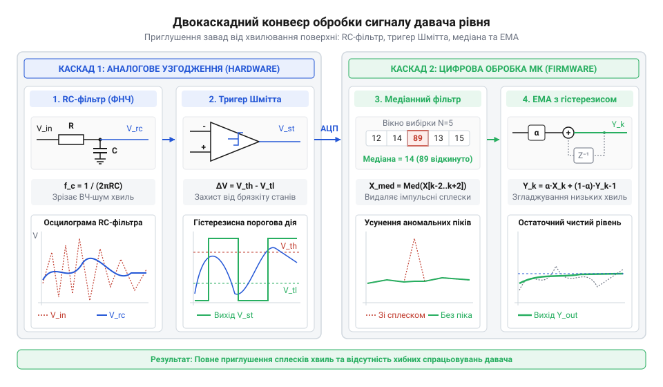
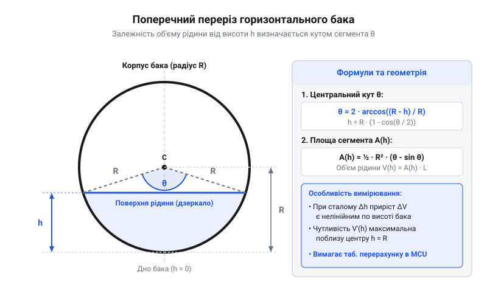

# Давач рівня рідини

<preknowlist>
- [HW-038 — давач рівня води](root:cat-hw-sensors/hw-038-water-level) — принципи роботи базових контактних резистивних доріжок та потенціометричного зчитування напруги
- [Ємнісний давач вологості ґрунту (v1.2)](root:cat-hw-sensors/capacitive-soil) — вимірювання ємності без прямого електричного контакту з провідним середовищем
</preknowlist>

## Захист обладнання від сухого ходу

Уявіть резервуар із водою, з якого відцентрова помпа перекачує рідину в технологічну лінію або домогосподарство. У нормальному режимі занурена імпелерна камера повністю заповнена водою, яка одночасно виконує дві критичні фізичні функції: безперервно відводить тепло від робочих вузлів та забезпечує гідродинамічне змащення механічного сальника (від англ. @@en|mechanical seal@@ — «механічне сальникове ущільнення») і підшипників ковзання. Якщо рідина в баку вичерпується нижче рівня всмоктувального патрубка, у камеру помпи потрапляє повітря. Момент, коли насос продовжує обертатися в порожнечі, називається сухим ходом (від англ. @@en|dry run@@ або @@en|dry running@@ — «сухий хід» / «робота всуху»). За відсутності рідини тертя в сальниковому ущільненні миттєво піднімає температуру до сотень градусів Цельсія. Полімерні чи керамічні ущільнювальні кільця деформуються й тріскаються протягом десятка секунд, після чого тепловий удар передається на підшипникову групу та обмотки електродвигуна, спричиняючи механічне заклинювання та термічний пробій ізоляції.

Зворотна сторона відсутності автоматичного контролю — це аварійне переповнення (від англ. @@en|overflow@@ — «переповнення») резервуарів під час наповнення. Коли помпа або електромагнітний клапан подачі рідини продовжують працювати без відстеження верхнього дзеркала, рідина виходить за межі бака. Це призводить до затоплення виробничих площ, вимивання дороговартісних хімічних реактивів чи короткого замикання у розташованих поруч шафах автоматики. Хоча [витратомір фіксує потік](root:cat-hw-sensors/water-flow-sensor) рідини в магістралі, він не може завчасно попередити про вичерпання запасу в самому резервуарі, оскільки реєструє факт руху середовища вже після його входження у всмоктувальний патрубок.

Ручне спостереження чи керування помпою за допомогою простих програмних затримок виявляються непридатними для реальних об'єктів. Витрата води змінюється динамічно залежно від кількості споживачів, продуктивність насоса падає з природним зносом імпелера, а вхідний тиск у магістралі коливається. Безпосереднє відстеження межі розподілу фаз рідкого та газоподібного середовищ стає неминучою вимогою для безпеки будь-якої автоматизованої гідравлічної системи. Історичний розвиток приладів [від механічних поплавків](root:cat-hw-sensors/liquid-level-sensor/hist-liquid-level-sensing-evolution.md) із важільними вимикачами до сучасних твердотільних сенсорів показує, як ускладнення технологічних процесів вимагало все вищої надійності та точності фіксації межі рідини.

Для побудови надійного захисту обладнання висуваються три суворі рівні вимог до систем вимірювання рівня:

1. **Аварійне дискретне блокування** (від англ. @@en|interlock@@ — «блокування»). Сенсор критично низького рівня встановлюється безпосередньо над всмоктувальним патрубком. При розмиканні чи замиканні його контакту коло живлення контактора помпи розривається апаратно, минаючи навіть програмний стек мікроконтролера, що гарантує захист від програмних зависань. Аналогічно сенсор критично високого рівня зупиняє наповнювальний клапан. 2. **Дискретне двопозиційне керування з гістерезисом**. Для автоматичної підтримки рівня використовуються дві відмітки: нижня (увімкнення подачі) та верхня (вимкнення подачі). Зона між ними утворює гістерезис (від грец. @@el|hysteresis@@ — «запізнення»; англ. @@en|hysteresis@@), який запобігає високочастотному старт-стопному посмику (від англ. @@en|chattering@@ — «деренчання») реле та помпи при дрібних коливаннях дзеркала води. 3. **Безперервний аналоговий або цифровий моніторинг**. Системи з плавною регуляцією продуктивності за допомогою частотно-регульованого приводу (від англ. @@en|VFD@@ — *Variable Frequency Drive*, частотно-регульований привід) потребують постійного знання точної висоти стовпа рідини в міліметрах чи відсотках об'єму. Це дозволяє оптимізувати оберти помпи та прогнозувати час вичерпання ресурсу. У глибоких свердловинах або резервуарах великого об'єму для цього часто застосовують [занурювальний п'єзорезистивний зонд](root:cat-hw-sensors/hydrostatic-pressure-level-sensor), який перетворює гідростатичний тиск стовпа рідини на електричний сигнал.

## Фізика контактного та безконтактного зчитування

Визначення висоти стовпа рідини або досягнення нею певної позначки спирається на виявлення фізичного контрасту між рідкою та газоподібною фазами. Рідина та повітря по-різному проводять електричний струм, мають відмінні значення відносної діелектричної проникності, неоднаково заломлюють світлові промені та мають кардинально різний акустичний імпеданс. За залежністю від безпосереднього взаємозв'язку з середовищем усі давачі поділяються на контактні (занурювальні) та безконтактні (дистанційні).


*Порівняння п'яти фізичних принципів вимірювання рівня: розташування сенсорів відносно межі розподілу фаз рідкого та газоподібного середовищ.*

1. **Резистивний (кондуктометричний) метод**. Принцип базується на вимірюванні електричної провідності рідини між двома або кількома металевими електродами. Вода з розчиненими солями містить вільні іони, дія яких знижує електричний опір між електродами від мегаомів у повітрі до сотень чи одиниць кілоомів у рідині. Контактні [резистивні доріжки HW-038](root:cat-hw-sensors/hw-038-water-level) представляють собою друковану плату з паралельними мідними треками. При зануренні рідина перекриває проміжок між треками, створюючи резистивний дільник напруги. Головна перевага методу — гранична простота й низька вартість. Проте прямому контакту притаманний фундаментальний недолік: під дією постійного струму протікає [електрохімічна корозія електродів](root:ph-electromagnetism/electrochemistry-electrolysis-and-corrosion-in-electronics), а розчинені солі викликають швидке руйнування металу та електроліз середовища.

2. **Поплавковий герконовий метод**. У цьому підході фізичний контакт із рідиною має лише механічний поплавок із вбудованим постійним магнітом, тоді як електричне коло герметично ізольоване. Поплавок переміщується вздовж вертикальної трубки з нержавіючої сталі або пластику, всередині якої встановлено геркон (від рос. @@ru|герметичный контакт@@; англ. @@en|reed switch@@). Геркон складається з двох феромагнітних контактних пластин у скляній колбі з інертним газом. Коли магніт поплавка наближається до геркона, магнітне поле замикає пластини. Оскільки електричні контакти перебувають у @@de|hermetisch@@ (герметичній) зоні, вони не піддаються корозії та електролізу. Герконові поплавки забезпечують надійне дискретне перемикання, але мають рухомі механічні частини, які можуть заклинювати в брудних або в'язких рідинах.

3. **Ємнісний метод**. Принцип спирається на вимірювання електроємності конденсатора, де роль діелектрика виконує середовище між обкладинками. Повітря має відносну діелектричну проникність `ε_air ≈ 1`, тоді як дистильована вода має відносну діелектричну проникність (від грец. @@el|dia-@@ — «через» та @@el|elektron@@ — «бурштин», лат. @@la|permittere@@ — «пропускати»; англ. @@en|dielectric permittivity@@) `ε_water ≈ 80`. Занурення ізольованого електроду у воду різко збільшує ємність вимірювального вузла. Подібно до того, як [ємнісні давачі вологості](root:cat-hw-sensors/capacitive-soil) ізолюють провідники від ґрунту маскою друкованої плати, ємнісний давач рівня покривається шаром фторопласту чи тефлону. Металева обкладинка не має прямого гальванічного контакту з рідиною, що повністю усуває корозію та електроліз.

Розрахунок ємності коаксіального або паралельного ємнісного давача при частковому зануренні на висоту `h` у резервуарі загальної висоти `H` описується формулою:

```
C_total = C_air + C_liquid
        = (2π · ε_0 · ε_air · (H - h)) ÷ ln(D ÷ d) + (2π · ε_0 · ε_liquid · h) ÷ ln(D ÷ d)    [сума ємностей сухої та зануреної ділянок]
        = (2π · ε_0 ÷ ln(D ÷ d)) · [ε_air · (H - h) + ε_liquid · h]                             [винесення спільних геометричних множників]
```

де `ε_0` — електрична стала (`8.854 × 10⁻¹²` Ф/м), `d` — діаметр внутрішнього занурювального електрода, `D` — діаметр зовнішнього коаксіального екрана або металевої стінки бака, `h` — висота стовпа рідини. З формули видно, що ємність `C_total` зростає строго лінійно зі збільшенням висоти занурення `h`. Для зчитування мікроскопічних змін ємності використовують спеціалізовані [перетворювачі ємності в цифру](root:hw-sensing/capacitive-sensing-principles-and-cdc) (від англ. @@en|CDC@@ — *Capacitance-to-Digital Converter*, перетворювач ємності в цифру).

4. **Оптичний призматичний метод**. Використовує явище повного внутрішнього відбиття (від англ. @@en|total internal reflection@@ — «повне внутрішнє відбиття») світла на межі матеріалу призми та зовнішнього середовища. Сенсор складається з інфрачервоного світлодіода, фототранзистора та конічної пластикової або скляної призми (від грец. @@el|prisma@@ — «відпиляне»; англ. @@en|prism@@). Коли призма оточена повітрям, промінь світла від світлодіода падає на внутрішню грань під кутом, більшим за критичний кут відбиття. Світло повністю відбивається від обох граней призми та потрапляє на фототранзистор, утримуючи його у відкритому стані. Коли рідина вкриває призму, показники заломлення призми та рідини стають близькими. Заломлений світловий промінь виходить назовні в рідину, відбиття зникає, і фототранзистор закривається. Оптичні давачі точкові, не мають рухомих частин і миттєво реагують на контакт із рідиною, але чутливі до налипання крапель, піни та прозорості пластику.

5. **Ультразвуковий акустичний метод**. Це повністю безконтактний метод вимірювання, що монтується у верхній кришці резервуара над дзеркалом рідини. П'єзоелектричний випромінювач (від грец. @@el|piezein@@ — «тиснути»; англ. @@en|piezoelectric transducer@@ — «п'єзоелектричний перетворювач») генерує імпульс високої частоти (зазвичай 40 кГц або 200 кГц). Акустична хвиля поширюється у повітряному просторі бака, відбивається від дзеркала рідини завдяки велетенському стрибку акустичного імпедансу між повітрям та водою, і повертається назад до приймача. Давач вимірює час прольоту хвилі (від англ. @@en|Time-of-Flight@@, або @@en|ToF@@ — «час прольоту»).

Обчислення відстані `D_surface` від давача до поверхні рідини здійснюється за формулою:

```
D_surface = (v_sound × t_flight) ÷ 2
          = (343 · 0.0024) ÷ 2        [підстановка швидкості звуку у повітрі 343 м/с та виміряного часу 2.4 мс]
          = 0.8232 ÷ 2                 [обчислення повного пройденого шляху хвилі туди й назад]
          = 0.4116 м                   [відстань від кришки бака до дзеркала рідини]
```

Знаючи повну висоту резервуара `H_tank`, висота стовпа рідини визначається як `h_liquid = H_tank - D_surface`. Детальні [фізико-математичні моделі вимірювання](root:cat-hw-sensors/liquid-level-sensor/math-capacitive-and-ultrasonic-sensing-physics.md) розглядають також температурну компенсацію швидкості звуку, адже швидкість залежить від температури повітря у баку. Головна перевага ультразвукового методу — повна відсутність контакту з агресивною або брудною рідиною. Проте на точність впливають піна на поверхні, яка поглинає акустичну хвилю, пар, підвищена турбулентність та хвилювання. Використання подібного принципу детальніше розглянуто у матеріалі про [часопролітне вимірювання відстані](root:hw-sensing/ultrasonic-tof-method).

Порівняльний аналіз п'яти розглянутих методів зведений у таблицю:

| Метод | Контакт з рідиною | Вплив провідності | Вплив діелектричної проникності | Чутливість до піни / бруду | Тип вимірювання |
| :--- | :--- | :--- | :--- | :--- | :--- |
| **Резистивний** | Прямий контакт | Високий (потрібні іони) | Відсутній | Висока (корозія / осад) | Дискретний / Грубий аналоговий |
| **Герконовий поплавок** | Механічний (поплавок) | Відсутній | Відсутній | Середня (заклинювання) | Дискретний (багатоточковий) |
| **Ємнісний** | Ізольований контакт | Низький (при ізоляції) | Високий (критична `ε_r`) | Середня (налипання плівки) | Безперервний аналоговий |
| **Оптичний призматичний** | Контакт призми | Відсутній | Відсутній | Висока (плівка / краплі) | Дискретний точковий |
| **Ультразвуковий** | Безконтактний | Відсутній | Відсутній | Висока (піна поглинає звук) | Безперервний дистанційний |

## Вплив властивостей рідини на сенсори

Лабораторні випробування давача рівня в стакані з чистою водою створюють ілюзію ідеальної лінійності: резистивний трек чітко змінює опір, ємнісний зонд показує передбачуваний зсув ємності, а ультразвук бездоганно відбивається від гладкого рідкого дзеркала. Проте в реальному середовищі — від побутового септика й бака гідропоніки до паливного резервуара чи хімічного реактора — фізико-хімічні властивості рідини стають головним джерелом завад і фатальних помилок вимірювання. Якщо при розробці пристрою не врахувати електропровідність, діелектричну проникність, в'язкість, поверхневий натяг та схильність середовища до утворення піни чи осаду, автоматика або передчасно відключить помпу, або допустить катастрофічне переповнення ємності.

Контактні резистивні давачі (зокрема [доріжки резистивного модуля](root:cat-hw-sensors/hw-038-water-level)) вимірюють опір рідкого стовпа між зануреними провідниками. Опір рідкого провідника `R_liquid` визначається геометричною довжиною зануреної ділянки `L`, площею перерізу `S`, питомою електропровідністю `σ` (від лат. *conductio* — проведення) та питомим опором `ρ`:

```
R_liquid = L / (σ · S)
= L · ρ / S            [де ρ = 1 / σ — питомий опір рідини]
```

З виразу видно, що при збільшенні електропровідності `σ` внаслідок розчинення солей опір рідини `R_liquid` пропорційно зменшується навіть при незмінному фізичному рівні занурення. У чистій дистильованій воді питома провідність `σ` становить близько 0.05 мкСм/см, що робить її практично @@en|ізолятором@@. Звичайна водопровідна вода має провідність у межах 100–500 мкСм/см за рахунок розчинених мінералів. Якщо ж у резервуар потрапляє @@en|морська вода@@ чи розчин добрив, провідність зростає до 50 000 мкСм/см і більше (@@en|солоність@@, від англ. *salinity*). В результаті опір `R_liquid` між тими ж самими електродами падає в сотні разів при тому самому рівні рідини, викликаючи хибне спрацьовування аналогово-цифрового перетворювача (АЦП).

У ємнісних давачах провідність середовища змінює розподіл електричного поля. Для дизельного палива чи олив з низькою провідністю рідина виступає @@en|діелектриком@@ (від грец. *dia* — через та лат. *electricus* — бурштиновий). Але для провідної води сама рідина перетворюється на продовження одного з електродів, а діелектриком стає ізоляційне фторопластове чи лакове покриття зонда. При цьому висока солоність створює паразитно послідовний опір `R_s`, що збільшує тангенс кута діелектричних втрат. Детальні фізико-математичні моделі цих процесів описано в [математичних моделях ємнісного вимірювання](root:cat-hw-sensors/liquid-level-sensor/math-capacitive-and-ultrasonic-sensing-physics.md).

Ємнісні сенсори вимірюють відносну @@en|діелектричну проникність@@ `ε_r` середовища. Вода має високе значення `ε_r ≈ 80` при температурі 20 °C завдяки дипольній структурі молекул. Для порівняння, мінеральні оливи мають `ε_r ≈ 2.1–2.3`, спирти — `ε_r ≈ 24`, а повітря — `ε_r ≈ 1.0`. Головна пастка полягає в тому, що діелектрична проникність більшості рідин залежить від температури: при нагріванні води від 20 °C до 80 °C значення `ε_r` зменшується з 80 до 61 через посилення теплового руху молекул. Без температурної компенсації ємнісний давач зафіксує хибне зниження рівня рідини майже на 25% при незмінній висоті стовпа. Для точної компенсації температурних і діелектричних зсувів [застосовують спеціалізовані перетворювачі](root:hw-sensing/capacitive-sensing-principles-and-cdc) ємності в цифру.

При зниженні рівня в'язке середовище (мастило, моторна олива, сироп) залишає на поверхні сенсора @@en|паразитну плівку@@ (від грец. *parasitos* — утриманець, від англ. *film formation*). Для контактних та ємнісних зондів ця тонка рідка плівка створює електричний або ємнісний місток між електродами навіть після того, як основне рідке дзеркало опустилося. Давач продовжує сигналізувати про наявність рідини, створюючи хибно-позитивний стан.

Поверхневий натяг `γ` (від англ. *surface tension*) викликає утворення @@en|меніска@@ (від грец. *meniskos* — півмісяць) навколо корпусів сенсорів та в капілярних трубах. У поплавкових герконових давачах в'язкі рідини та осад накопичуються у зазорі між поплавком і напрямною трубою, що призводить до механічного заклинювання поплавка.

У відкритих баках та реакторах виникають додаткові деструктивні чинники:

1. @@en|Осад@@ (від англ. *sedimentation*): Важкі частки мулу чи солей осідають на дні, вкриваючи занурені електроди шаром накипу, що повністю ізолює контакти або створює постійне коротке замикання. 2. @@en|Піна@@ (від англ. *foam*): Бульбашки газу мають низьку густину та невизначену діелектричну проникність. Оптичний давач, що працює на заломленні світла в призмі, втрачає чітку межу фаз. Ультразвуковий імпульс від п'єзоперетворювача сильно згасає та розсіюється в піні, через що давач втрачає відбите ехо. Фізику поширення акустичних хвиль розкрито в [принципах ультразвукової віддалеметрії](root:hw-sensing/ultrasonic-tof-method). 3. @@en|Хвилювання поверхні@@ (від англ. *wave agitation*): Коливання рідкого дзеркала через роботу помп або вхідних струменів створюють сплески та шум у первинному сигналі.

Для захисту від коливань поверхні застосовують комбінацію аналогового узгодження сигналу та цифрової фільтрації в мікроконтролері.


*Схема первинної аналогової фільтрації та порівняльний графік вхідного зашумленого сигналу з відфільтрованими показаннями рівня рідини при її коливаннях.*

Первинна аналогова RC-ланцюг зрізає високочастотні наводки, а програмна медіанна фільтрація чи експоненційне згладжування в мікроконтролері відсікає поодинокі сплески від хвиль. Детальні сигнатури функцій обробки даних наведено в [програмному інтерфейсі драйвера](root:cat-hw-sensors/liquid-level-sensor/api-liquid-level-sensor-driver-software-interface.md), а розробку повної системи контролю об'єму бака розкрито в [проєкті безконтактного моніторингу об'єму](root:cat-hw-sensors/liquid-level-sensor/proj-ultrasonic-capacitive-tank-gauge.md).

## Запобігання електролізу та деградації електродів

Підключення простих металевих контактів або друкованої плати резистивного сенсора безпосередньо до постійної напруги +5 В мікроконтролера здається найпростішим рішенням для виявлення води. Проте через кілька годин безперервної роботи автоматика втрачає чутливість. При візуальному огляді електродів виявляється, що мідні доріжки плати повністю розчинилися, перетворившись на пластівці солей міді, а сама рідина забруднена токсичними йонами. Причиною цього руйнування є електрохімічна корозія та електроліз під дією постійного струму.

При протіканні постійного струму `I_DC` крізь провідне рідке середовище на поверхнях занурених електродів виникають @@en|електрохімічні реакції@@ (від грец. *электро* — електрика та *lysis* — розпад):

1. На @@en|аноді@@ (позитивний електрод `+`, від грец. *anodos* — шлях вгору) відбувається процес @@en|анодного розчинення@@ (від англ. *anodic dissolution*). Атоми металу віддають валентні електрони й переходять у розчин у вигляді позитивних йонів:

```
Me -> Meⁿ⁺ + n · e⁻
```

Для мідних електродів `Cu -> Cu²⁺ + 2e⁻`. Далі мідь реагує з гідроксид-іонами `OH⁻`, утворюючи осад `Cu(OH)₂` і руйнуючи провідний шар аж до повного обриву доріжки. Докладніший аналіз окисно-відновних процесів наведено у викладі про [електрохімію та корозію в електроніці](root:ph-electromagnetism/electrochemistry-electrolysis-and-corrosion-in-electronics).

2. На @@en|катоді@@ (негативний електрод `-`, від грец. *kathodos* — шлях вниз) відбувається @@en|катодне відновлення@@ (від англ. *cathodic reduction*). У воді це супроводжується виділенням газоподібного водню `2H⁺ + 2e⁻ -> H₂ ↑`. Бульбашки водню огортають поверхню контакту, створюючи газовий ізоляційний шар і змінюючи контактний опір.

Маса втраченого металу `m` на аноді залежить від пропущеного крізь електроліт електричного заряду `Q` відповідно до першого закону Фарадея:

```
m = k · Q
= k · ∫ I(t) dt         [де k — електрохімічний еквівалент речовини]
```

З цієї залежності випливає, що скорочення часу протікання струму безпосередньо зменшує масу електролітично розчиненого металу. Для цього застосовують імпульсне живлення: мікроконтролер подає напругу на сенсор через цифровий вихід GPIO або MOSFET лише на короткий інтервал `t_pulse ≈ 5–10 мс`, необхідний для зчитування АЦП, після чого вимикає коло на період сну `t_sleep ≈ 1–5 с`.

Скважність `D` (від англ. *duty cycle*) імпульсного живлення розраховується як відношення часу активної роботи до повного циклу вимірювання:

```
D = t_pulse / (t_pulse + t_sleep)
= 0.005 / (0.005 + 1.0)
≈ 0.005                [скважність становить 0.5%]
```

Зменшення скважності до частоти менше одного відсотка дозволяє сповільнити корозійне руйнування в сотні разів і продовжити термін служби датчика з кількох днів до років. Проте постійна полярність напруги залишає односпрямований перенос заряду, тому анодне розчинення не зупиняється повністю.

Для абсолютного захисту від електролізу використовують @@en|змінний струм@@ (від англ. *AC excitation*) з нульовим постійним зсувом (@@en|DC offset@@). Якщо полярність живлення електродів змінюється з частотою від 100 Гц до 10 кГц, процеси окиснення й відновлення на контактах періодично міняються місцями. За один півперіод виділяється мікроскопічна кількість йонів, а за наступний півперіод зворотної полярності відбуваються рекомбінація та відновлення, що запобігає деградації металу. Оптимальний діапазон частот 100 Гц – 10 кГц обрано тому, що при нижчих частотах встигає сформуватися подвійний електричний шар, а при частотах понад 50 кГц починає позначатися паразитна ємність підключених кабелів.


*Схема живлення контактних електродів двополярними імпульсами змінного струму та часові діаграми, що запобігають накопиченню односпрямованого заряду й електрохімічній корозії.*

Двополярне збудження реалізують за допомогою двох інверсних цифрових виходів мікроконтролера, підключених до електродів через послідовні розділові конденсатори `C_c` (від англ. *series capacitor*). Конденсатори фізично блокують протікання постійної складової струму: навіть якщо програма завісне в одному стані, DC-струм не зможе протікати крізь конденсатор у рідину.

У програмі керування мікроконтролером подачу імпульсів та опитування АЦП виконують за суворим часовим алгоритмом:

:::tabs
```cpp|arduino
// Приклад імпульсного живлення давача рівня для Arduino (C++)
const int SENSOR_POWER_PIN = 7;
const int SENSOR_ADC_PIN = A0;

int readWaterLevelPulsed() {
    pinMode(SENSOR_POWER_PIN, OUTPUT);
    digitalWrite(SENSOR_POWER_PIN, HIGH); // Увімкнути живлення електрода
    delayMicroseconds(5000);              // Пауза 5 мм для стабілізації
    int rawValue = analogRead(SENSOR_ADC_PIN); // Зчитати сигнал
    digitalWrite(SENSOR_POWER_PIN, LOW);  // Негайно вимкнути живлення
    return rawValue;
}
```
:::code liquid-level-sensor-d/c/esp-idf/read-water-level-pulsed.c
:::

Вибір матеріалу електродів також відіграє вирішальну роль. Друковані плати з мідними доріжками (як на [побутових давачах дощу](root:cat-hw-sensors/funduino-rain)) дегрудують найшвидше. Застосування нержавіючої сталі (марки AISI 316L) забезпечує захист завдяки природному @@en|пасивному шару@@ оксиду хрому (від лат. *passivus* — бездіяльний, від англ. *passivation*). Для агресивних середовищ застосовують титанові або графітові стержні.

Принципові підключення та карту регістрів збирають за допомогою [інтерфейсних схем апаратного підключення](root:cat-hw-sensors/liquid-level-sensor/api-liquid-level-sensor-hardware-interface.md), а готову практичну схему безкорозійного монітора дивіться в [контролера на змінному струмі](root:cat-hw-sensors/liquid-level-sensor/proj-ac-resistive-liquid-level-monitor.md).

## Обробка сигналу та фільтрація хвилювання

Під час заповнення резервуара помповими агрегатами, механічної вібрації ємності або термічної конвекції поверхня рідини вкривається хвилями та сплесками. Якщо встановити давач у таке середовище, вимірювальний аналоговий чи цифровий канал отримує не стабільне значення висоти, а неперервний хаотичний шум. Для дискретних контактних або поплавкових вимикачів це викликає миттєві повторювані перемикання — @@en|chattering@@ (від англ. *chatter* — брязкати, деренчати; брязкіт контактів). Таке брязкання швидко руйнує контакти електромеханічних реле та перевантажує мікроконтролер неперервною серією переривань. Для безперервних давачів, орієнтованих на принципи [ультразвукової віддалеметрії](root:hw-sensing/ultrasonic-tof-method), хвилювання поверхні призводить до різких хибних вимірів, коли випромінений акустичний імпульс відбивається від схилу хвилі під кутом і не повертається до приймача. При використанні схем із [принципами ємнісного вимірювання](root:hw-sensing/capacitive-sensing-principles-and-cdc) коливання поверхні створюють викроплювання та налипання піни, що викликає викривлення виміряної ємності.

Першою лінією захисту від високочастотних електричних наводок та механічних сплесків є аналогове узгодження сигналу. Вихідний аналоговий сигнал від сенсора перш ніж потрапити на аналогово-цифровий перетворювач мікроконтролера повинен пройти через пасивний або активний @@en|low-pass filter@@ (від англ. *low* — низький, *pass* — пропускати, *filter* — фільтр; фільтр нижніх частот). Пасивний RC-ланцюг пригнічує високочастотні амплітудні коливання, пропускаючи лише повільні зміни рівня рідини.

Низькочастотний аналоговий фільтр першого порядку задає частоту зрізу `f_c`, вище якої амплітуда високочастотних шумів стрімко зменшується. Величина частоти зрізу — @@en|cutoff frequency@@ (від англ. *cutoff* — зріз та *frequency* — частота; частота зрізу) — визначається параметрами резистора `R` та конденсатора `C`:

```
f_c = 1 ÷ (2 · π · R · C)
```

тут `R` — опір резистора в омах, `C` — ємність конденсатора у фарадах, `π` — математична константа (приблизно 3.14159). При виборі опору `R = 10` кОм та ємності `C = 10` мкФ частота зрізу становить приблизно 1.59 Гц, що ефективно пригнічує коливання поверхні від дрібних хвиль.

Окрім фільтрації, аналогове коло здійснює узгодження імпедансу. Високоомний вихід ємнісного чи резистивного сенсора не здатен заряджати вхідну ємність аналогово-цифрового перетворювача без викривлення напруги. Для цього застосовують буферний операційний підсилювач у режимі повторювача напруги. Для дискретних поплавкових або оптичних датчиків обов'язковим елементом є @@en|Schmitt trigger@@ (від прізвища винахідника Отто Шмітта; тригер Шмітта). Він додає в апаратний канал @@en|hysteresis@@ (від грец. *ὑστέρησις* — запізнення; гістерезис), забезпечуючи чітке формування логічних рівнів 0 та 1 без брязкоту на межі спрацьовування. Докладно принципові розводки кіл живлення, захисні діоди та гальванічну розв'язку розглянуто у довіднику про [апаратні схеми підключення](root:cat-hw-sensors/liquid-level-sensor/api-liquid-level-sensor-hardware-interface.md) сенсорів.

Аналогова фільтрація не може повністю усунути низькочастотні коливання хвиль та грубі поодинокі шумові викрутаси — @@en|outlier@@ (від англ. *out-lier* — те, що лежить зовні; шумовий сплеск). Для їх усунення застосовують конвеєр програмної обробки на боці мікроконтролера.

Для дискретних сигналів реалізують програмний @@en|debounce@@ (від англ. *de-* — зняття та *bounce* — відскік; усунення брязкоту). Новий стан дискретного входу вважається дійсним лише тоді, коли він лишається незмінним протягом заданого часу затримки (наприклад, 300–500 мс).

Для безперервних давачів застосовують двокаскадний цифровий фільтр:

1. **Медіанний фільтр** — @@en|median filter@@ (від лат. *medianus* — середній; медіанний фільтр). Алгоритм зберігає масив із `N` останніх вимірів (де `N` — непарне число, наприклад 5 або 7), сортує їх за значенням і обирає центральний елемент. Це повністю усуває поодинокі відхилення, викликанні втратою ультразвукового відбиття чи ехо-імпульсом від піни. 2. **Експоненційне ковзне усереднення** — @@en|exponential moving average@@ (від лат. *exponentia* — показник та англ. *moving average* — ковзне усереднення; експоненційне ковзне усереднення, EMA). Фільтр забезпечує високу плавність сигналу без збереження великих масивів даних у пам'яті мікроконтролера.

Для експоненційного ковзного усереднення поточне згладжене значення `y[n]` обчислюється на основі нового виміру `x[n]` та попереднього виходу `y[n-1]`:

```
y[n] = α · x[n] + (1 - α) · y[n-1]
```

тут `α` — коефіцієнт згладжування у діапазоні від 0 до 1, `x[n]` — поточне значення виміру після медіанного фільтра, `y[n-1]` — попередньо обчислене згладжене значення. Мале значення `α = 0.1` забезпечує високий рівень придушення хвилювання, тоді як `α = 0.8` робить вихід чутливішим до швидкої зміни рівня.

Після проходження фільтрів до вихідного сигналу застосовують програмний @@en|hysteresis@@ для порогів увімкнення та вимкнення помпи. Завершену реалізацію такого вимірювального вузла наведено у матеріалах про [проєкт безконтактного моніторингу](root:cat-hw-sensors/liquid-level-sensor/proj-ultrasonic-capacitive-tank-gauge.md) резервуара. Повний перелік сигнатур функцій, структури конфігурації фільтрів та коди помилок драйвера можна знайти у довіднику про [програмний інтерфейс драйвера](root:cat-hw-sensors/liquid-level-sensor/api-liquid-level-sensor-driver-software-interface.md) систем обробки рівня.


*Схема двокаскадного конвеєра обробки сигналу демонструє послідовне придушення високочастотного шуму й механічного хвилювання за допомогою аналогового RC-фільтра, тригера Шмітта, цифрової медіанної фільтрації та EMA з гістерезисом.*

:::tabs
@tab C (ESP-IDF)
:::code liquid-level-sensor-d/c/esp-idf/level-filter-init.c
@tab C++ (Arduino)
:::code liquid-level-sensor-d/cpp/arduino/levelfilter.cpp
:::

## Калібрування та геометричний перерахунок об'єму

Отримавши відфільтроване значення висоти стовпа рідини `h` у міліметрах чи відсотках від повної шкали, розробник автоматики стикається з наступною вимірювальною перешкодою: більшість промислових та побутових ємностей мають складну геометричну форму. У вертикальному циліндрі чи прямокутному баку зміна висоти рівня на 10% відповідає зміні об'єму рідини рівно на 10%. Проте у горизонтальному циліндричному резервуарі, баку з конічним дном або сферичній цистерні лінійна залежність між висотою та об'ємом порушується. Якщо обчислити залишковий об'єм простим множенням виміряної висоти на сталу площу основи, похилка обчислення біля дна та склепіння ємності сягатиме 30–40%. Подібні похибки стають критичними при застосуванні методів [вимірювання гідростатичного тиску](root:cat-hw-sensors/hydrostatic-pressure-level-sensor), де виміряний тиск прямо пропорційний висоті стовпа, але не об'єму.

Розглянемо горизонтальний циліндричний резервуар із плоскими торцями радіусом `R` та довжиною `L`. Поперечний переріз заповненої частини циліндра при висоті рідини `h` утворює круговий сегмент. Кут сегмента `θ` у радіанах обчислюється через функцію арккосинуса відношення відстані від центра до поверхні рідини:


*Геометрична схема поперечного перерізу горизонтального бака ілюструє залежність площі рідкого сегмента від висоти рівня h, радіуса R та центрального кута theta.*

```
θ = 2 · arccos((R - h) ÷ R)
```

тут `h` — висота стовпа рідини від нижньої точки бака, `R` — внутрішній радіус циліндра.

Площа кругового сегмента `A` визначається різницею площ кругового сектора та трикутника, утвореного радіусами:

```
A = 0.5 · R² · (θ - sin(θ))
```

Для циліндра довжиною `L` повний залишковий об'єм рідини `V` обчислюється множенням площі перерізу `A` на довжину:

```
V = A · L
  = 0.5 · L · R² · (2 · arccos((R - h) ÷ R) - sin(2 · arccos((R - h) ÷ R)))
```

тут `L` — довжина циліндричної частини резервуара, `R` — внутрішній радіус, `h` — поточний рівень рідини. З отриманого виразу випливає, що зміна об'єму при зміні рівня на дні та склепінні резервуара є набагато меншою, ніж у центральній частині циліндра.

Для ємностей із конічним дном радіус вільної поверхні рідини лінійно зростає з висотою `h`, тому об'єм заповненого конуса описується степеневою залежністю третього порядку:

```
V = (1 ÷ 3) · π · h³ · tan²(α)
```

тут `α` — кут нахилу твірної конуса до вертикальної осі, `h` — висота рідини від вершини конуса. Повний математичний розрахунок для складних комбінованих ємностей із опуклими торцями наведено у вставці про [математику перерахунку рівня](root:cat-hw-sensors/liquid-level-sensor/math-tank-volume-and-level-calibration.md) в об'єм.

На практиці стінки резервуарів можуть мати технологічні вм'ятини, зварні шовні деформації, нахил при монтажі або внутрішні перегородки. У таких умовах точно вирахувати геометричну формулу стає неможливо. Для вирішення цієї проблеми застосовують метод багатоточкового калібрування з побудовою таблиці пошуку — @@en|look-up table@@ (від англ. *look up* — шукати та *table* — таблиця; таблиця пошуку, LUT).

Процес калібрування полягає у покроковому наповненні порожнього резервуара еталонними порціями рідини `ΔV` з одночасною фіксацією виміряної висоти `h` або сирого значення АЦП. Результатом калібрування є впорядкований масив опорних точок `(h_i, V_i)`.

При використанні калібрувальної таблиці для виміряної висоти `h`, що лежить у суміжному інтервалі між опорними точками `h_i` та `h_{i+1}`, значення об'єму `V(h)` обчислюється за виразом:

```
V(h) = V_i + (V_{i+1} - V_i) · ((h - h_i) ÷ (h_{i+1} - h_i))
```

тут `h_i` та `h_{i+1}` — суміжні опорні значення висоти з калібрувальної таблиці, `V_i` та `V_{i+1}` — відповідні опорні значення об'єму.

Використання алгоритму — @@en|piecewise linear approximation@@ (від англ. *piecewise* — поштучно/кусково та *linear* — лінійний; кусково-лінійна апроксимація) — дає змогу виконувати швидкодіючий перерахунок на 8-бітних та 32-бітних мікроконтролерах без тригонометричних обчислень. При цьому зберігається @@en|monotonicity@@ (від грец. *μονοτονία* — одноманітність; монотонність) залежності, що виключає появу хибних локальних екстремумів.

Під час калібрування також враховують вимірювальні межі сенсора, зокрема @@en|dead zone@@ (від англ. *dead* — мертвий та *zone* — зона; сліпа зона давача) для ультразвукових випромінювачів, у межах якої вимірювання висоти є невалідним. Для контактних електродів при вимірюванні агресивних рідин або води зі змінною солоністю калібрувальні параметри комбінують із захисними заходами, описаними у описі [проєкт контролера рівня](root:cat-hw-sensors/liquid-level-sensor/proj-ac-resistive-liquid-level-monitor.md) на змінному струмі.

:::tabs
@tab C (ESP-IDF)
:::code liquid-level-sensor-d/c/esp-idf/calculate-volume-lut.c
@tab C++ (Arduino)
:::code liquid-level-sensor-d/cpp/arduino/calibrationpoint.cpp
:::