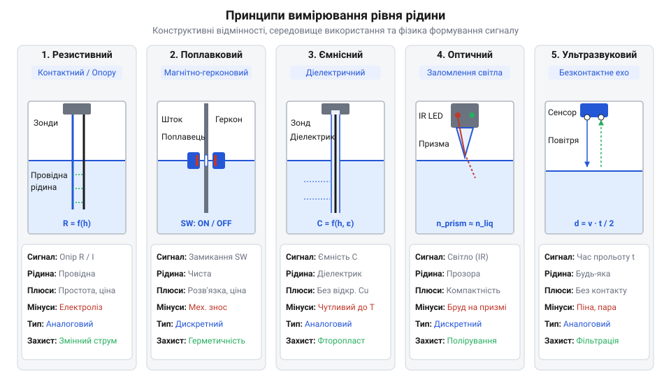
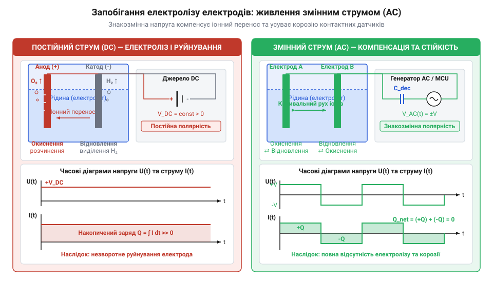
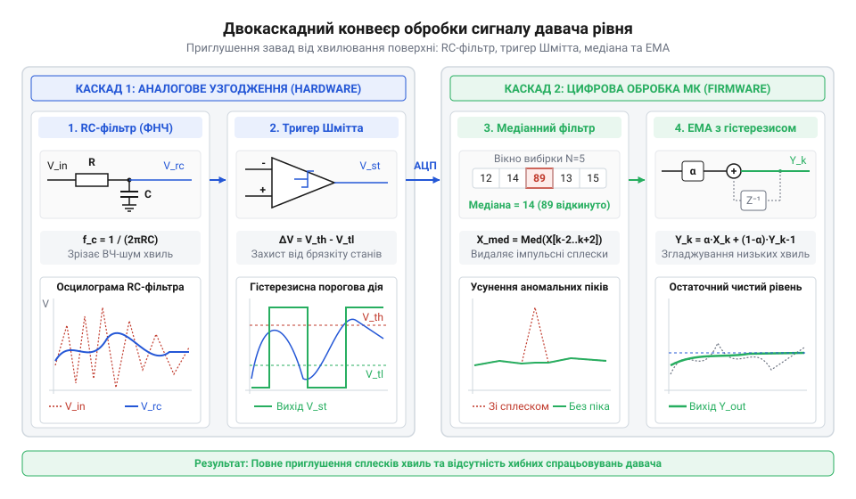
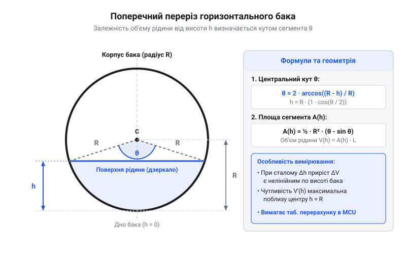

# Давач рівня рідини

<preknowlist>
- [HW-038 — давач рівня води](root:cat-hw-sensors/hw-038-water-level) — принципи роботи базових контактних резистивних доріжок та потенціометричного зчитування напруги
- [Ємнісний давач вологості ґрунту (v1.2)](root:cat-hw-sensors/capacitive-soil) — вимірювання ємності без прямого електричного контакту з провідним середовищем
</preknowlist>

## Захист від сухого ходу й переповнення

Обертання крильчатки помпи без рідини спричиняє @@en|сухий хід@@. Оскільки рідина охолоджує та змащує підшипники й ущільнення, без неї тертя швидко призводить до перегріву, деформації сальників і заклинювання ротора. Аварійне ж переповнення резервуара затоплює приміщення й псує електроніку. Програмні затримки не враховують зміни припливу, а [турбінний витратомір води](root:cat-hw-sensors/water-flow-sensor) виявляє потік лише після запуску й не захищає від сухої кавітації.

Для надійної роботи застосовують три рівні захисту. Перший — аварійне апаратне блокування, де реле чи симистор розмикає живлення помпи за сигналом граничного рівня незалежно від мікроконтролера. Другий — двопозиційне керування з @@el|гістерезисом@@ (грец. *hysteresis* — запізнення), коли помпа вмикається при `h_min` і вимикається при `h_max`, що запобігає частим перезапускам. Третій — безперервний аналоговий моніторинг для оцінки об'єму й динаміки споживання.

## Фізичні принципи вимірювання рівня рідини


*Підпис: Конструктивні варіанти давачів рівня від контактних резистивних до безконтактних ультразвукових.*

Виявлення межі розподілу фаз ґрунтується на відмінностях фізичних властивостей рідини й газу:

1. Резистивний — фіксує зміну опору або замикання струму між зануреними електродами ([модуль HW-038](root:cat-hw-sensors/hw-038-water-level)). 2. Поплавковий — замикає геркон (англ. *sealed reed switch*, герметичний контакт) магнітом у поплавку при досягненні позначки. 3. Ємнісний — вимірює ємність між обкладинками, де рідина виступає діелектриком ([давач вологості ґрунту](root:cat-hw-sensors/capacitive-soil)). 4. Оптичний призматичний — аналізує заломлення променя в призмі: у повітрі світло відбивається на фототранзистор, а в рідині заломлюється назовні ([оптичний давач рівня](root:cat-hw-sensors/optical-prism-level-sensor)). 5. Ультразвуковий — вимірює час прольоту акустичної хвилі до дзеркала рідини й назад ([ультразвуковий давач рівня](root:cat-hw-sensors/ultrasonic-level-sensor)).

Відстань `d` від випромінювача до дзеркала рідини обчислюють за часом прольоту акустичного імпульсу:

```
d = (v · t) ÷ 2
```

де `v` — швидкість звуку в повітрі (близько 343 м/с при 20 °C), `t` — повний час від посилання імпульсу до луни.

## Вплив середовища та запобігання електролізу


*Підпис: Зміна полярності напруги запобігає перенесенню іонів та розчиненню металу електродів.*

Температура, піна та хвилювання рідини викривляють покази сенсорів. У контактних електродах, як у [дощових сенсорах](root:cat-hw-sensors/funduino-rain) чи [сенсорах ґрунту](root:cat-hw-sensors/soil-moisture), постійний струм додатково спричиняє @@el|електроліз@@ (грец. *elektron* — бурштин, *lysis* — розчинення).

За законами Фарадея маса розчиненого анода `m` залежить від струму `I`, часу `t` та електрохімічного еквіваленту металу `k`:

```
m = k · I · t
```

Під постійною напругою анод окиснюється й руйнується. Щоб зупинити корозію, застосовують імпульсне живлення з низькою скважністю або двополярне збудження змінного струму (@@en|AC excitation@@). Періодична зміна полярності робить сумарний заряд нульовим (`∫ I dt = 0`), що відновлює іони й зупиняє деградацію електродів.

## Фільтрація шуму та хвилювання поверхні


*Підпис: Послідовна обробка сигналу RC-ланцюгом, медіанним та експоненційним фільтрами.*

Механічний брязкіт контактів і високочастотні завади придушують апаратно: аналоговий RC-фільтр згладжує сплески, а @@de|тригер Шмітта@@ (англ. *Schmitt trigger*) формує чіткий фронт завдяки гістерезису.

Аналогові й ультразвукові виміри обробляють двокаскадним цифровим конвеєром. Спочатку @@en|медіанний фільтр@@ відкидає аномальні викиди, а далі @@en|експоненційне ковзне усереднення@@ згладжує хвилювання:

```
yₖ = α · xₖ + (1 - α) · yₖ₋₁
```

де `xₖ` — вхідне значення, `yₖ` і `yₖ₋₁` — поточний та попередній стан, а `α ∈ (0, 1]` — коефіцієнт згладжування.

## Калібрування та геометричний розрахунок об'єму


*Підпис: Нелінійна залежність об'єму рідини від висоти стовпа в циліндричній ємності.*

У резервуарах непрямокутної форми (горизонтальні циліндри, конуси) залежність між рівнем `h` та об'ємом `V` є нелінійною. Об'єм циліндра радіусом `R` і довжиною `L` обчислюють через площу кругового сегмента:

```
V = L · (R² · arccos((R - h) ÷ R) - (R - h) · √(2 · R · h - h²))
```

де `R` — радіус, `L` — довжина, `h` — рівень.

Тригонометрію на мікроконтролері оптимізують @@ar|калібруванням@@ (араб. *qalib* — форма) за таблицями пошуку (@@en|Lookup Table, LUT@@) з кусково-лінійною @@la|інтерполяцією@@ (лат. *interpolatio* — відновлення). Замість обчислення формули зберігають опорні точки висоти й об'єму, розраховуючи проміжні значення за лінійною пропорцією.