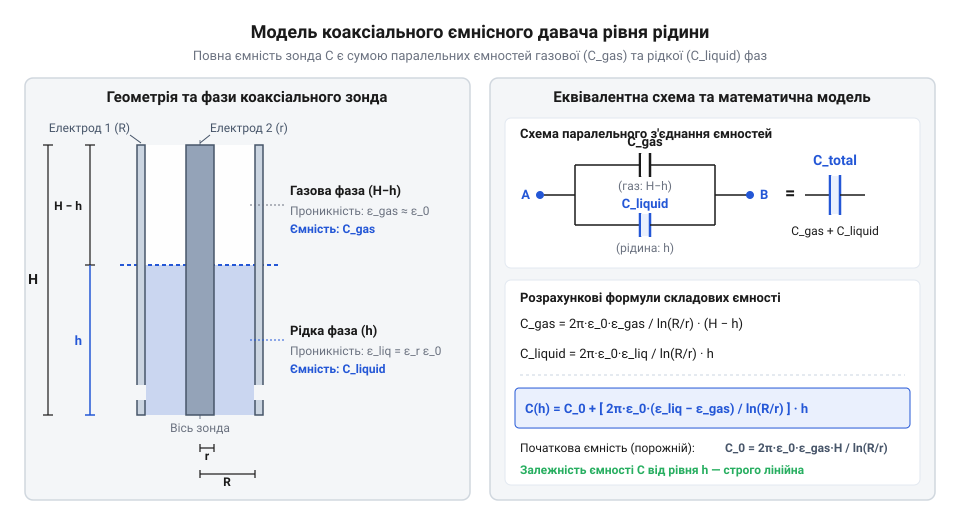
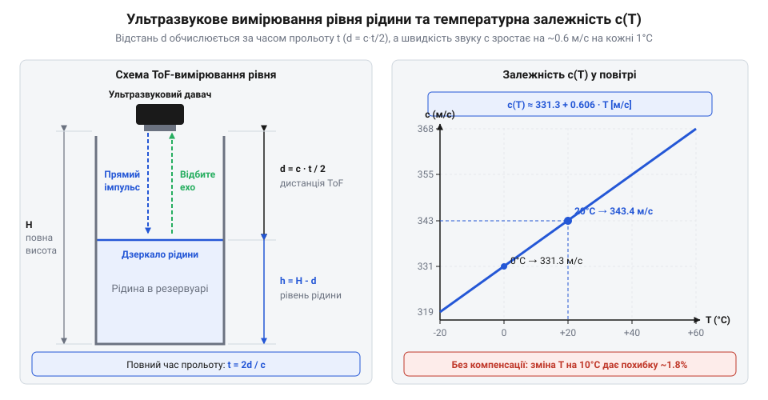

# Фізико-математичні моделі ємнісного та ультразвукового вимірювання рівня

<preknowlist>
- [Ємнісний давач вологості ґрунту (v1.2)](root:cat-hw-sensors/capacitive-soil) — Принцип вимірювання ємності середовища ізольованими електродами та вплив відносної діелектричної проникності.
- [HW-038 — давач рівня води](root:cat-hw-sensors/hw-038-water-level) — Принцип прямого резистивного вимірювання контакту з водою та його недоліки в неперервному моніторингу.
</preknowlist>

## Помилки прямого вимірювання рівня рідини

У закритих резервуарах, паливних баках та технологічних ємностях хімічної промисловості контроль об'єму рідкої фази є необхідною умовою безпечної експлуатації. На перший погляд, найпростішим рішенням здається застосування механічного поплавця, з'єднаного з важелем або потенціометром. Однак у реальних інженерних умовах механічні рухомі вузли швидко стають джерелом відмов. Під дією високого тиску, агресивного пара чи накопичення смолистих і сольових відкладень поплавковий механізм піддається підвищеному тертю, заклинює в проміжних положеннях або втрачає плавучість через розгерметизацію порожнини.

Альтернативний підхід полягає у встановленні дискретних контактних датчиків на різних висотах резервуара. Коли рідина досягає заданої позначки, @@la|дискретний давач@@ (від лат. *discretus* — розділений, переривчастий) замикає електричне коло. Такий підхід створює ступенчату оцінку об'єму, але позбавляє систему можливості здійснювати @@en|неперервний моніторинг рівня@@ (англ. @@en|continuous level monitoring@@). Дискретна схема не дає змоги оцінити швидкість витрати речовини, вчасно виявити витік чи розрахувати точний динамічний баланс у проміжках між фіксованими рівнями. Для неперервного контролю без рухомих деталей іноді намагаються використати [пряме резистивне вимірювання](root:cat-hw-sensors/hw-038-water-level), де занурені електроди вимірюють омичний опір стовпа рідини.

Спроба занурити відкриті металеві провідники безпосередньо у провідне середовище викликає незворотну деградацію сенсорного вузла. Проходження електричного струму крізь рідину спричиняє електролітичну корозію та гальванічний розпад металу електродів. Зміна концентрації іонів, окислення контактних поверхонь та утворення плівки з відкладень змінюють питомий опір середовища. У результаті виміряний опір залежить не стільки від висоти стовпа рідини, скільки від ступеня забруднення й хімічного складу середовища. Аналогічно до того, як руйнуються [контактні доріжки сенсора](root:cat-hw-sensors/soil-moisture) або [відкриті провідники плати](root:cat-hw-sensors/funduino-rain) під дією постійної напруги, @@la|резистивний давач@@ (від лат. *resisto* — чинити опір) втрачає калібрування за кілька діб експлуатації.

Навіть спроба непрямого оцінювання об'єму через інтегрування масової витрати, яку вимірюють [імпульсні турбінні витратоміри](root:cat-hw-sensors/water-flow-sensor), не вирішує проблеми. Будь-яка похибка вимірювання швидкості потоку або мікровитік у запірній арматурі накопичується в часі, створюючи необмежений дрейф розрахованого рівня від реального значення.

Отже, надійний довготривалий моніторинг вимагає повної відмови від відкритих гальванічних контактів, рухомих механічних елементів та математичного накопичення похибок. Це формує строгий математичний запит на оцінку рівня рідини через непрямі фізичні величини, що вимірюються крізь суцільний ізоляційний бар'єр або на відстані. Основними фізичними принципами для створення таких моделей є:
1. Вимірювання електричної ємності, де занурений у захисну ізоляцію @@la|ємнісний зонд@@ (від лат. *capacitas* — місткість) разом зі стінками резервуара або другим електродом утворює конденсатор зі змінним діелектриком. 2. Вимірювання часу прольоту акустичного імпульсу від випромінювача до дзеркала рідини, де використовується @@en|неконтактне вимірювання@@ (англ. @@en|non-contact measurement@@) на основі ультразвукової локації.

Перехід до непрямих вимірювань вимагає побудови строгих фізико-математичних моделей, що описують зв'язок між геометричними параметрами зонда, електрофізичними властивостями середовища та підсумковим вимірюваним сигналом.

## Ємнісна модель циліндричного давача рівня

Щоб усунути гальванічний контакт із рідиною та позбутися рухомих механізмів, вимірювальні електроди покривають суцільним діелектричним шаром або розміщують у вигляді двох ізольованих провідників. Завдяки цьому середовище всередині резервуара виконує роль змінного діелектрика. Найбільш поширеною та математично визначеною геометрією для промислових вимірювачів є @@la|коаксіальний зонд@@ (від лат. *co-* — спільно та *axis* — вісь), що складається з внутрішнього суцільного циліндричного провідника радіусом `R₁` та зовнішнього порожнистого циліндра радіусом `R₂`.

Конструктивно зонд має повну довжину `H` і встановлюється вертикально від дна до верхньої кришки резервуара. При частковому заповненні ємності на глибину `h` внутрішній простір між циліндрами розділяється на дві чіткі зони: нижню ділянку висотою `h`, заповнену рідиною, та верхню ділянку заввишки `H - h`, заповнену газом або повітрям. Головна електрофізична характеристика, що визначає відгук системи, — це @@gr|діелектрична проникність@@ (від грец. *dia-* — через та *elektron* — бурштин) кожної з фаз. Позначимо відносну діелектричну проникність газу як `ε_gas`, а рідини — як `ε_liquid`.


*Схема геометрії коаксіального зонда висотою H, зануреного в рідину на глибину h, та його еквівалентна електрична схема у вигляді двох паралельно з'єднаних конденсаторів C_gas та C_liquid.*

Для математичного опису системи розглянемо розподіл електричного поля між двома співвісними циліндрами. Згідно з теоремою Гаусса для електростатики, ємність на одиницю довжини коаксіального конденсатора з однорідним діелектриком `εᵣ` визначається формулою:

```
C_unit = (2 · π · ε₀ · εᵣ) / ln(R₂ / R₁)      [погонна ємність коаксіального циліндра]
```

де `ε₀ = 8.85418781762 × 10⁻¹² F/m` — електрична стала вакууму, `π ≈ 3.14159265` — математична константа кола, `R₁` — зовнішній радіус внутрішнього електрода, `R₂` — внутрішній радіус зовнішнього циліндра, `ln` — натуральний логарифм.

Оскільки газовий та рідкий сектори розташовані вздовж одного суцільного провідника, вектор напруженості електричного поля в обох зонах спрямований радіально від центральної осі до зовнішньої стінки. Це означає, що розділення середовищ відбувається вздовж еквіпотенціальних поверхонь, а отже, верхня та нижня ділянки зонда електрично з'єднані паралельно. Загальна ємність @@la|коаксіального зонда@@ `C(h)` дорівнює сумі ємності газового сектора `C_gas` та ємності зануреного сектора `C_liquid`:

```
C(h) = C_gas + C_liquid
= (2 · π · ε₀ · ε_gas · (H - h)) / ln(R₂ / R₁) + (2 · π · ε₀ · ε_liquid · h) / ln(R₂ / R₁)      [сума ємностей паралельних ділянок газової та рідкої фаз]
= (2 · π · ε₀ / ln(R₂ / R₁)) · (ε_gas · (H - h) + ε_liquid · h)                               [винесення спільних геометричних множників]
= (2 · π · ε₀ / ln(R₂ / R₁)) · (ε_gas · H + (ε_liquid - ε_gas) · h)                           [розгрупування доданків за глибиною занурення h]
```

Отримане виведення демонструє фундаментальний висновок: ємність зонда є строго лінійною функцією від глибини занурення `h`. Рівняння можна переписати у канонічній лінійній формі `C(h) = C_min + S · h`, де `C_min` — початкова ємність порожнього резервуара (`h = 0`):

```
C_min = (2 · π · ε₀ · ε_gas · H) / ln(R₂ / R₁)      [ємність сухого зонда]
```

А коефіцієнт `S = dC / dh` визначає чутливість перетворювача рівня:

```
S = dC / dh
= (2 · π · ε₀ · (ε_liquid - ε_gas)) / ln(R₂ / R₁)      [чутливість ємнісного зонда до зміни рівня]
```

Аналіз формули чутливості виявляє ключові фактори, що впливають на вимірювання:
1. Вплив властивостей рідини: Чутливість `S` прямо пропорційна різниці діелектричних проникностей `(ε_liquid - ε_gas)`. Для дистильованої та прісної води (`ε_liquid ≈ 80`, `ε_gas ≈ 1`) зміна ємності на метр занурення є максимальною, що забезпечує високе співвідношення сигнал/шум. Для нафтопродуктів, дизельного пального та трансформаторного масла (`ε_liquid ≈ 2.0 - 2.3`) різниця `(ε_liquid - ε_gas) ≈ 1.1 - 1.3` є набагато меншою, що вимагає застосування вимірювальних схем з високою роздільною здатністю. 2. Вплив геометрії електродів: Вираз `K_geom = (2 · π) / ln(R₂ / R₁)` є геометричним коефіцієнтом зонда. Зменшення зазору між циліндрами (`R₂ / R₁ → 1`) збільшує логарифмічний знаменник `ln(R₂ / R₁) → 0`, що пропорційно підвищує крутизну статичної характеристики `S`. Проте надмірно малий зазор збільшує ризик капілярного затримання рідини при зниженні рівня.

Окрім коаксіальної структури, на практиці також застосовують двопровідні зонди, виготовлені з двох паралельних ізольованих жил радіусом `r`, розташованих на відстані `D` одна від одної. За аналогічним принципом виведення, погонна ємність паралельних провідників дає лінійну залежність:

```
C_two_wire(h) = (π · ε₀ / ln(D / (2 · r))) · (ε_gas · H + (ε_liquid - ε_gas) · h)      [ємнісна модель двопровідного зонда]
```

У реальних конструкціях на кінцях зонда виникає @@en|крайовий ефект@@ (англ. @@en|fringe effect@@) — викривлення силових ліній електричного поля на межах металевих електродів та донних кріплень. Це додає постійну аддитивну складову `C_fringe`, яка викривляє розрахункове значення `C_min`, але не змінює чутливість `S`.

Подібно до того, як [ємнісний вимірювальний зонд](root:cat-hw-sensors/capacitive-soil) використовує ізольовані друковані провідники для аналізу вологості, розглянутий циліндричний зонд перетворює зміну висоти рідини в електричний параметр без прямого гальванічного контакту. Проте ідеальна модель `C(h)` у реальних умовах зазнає впливу паразитного середовища та температурних коливань. Для вивчення мостових і генераторних схем перетворення виміряної ємності зонда у частоту або цифровий код мікроконтролера перегляньте статтю про [електричні перетворювачі ємності зондів](root:hw-sensing/coaxial-capacitive-circuits).

## Компенсація паразитної ємності та дрейфу

Ідеальна математична модель `C(h)` описує лише ємність самого вимірювального зонда. Проте в реальних промислових вимірювальних системах вимірювач електронного блоку підключений до зонда за допомогою сполучного коаксіального або екранованого кабелю. Крім того, конструктивні елементи резервуара та монтажні фланці створюють власні розподілені ємності на землю. Підсумкова ємність, яку фіксує вимірювальний прилад, становить:

```
C_meas(h, T) = C(h, T) + C_cable + C_stray      [повна вимірювана ємність вимірювального кола]
```

де `C_cable` — @@en|паразитна ємність@@ (англ. @@en|parasitic capacitance@@) сполучного кабелю, яка залежить від його довжини, вигинів та температури довкілля (зазвичай становить від `20` до `200 pF`), а `C_stray` — паразитна ємність монтажних елементів. Якщо ємність кабелю `C_cable` співвідносна зі зміною ємності зонда від рівня `ΔC(h)`, нерахований кабель створює катастрофічну похибку вимірювання.

Другим критичним фактором є @@nl|температурний дрейф@@ (від голл. *drijf* — плавати, дрейфувати) відносної діелектричної проникності рідини `ε_liquid(T)`. Для більшості дипольних рідин @@gr|діелектрична проникність@@ суттєво зменшується зі зростанням температури через теплову дезорієнтацію молекул. Наприклад, для чистої води `ε_liquid` становить `88.0` при `0 °C`, спадає до `78.4` при `25 °C` і досягає `55.3` при `100 °C` (нелінійне падіння понад `30 %`). Для нафтопродуктів температурний коефіцієнт зумовлений зміною густини речовини при тепловому розширенні. Зміна `ε_liquid(T)` призводить до того, що коефіцієнт чутливості `S(T)` стає функцією температури, позбавляючи систему стабільного калібрування.

Для усунення @@en|паразитної ємності@@ кабелю `C_cable` застосовують математичний метод двоточкового калібрування та нормування сигналу. Виміряємо значення вихідної ємності для порожнього резервуара `C_dry` (`h = 0`) та повністю заповненого `C_wet` (`h = H`):

```
C_dry = K_geom · ε₀ · ε_gas · H + C_cable + C_stray      [виміряна ємність сухого резервуара]
```

```
C_wet = K_geom · ε₀ · ε_liquid · H + C_cable + C_stray    [виміряна ємність заповненого резервуара]
```

де `K_geom = (2 · π) / ln(R₂ / R₁)` — геометричний коефіцієнт зонда. Віднімаючи `C_dry` від `C_meas(h)`, отримуємо приростову ємність:

```
C_meas(h) - C_dry
= (K_geom · ε₀ · (ε_gas · H + (ε_liquid - ε_gas) · h) + C_cable + C_stray) - (K_geom · ε₀ · ε_gas · H + C_cable + C_stray)      [різниця поточного та сухого вимірювань]
= K_geom · ε₀ · (ε_liquid - ε_gas) · h                                                                                          [скорочення сталих доданків та паразитної ємності]
```

Аналогічно, діапазонна різниця між повним і сухим станом дорівнює:

```
C_wet - C_dry = K_geom · ε₀ · (ε_liquid - ε_gas) · H      [повний вимірювальний діапазон ємності]
```

Шляхом ділення приростової ємності на діапазонну різницю отримуємо формулу нормованого відносного рівня:

```
h = H · (C_meas(h) - C_dry) / (C_wet - C_dry)      [формула компенсації паразитної ємності кабелю]
```

У цьому виразі величини `C_cable` та `C_stray` повністю скорочуються. Проте якщо температура рідини змінилася, значення `ε_liquid(T)` відхиляється від моменту калібрування `C_wet`, що спричиняє температурну похибку.

Щоб одночасно усунути як паразитну ємність кабелю, так і @@nl|температурний дрейф@@ `ε_liquid(T)`, застосовують @@la|диференціальне вимірювання@@ (від лат. *differentia* — різниця) за допомогою двосегментного зонда з додатковим опорним конденсатором `C_ref`. Опорний секційний конденсатор висотою `h_ref` розміщують у найнижчій точці резервуара так, щоб він завжди залишався повністю зануреним у рідину під час роботи системи (`h ≥ h_ref`).

Рівняння ємності опорного зануреного сектора та основного вимірювального сектора мають вигляд:

```
C_ref(T) = K_ref · ε₀ · ε_liquid(T) + C_cable_ref      [ємність завжди зануреного опорного зонда]
```

```
C_main(h, T) = K_geom · ε₀ · (ε_gas · (H - h) + ε_liquid(T) · h) + C_cable_main      [ємність основного вимірювального зонда]
```

Позначимо сухий базис опорного сектора як `C_ref_dry = K_ref · ε₀ · ε_gas + C_cable_ref`. Віднімаючи сухий базис, отримуємо приростовий сигнал опорного сектора, який прямо пропорційний поточній діелектричній проникності рідкої фази при даній температурі `T`:

```
ΔC_ref(T) = C_ref(T) - C_ref_dry
= K_ref · ε₀ · (ε_liquid(T) - ε_gas)      [приріст ємності опорного зонда від діелектрика]
```

Виразимо поточне значення діелектричної різниці `(ε_liquid(T) - ε_gas)` з опорного сигналу та підставимо його в вираз приросту основного зонда `ΔC_main(h, T) = C_main(h, T) - C_main_dry`:

```
ΔC_main(h, T) = K_geom · ε₀ · (ε_liquid(T) - ε_gas) · h
= K_geom · ε₀ · (ΔC_ref(T) / (K_ref · ε₀)) · h      [підстановка температурно залежного діелектричного дрейфу]
= (K_geom / K_ref) · ΔC_ref(T) · h                  [скорочення електричної сталої ε₀ та діелектричної проникності]
```

Розв'язуючи це рівняння відносно висоти занурення `h`, отримуємо підсумкову диференціальну формулу компенсації:

```
h = (K_ref / K_geom) · (ΔC_main(h, T) / ΔC_ref(T))      [інваріантне від температури та кабелю рівняння рівня]
```

Математичний аналіз отриманого підсумкового співвідношення показує:
1. Повна інваріантність до температури: Невідома функція `ε_liquid(T)`, електрична стала `ε₀` та @@en|паразитна ємність@@ кабелю `C_cable` повністю скорочуються під час ділення змінних. 2. Геометрична стабільність: Значення рівня `h` залежить виключно від співвідношення конструктивних геометричних коефіцієнтів двох секторів `K_ref / K_geom` та від відношення двох виміряних електричних сигналів `ΔC_main / ΔC_ref`.

Таким чином, використання диференціальних математичних моделей дозволяє будувати високоточні алгоритми розрахунку рівня, стійкі до зміни довжини кабелю та температурного дрейфу середовища.

## Акустичний час прольоту ультразвукового імпульсу

Застосування ємнісного вимірювання вимагає постійного перебування електродів усередині резервуара. Якщо рідина є хімічно агресивною кислотою, гарячим лугом, густою суспензією або в'язким нафтопродуктом, тривалий контакт викликає налипання речовини на захисну ізоляцію зонда. Налиплий шар змінює ефективний діелектрик і спотворює виміряну ємність. Для таких середовищ необхідне @@en|неконтактне вимірювання@@, де сенсор розташовується у верхній частині резервуара над дзеркалом рідини й аналізує повітряний проміжок.

Фізичною основою такого підходу є @@gr|акустичний час прольоту@@ (англ. @@en|Time of Flight@@, скорочено @@en|ToF@@, від грец. *akoustikos* — слуховий). На кришці ємності на абсолютній висоті `H` від дна встановлюють @@la|ультразвуковий випромінювач@@ (від лат. *ultra* — понад та *sonus* — звук). Сенсор генерує короткий акустичний імпульс високої частоти (зазвичай `40 kHz` або `200 kHz`), який поширюється вниз крізь повітряне середовище зі швидкістю `c`. Досягнувши межі розділу фаз «повітря — рідина», акустична хвиля відбивається від дзеркала рідини через різницю акустичних імпедансів середовищ і повертається назад до приймача. Детальніше про п'єзоелектричний ефект, генерацію акустичних імпульсів та формування діаграми спрямованості випромінювача читайте у матеріалі про [фізичні основи п'єзоелектричних ультразвукових випромінювачів](root:hw-sensing/ultrasonic-transducer-physics).


*Схема геометрії ультразвукового вимірювання рівня від випромінювача на висоті H до дзеркала рідини на висоті h та залежність швидкості звуку c від температури повітря T.*

Повний шлях `2 · d`, який долає імпульс від випромінювача до поверхні рідини на відстані `d` і назад за виміряний час прольоту `t`, описується кінематичним рівнянням:

```
d = (c · t) / 2      [відстань від випромінювача до дзеркала рідини]
```

Оскільки повна висота резервуара `H` є фіксованою геометричною константою, висота стовпа рідини `h` дорівнює різниці між висотою встановлення давача та виміряною відстанню `d`:

```
h = H - d
  = H - (c · t) / 2      [кінематична модель акустичного вимірювання рівня]
```

Аналіз отриманої моделі показує, що точність визначення рівня `h` безпосередньо залежить від точності знання швидкості поширення акустичної хвилі `c`. У газах швидкість звуку визначається термодинамічним станом середовища. Згідно з моделлю ідеального газу, швидкість звуку `c` залежить від абсолютної температури `T_abs = T + 273.15` у кельвінах:

```
c = √(γ · R · (T + 273.15) / M)      [термодинамічна швидкість звуку в газі]
```

де `γ ≈ 1.402` — показник адіабати для двоатомних газів (повітря), `R = 8.31446 J/(mol · K)` — універсальна газова стала, `M ≈ 0.028964 kg/mol` — молярна маса сухого повітря, `T` — температура повітря у градусах Цельсія (`°C`).

Для практичних обчислень у діапазоні робочих температур від `-40 °C` до `+60 °C` квадратний корінь лінеаризують за допомогою розкладу в ряд Тейлора в околі `0 °C` (`273.15 K`):

```
c(T) = c₀ · √(1 + T / 273.15)
     ≈ c₀ · (1 + T / (2 · 273.15))                      [лінеаризація Тейлора першого порядку]
     = 331.3 · (1 + T / 546.3)                         [підстановка швидкості звуку при 0 °C]
     ≈ 331.3 + 0.606 · T                               [лінійне наближення швидкості звуку від температури]
```

де `c₀ = 331.3 m/s` — швидкість звуку у сухому повітрі при `0 °C`.

Окрім температури, на молярну масу повітря впливає @@la|відносна вологість@@ (від лат. *relativus* — відносний). Молекули водяної пари `H₂O` мають молярну масу `M_H2O ≈ 0.018 kg/mol`, що є меншим за молярну масу сухого повітря `M_air ≈ 0.029 kg/mol`. Збільшення вологості зменшує середнявшану густину суміші, що злегка підвищує швидкість звуку. Уточнена двопараметрична формула має вигляд:

```
c(T, R_H) ≈ 331.3 + 0.606 · T + 0.0124 · R_H      [з урахуванням відносної вологості R_H]
```

де `R_H` — відносна вологість у відсотках (`%`).

Чутливість швидкості звуку до температурного дрейфу становить `∂c / ∂T ≈ 0.606 m/(s · °C)`. Оцінимо похибку вимірювання рівня `Δh`, спричинену нерахованим зміщенням температури `ΔT`:

```
Δh = - (t / 2) · Δc
   = - (t / 2) · 0.606 · ΔT      [температурна похибка визначення рівня]
```

Якщо відстань до рідини становить `d = 2 m` (`t ≈ 11.65 ms`), то зміна температури повітря на `ΔT = +10 °C` створює похибку швидкості `Δc ≈ 6.06 m/s`. Це призводить до хибного зміщення обчисленого рівня на `Δh ≈ -3.53 cm`. У резервуарі висотою `2 m` така похибка становить понад `1.76 %` від повної шкали, що є неприпустимим для точних облікових систем.

Підставляючи температурно залежну швидкість `c(T)` у кінематичне рівняння, отримуємо остаточну модель з автоматичною термокомпенсацією:

```
h(t, T) = H - ((331.3 + 0.606 · T) · t) / 2      [температурно компенсоване рівняння рівня]
```

На відміну від занурюваних зондів, про які йдеться у [вимірювачах вологості ґрунту](root:cat-hw-sensors/capacitive-soil), акустична модель забезпечує повну ізоляцію сенсора від середовища, але вимагає точного вимірювання температури повітряного проміжку безпосередньо в зоні прольоту імпульсу. Для розширеного аналізу математичних моделей часу прольоту, геометричного розходження акустичного променя та точної компенсації середовища дивіться матеріал про [математичні моделі ультразвукового часу прольоту](root:hw-sensing/ultrasonic-tof-level-math).

## Калібрування та обчислення підсумкової похибки

Синтез виведених ємнісної та акустичної моделей у реальну вимірювальну систему вимагає процедури калібрування. Конструктивні відхилення розмірів резервуара, монтажні допуски, початкова ємність кабелю та локальні умови середовища роблять теоретичні розрахунки лише першим наближенням. Для досягнення високої точності застосовують @@ar|двоточкове калібрування@@ (від араб. *qālib* — форма, шаблон) при двох реперних станах: порожньому резервуарі (`h = 0`) та заповненому до максимальної позначки (`h = H_max`).

Для ємнісної системи первинним вимірюваним сигналом є ємність `C_meas`. Зафіксувавши значення `C₀` при `h = 0` та `C_max` при `h = H_max`, нормований алгоритм обчислення висоти занурення набуває вигляду:

```
h = H_max · (C_meas - C₀) / (C_max - C₀)      [двочкове калібрування ємнісного давача]
```

Для ультразвукової системи первинною величиною є виміряний час прольоту `t_meas`. При порожньому резервуарі час прольоту є максимальним `t₀ = 2 · H / c(T)`, а при максимальному заповненні `H_max` — мінімальним `t_max = 2 · (H - H_max) / c(T)`. Калібрувальне рівняння для акустичного давача виражається через відносний приріст часу:

```
h = H_max · (t₀ - t_meas) / (t₀ - t_max)      [двочкове калібрування акустичного давача]
```

Подібно до того, як калібрують [контактні резистивні датчики](root:cat-hw-sensors/hw-038-water-level) або [перетворювачі витрати потоку](root:cat-hw-sensors/water-flow-sensor), нормована двоточкова схема усуває постійне зміщення нуля та масштабує вихідний діапазон. Проте реальна похибка вимірювання визначається сукупним впливом багатьох незалежних факторів.

Для розрахунку підсумкової точності будують @@en|бюджет похибок@@ (англ. @@en|error budget@@), що об'єднує три основні категорії невизначеностей:
1. @@la|електрична невизначеність@@ `u_elec`: шум аналогово-цифрового перетворювача (АЦП), роздрібнювальна здатність таймера мікроконтролера та квантування часу прольоту. 2. @@la|геометрична невизначеність@@ `u_geom`: відхилення кута монтажу сенсора `θ` від вертикалі (кутове відхилення подовжує акустичний шлях за законом `d_eff = d / cos(θ)`), допуск на висоту встановлення `ΔH` та деформація стінок резервуара під тиском. 3. @@la|параметрична невизначеність@@ `u_env`: похибка вимірювання температури `ΔT`, наявність вертикального температурного градієнта та коливання тиску й вологості.

Відповідно до міжнародного керівництва з вираження невизначеності вимірювань (GUM), підсумкова комбінована @@la|стандартна невизначеність@@ `u_c(h)` для взаємно незалежних вхідних величин `x₁, x₂, ..., xₙ` обчислюється через закон накопичення квадратів часткових похідних (коефіцієнтів чутливості):

```
u_c²(h) = ∑ ( (∂h / ∂xᵢ)² · u²(xᵢ) )      [закон накопичення квадратів стандартних похибок]
```

Розглянемо акустичну модель `h(t, T, H) = H - ((c₀ + k_T · T) · t) / 2`, де `k_T = 0.606 m/(s · °C)`. Часткові похідні за основними параметрами дорівнюють:

```
∂h / ∂H = 1                                 [чутливість до похибки висоти монтажу]
```

```
∂h / ∂t = - (c₀ + k_T · T) / 2 = - c(T) / 2  [чутливість до похибки вимірювання часу]
```

```
∂h / ∂T = - (k_T · t) / 2                   [чутливість до похибки вимірювання температури]
```

Підставляючи часткові похідні у квадратну суму, отримуємо вираз для аналітичного обчислення дисперсії вимірювання рівня:

```
u_c²(h) = u²(H) + (c(T) / 2)² · u²(t) + (k_T · t / 2)² · u²(T)      [квадрат підсумкової похибки рівня]
```

**Обчислення бюджету похибок для практичного прикладу:**

**Умова:** Резервуар висотою `H = 2.000 m` заповнений до половини (`h = 1.000 m`, відстань до дзеркала `d = 1.000 m`). Температура повітря `T = 20 °C` (`c(20 °C) = 343.42 m/s`), час прольоту `t ≈ 5.824 ms`. Стандартні невизначеності вимірювальних каналів становлять: невизначеність висоти монтажу `u(H) = 0.002 m` (`2 mm`), невизначеність вимірювання часу таймером `u(t) = 10 μs` (`10⁻⁵ s`), невизначеність термодатчика `u(T) = 0.5 °C`.

```
u²_H = (0.002)²
     = 4.000 × 10⁻⁶ m²                              [складова геометричної похибки]
```

```
u²_t = (343.42 / 2)² · (10⁻⁵)²
     = (171.71)² · 10⁻¹⁰
     = 2.948 × 10⁻⁶ m²                              [складова часової похибки АЦП/таймера]
```

```
u²_T = (0.606 · 0.005824 / 2)² · (0.5)²
     = (0.001764)² · 0.25
     = 0.778 × 10⁻⁶ m²                              [складова температурної похибки]
```

```
u_c²(h) = u²_H + u²_t + u²_T
        = 4.000 × 10⁻⁶ + 2.948 × 10⁻⁶ + 0.778 × 10⁻⁶
        = 7.726 × 10⁻⁶ m²                           [сумарна дисперсія вимірювання]
```

```
u_c(h) = √(7.726 × 10⁻⁶)
       ≈ 0.00278 m = 2.78 mm                        [підсумкова стандартна похибка вимірювання]
```

Для довірчої ймовірності `95 %` (розширений коефіцієнт охоплення `k = 2`) розширена похибка вимірювання становить `U = 2 · u_c(h) ≈ 5.56 mm` (або `0.28 %` від повної шкали `2 m`).

Побудований бюджет похибок наочно показує інженеру, які вузли системи створюють наибольший внесок у підсумкову невизначеність. Наприклад, у розглянутому випадку геометричний допуск монтажу `u(H)` формує понад `50 %` сумарної дисперсії, що вказує на необхідність точнішого юстування корпусу сенсора, а не подальшого підвищення частоти дискретизації АЦП.