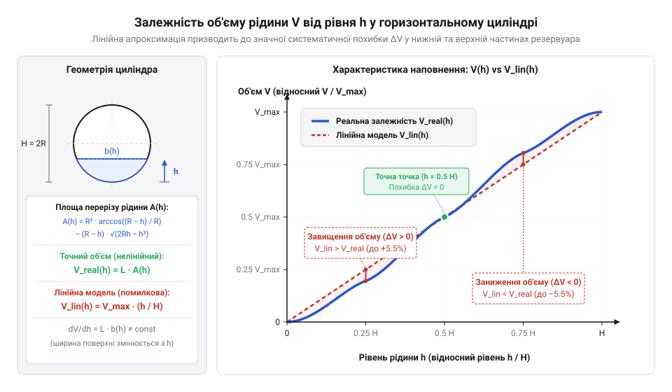
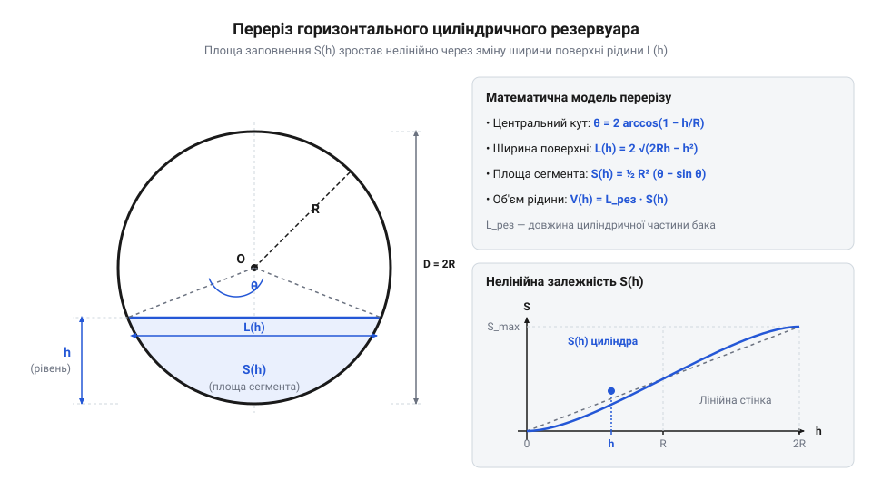
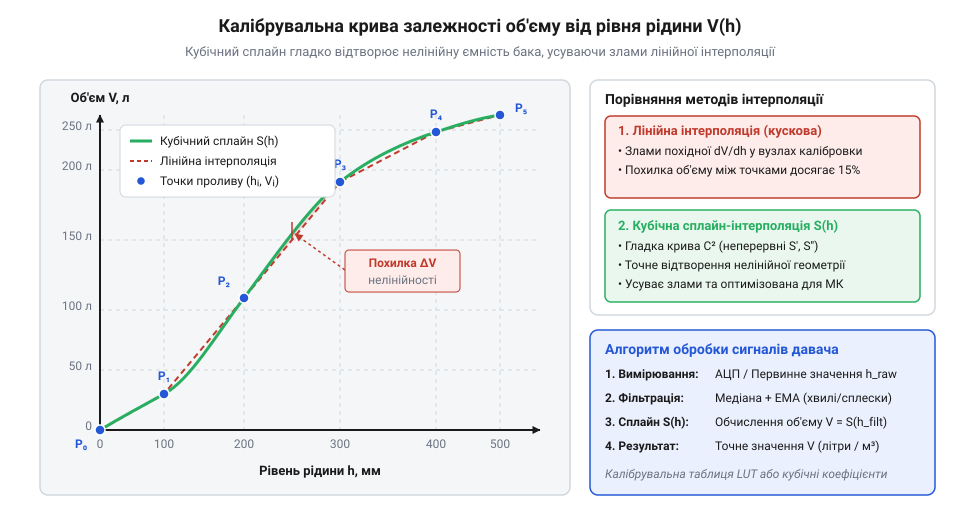

# Математика перерахунку рівня в об'єм та калібрування ємностей

<preknowlist>
- [HW-038 — давач рівня води](root:cat-hw-sensors/hw-038-water-level) — принцип вимірювання глибини занурення та отримання первинного аналогового сигналу висоти рівня
</preknowlist>

## Хибність лінійного перерахунку рівня в об'єм

Коли первинний [давач рівня води HW-038](root:cat-hw-sensors/hw-038-water-level) вимірює глибину занурення у водоймі чи ємності, він видає електричний аналоговий сигнал, прямо пропорційний висоті стовпа рідини `h`. Перша інженерна спокуса полягає в тому, щоб помножити виміряну висоту на відому площу основи бака `S₀` й отримати поточний об'єм `V = S₀ · h`. Проте такий простий лінійний перерахунок гарантує точність лише для одного часткового випадку — прямого вертикального циліндра або прямокутного бака зі сталим поперечним перерізом по всій висоті. У такій ємності кожен додатковий міліметр підняття рівня відповідає одному й тому самому приросту об'єму `ΔV = S₀ · Δh`. Для вимірювання висоти стовпа рідини у глибоких резервуарах за допомогою вимірювання тиску використовують [гідростатичні давачі рівня рідини](root:hw-sensing/hydrostatic-pressure-level-sensor).

Більшість реальних технологічних та побутових резервуарів — горизонтальні паливні баки, сферичні накопичувачі, конічні дозатори чи зрізані цистерни — мають виражену @@la|нелінійність@@ (лат. *linea* — лінія) геометричної форми. У цих ємностях площа горизонтального перерізу рідини `S(z)` не залишається постійною, а є неперервною функцією поточної висоти `z`. Якщо нехтувати цією геометричною особливістю й застосовувати спрощену пропорцію `V_lin(h) = V_max · (h / H)`, виникає значна @@en|систематична похибка@@ у визначенні реального залишкового об'єму.

З фізичного погляду залежність між об'ємом та висотою визначається диференціальним співвідношенням `dV = S(h) · dh`. Похідна об'єму за висотою `dV / dh = S(h)` характеризує чутливість об'єму до зміни рівня. У зонах, де площа перерізу `S(h)` є максимальною (наприклад, у середній частині горизонтального бака), навіть незначне підняття рівня на один сантиметр відповідає значному припливу рідини. Натомість біля дна чи верхнього склепіння, де площа перерізу мала, той самий сантиметр висоти вміщує мізерний об'єм.

Щоб наочно побачити небезпеку лінійного спрощення, розглянемо обчислювальний приклад для горизонтального циліндричного резервуара радіуса `R` та довжини `L`. Загальна висота резервуара дорівнює `H = 2 · R`, а повний об'єм становить `V_max = π · R² · L`. Якщо бак заповнений рівно наполовину (`h = R`), то через дзеркальну симетрію верхньої та нижньої половин лінійна формула випадково дасть правильний результат: `V_lin(R) = V_max · (R / (2 · R)) = 0.5 · V_max`.

Проте уявимо, що рідина заповнює бак лише на чверть висоти (`h = 0.5 · R`, тобто 25% від загальної висоти `2 · R`). Спрощена лінійна модель передбачає, що в баку знаходиться 25% від повного об'єму рідини. Обчислимо фактичний об'єм за геометрією кругового @@la|сегмента@@ (лат. *segmentum* — відрізок):

    θ = 2 · arccos((R - 0.5 · R) / R)
      = 2 · arccos(0.5)                   [спрощення аргументу арккосинуса]
      = 2 · (π / 3)                       [арккосинус 0.5 дорівнює 60 градусам або π/3 радіан]
      = 2 · π / 3                         [центральний кут у радіанах, дорівнює 120°]

Площа рідкого сегмента `S_seg` обчислюється як різниця площ кругового @@la|сектора@@ (лат. *sector* — висілок) та трикутника між центром циліндра та поверхнею рідини:

    S_seg = 0.5 · R² · (θ - sin(θ))
          = 0.5 · R² · (2 · π / 3 - sin(2 · π / 3))     [підстановка кута θ = 120°]
          = 0.5 · R² · (2 · π / 3 - √3 / 2)             [значення синуса 120° дорівнює √3/2]
          ≈ 0.5 · R² · (2.0944 - 0.8660)                [обчислення числових значень у дужках]
          ≈ 0.5 · R² · 1.2284                           [різниця кута та синуса]
          ≈ 0.6142 · R²                                [площа заштрихованого сегмента рідини]

Відношення фактичної площі рідкого сегмента до площі повного круга `S_circle = π · R²` дає реальну частку заповнення резервуара:

    Частка = S_seg / (π · R²)
           ≈ (0.6142 · R²) / (3.1416 · R²)       [скорочення радіуса R² у чисельнику та знаменнику]
           ≈ 0.1955                               [фактична частка становить 19.55% від повного об'єму]

Порівняння показує істотний розрив: лінійний перерахунок оцінює залишок у 25% (0.25 · V_max), тоді як насправді в баку залишилося лише 19.55% (0.1955 · V_max). Абсолютна помилка оцінки становить 5.45% від всієї місткості бака. Проте відносна похибка обчислення залишкового палива чи води є ще вищою:

    Похибка = (0.2500 - 0.1955) / 0.1955
            = 0.0545 / 0.1955                     [різниця оцінок віднесена до реального об'єму]
            ≈ 0.2788                              [завищення реального залишку на 27.9%]

Таке лінійне спрощення створює хибну впевненість у запасі ресурсів: система вважатиме, що в резервуарі є 250 літрів рідини з 1000, хоча реальний залишок становить лише 195.5 літрів. На відміну від прямих вимірювачів витрати, таких як [давач витрати води](root:cat-hw-sensors/water-flow-sensor), що підраховують об'єм через кількість обертів турбіни, визначення об'єму за рівнем вимагає точного математичного моделювання геометрії резервуара для кожного можливого рівня `h`.


*Порівняння лінійного перерахунку об'єму та реальної кривої наповнення горизонтального циліндра: виділена зона систематичної похибки демонструє суттєве завищення залишку рідини при малій висоті заповнення.*

## Геометричні моделі канонічних форм резервуарів

Щоб перетворити показання давача рівня на точне значення об'єму, необхідно побудувати аналітичну геометричну модель ємності. В основі розрахунку лежить обчислення визначеного @@la|інтеграла@@ (лат. *integer* — цілісний) від площі поперечного перерізу `S(z)` вздовж вертикальної осі `z` від дна ємності `z = 0` до поточного рівня рідини `z = h`: Якщо ж функція площі перерізу задана дискретним масивом точок, для розрахунку об'єму застосовують [чисельне інтегрування перерізів для резервуарів](root:math-numeric/numerical-integration-level-calibration).

    V(h) = ∫₀ʰ S(z) dz

Для канонічних симетричних тіл — горизонтального циліндра, сфери та зрізаного конуса — цей інтеграл розв'язується аналітично, даючи точні формули перерахунку.

### Горизонтальний циліндр

Розглянемо горизонтальний @@gr|циліндр@@ (грец. *kylindros* — валик) із радіусом основи `R` та довжиною `L`. Рівень рідини `h` відлічується від найнижчої точки дна резервуара (`0 ≤ h ≤ 2 · R`).


*Переріз горизонтального циліндричного резервуара: площа заштрихованого сегмента рідини обчислюється через центральний кут θ та геометрію трикутника над дзеркалом води.*

Площа рідкого сегмента дорівнює різниці площ кругового @@la|сектора@@ із центральним кутом `θ(h)` та трикутника, утвореного центром циліндра та поверхнею рідини. Центральний кут `θ(h)` обчислюється через відстань від центра циліндра до поверхні рідини `|R - h|`:

    θ(h) = 2 · arccos((R - h) / R)

Площа рідкого сегмента `S_seg(h)` визначається як:

    S_seg(h) = 0.5 · R² · θ(h) - (R - h) · √(R² - (R - h)²)
             = R² · arccos((R - h) / R) - (R - h) · √(2 · R · h - h²)      [розкриття різниці квадратів під коренем]

Множенням площі сегмента на довжину циліндра `L` отримуємо підсумкову формулу об'єму:

    V(h) = L · [R² · arccos((R - h) / R) - (R - h) · √(2 · R · h - h²)]

Ця формула є інваріантною відносно рівня `h` у всьому діапазоні від `0` до `2 · R`. Коли рівень перевищує радіус (`h > R`), вираз `(R - h)` стає від'ємним. Арккосинус від'ємного аргументу повертає кут, більший за `π / 2` (понад 90°), а другий доданок змінює знак на плюс, автоматично додаючи площу верхнього трикутника до напівкруга. При `h = 2 · R` аргумент арккосинуса дорівнює `-1`, що дає `θ = 2 · π`, а підкореневий вираз перетворюється на нуль, забезпечуючи точний результат `V(2 · R) = π · R² · L`.

### Сферичний резервуар

@@gr|Сфера@@ (грец. *sphaira* — куля) радіуса `R` має тривимірну симетрію, але її горизонтальні перерізи є кругами, радіус яких `r(z)` нелінійно залежить від висоти `z` (`0 ≤ h ≤ 2 · R`).

На довільній висоті `z` від дна відстань від горизонтального перерізу до центра сфери становить `|R - z|`. За теоремою Піфагора радіус перерізу `r(z)` дорівнює:

    r(z)² = R² - (R - z)²
          = R² - (R² - 2 · R · z + z²)        [розкриття квадрата різниці]
          = 2 · R · z - z²                    [зведення подібних доданків]

Площа горизонтального кругового перерізу на висоті `z` дорівнює `S(z) = π · r(z)² = π · (2 · R · z - z²)`. Обчислимо об'єм рідкої фази шляхом інтегрування площі перерізу:

    V(h) = ∫₀ʰ π · (2 · R · z - z²) dz
         = π · [R · z² - z³ / 3]₀ʰ            [знаходження первісної функції]
         = π · h² · (R - h / 3)               [винесення h² за дужки]

Щоб перевірити математичну коректність виведення, візьмемо похідну від отриманого об'єму за висотою `h`:

    dV / dh = d/dh [π · (R · h² - h³ / 3)]
            = π · (2 · R · h - h²)            [диференціювання за висотою h]
            = S(h)                            [отримали точну площу горизонтального перерізу]

Похідна від функції об'єму тотожно дорівнює площі перерізу `S(h)`, що повністю підтверджує базову теорему аналізу для інтегрування геометричних тіл.

### Конічний резервуар та зрізаний конус

Ємності у формі зрізаного @@gr|конуса@@ (грец. *konos* — соснова шишка) поширені у промислових змішувачах, дозаторах сипучих і рідких речовин та відстійниках. Розглянемо зрізаний конус із радіусом дна `R₁`, радіусом верхньої горловини `R₂` та висотою `H`.

За лінійним законом радіус горизонтального перерізу `r(z)` на висоті `z` дорівнює:

    r(z) = R₁ + (R₂ - R₁) · (z / H)

Площа перерізу на висоті `z` становить `S(z) = π · r(z)²`. Інтегруємо цю квадратичну залежність для обчислення об'єму:

    V(h) = ∫₀ʰ π · [R₁ + (R₂ - R₁) · (z / H)]² dz
         = π · ∫₀ʰ [R₁² + 2 · R₁ · (R₂ - R₁) · (z / H) + (R₂ - R₁)² · (z² / H²)] dz    [розкриття квадрата суми]
         = π · [R₁² · h + R₁ · (R₂ - R₁) · (h² / H) + (R₂ - R₁)² · (h³ / (3 · H²))]    [інтегрування за z від 0 до h]
         = (π · h / 3) · [R₁² + R₁ · r(h) + r(h)²]                                     [згортання до компактної алгебраїчної форми]

Розглянемо два важливих граничних випадки орієнтації конуса:

1. **Конус вершиною донизу (`R₁ = 0`, радіус верхнього отвору `R₂`):**
   У такому бункері радіус перерізу становить `r(h) = R₂ · (h / H)`. Підстановка `R₁ = 0` у формулу об'єму дає:

       V(h) = (π / 3) · R₂² · (h³ / H²)
            = V_max · (h / H)³                                                         [кубічна залежність від рівня h]

   Кубічна залежність означає дуже стрімке зростання об'єму з висотою: якщо резервуар заповнено наполовину за висотою (`h = 0.5 · H`), об'єм рідини становить лише `(0.5)³ = 0.125` або 12.5% від повного об'єму.

2. **Зрізаний конус вершиною догори (`R₁ > R₂`):**
   У таких баках найбільша площа розташована внизу. У міру підняття рівня приріст об'єму сповільнюється, а залежність `V(h)` виполажується у верхній частині ємності.

Точні аналітичні моделі чудово працюють для ідеальних геометричних форм. Однак у реальних умовах баки можуть мати зварні шви, технологічні вм'ятини чи складну несиметричну конфігурацію, для яких аналітичний інтеграл не виводиться. У таких випадках застосовують табличне калібрування з подальшою цифровою інтерполяцією.

## Сплайн-інтерполяція для баків довільної геометрії

Аналітичні формули залежності об'єму від рівня, виведені для ідеальних горизонтальних циліндрів, сфер та конусів, бездоганно працюють лише на кресленнях. У реальних експлуатаційних умовах геометрія резервуара майже ніколи не відповідає канонічним фігурам. Штамповані пластикові баки мають технологічні ухили стінок для виймання з прес-форми, металеві цистерни деформуються під власною вагою рідини, а всередині баків розміщуються ребра жорсткості, хвилерізи та заглиблення для зливних патрубків. Крім того, сама ємність під час монтажу може отримати нахил у кілька градусів до горизонту. Спроба розрахувати об'єм у такому деформованому чи похилому баку за точними інтегральними формулами ідеального циліндра призводить до систематичної похибки, яка досягає 10–15% від фактичної місткості.

Коли аналітичне рівняння геометрії невідоме або занадто складне, єдиним способом точного вимірювання стає експериментальне калібрування (з арабської *qālib* — форма, через французьке *calibre* — розмір, шаблон; термін: @@fr|calibration@@). Процес полягає в послідовному проливанні резервуара: у порожній бак дозовано подають точні порції рідини `ΔV` і фіксують покази давача рівня. Під час експериментального наповнення ємності точний приплив рідини контролюють через [проточний турбінний витратомір](root:cat-hw-sensors/water-flow-sensor), а відповідне підняття дзеркала вимірюють за допомогою [аналогового давача рівня води](root:cat-hw-sensors/hw-038-water-level). У результаті формується калібрувальна таблиця розшуку (@@en|look-up table@@) з дискретних пар точок `(h₀, V₀), (h₁, V₁), ..., (hₙ, Vₙ)`.

Найпростіший спосіб обчислити об'єм між опорними замірами — кусково-лінійна інтерполяція (з латинської *interpolatio* — відновлення, підновлення, від *inter* — між та *polire* — полірувати; термін: @@la|interpolatio@@). Проте з'єднання дискретних точок прямими відрізками створює штучні злами на кривій `V(h)`. У точках калібрування похідна `dV/dh`, яка фізично відповідає площі горизонтального перерізу бака, змінюється стрибкоподібно. Якщо мікроконтролер обчислює витрату або швидкість зміни об'єму `dV/dt = (dV/dh) · (dh/dt)`, кусково-лінійна @@la|interpolatio@@ спричиняє хибні імпульсні сплески розрахованого потоку щоразу, коли рівень рідини перетинає опорну точку.

Для побудови гладкої кривої без кутових зламів застосовують кубічну сплайн-інтерполяцію (з англійської *spline* — гнучка дерев'яна рейка, що згиналася креслярами через опорні точки; термін: @@en|spline@@). Кубічний @@en|spline@@ розбиває весь діапазон вимірювання на окремі інтервали `[hᵢ, hᵢ₊₁]` і на кожному з них описує залежність об'єму від рівня многочленом третього степеня:

`Sᵢ(h) = aᵢ + bᵢ · (h - hᵢ) + cᵢ · (h - hᵢ)² + dᵢ · (h - hᵢ)³`

Де `dx = h - hᵢ` — зсув від початку поточного інтервалу. Для розрахунку чотирьох коефіціентів `aᵢ, bᵢ, cᵢ, dᵢ` на кожному відрізку висувають чотири математичні вимоги:
1. Збіг значення об'єму на початку інтервалу: `Sᵢ(hᵢ) = Vᵢ` (звідси `aᵢ = Vᵢ`). 2. Збіг значення об'єму в кінці інтервалу: `Sᵢ(hᵢ₊₁) = Vᵢ₊₁`. 3. Неперервність першої похідної (гладкість площі перерізу): `Sᵢ'(hᵢ₊₁) = Sᵢ₊₁'(hᵢ₊₁)`. 4. Неперервність другої похідної (гладкість зміни площі): `Sᵢ''(hᵢ₊₁) = Sᵢ₊₁''(hᵢ₊₁)`.

Для `N` калібрувальних точок ці умови разом із граничними вимогами природного кубічного сплайна (`S''(h₀) = 0` та `S''(hₙ) = 0`) утворюють систему лінійних алгебричних рівнянь із тридіагональною матрицею. Цю систему обчислюють один раз під час калібрування за допомогою алгоритму прогонки (метод Томаса) з часовою складністю `O(N)`.

Різницю між кусково-лінійною та сплайн-інтерполяцією для нестандартного резервуара наочно показано на графіку.


*Графік залежності об'єму від рівня рідини в баку складного профілю: дискретні виміри проливного калібрування, ламана лінійна інтерполяція та гладка крива кубічного сплайна.*

На мікроконтролері обчислювати коефіцієнти кубічного сплайна під час кожного вимірювання не потрібно — розраховані значення `(hᵢ, aᵢ, bᵢ, cᵢ, dᵢ)` зберігаються у неенергонезалежній пам'яті як таблиця розшуку (@@en|look-up table@@). Коли давач повертає поточну висоту `h`, обчислення відбувається у два кроки:
1. Двійковим пошуком знаходять номер інтервалу `i`, для якого `hᵢ ≤ h < hᵢ₊₁`. 2. Обчислюють значення многочлена за схемою Горнера, яка мінімізує кількість операцій множення з плаваючою крапкою.

```
V(h) = aᵢ + bᵢ · dx + cᵢ · dx² + dᵢ · dx³
= aᵢ + dx · (bᵢ + dx · (cᵢ + dx · dᵢ))      [групування за схемою Горнера]
```

Завдяки групуванню за схемою Горнера кількість операцій множення скорочується з 6 до 3, що суттєво зменшує навантаження на процесорне ядро мікроконтролера @@en|AVR@@, @@en|ARM@@ або @@en|ESP32@@.

Нижче наведено приклад реалізації двійкового пошуку інтервалу та обчислення об'єму за кубічним сплайном на C та C++.

:::tabs
:::code math-tank-volume-and-level-calibration/c/esp-idf/spline-evaluate.c
:::code math-tank-volume-and-level-calibration/cpp/arduino/splinesegment.cpp
:::

Використання кубічного сплайна забезпечує високу точність обчислення статичного об'єму, проте в реальних умовах виміряна висота `h` рідко залишається нерухомою.

## Цифрова фільтрація коливань та сплесків рідини

Навіть найточніша сплайн-модель `V(h)` стає безпорадною, якщо первинний сигнал вимірювання рівня зазнає динамічних спотворень. У реальних резервуарах поверхня рідини постійно рухається: включення заглибного насоса створює турбулентні сплески, робота рушійного обладнання або транспорту викликає хвилювання, а при заповненні бака утворюється піна та бульбашки повітря. У результаті первинний аналоговий сигнал, який повертає [занурювальний давач рівня](root:cat-hw-sensors/hw-038-water-level), містить два типи завад: поодинокі екстремальні сплески (викиди, @@en|outlier@@) та високочастотні хвильові коливання.

Просте арифметичне або рухоме середнє (@@en|moving average@@) не здатне впоратися з імпульсними викидами. Якщо під час сплеску рідини давач короткочасно зафіксує рівень `h = 80 см` при реальній глибині `20 см`, це єдине аномальне значення потрапить у буфер усереднення і надовго змістить розрахований об'єм угору. Експоненційне згладжування без попередньої очистки розмаже цей імпульс у тривалий згасаючий "хвіст", створюючи хибне уявлення про раптове наповнення бака.

Для усунення поодиноких викидів без спотворення корисного сигналу застосовують цифрове фільтрування (з пізньолатинської *filtrum* — повсть, через яку проціджували рідину; термін: @@la|filtrum@@) на основі медіанного фільтра (з латинської *medianus* — середній; термін: @@la|medianus@@). Медіанний фільтр підтримує рухоме вікно (@@en|sliding window@@) із `W` останніх вимірів (наприклад, `W = 5` або `7`). На кожному кроці елементи вікна сортуються за зростанням, і з них вибирається центральне значення `h_med`. Оскільки аномальний сплеск або провал опиняється на самому краю відсортованого масиву (як максимальне або мінімальне значення), він повністю відсікається. Вікно розміром `W` гарантовано придушує до `(W - 1) / 2` одночасних імпульсних викидів (@@en|outlier@@).

Після видалення імпульсних сплесків медіанним фільтром у сигналі залишаються дрібні хвильові коливання поверхні. Для їх придушення використовують експоненціальне згладжування (@@en|exponential smoothing@@). Це рекурсивний фільтр першого порядку, який оновлює згладжений рівень `h_smooth` за формулою:

```
h_smooth[k] = α · h_med[k] + (1 - α) · h_smooth[k-1]      [перший порядок рекурсивного розрахунку]
```

Де `α` — коефіцієнт згладжування (`0 < α ≤ 1`). Величина `α` визначає баланс між швидкістю реакції та ступенем придушення хвилювання:
- Малі значення (`α = 0.05...0.1`) забезпечують високу стабільність показів навіть при сильних хвилях, але створюють фазове запізнення при реальному наповненні чи спорожненні бака. - Великі значення (`α = 0.3...0.5`) дозволяють миттєво відстежувати динамічні зміни рівня, проте пропускають частину високочастотного тремтіння дзеркала рідини.

Найбільшу стійкість у реальних умовах демонструє каскадна обробка даних:

`Первинний сигнал ADC` → `[1. Медіанний фільтр (W=5)]` → `[2. Експоненціальне згладжування (α=0.1)]` → `[3. Сплайн-перерахунок V(h)]` → `Стабільний об'єм (літри)`

Порядок ланок у цьому каскаді є принциповим: медіанний фільтр обов'язково повинен стояти ПЕРЕД експоненціальним згладжуванням. Якщо поміняти їх місцями, експоненціальне згладжування розмаже імпульсний викид у гладку хвилю, і медіанний фільтр вже не зможе розпізнати його як аномалію. Фінальний перерахунок у кубічному сплайні виконується вже над очищеним і згладженим значенням рівня, що виключає появу неіснуючих коливань об'єму.

Повний приклад реалізації каскадного фільтра рівня та розрахунку об'єму наведено нижче.

:::tabs
:::code math-tank-volume-and-level-calibration/c/esp-idf/level-filter-init.c
:::code math-tank-volume-and-level-calibration/cpp/arduino/levelfilter.cpp
:::

Поєднання кубічної сплайн-інтерполяції для нелінійних ємностей із каскадною медіанно-експоненціальною фільтрацією дає завершений алгоритм, який забезпечує точне та стабільне визначення об'єму рідини в будь-яких баках складної геометрії.