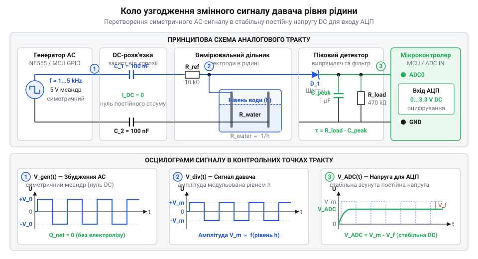
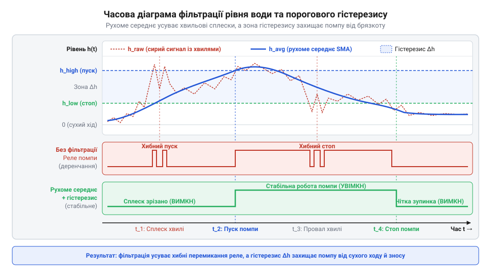

# Проєкт контролера рівня води на змінному струмі проти корозії

<preknowlist>
- [HW-038 — давач рівня води](root:cat-hw-sensors/hw-038-water-level) — Базові принципи резистивного вимірювання занурення контактних доріжок та обмеження найпростіших DC-схем.
- [Ємнісний давач вологості ґрунту (v1.2)](root:cat-hw-sensors/capacitive-soil) — Альтернативні безконтактні методи вимірювання та відмінності ізольованих давачів від гальванічних електродів.
</preknowlist>

Контактне вимірювання рівня рідини за допомогою занурених металевих електродів є одним із найпоширеніших, найдешевших та конструктивно простих інженерних рішень для дренажних приямків, водонапірних веж, баків поливу та систем захисту від затоплення. Проте більшість розробників-початківців стикаються з критичною проблемою: підключення електродів безпосередньо до ліній постійного струму мікроконтролера або транзисторних ключів призводить до повного руйнування металу та відмови системи вже через кілька днів або тижнів експлуатації. У цьому практичному проєкті ми спроєктуємо та побудуємо надійний промисловий контролер рівня води, у якому реалізовано збудження сенсорних зондів чистим змінним струмом без постійної складової. Ми розглянемо фізику електрохімічної деградації, зберемо вимірювальний міст та аналоговий амплітудний детектор, а також напишемо прошивку мікроконтролера з програмним гістерезисом, фільтрацією хвильових сплесків та комплексними захисними таймаутами для помпового обладнання.

## Електроліз і корозія занурених електродів

Головною вразливістю резистивних датчиків рівня води (таких як популярний модуль HW-038) при живленні від постійної напруги є виникнення явища електролізу та прискореної гальванічної корозії. Коли між двома зануреними провідниками протікає постійний струм (навіть величиною у сотні мікроамперів), у водному електроліті виникають спрямовані потоки йонів. На позитивному електроді (аноді) відбувається окиснення металу: атоми міді, нікелю чи навіть нержавіючої сталі втрачають електрони та переходять у розчин у вигляді катіонів.

Одночасно на негативному електроді (катоді) відновлюється водень, утворюючи мікробульбашки газу. Цей процес супроводжується двома руйнівними наслідками:
1. Фізичне розчинення та витончення металу анода аж до повного механічного обриву контактної доріжки.
2. Електрохімічна поляризація та утворення щільної діелектричної оксидної плівки на поверхні контактів, через що електричний опір між електродами зростає у десятки й сотні разів.

У результаті мікроконтролер перестає фіксувати наявність рідини навіть за повного занурення давача, що створює аварійну ситуацію переливу або сухого ходу помпи.

Єдиним надійним методом усунення електролізу є живлення занурених електродів змінним струмом (AC) симетричної форми з нульовим середнім значенням постійної складової напруги. Якщо полярність електричного поля змінюється із частотою від кількох сотень герц до десятків кілогерц, йони у подвійному електричному шарі просто коливаються біля поверхні електрода без накопичення продуктів окиснення. Будь-який мікроскопічний перенос речовини в один напівперіод повністю компенсується зворотним електрохімічним потенціалом у наступний напівперіод, завдяки чому електроди служать роками без ознак деградації.

## Генерація змінного сигналу збудження електродів

Для формування змінного збудження можна використати апаратний генератор на базі таймера NE555 або виділити два цифрові виводи мікроконтролера, що працюють у протифазі (push-pull). Використання двох GPIO мікроконтролера є найбільш економічним та гнучким рішенням, оскільки дозволяє активувати змінний сигнал лише в момент вимірювання, знижуючи середнє енергоспоживання вузла до одиниць мікроамперів.

У схему збудження обов'язково встановлюються роздільні керамічні або плівкові конденсатори ємністю 100 нФ...1 мкФ послідовно з кожною лінією електродів. Роздільний конденсатор має нескінченний опір для постійного струму і гарантує, що навіть за випадкового зависання ядра мікроконтролера у високому або низькому логічному рівні постійний струм через воду протікати не зможе.

Частота збудження обирається у діапазоні від 500 Гц до 5 кГц. Нижча частота (менше 100 Гц) неефективна через зростання реактивного опору роздільних конденсаторів та частковий перебіг поляризаційних процесів. Вищі частоти (понад 20 кГц) небажані через паразитно-ємнісний витік струму через кабельні траси до бака.

## Перетворення змінного опору в постійну напругу

Занурені електроди разом з опором рідини між ними утворюють нижнє плече вимірювального дільника напруги. Верхнім плечем слугує прецизійний резистор з опором, близьким до очікуваного опору води (зазвичай від 10 кОм до 100 кОм залежно від мінералізації). Змінна напруга на електродах має амплітуду, що зменшується в міру занурення датчика у воду (оскільки опір рідини шунтує електроди).

Для подачі сигналу на вхід вбудованого АЦП мікроконтролера його необхідно випрямити та згладити. Для цього застосовується піковий амплітудний детектор на діоді Шотткі (наприклад, BAT54 або 1N5819 із низьким прямим падінням напруги 0.2...0.3 В), паралельному конденсаторі та резисторі розряду.

Схема працює наступним чином: під час позитивного напівперіоду імпульсу конденсатор пікового детектора заряджається до максимальної амплітуди через діод Шотткі. У паузі між імпульсами діод закривається, а високий вхідний опір АЦП разом із балансним резистором розряду утримує стабільний потенціал постійної напруги, пропорційний залишковому опору занурених електродів.

## Програмний гістерезис і фільтрація сплесків води

У реальних резервуарах та дренажних колодязях поверхня рідини ніколи не буває абсолютно статичною. Робота насоса, вхідний потік з труби або пориви вітру викликають бризки, поверхневі хвилі та турбулентність. Якщо контролер орієнтується на миттєве значення АЦП, поблизу порогового рівня неминуче виникне високочастотне перемикання реле помпи — так званий брязкіт (chattering), що виводить з ладу контактори та електродвигун.

Для боротьби з хвилюванням застосовується двоетапна обробка сигналу:
1. Цифровий фільтр ковзного середнього (Moving Average) або медіанний фільтр, що згладжує короткочасні викиди виміряного рівня.
2. Програмний гістерезис із роздільними порогами увімкнення та вимкнення.

Для режиму відкачування (дренаж) помпа вмикається лише тоді, коли відфільтрований рівень перевищує верхній поріг (наприклад, 80%), і продовжує працювати доти, доки рівень не опуститься нижче нижнього порогу (наприклад, 20%). Для режиму наповнення (водонапірний бак) логіка протилежна: вмикання при 25%, вимкнення при 85%.

## Захисні таймаути та керування помпою

Справжній інженерний контролер рівня повинен бути захищений не лише від електричних завад, а й від гідравлічних та механічних аварій. Найнебезпечнішими нештатними ситуаціями для помпового обладнання є:
- **Сухий хід (Dry Run):** якщо після увімкнення помпи наповнення рівень води не починає зростати протягом заданого таймауту (наприклад, 10–30 секунд), це вказує на відсутність води у свердловині, заклинювання крильчатки або розрив магістралі. Помпа повинна бути негайно знеструмлена з виставленням прапорця аварії.
- **Перекачування (Overrun):** обмеження максимального часу безперервної роботи двигуна (наприклад, не більше 15 хвилин), що запобігає перегріву обмоток та затопленню об'єкта при пошкодженні кабелю датчика рівня.
- **Апаратні дублюючі поплавки:** наявність додаткових герконових поплавкових вимикачів нижнього та верхнього критичних рівнів, що підключаються до окремих входів мікроконтролера та забезпечують апаратне блокування за принципом «запобігання єдиній точці відмови».

## Повний вихідний код реалізації

Нижче наведено робочі реалізації драйвера та системи керування помпою мовами C та C++.

:::tabs
@tab C
:::code proj-ac-resistive-liquid-level-monitor/c/src/main.c
@tab C++
:::code proj-ac-resistive-liquid-level-monitor/cpp/src/main.cpp
:::

## Висновки

Застосування змінного струму для збудження занурених контактних електродів усуває електрохімічну корозію та електроліз, подовжуючи термін служби датчиків з кількох днів до багатьох років. Поєднання роздільних конденсаторів, вимірювального дільника, пікового детектора на діоді Шотткі та мікроконтролерної фільтрації забезпечує стабільне аналогове зчитування. Впровадження програмного гістерезису, захисних таймаутів сухого ходу та дублюючих дискретних поплавків гарантує надійну безаварійну роботу помпової автоматики в промислових та побутових резервуарах.
