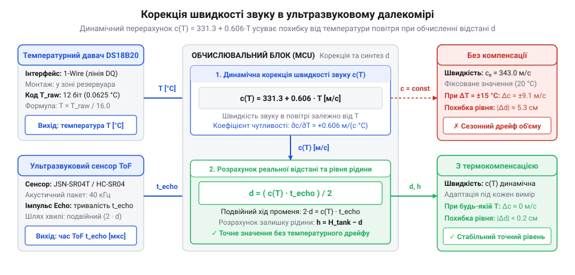
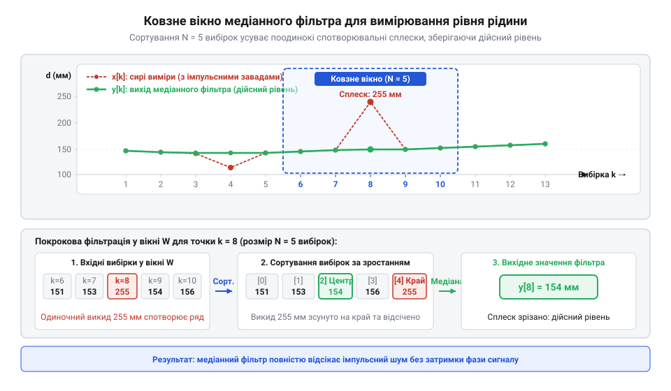

# Проєкт безконтактного моніторингу об'єму резервуара з цифровим фільтром

<preknowlist>
- [HW-038 — давач рівня води](root:cat-hw-sensors/hw-038-water-level) — Обмеження контактного вимірювання рівня рідини та принципи зчитування аналогового сигналу рівня.
- [Ємнісний давач вологості ґрунту (v1.2)](root:cat-hw-sensors/capacitive-soil) — Принципи безконтактного та ізольованого вимірювання параметрів рідкого середовища.
</preknowlist>

Точне безперервне вимірювання рівня та залишкового об'єму рідини в накопичувальних резервуарах, цистернах з паливом, баках систем водопостачання чи технологічних ємностях вимагає відмови від прямих механічних або занурених контактів. Безконтактні методи — насамперед ультразвукові віддалеміри та зовнішні ємнісні датчики — виключають хімічну взаємодію з рідиною, не піддаються корозії та не забруднюють середовище. Однак пряме використання сирих вимірів відстані без урахування фізики середовища призводить до неприпустимих похибок. У цьому проєкті ми розробимо закінчену систему моніторингу об'єму бака на мікроконтролері з динамічною температурною корекцією швидкості звуку, ковзним медіанним фільтром імпульсних викидів та табличним перерахунком нелінійної геометрії резервуара зі збереженням калібрування в EEPROM.

## Провал прямого вимірювання рівня у резервуарі

Найпростіший підхід до ультразвукового вимірювання рівня полягає у закріпленні давача (наприклад, водонепроникного модуля JSN-SR04T або промислового трансдюсера) на верхній кришці бака, спрямованого вниз на поверхню рідини. Вимірявши час подвійного пробігу імпульсу відлуння (Time-of-Flight, ToF), мікроконтролер обчислює відстань за стандартною шкільною формулою за фіксованої швидкості звуку 340 або 343 м/с.

Проте під час першої ж тривалої експлуатації виникає критичний розрив між очікуваннями та реальністю:
1. **Температурний дрейф:** зміна температури повітря усередині закритого бака від нічних +5 °C до денних +35 °C змінює швидкість звуку приблизно на 18 м/с. Для бака глибиною 2 метри це викликає систематичну температурну похибку до 10–12 см, що в перерахунку на об'єм цистерни становить сотні літрів вигаданого «зникнення» або «прибутку» рідини.
2. **Імпульсні завади та відбиття від стінок:** хвилювання дзеркала рідини при наповненні, бризки, піна або пара відхиляють вузький акустичний промінь. Давач або фіксує бічне відбиття від стінки (хибна мала відстань), або взагалі втрачає відлуння, повертаючи максимальний таймаут.
3. **Нелінійність об'єму:** у круглих горизонтальних цистернах, конічних баках чи ємностях складної форми висота стовпа рідини не пропорційна об'єму. Простий лінійний перерахунок створює помилку до 30–40% у середній зоні заповнення.

Без системного поєднання фізичної компенсації та цифрової фільтрації пряме вимірювання дистанції непридатне для обліку запасів рідини.

## Температурна корекція швидкості поширення ультразвуку

Швидкість поширення звукових хвиль у сухому повітрі залежить від абсолютної термодинамічної температури. З високою точністю для діапазону від -30 °C до +60 °C її можна апроксимувати лінійною залежністю:

```
c(T) = 331.3 + 0.606 * T
```

де `c` — швидкість звуку у метрах на секунду (м/с), а `T` — поточна температура повітря у градусах Цельсія (°C).

Для усунення температурного дрейфу безпосередньо біля ультразвукового випромінювача розміщується цифровий датчик температури DS18B20 із роздільною здатністю 0.0625 °C або точний аналоговий давач. Перед кожним акустичним вимірюванням мікроконтролер опитує температуру, обчислює фактичну швидкість звуку `c(T)` та визначає реальну дистанцію до поверхні за виразом:

```
d = (c(T) * t_echo) / 2
```

де `t_echo` — виміряний час прольоту імпульсу в мікросекундах.



Своєчасна динамічна корекція швидкості звуку зменшує температурну похибку з 5–6% до менше ніж 0.3%, забезпечуючи надійну метрологічну стабільність системи взимку та влітку.

## Медіанне фільтрування сплесків та завад

Навіть за точного знання швидкості звуку поодинокі акустичні завади утворюють гострі імпульсні викиди (outliers). Звичайні лінійні фільтри (такі як просте або експоненційне ковзне середнє) у цій ситуації неефективні: один поодинокий викид (наприклад, втрата відлуння із дистанцією 4 метри замість 1 метра) надовго зміщує середнє значення та викликає тривале хибне коливання розрахованого об'єму.

Оптимальним математичним апаратом для відсікання імпульсних сплесків є нелінійний медіанний фільтр (Median Filter). Алгоритм формує ковзне вікно з непарної кількості останніх вимірів (зазвичай 5 або 7 відліків), сортує їх за зростанням та обирає центральне значення.



Як видно з діаграми, будь-які поодинокі спотворення або тимчасові пропуски імпульсів автоматично опиняються на краях відсортованого масиву і повністю ігноруються. На вихід фільтра потрапляє лише стабільне фізичне дзеркало рідини.

## Табличний перерахунок геометрії та EEPROM

Знаючи точну відфільтровану відстань `d` від давача до води, висота стовпа рідини від дна резервуара розраховується як:

```
h = H_sensor - d
```

де `H_sensor` — висота монтажу випромінювача від дна бака.

Для перетворення висоти `h` у залишковий об'єм `V` у літрах використовується кусочно-лінійна інтерполяція за опорними точками калібрувальної таблиці. Таблиця складається з пар `(висота_мм, об'єм_л)`, отриманих шляхом тарування ємності (проливання мірними порціями) або розрахунку за геометричними моделями (наприклад, для горизонтального циліндра з круглими днищами).

Між двома сусідніми калібрувальними вузлами `(h0, V0)` та `(h1, V1)` об'єм обчислюється за формулою:

```
V = V0 + ((h - h0) / (h1 - h0)) * (V1 - V0)
```

Калібрувальна структура разом із висотою монтажу, граничним об'ємом та 16-бітною контрольною сумою CRC16 зберігається в енергонезалежній пам'яті EEPROM мікроконтролера. Це дозволяє один раз налаштувати систему під час пусконалагодження без перепрошивки вихідного коду при перенесенні приладу на інший резервуар.

## Побудова цілісного вузла моніторингу об'єму

Архітектура кінцевої прошивки об'єднує всі компоненти в неблокуючий циклічний процес:
1. Запуск вимірювання температури DS18B20 та акустичного ехо-імпульсу.
2. Температурна корекція швидкості звуку та розрахунок поточної фізичної дистанції.
3. Пропускання відліку через ковзне вікно медіанного фільтра.
4. Розрахунок висоти стовпа рідини та кусочно-лінійна інтерполяція об'єму.
5. Обчислення відсотка заповнення бака від максимальної місткості.
6. Формування пакетів телеметрії та виведення на графічний дисплей, шину RS-485 Modbus або протокол MQTT через Wi-Fi/Ethernet.

## Повний вихідний код реалізації

Нижче наведено модульну бібліотеку розрахунку, фільтрації та інтерполяції об'єму мовами C та C++.

:::tabs
@tab C
:::code proj-ultrasonic-capacitive-tank-gauge/c/src/main.c
@tab C++
:::code proj-ultrasonic-capacitive-tank-gauge/cpp/src/main.cpp
:::

## Висновки

Створення надійного вузла обліку об'єму рідини на базі ультразвукового віддалеміра вимагає подолання трьох фізичних викликів: температурної нестабільності швидкості звуку, імпульсних завад хвилювання та нелінійності геометрії бака. Інтеграція датчика DS18B20 усуває сезонний дрейф показників. Медіанний фільтр ефективно очищує виміри від випадкових викидів без затримок лінійного згладжування. Збереження калібрувальної таблиці в EEPROM з кусочно-лінійною інтерполяцією забезпечує точне відображення залишку рідини в літрах і відсотках для резервуарів будь-якої складної форми.
