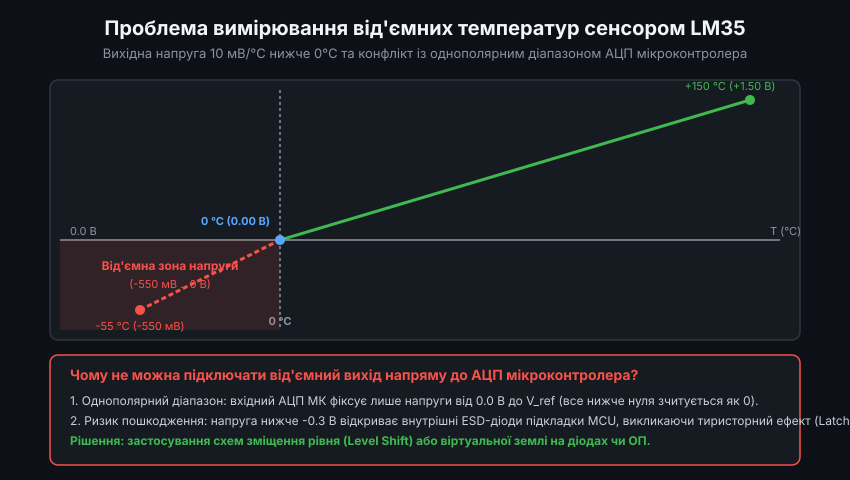
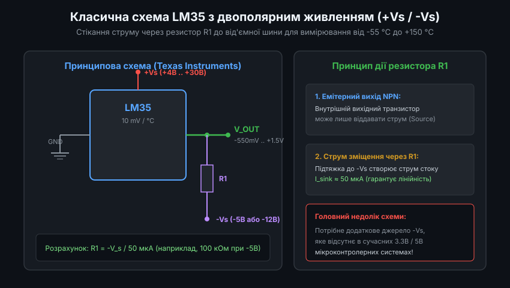
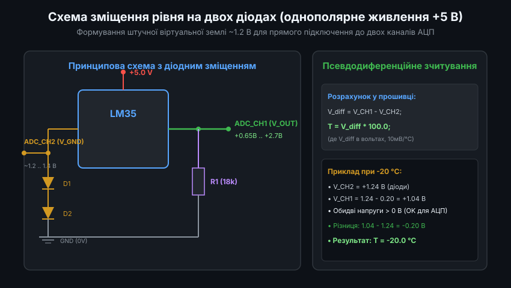
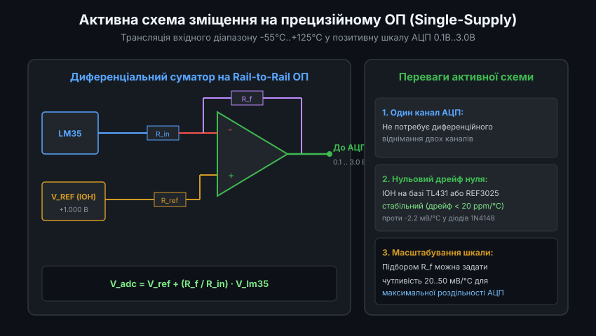
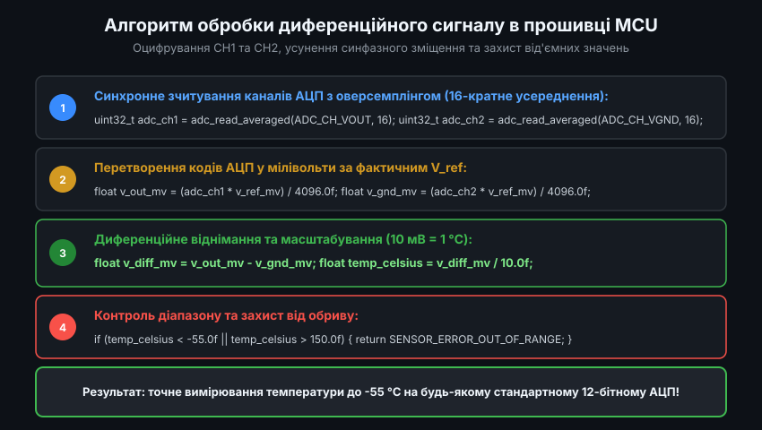

# Схеми вимірювання від'ємних температур на сенсорі LM35: Схемотехніка, аналіз похибок та прошивка

Напівпровідниковий інтегральний термоперетворювач LM35 (а також його прецизійна модифікація LM35A) володіє лінійною шкалою за Цельсієм із передаточним коефіцієнтом `10.0 мВ/°C`. На відміну від сенсора LM335, шкала якого прив'язана до абсолютного нуля Кельвіна (10 мВ/K, тобто +2.73 В при 0 °C), сенсор LM35 видає 0.0 В при 0.0 °C. Це суттєво спрощує схемотехніку в діапазоні додатних температур, але створює суттєві складнощі при необхідності моніторингу від'ємних температур у морозильних камерах, кліматичних установках або зовнішніх метеостанціях (-55 °C .. 0 °C).

---

### 1. Електричні обмеження однополярного АЦП та небезпека тиристорної засувки (Latch-up)

При температурі нижче 0 °C вихідний потенціал LM35 стає від'ємним відносно виводу GND сенсора:
`V_out(T) = 10.0 мВ/°C * T`
- При T = -10 °C: `V_out = -100 мВ` (-0.10 В)
- При T = -40 °C: `V_out = -400 мВ` (-0.40 В)
- При T = -55 °C: `V_out = -550 мВ` (-0.55 В)



Спроба подати такий сигнал безпосередньо на аналоговий вхід мікроконтролера викликає серйозні проблеми:

1. **Нелінійність і насичення однополярного АЦП**:
   Архітектура АЦП послідовного наближення (SAR ADC) у мікроконтролерах базується на масиві зважених конденсаторів, підключених між шиною аналогової землі (AGND / VSSA) та джерелом опорної напруги (VREF+). При вхідній напрузі `V_in < 0 В` конденсатор вибірки зміщується нижче потенціалу підкладки. Результатом оцифрування завжди буде нульовий код (`0x000`), що унеможливлює вимірювання.

2. **Ефект тиристорної засувки (CMOS Latch-up)**:
   Кремнієвий кристал сучасних КМОН-мікроконтролерів містить паразитарні біполярні p-n-p-n структури, утворені ізолюючими кишенями n-well та p-субстратом. Якщо на аналоговий пін надходить напруга, яка стає від'ємнішою за -0.3 В (поріг відмикання кремнієвого p-n переходу), відкривається захисний ESD-діод між піном та підкладкою кристала:
   `I_parasitic = (0 - V_in - V_diode) / R_source`
   Це може ініціювати регенеративне відкриття паразитного тиристора, що закорочує шини VDD та GND всередині чипа. Струм споживання стрибкоподібно зростає до 200-500 мА, кристал миттєво розігрівається і фізично вигорає.

3. **Внутрішня схемотехніка LM35**:
   Вихідний каскад сенсора є емітерним повторювачем на транзисторі NPN. Він може працювати виключно як джерело струму (Source). Щоб вихідна напруга могла опуститися нижче потенціалу землі сенсора, через вихідний вивід обов'язково повинен протікати втікаючий струм (Sink) величиною не менше 50 мкА.

---

### 2. Двополярна схема живлення (+Vs / -Vs): розрахунок струму стоку R1

Коли в системі є двополярне джерело напруги (наприклад, ±5 В, ±12 В або інвертуючий перетворювач зарядної помпи типу ICL7660 / MAX660), реалізується класична схема Texas Instruments.



Схема підключення:
- Вивід `+Vs` (пін 1) живиться напругою від +4 В до +30 В.
- Вивід `GND` (пін 3) підключається до системної землі 0 В.
- Вивід `V_out` (пін 2) з'єднується з від'ємною шиною живлення `-Vs` через резистор `R1`.

#### Розрахунок номіналу підтягуючого резистора R1:
Для забезпечення стабільної роботи внутрішнього підсилювача LM35 у всьому діапазоні температур струм стоку через вихідний каскад має перебувати в межах від 40 до 60 мкА при 0 °C:
`R1 = | -Vs | / I_sink = | -Vs | / 50 мкА`

Приклади розрахунку номіналів:
- При `-Vs = -5.0 В`: `R1 = 5.0 В / 50 мкА = 100 кОм` (стандартний ряд E24).
- При `-Vs = -12.0 В`: `R1 = 12.0 В / 50 мкА = 240 кОм`.
- При `-Vs = -3.3 В`: `R1 = 3.3 В / 50 мкА = 68 кОм`.

Вихідний сигнал у такій схемі є ідеально лінійним від -550 мВ (-55 °C) до +1500 мВ (+150 °C). Для подачі на однополярний АЦП сигнал з виходу `V_out` необхідно пропустити через диференціальний або інвертуючий операційний підсилювач зі зміщенням рівня.

---

### 3. Однополярне живлення +5 В: схема на двох діодах та псевдодиференційне зчитування

В автономних приладах та IoT-контролерах введення від'ємного джерела `-Vs` є економічно недоцільним. Найбільш елегантним рішенням є схема створення штучної віртуальної землі за допомогою двох кремнієвих діодів (1N4148).



#### Принцип створення віртуальної землі:
1. Вивід 3 (GND) сенсора LM35 ізолюється від системної землі і підключається до неї через два послідовно увімкнених діоди D1 та D2.
2. Власний струм споживання сенсора LM35 становить близько 55-80 мкА при напрузі живлення +5 В. Протікаючи крізь два діоди 1N4148, цей струм створює пряме падіння напруги:
   `V_gnd_sensor = V_D1 + V_D2 ≈ 2 * 0.62 В = 1.24 В`
3. Резистор підтяжки `R1` номіналом 18 кОм підключається між виходом `V_out` та справжньою системною землею (0 В).
4. Оскільки вивід землі сенсора зміщений на +1.24 В вгору, вихідна напруга `V_out` відносно системної землі дорівнює:
   `V_out_abs = V_gnd_sensor + 10 мВ * T`

Розрахунок робочих точок:
- При T = 0 °C: `V_out_abs = 1.24 В + 0.0 В = +1.24 В`
- При T = -55 °C: `V_out_abs = 1.24 В - 0.55 В = +0.69 В`
- При T = +100 °C: `V_out_abs = 1.24 В + 1.00 В = +2.24 В`

Увесь діапазон напруг (+0.69 В .. +2.24 В) є строго додатним і ідеально лягає в середину шкали як 3.3-вольтового, так і 5-вольтового АЦП.

#### Компенсація температурного дрейфу діодів:
Кремнієві діоди мають значний власний температурний коефіцієнт падіння напруги:
`d(V_D)/dT ≈ -2.1 .. -2.2 мВ/°C` на один діод (сумарно близько -4.4 мВ/°C для двох діодів).
Якщо вимірювати лише потенціал `V_out_abs`, зміна температури навколишнього середовища викликала б похибку до 0.4 °C на кожен градус нагріву плати.

Рішення полягає у **синхронному двоканальному вимірюванні**:
- Канал `ADC1` вимірює напругу виходу: `V_CH1 = V_gnd_sensor + V_temp`
- Канал `ADC2` вимірює напругу віртуальної землі: `V_CH2 = V_gnd_sensor`
- Прошивка розраховує математичну різницю:
  `V_diff = V_CH1 - V_CH2 = (V_gnd_sensor + V_temp) - V_gnd_sensor = V_temp`
Синфазний дрейф діодів повністю взаємознищується при відніманні!

---

### 4. Активні схеми прецизійного зміщення рівня на операційному підсилювачі

Для промислових застосувань, де небажано займати два канали АЦП або де потрібна довготривала стабільність краще 0.05 °C, використовують активний зміщувач рівня на операційному підсилювачі Rail-to-Rail (наприклад, OPA333, MCP6001 або AD8605).



Схема суматора з опорним джерелом:
- Опорне джерело `V_ref` (прецизійний ІОН на 1.000 В або 1.250 В, наприклад ADR1581 або TL431 з резистивним дільником) задає базовий зсув нуля.
- Вихід LM35 через вхідний резистор `R_in` надходить на інвертуючий або диференціальний вхід ОП.
- Передаточна функція схеми:
  `V_adc = V_ref + (R_f / R_in) * V_lm35`

При використанні резисторів із допуском 0.1% (коефіцієнт передачі рівно 1.000):
- При T = 0 °C: `V_adc = 1.000 В`
- При T = -50 °C: `V_adc = 1.000 В - 0.500 В = +0.500 В`
- При T = +100 °C: `V_adc = 1.000 В + 1.000 В = +2.000 В`

Оцифрування виконується одним каналом АЦП, при цьому динамічний діапазон використовується максимально ефективно, а нульова точка не залежить від струму навантаження сенсора.

---

### 5. Повний програмний драйвер для псевдодиференційного вимірювання на C

Нижче наведено промисловий драйвер мовою C для оцифрування LM35 за схемою з діодним зміщенням. Алгоритм містить апаратне усереднення (оверсемплінг), конвертацію кодів, захист від обриву та калібрувальну поправку нуля.



```c
#include <stdint.h>
#include <stdbool.h>

#define OVERSAMPLING_SAMPLES  32     // 32-кратне усереднення для придушення шуму
#define ADC_MAX_CODE          4095.0f // 12-бітний АЦП (STM32 / ESP32)
#define SENSOR_SENSITIVITY    0.010f  // 10 мВ на градус Цельсія (0.010 В/°C)

typedef struct {
    float vref_volts;      // Фактична напруга джерела опорної напруги АЦП (напр., 3.300 В)
    float zero_offset_c;   // Калібрувальна поправка нуля (з EEPROM)
    uint8_t ch_vout;       // Номер каналу АЦП для V_OUT (ADC1)
    uint8_t ch_vgnd;       // Номер каналу АЦП для V_GND (ADC2)
} lm35_config_t;

typedef enum {
    LM35_OK = 0,
    LM35_ERROR_UNDERFLOW,   // Обрив лінії GND або напруга нижче -55 °C
    LM35_ERROR_OVERFLOW,    // Коротке замикання або напруга вище +150 °C
    LM35_ERROR_HARDWARE     // Несправність АЦП або діодного ланцюга
} lm35_status_t;

// Зовнішня функція низькорівневого зчитування сирого коду АЦП
extern uint16_t bsp_adc_read_channel(uint8_t channel);

lm35_status_t lm35_read_temperature(const lm35_config_t *cfg, float *temperature_c)
{
    uint32_t acc_vout = 0;
    uint32_t acc_vgnd = 0;

    // Крок 1: Синхронний оверсемплінг з чергуванням каналів
    for (int i = 0; i < OVERSAMPLING_SAMPLES; i++) {
        acc_vout += bsp_adc_read_channel(cfg->ch_vout);
        acc_vgnd += bsp_adc_read_channel(cfg->ch_vgnd);
    }

    // Середнє значення коду АЦП
    float code_vout = (float)acc_vout / (float)OVERSAMPLING_SAMPLES;
    float code_vgnd = (float)acc_vgnd / (float)OVERSAMPLING_SAMPLES;

    // Крок 2: Перетворення у фізичні напруги
    float v_out = (code_vout * cfg->vref_volts) / ADC_MAX_CODE;
    float v_gnd = (code_vgnd * cfg->vref_volts) / ADC_MAX_CODE;

    // Крок 3: Апаратна самодіагностика діодного зміщення
    // Напруга віртуальної землі повинна бути в межах 0.9 В .. 1.6 В (падіння на 2 діодах)
    if (v_gnd < 0.8f || v_gnd > 1.8f) {
        return LM35_ERROR_HARDWARE;
    }

    // Крок 4: Псевдодиференційне віднімання
    float v_differential = v_out - v_gnd;

    // Крок 5: Розрахунок температури з калібрувальною поправкою
    float temp_calc = (v_differential / SENSOR_SENSITIVITY) + cfg->zero_offset_c;

    // Крок 6: Перевірка паспортного діапазону сенсора (-55 °C .. +150 °C)
    if (temp_calc < -55.0f) {
        *temperature_c = -55.0f;
        return LM35_ERROR_UNDERFLOW;
    }
    if (temp_calc > 150.0f) {
        *temperature_c = 150.0f;
        return LM35_ERROR_OVERFLOW;
    }

    *temperature_c = temp_calc;
    return LM35_OK;
}
```

Використання псевдодиференційного алгоритму з чергуванням вимірювань гарантує точність краще ±0.25 °C у діапазоні від -40 °C до +100 °C при однополярному живленні без використання дорогих спеціалізованих ІС.
