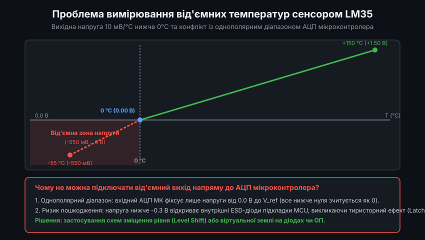
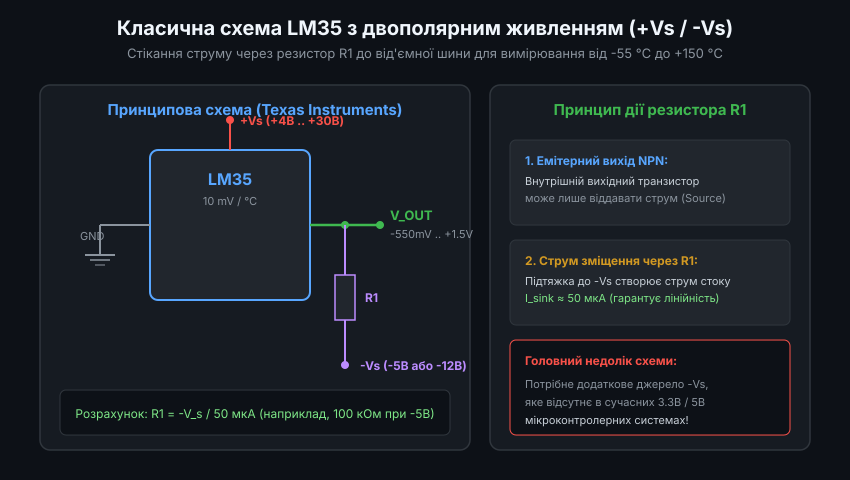
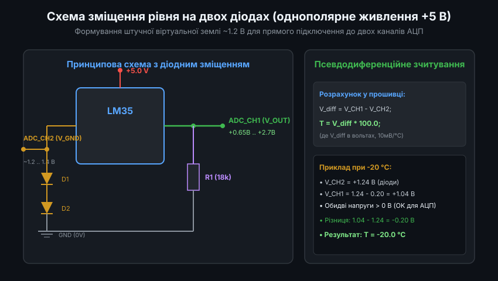
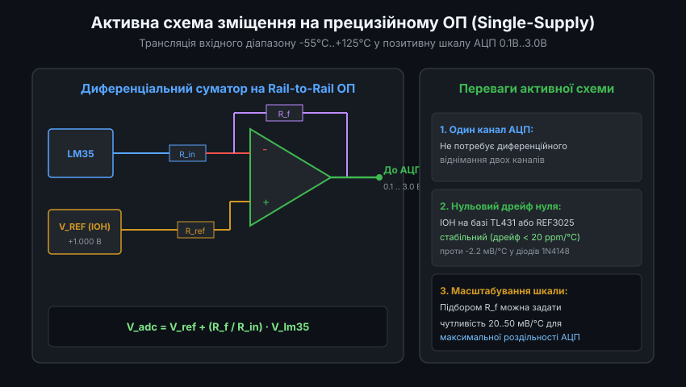
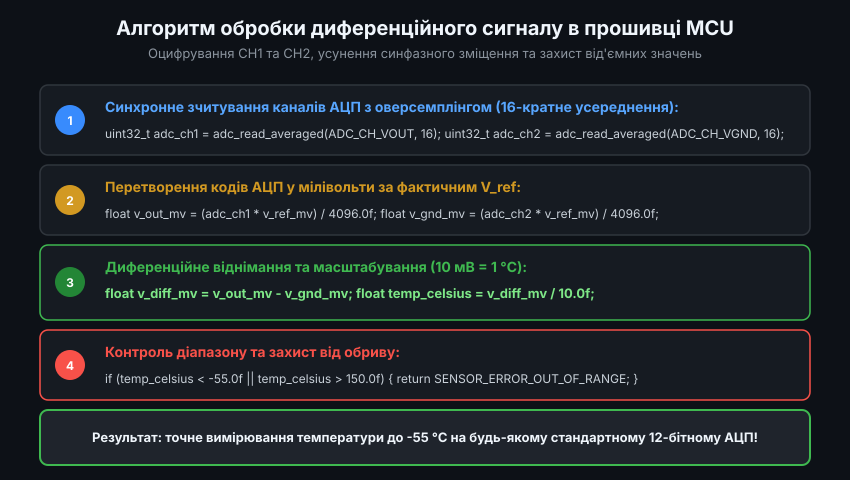

# Схеми вимірювання від'ємних температур на сенсорі LM35

Аналоговий напівпровідниковий термоперетворювач LM35 від компанії Texas Instruments є популярним сенсором із лінійною шкалою за шкалою Цельсія: його чутливість становить строго 10 мВ/°C з нульовою вихідною напругою при 0.0 °C. Завдяки цьому при кімнатній температурі +25 °C давач видає зручну напругу +250 мВ, яка легко оцифровується будь-яким аналого-цифровим перетворювачем (АЦП). Проте повний робочий діапазон сенсора сягає від -55 °C до +150 °C. Робота в області від'ємних температур вимагає застосування спеціальних схемотехнічних рішень, оскільки вихідна напруга сенсора стає від'ємною відносно виводу землі.

---

### 1. Фізична проблема від'ємних напруг та обмеження однополярного АЦП

Чутливість сенсора LM35 строго пропорційна температурі: `V_out = 10 мВ * T`. Відповідно:
- При температурі 0 °C напруга становить 0.0 В.
- При температурі -20 °C напруга падає до -200 мВ (-0.2 В).
- При граничній температурі -55 °C напруга досягає -550 мВ (-0.55 В).

Для розробника мікроконтролерних систем це створює дві критичні апаратні перешкоди:
1. **Однополярний діапазон входу АЦП**: вбудовані АЦП мікроконтролерів (STM32, ESP32, AVR, PIC) призначені для оцифрування напруг строго від 0.0 В до напруги опорного джерела V_ref (наприклад, 3.3 В). Будь-яка напруга нижче 0 В розпізнається АЦП як нульовий цифровий код, що робить вимірювання неможливим.
2. **Ризик засувки кристала (Latch-up)**: якщо потенціал аналогового входу мікроконтролера опускається нижче -0.3 В відносно системної землі, відкривається внутрішній захисний ESD-діод підкладки кремнію. Це викликає тиристорний ефект засувки, протікання катастрофічного струму та термічне руйнування мікроконтролера.
3. **Обмеження вихідного каскаду LM35**: внутрішній вихідний транзистор NPN у схемі емітерного повторювача здатний лише віддавати струм у навантаження (Source). Без зовнішньої підтяжки струму напруга на виході взагалі не може опуститися нижче потенціалу виводу GND самого чипа.

---

### 2. Класична схема з двополярним живленням (+Vs / -Vs) та резистором R1

Офіційний даташит Texas Instruments для вимірювання від'ємних температур у повному діапазоні від -55 °C до +150 °C пропонує класичну схему з двополярним живленням.

Особливості схемотехніки двополярного підключення:
- **Підключення живлення**: позитивний вивід `+Vs` підключається до джерела від +4 В до +30 В, а системний вивід `GND` сенсора з'єднується з від'ємною шиною `-Vs` (наприклад, -5 В або -12 В).
- **Резистор витягування струму R1**: вмикається між вихідним виводом `V_out` та від'ємною шиною `-Vs`.
- **Розрахунок номіналу R1**: величина резистора вибирається таким чином, щоб забезпечити струм витоку близько 50 мкА при нульовій напрузі на виході:
  `R1 = -Vs / 50 мкА` (наприклад, при `-Vs = -5 В` опір становить `R1 = 5 В / 50 мкА = 100 кОм`).

Струм через резистор R1 примушує вихідний каскад LM35 працювати лінійно аж до -55 °C, видаючи -550 мВ. Проте в сучасних портативних пристроях та платах IoT двополярне живлення зазвичай відсутнє, що вимагає застосування однополярних рішень зі зміщенням рівня.

---

### 3. Схема зміщення рівня на двох діодах (віртуальна земля)

Найпростішим та найбільш економічним способом вимірювання від'ємних температур від одного позитивного джерела живлення +5 В є використання схеми штучного підняття потенціалу землі за допомогою двох кремнієвих діодів (наприклад, 1N4148 або 1N4007).

Принцип функціонування діодного зміщення:
- Два послідовних діоди D1 та D2 встановлюються між виводом землі мікросхеми LM35 та реальною системною шиною GND схеми.
- Струм спокою сенсора, протікаючи крізь діоди, створює на виводі GND сенсора пряме падіння напруги `V_gnd_sensor ≈ 2 * 0.65 В = 1.3 В`.
- Вихідний резистор підтяжки `R1` (номіналом близько 18 кОм) підключається між виходом `V_out` та системною землею 0 В.
- Тепер при температурі -55 °C напруга на виході становить `1.3 В - 0.55 В = +0.75 В`, а при 0 °C дорівнює `+1.30 В`. Обидві напруги є строго додатними відносно землі і абсолютно безпечними для АЦП.

Мікроконтролер вимірює напругу двома каналами АЦП: каналом `ADC_CH1` (підключеним до `V_out`) та каналом `ADC_CH2` (підключеним до виводу віртуальної землі сенсора). Температура розраховується як різниця показань:
`T = (V_CH1 - V_CH2) / 0.010 В`

Оскільки падіння на діодах віднімається програмно, власний температурний коефіцієнт діодів (-2.2 мВ/°C) практично повністю компенсується синфазним відніманням.

---

### 4. Активні схеми зміщення рівня на операційних підсилювачах

Коли в мікроконтролері доступний лише один вільний канал АЦП, або коли потрібна підвищена точність без ризику синфазних похибок діодів, застосовують активний зміщувач рівня на базі операційного підсилювача (ОП) із живленням від одного джерела (Single-Supply Rail-to-Rail).

Схема побудована на прецизійному диференціальному підсилювачі або суматорі:
- Опорне джерело напруги (ІОН), наприклад TL431 або REF3025, формує стабільний потенціал зміщення `V_ref = +1.000 В` з температурним дрейфом менше 20 ppm/°C.
- Операційний підсилювач додає напругу сенсора LM35 до опорної напруги:
  `V_adc = V_ref + (R_f / R_in) * V_lm35`
- При температурі 0 °C вихід становить рівно +1.000 В.
- При температурі -50 °C вихід становить `1.0 В - 0.5 В = +0.500 В`.
- При температурі +100 °C вихід досягає `1.0 В + 1.0 В = +2.000 В`.

Вихідна напруга залишається в межах оптимального лінійного діапазону 12-бітного АЦП мікроконтролера (від 0.5 В до 2.5 В), забезпечуючи максимальне співвідношення сигнал/шум та виняткову стабільність нуля.

---

### 5. Програмний алгоритм оцифрування та обробка похибок у прошивці

Для отримання достовірних кліматичних даних у вбудованому програмному забезпеченні необхідно реалізувати захищений конвеєр зчитування.

Конвеєр складається з таких обов'язкових кроків:

1. **Оверсемплінг (Averaging)**: оскільки крок шкали становить лише 10 мВ на градус, одиничний відлік АЦП схильний до впливу шумів живлення. Здійснюється серія з 16 або 64 вимірювань для кожного з каналів.
2. **Перетворення в абсолютну напругу (мілівольти)**: коди АЦП масштабуються за фактичною напругою джерела V_ref мікроконтролера.
3. **Псевдодиференційне віднімання**: обчислюється різниця напруг `V_diff = V_out - V_gnd`.
4. **Масштабування у фізичну температуру**:
   `T_celsius = V_diff_mv / 10.0f`
5. **Валідація та діагностика обриву лінії**: якщо виміряна напруга виходить за межі фізичного діапазону (наприклад, різниця перевищує +1.6 В або падає нижче -0.6 В), прошивка фіксує апаратну несправність сенсора або обрив з'єднувального кабелю.
