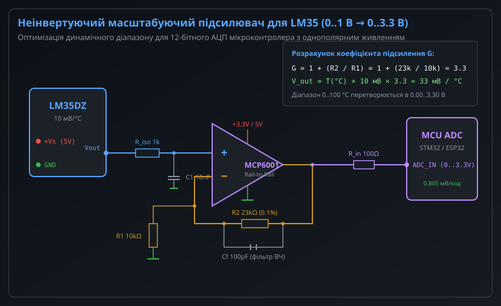
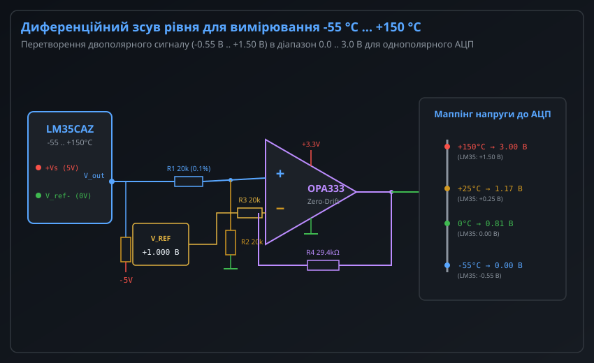
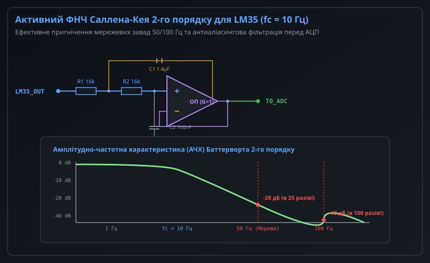
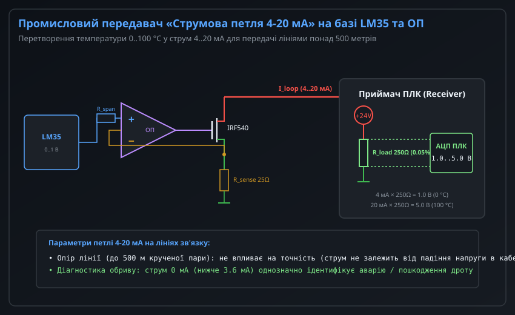
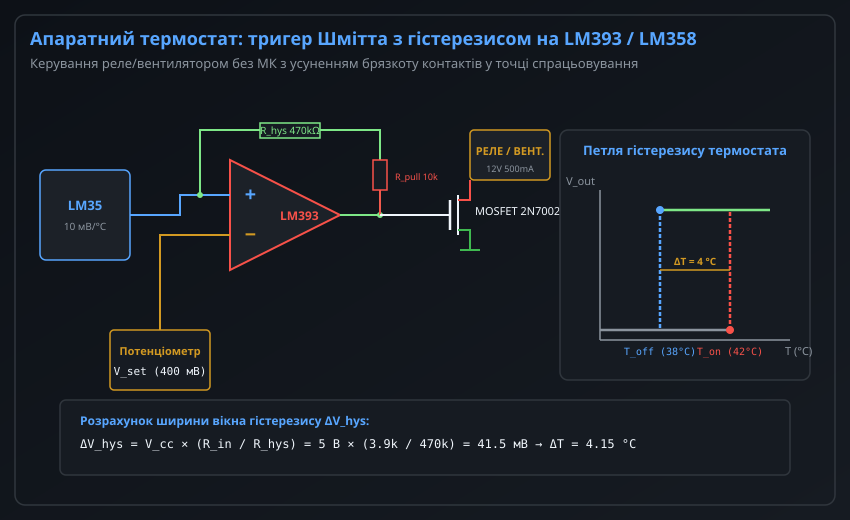

# Підсилення та узгодження сигналів LM35 на операційних підсилювачах

Інтегральний аналоговий датчик температури LM35 вирізняється простотою застосування та точно каліброваною лінійною характеристикою 10 мВ/°C. Однак при побудові промислових вимірювальних систем, прецизійних вузлів збору даних і систем аварійного термозахисту вихідний сигнал датчика стикається з апаратними обмеженнями: вузьким розмахом напруги (лише 0–1 В для 0–100 °C), від'ємною полярністю при субнульових температурах, високою чутливістю до ємнісного навантаження кабелю та наведеними мережевими завадами.

Застосування операційних підсилювачів (ОП) дозволяє розв'язати ці проблеми на апаратному рівні: відмасштабувати сигнал під повний динамічний діапазон сучасних АЦП, зсунути рівень для обробки діапазону від -55 °C до +150 °C при однополярному живленні, забезпечити активну фільтрацію завад 50/100 Гц, перетворити напругу в промислову струмову петлю 4–20 мА або реалізувати автономний термостат із захисним гістерезисом.

---

## 1. Неінвертуючий масштабуючий підсилювач для розширення динамічного діапазону АЦП

При прямому підключенні LM35 до типового 12-бітного АЦП мікроконтролера з опорною напругою 3.3 В або 5.0 В використовується лише незначна частина доступної шкали. Наприклад, вимірювання температури в діапазоні 0...+100 °C генерує вихідну напругу 0...+1000 мВ. Для АЦП з V_ref = 3.3 В це становить менше 30% шкали перетворення, що призводить до втрати майже двох бітів роздільної здатності через шум квантування.

Неінвертуючий підсилювач на базі сучасного прецизійного ОП узгоджує вихідний діапазон датчика з повною шкалою АЦП без інверсії фази сигналу.



### Розрахунок коефіцієнта підсилення та вибір пасивних компонентів

Коефіцієнт передачі неінвертуючого підсилювача визначається відношенням резисторів зворотного зв'язку:

```
G = 1 + (R2 / R1)
```

Для узгодження діапазону 0..1.0 В з опорною напругою АЦП 3.30 В необхідний коефіцієнт підсилення G = 3.30. Вибираючи стандартний номінал резистора R1 = 10.0 кОм (з допуском 0.1%), розраховуємо R2:

```
R2 = R1 * (G - 1) = 10.0 кОм * (3.30 - 1) = 23.0 кОм (E96: 23.2 кОм або комбінація 22 кОм + 1 кОм)
```

При такому налаштуванні чутливість вимірювального тракту зростає з 10.0 мВ/°C до:

```
S_scaled = 10 мВ/°C * 3.30 = 33.0 мВ/°C
```

Ціна молодшого розряду (LSB) для 12-бітного АЦП (4096 відліків) становить:

```
LSB = 3300 мВ / 4096 = 0.8057 мВ/код
Еквівалентна роздільна здатність по температурі = 0.8057 мВ / 33.0 мВ/°C = 0.0244 °C/код
```

### Вимоги до операційного підсилювача

Для забезпечення високої точності аналогового тракту операційний підсилювач повинен задовольняти такі критерії:
1. **Архітектура Rail-to-Rail Input/Output (RRIO):** За однополярного живлення +3.3 В або +5.0 В вихід підсилювача має опускатися максимально близько до потенціалу шини GND (бажано < 5–15 мВ). Рекомендовані мікросхеми: MCP6001, MCP6002, LMV321, OPA340, TSV991.
2. **Низька вхідна напруга зміщення (V_os):** Напруга V_os безпосередньо додається до вихідного сигналу LM35 і множиться на коефіцієнт G. Для прецизійних задач застосовують ОП класу Zero-Drift (OPA333, MCP6V01) з V_os < 10 мкВ.
3. **Ізоляція ємнісного навантаження:** Внутрішній емітерний повторювач LM35 схильний до паразитної генерації при ємнісному навантаженні понад 50 пФ. Резистор R_iso = 1.0 кОм послідовно з входом ОП та шунтуючий конденсатор C1 = 10 нФ створюють захисний фільтр і гарантують безумовну стійкість контуру.
4. **ВЧ-компенсація у зворотному зв'язку:** Конденсатор Cf (100 пФ) паралельно до резистора R2 обмежує смугу пропускання підсилювача зверху, запобігаючи підсиленню радіочастотних завад і збудженню на частотах мегагерцового діапазону.

---

## 2. Схеми диференційного зсуву рівня для вимірювання від'ємних температур (-55 °C ... +150 °C)

Датчики родини LM35 (модифікації LM35A, LM35C) здатні вимірювати температури в діапазоні від -55 °C до +150 °C. Однак при температурах нижче 0 °C вихідний потенціал LM35 стає від'ємним (-100 мВ при -10 °C і -550 мВ при -55 °C). 

Якщо мікроконтролер живиться від однополярного джерела +3.3 В або +5 В, його вбудований АЦП не здатний оцифровувати потенціали нижче рівня шини GND. Подача від'ємної напруги на вхідний вивід АЦП відкриває паразитно-захисні діоди кристала, що спричиняє замикання входу, спотворення даних сусідніх каналів мультиплексора та ризик тиристорного замикання (latch-up).



### Організація витоку струму для негативного діапазону

Згідно з документацією виробника, для генерації від'ємної вихідної напруги LM35 потребує зовнішнього струмознімального резистора R_pull, підключеного між виходом V_out і шиною від'ємного живлення -Vs. 

За відсутності двополярного блоку живлення від'ємне зміщення реалізують двома способами:
- Застосуванням інвертуючого генератора підкачування заряду (наприклад, ICL7660 або TC7662), який формує шину -3.3 В або -5 В зі струмом споживання до 10 мА.
- Створенням псевдоземлі за допомогою прецизійного шунтуючого стабілізатора або опорного діода (наприклад, LM385-1.2 або двох кремнієвих діодів 1N4148), зміщуючи вивід GND самого сенсора LM35 на +1.2 В вище системного нуля.

### Диференційний підсилювач зі зсувом рівня

Для перенесення двополярного діапазону [-0.55 В ... +1.50 В] у додатну зону [0.0 В ... 3.0 В] однополярного АЦП використовується схема диференційного підсилювача з опорною напругою зсуву V_ref.

Вихідна напруга схеми описується рівнянням:

```
V_adc = (V_lm35 + V_offset) * G
```

Таблиця зіставлення контрольних точок перетворення:

| Температура сенсора | Напруга на виході LM35 | Напруга після зсуву та підсилення (V_adc) | Код 12-бітного АЦП (V_ref = 3.3 В) |
| :--- | :--- | :--- | :--- |
| **-55 °C** | -0.550 В | 0.000 В | 0 |
| **-20 °C** | -0.200 В | 0.512 В | 635 |
| **0 °C** | 0.000 В | 0.805 В | 999 |
| **+25 °C** | +0.250 В | 1.171 В | 1453 |
| **+100 °C** | +1.000 В | 2.268 В | 2814 |
| **+150 °C** | +1.500 В | 3.000 В | 3723 |

Для мінімізації похибки коефіцієнта придушення синфазного сигналу (CMRR) усі чотири резистори диференційного моста (R1–R4) повинні мати похибку номіналу не гірше 0.1% та низький температурний коефіцієнт опору (ТКО < 25 ppm/°C).

---

## 3. Активна фільтрація сигналів: топологія Саллена-Кея та придушення мережевих завад

Сигнал температури є повільно змінним процесом: типова теплова постійна часу капсульованого датчика LM35 становить від 3 до 30 секунд. Водночас сигнальні дроти діють як антена, на яку наводяться сильні електромагнітні завади від мережі змінного струму (50 Гц в Україні та Європі, 60 Гц у США) та гармоніки комутації імпульсних блоків живлення (100 Гц, десятки кГц).

Простий пасивний RC-фільтр першого порядку має спад АЧХ лише -20 дБ на декаду. Для істотного придушення частоти 50 Гц (хоча б на 30 дБ) частоту зрізу пасивного фільтра довелося б опускати нижче 1.5 Гц, що вимагає застосування конденсаторів великої ємності з високим струмом витоку та резисторів високого номіналу, які збільшують вихідний імпеданс джерела.



### Переваги топології Саллена-Кея 2-го порядку

Активний фільтр низьких частот (ФНЧ) другого порядку на основі схеми Саллена-Кея (Sallen-Key) забезпечує спад АЧХ -40 дБ на декаду за частотою зрізу. Налаштований на апроксимацію Баттерворта з максимально плоскою вершиною у смузі пропускання (коефіцієнт демпфування Q = 0.707), він вирішує відразу кілька завдань:
1. **Глибоке придушення мережевого фону:** При частоті зрізу fc = 10 Гц коефіцієнт передачі на частоті 50 Гц становить -28 дБ (потужність завади падає у 25 разів), а на другій гармоніці 100 Гц — понад -40 дБ (придушення у 100 разів).
2. **Антиаліасинг:** Повне усунення стробоскопічного ефекту накладання спектрів (aliasing) при частотах опитування АЦП від 100 вибірок/с і вище.
3. **Ідеальний буфер для комутованих входів АЦП:** Внутрішній конденсатор пристрою вибірки та зберігання АЦП (Sample-and-Hold, ємністю 5–20 пФ) під час комутації створює різкі імпульсні сплески струму перезаряджання. Низький вихідний динамічний опір ОП (< 0.1 Ом на низьких частотах) миттєво компенсує ці імпульси без осідання заряду.

### Розрахунок елементів фільтра Баттерворта

Частота зрізу фільтра Саллена-Кея з одиничним коефіцієнтом підсилення розраховується за формулою:

```
fc = 1 / (2 * pi * sqrt(R1 * R2 * C1 * C2))
```

Для реалізації характеристики Баттерворта (Q = 1 / sqrt(2) ≈ 0.707) при виборі однакових резисторів R1 = R2 = R співвідношення конденсаторів має дорівнювати C1 = 2 * C2.

Приймаючи цільову частоту fc = 10.0 Гц і базові резистори R1 = R2 = 16.0 кОм:

```
C1 = sqrt(2) / (2 * pi * fc * R) = 1.4142 / (2 * 3.14159 * 10 Гц * 16000 Ом) ≈ 1.406 мкФ (номінал 1.5 мкФ або паралельно 1.0 мкФ + 470 нФ)
C2 = C1 / 2 = 1.406 мкФ / 2 ≈ 703 нФ (номінал 680 нФ)
```

Рекомендується використовувати плівкові або високостабільні керамічні діелектрики класу X7R/C0G (NP0) для мінімізації діелектричної абсорбції та температурного дрейфу.

---

## 4. Промисловий інтерфейс "струмова петля 4-20 мА" на базі LM35 та ОП

При винесенні температурного сенсора за межі друкованої плати в цехові умови (кабельні траси довжиною 50–500 метрів через кабельні естакади) передача аналогової напруги стає непридатною:
- Падіння напруги на опорі мідного дроту кабелю створює систематичну температурну похибку, яка змінюється залежно від температури навколишнього середовища самого кабелю.
- Блукаючі струми в контурах заземлення (ground loops) між сенсором і шафою керування спричиняють значні зміщення потенціалів.

Стандартом промислової автоматики (ДСТУ EN 60381-1 / IEC 60381-1) є струмова петля 4–20 мА.



### Принцип побудови перетворювача "напруга-струм"

Схема перетворювача складається з прецизійного операційного підсилювача, керованого N-канального MOSFET (або BJT-транзистора), вимірювального резистора зворотного зв'язку R_sense та резистивного суматора для формування діапазону.

Операційний підсилювач керує затвором силового польового транзистора, відстежуючи падіння напруги на струмовимірювальному резисторі R_sense:

```
I_loop = V_in_plus / R_sense
```

Струм у петлі I_loop протікає по замкненому колу: від джерела живлення петлі (+24 В), через навантажувальний шунт приймача ПЛК, польовий транзистор передавача та датчик R_sense. Значення струму залишається суворо постійним незалежно від опору лінії зв'язку та напруги живлення (поки напруга на виводі стоку транзистора перевищує напругу насичення).

### Масштабування струмового сигналу

Шкала температури 0...+100 °C перетворюється у вихідний струм 4.00...20.00 мА:
- **0 °C:** Напруга LM35 дорівнює 0.00 В. Опорне джерело зміщення генерує струм "живого нуля" рівно 4.00 мА.
- **+100 °C:** Напруга LM35 дорівнює 1.00 В. Діапазонний підсилювач додає розмах 16.00 мА. Загальний струм петлі становить 4.00 + 16.00 = 20.00 мА.
- **Діагностика цілісності лінії:** Струм 0 мА (або будь-яке значення нижче 3.6 мА згідно зі стандартом NAMUR NE 43) однозначно сигналізує автоматиці контролера про аварію — обрив кабелю живлення чи вихід сенсора з ладу.

### Зчитування в приймачі ПЛК

На боці приймача (промислового контролера чи плати вводу-виводу) струм петлі пропускається через прецизійний шунтуючий резистор номіналом R_load = 250.0 Ом (допуск 0.05%, ТКО 10 ppm/°C).

Струм 4–20 мА створює на шунті стандартизовану напругу:

```
V_plc(0 °C) = 4.0 мА * 250 Ом = 1.000 В
V_plc(100 °C) = 20.0 мА * 250 Ом = 5.000 В
```

Такий підхід дозволяє використовувати стандартні вхідні аналогові модулі промислових контролерів (Siemens S7-1200/1500, Beckhoff, ОВЕН) без додаткових адаптерів.

---

## 5. Апаратний термостат та віконний компаратор з гістерезисом

У багатьох інженерних системах (системи вентиляції серверних шаф, захист силових трансформаторів, увімкнення охолоджуючих вентиляторів радіаторів) не потрібне безперервне обчислення температури в коді мікроконтролера. Більше того, застосування мікроконтролера в ланцюгах аварійного захисту знижує надійність системи (ризик зависання прошивки, помилки завантаження або зависання за тактовим генератором).

Для таких завдань будують повністю апаратні терморегулятори на базі компараторів або операційних підсилювачів (LM393, LM311, LM358).



### Проблема деренчання та розрахунок гістерезису

Якщо подати сигнал від LM35 на класичний компаратор без зворотного зв'язку, через наявність теплового шуму та наведень на рівні кількох мілівольт у точці рівності температур вихідний ключ буде хаотично перемикатися з високою частотою. Цей процес ("брязкіт" або chatter) швидко виводить з ладу електромеханічні реле, спричиняє обгорання контактів і перегрів силових транзисторів.

Для усунення явища брязкоту створюють неінвертуючий тригер Шмітта шляхом введення резистора позитивного зворотного зв'язку R_hys між виходом компаратора та неінвертуючим входом.

Ширина вікна гістерезису Delta_V_hys визначається співвідношенням резисторів дільника:

```
Delta_V_hys = V_cc * (R_in / R_hys)
```

Застосовуючи стандартні номінали R_in = 3.9 кОм, R_hys = 470 кОм при живленні V_cc = 5.0 В:

```
Delta_V_hys = 5.0 В * (3.9 кОм / 470 кОм) ≈ 0.0415 В = 41.5 мВ
```

Оскільки чутливість LM35 становить 10.0 мВ/°C, температурний гістерезис системи дорівнює:

```
Delta_T = 41.5 мВ / (10 мВ/°C) = 4.15 °C
```

### Алгоритм функціонування силового каскаду

1. **Фаза нагріву:** Коли температура об'єкта піднімається до встановленого верхнього порогу T_on = 42.0 °C (V_lm35 = 420 мВ), напруга на вході компаратора перетинає верхній поріг. Вихід LM393 переходить у високоімпедансний стан, підтягуючий резистор R_pull = 10 кОм відкриває N-канальний польовий транзистор (наприклад, 2N7002 або IRLZ44N), і реле або вентилятор охолодження вмикається.
2. **Фаза охолодження:** Охолоджуючий вентилятор знижує температуру радіатора нижче 42 °C. Завдяки позитивному зворотному зв'язку реле не вимикається відразу. Вимикання відбувається лише тоді, коли температура опуститься нижче нижнього порогу T_off = T_on - Delta_T = 42.0 - 4.15 = 37.85 °C (V_lm35 ≈ 378.5 мВ).
3. **Захист від індуктивного викиду:** Обмотка реле або двигун вентилятора обов'язково шунтуються захисним зворотним діодом (1N4007 або діод Шотткі SS14) для гасіння імпульсів ЕРС самоіндукції, які виникають при закриванні польового транзистора.

---

## Порівняльна характеристика схем узгодження LM35 на ОП

| Схема вузла | Ключове призначення | Використовувані мікросхеми | Головна перевага | Особливості налаштування |
| :--- | :--- | :--- | :--- | :--- |
| **Неінвертуючий підсилювач (G = 3.3)** | Узгодження зі шкалою 3.3 В АЦП | MCP6001, LMV321, OPA340 | Збільшення роздільної здатності АЦП у 3.3 раза | Потрібен ОП класу Rail-to-Rail |
| **Диференційний зсув рівня** | Вимірювання повного діапазону -55...+150 °C | OPA333, MCP6002, AD8605 | Однополярне живлення АЦП при двополярному сенсорі | Резистори 0.1% для збереження точності |
| **ФНЧ Саллена-Кея 2-го порядку** | Придушення завад 50/100 Гц, антиаліасинг | OPA340, TSV991, MCP6001 | Спад -40 дБ/дек, низький вихідний імпеданс | Плівкові конденсатори для виключення дрейфу |
| **Струмова петля 4–20 мА** | Передача сигналу на відстань 50–500 м | LM358, OPA188 + IRF540 | Несприйнятливість до опору дроту, захист від обриву | Потрібне зовнішнє живлення петлі 24 В |
| **Термостат з гістерезисом** | Автономний термозахист без МК | LM393, LM311, LM358 | Абсолютна надійність, відсутність брязкоту | Підбір R_hys для захисту реле від зносу |
