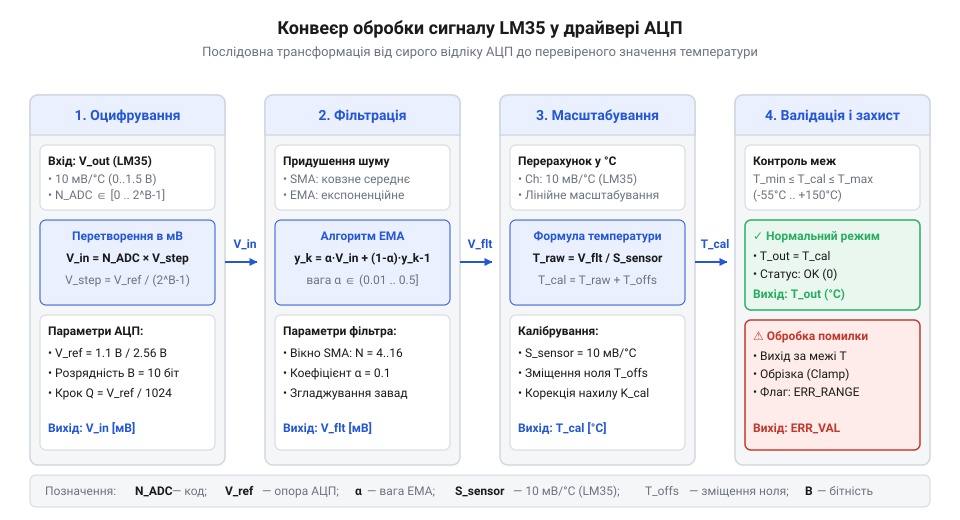
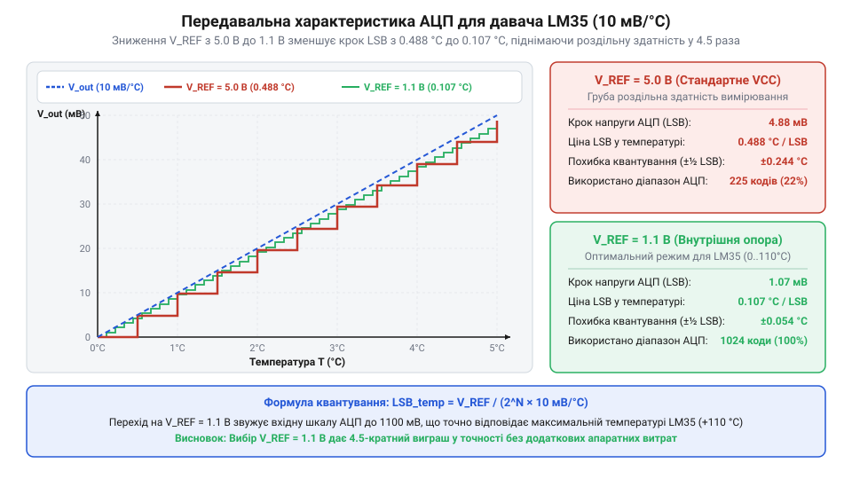
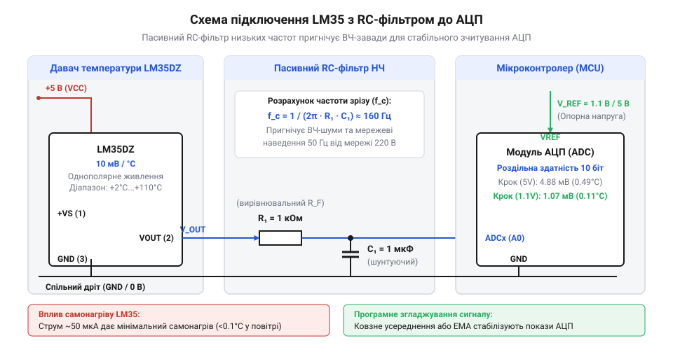
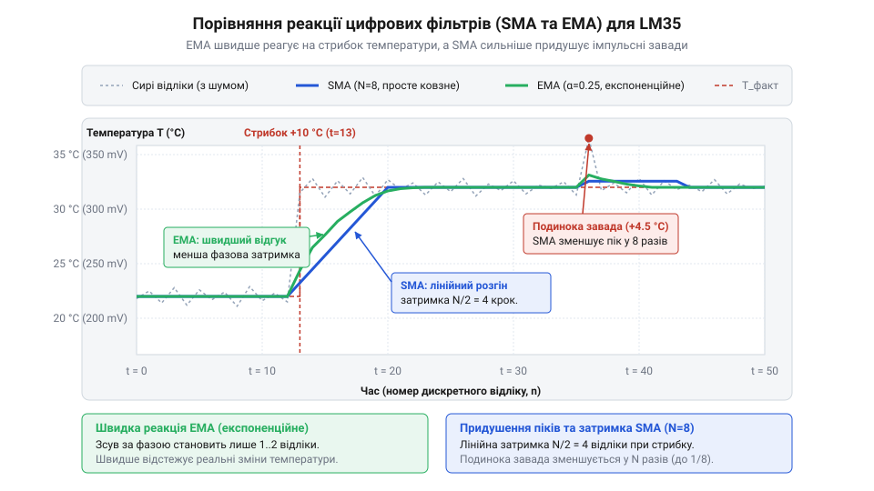
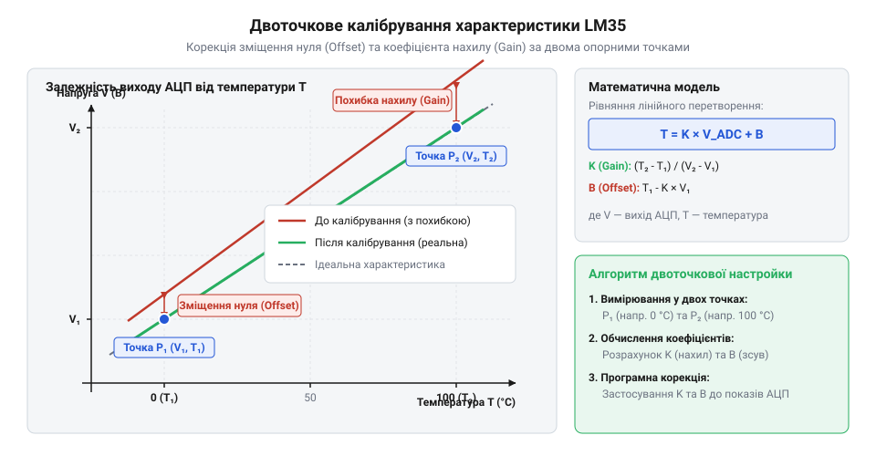

# Поглиблений інженерний аналіз цифрової обробки сигналів LM35

Проектування високоточного вимірювального тракту на базі аналогового сенсора LM35 вимагає поєднання аналогової схемотехніки узгодження імпедансів із сучасними методами цифрової обробки сигналів (DSP). Низький рівень вихідного сигналу (10 мВ/°C) у поєднанні з шумами перемикання цифрових шин мікроконтролера вимагає застосування технології оверсемплінгу (передискретизації), комбінованої медіанно-експоненційної фільтрації та статистичного двоточкового калібрування.



---

## 1. Теорія оверсемплінгу та децимації: підвищення ефективної розрядності АЦП

Класичний 10-розрядний АЦП мікроконтролерів AVR або 12-розрядний АЦП STM32 має обмежену розрядність квантування. Технологія оверсемплінгу (Oversampling and Decimation) дозволяє збільшити ефективну кількість розрядів (ENOB) без використання зовнішніх дорогих АЦП.

За фундаментальною теоремою обробки сигналів, для збільшення розрядності перетворення на n додаткових бітів необхідно виконати усереднення суми з N_samples відліків:

```text
N_samples = 4^n
```

де n — бажана кількість додаткових бітів розрядності.

### Розрахунок параметрів для LM35:
* **Підвищення 10-бітного АЦП до 12 біт (n = 2)**:
  `N_samples = 4^2 = 16 відліків`.
  Сума 16 відліків накопичується в 16-бітній змінній і зсувається праворуч на n = 2 біти (ділиться на 4).
* **Підвищення 10-бітного АЦП до 14 біт (n = 4)**:
  `N_samples = 4^4 = 256 відліків`.
  Сума 256 відліків зсувається праворуч на n = 4 біти (ділиться на 16).



Обов'язковою умовою ефективності оверсемплінгу є наявність у сигналі випадкового незкорельованого білого шуму (дзеркала дизерингу, dither noise) з амплітудою близько 1–2 LSB, джерелом якого природно виступають теплові шуми аналогового тракту та шуми квантування. Оверсемплінг покращує співвідношення сигнал/шум (SNR) на 6.02 × n дБ.

---

## 2. Аналіз та проектування вхідного антиаліасингового RC-фільтра

Вихідний каскад LM35 побудовано на емітерному повторювачі класу A з внутрішнім джерелом струму втягування (pull-down). При роботі на чисте ємнісне навантаження (довгий екранований кабель або ємність аналогового піна МК) фазовий зсув вихідного сигналу викликає самозбудження на частотах 100 кГц — 1 МГц.



Для безумовної стабільності виходу та захисту від накладання спектрів (Anti-Aliasing) розраховують пасивний фільтр низьких частот:

1. **Резистор розв'язки R = 1.0 кОм**:
   Відокремлює вихідний опір LM35 від вхідного конденсатора, забезпечуючи фазовий запас стійкості підсилювача понад 60°.
2. **Конденсатор C = 100 нФ**:
   Формує частоту зрізу фільтра `f_cut = 1 / (2 × pi × R × C) ≈ 159 Гц`. Це забезпечує затухання перешкод частоти промислової мережі 50 Гц на 10 дБ, а частоти 100 Гц (пульсації випрямляча) — на 16 дБ.
3. **Узгодження з часом вибірки АЦП (Sample Time)**:
   При комутації аналогового мультиплексора АЦП внутрішній конденсатор C_sample (зазвичай 5–12 пФ) заряджається імпульсним струмом. Зовнішній конденсатор C = 100 нФ у 10 000 разів більший за C_sample, тому комутаційний сплеск напруги на ньому не перевищує 0.01%, усуваючи взаємний вплив сусідніх каналів вимірювання.

---

## 3. Алгоритми цифрової фільтрації: комбінований медіанно-експоненційний фільтр

Для максимальної якості сигналу застосовують каскадну двоступеневу фільтрацію:



### Ступінь 1: Нелінійний медіанний фільтр 5-го порядку
Медіанний фільтр бере вікно з 5 останніх послідовних відліків `[X1, X2, X3, X4, X5]`, впорядковує їх за зростанням і обирає центральне значення. Якщо електромагнітна завада (іскра контактора, радіопередавач) створила одиничний стрибок на 100 LSB, медіанний фільтр повністю відкидає його без спотворення середнього рівня.

### Ступінь 2: Експоненційний фільтр низьких частот (EMA / IIR 1-го порядку)
Очищені від спайків відліки з виходу медіани надходять на фільтр експоненційного згладжування:

```text
Y[k] = alpha × X_median[k] + (1 - alpha) × Y[k - 1]
```

Еквівалентна постійна часу фільтра tau та частота зрізу f_c пов'язані з періодом опитування Delta_t співвідношеннями:
```text
alpha = Delta_t / (tau + Delta_t)
f_c ≈ alpha / (2 × pi × Delta_t)
```
При періоді вибірки Delta_t = 50 мс та alpha = 0.1 постійна часу становить tau ≈ 0.45 с, що ідеально відповідає динаміці зміни температури реальних теплових об'єктів.

---

## 4. Математична модель двоточкового калібрування лінійного зсуву

Функція перетворення реального тракту описується лінійним рівнянням першого порядку:



```text
T_cal = a × T_meas + b
```

де a — мультиплікативний коефіцієнт корекції чутливості (Gain Correction), b — адитивна поправка зміщення нуля (Offset Correction).

Розрахунок коефіцієнтів за результатами вимірювань у двох еталонних точках (T1_ref = 0.0 °C, T2_ref = 100.0 °C):
```text
a = (T2_ref - T1_ref) / (T2_meas - T1_meas)
b = T1_ref - a × T1_meas
```

Якщо прилад у льоду показав T1_meas = +0.50 °C, а в окропі T2_meas = +99.20 °C:
```text
a = (100.0 - 0.0) / (99.20 - 0.50) = 100.0 / 98.70 ≈ 1.01317
b = 0.0 - 1.01317 × 0.50 ≈ -0.5066 °C
```

Введення цих двох констант у драйвер усуває як похибку початкового зміщення LM35, так і відхилення реального значення опорної напруги V_ref від паспортного номіналу.

---

## 5. Виробничий драйвер оцифрування та фільтрації LM35 мовою C

Наведений нижче драйвер реалізує повнофункціональну обробку сигналу LM35: кільцевий буфер оверсемплінгу, швидкий медіанний фільтр, експоненційне згладжування EMA та застосування калібрувальних коефіцієнтів.

```c
#include <stdint.h>
#include <stdbool.h>

#define LM35_MEDIAN_WINDOW_SIZE    5
#define LM35_OVERSAMPLING_COUNT    16  // 16 відліків = +2 біти ENOB

// Структура налаштувань та калібрування
typedef struct {
    float v_ref_millivolts;       // Опорна напруга АЦП (напр. 1100.0f мВ або 3300.0f мВ)
    uint32_t adc_max_ticks;       // Базова шкала АЦП (1023 для 10-біт, 4095 для 12-біт)
    float gain_correction;        // Коефіцієнт масштабу 'a' (типово ~1.000f)
    float offset_correction_c;    // Зміщення нуля 'b' у °C (типово ~0.0f)
    float ema_alpha;              // Коефіцієнт згладжування EMA (0.05f .. 0.20f)
} lm35_config_t;

// Стан фільтра та контекст драйвера
typedef struct {
    uint32_t raw_buffer[LM35_MEDIAN_WINDOW_SIZE];
    uint8_t buffer_index;
    bool buffer_filled;
    float filtered_temperature_c;
} lm35_context_t;

// Ініціалізація драйвера
void lm35_init(lm35_context_t *ctx) {
    ctx->buffer_index = 0;
    ctx->buffer_filled = false;
    ctx->filtered_temperature_c = 0.0f;
    for (int i = 0; i < LM35_MEDIAN_WINDOW_SIZE; i++) {
        ctx->raw_buffer[i] = 0;
    }
}

// Швидке сортування вставками для медіани 5 елементів
static uint32_t calculate_median_5(const uint32_t *src) {
    uint32_t arr[LM35_MEDIAN_WINDOW_SIZE];
    for (int i = 0; i < LM35_MEDIAN_WINDOW_SIZE; i++) {
        arr[i] = src[i];
    }
    // Просте сортування вставками
    for (int i = 1; i < LM35_MEDIAN_WINDOW_SIZE; i++) {
        uint32_t key = arr[i];
        int j = i - 1;
        while (j >= 0 && arr[j] > key) {
            arr[j + 1] = arr[j];
            j--;
        }
        arr[j + 1] = key;
    }
    return arr[LM35_MEDIAN_WINDOW_SIZE / 2]; // Центральний елемент
}

// Обробка накопиченої суми 16 відліків оверсемплінгу
bool lm35_process_oversampled_sample(const lm35_config_t *cfg, 
                                     lm35_context_t *ctx, 
                                     uint32_t oversampled_sum, 
                                     float *out_temp_c) 
{
    // 1. Децимація суми 16 відліків (n = 2 біти):
    // Ділимо на sqrt(16) = 4 для переходу у 12-бітний масштаб (10-біт + 2 біти)
    uint32_t decimated_code = oversampled_sum >> 2; // Еквівалент ділення на 4

    // 2. Оновлення кільцевого буфера для медіани
    ctx->raw_buffer[ctx->buffer_index] = decimated_code;
    ctx->buffer_index = (ctx->buffer_index + 1) % LM35_MEDIAN_WINDOW_SIZE;
    if (ctx->buffer_index == 0) {
        ctx->buffer_filled = true;
    }

    uint32_t median_code = decimated_code;
    if (ctx->buffer_filled) {
        median_code = calculate_median_5(ctx->raw_buffer);
    }

    // 3. Розрахунок вхідної напруги з урахуванням розширеної шкали (adc_max_ticks * 4)
    uint32_t effective_max_ticks = cfg->adc_max_ticks * 4;
    float v_in_mv = ((float)median_code / (float)effective_max_ticks) * cfg->v_ref_millivolts;

    // 4. Перетворення напруги в «сирі» градуси Цельсія (10.0 мВ = 1 °C)
    float t_raw = v_in_mv / 10.0f;

    // 5. Застосування двоточкового калібрування
    float t_cal = (t_raw * cfg->gain_correction) + cfg->offset_correction_c;

    // 6. Експоненційне згладжування EMA
    if (!ctx->buffer_filled && ctx->filtered_temperature_c == 0.0f) {
        ctx->filtered_temperature_c = t_cal; // Перша ініціалізація
    } else {
        ctx->filtered_temperature_c = (cfg->ema_alpha * t_cal) + 
                                      ((1.0f - cfg->ema_alpha) * ctx->filtered_temperature_c);
    }

    *out_temp_c = ctx->filtered_temperature_c;
    return true;
}
```

Такий алгоритмічний конвеєр гарантує стійку роботу аналогового сенсора навіть в умовах завад промислового середовища та нестабільного живлення.
