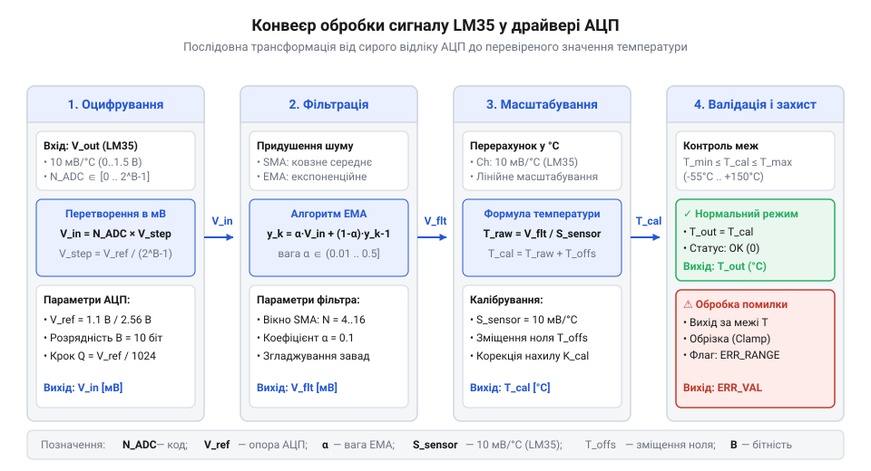
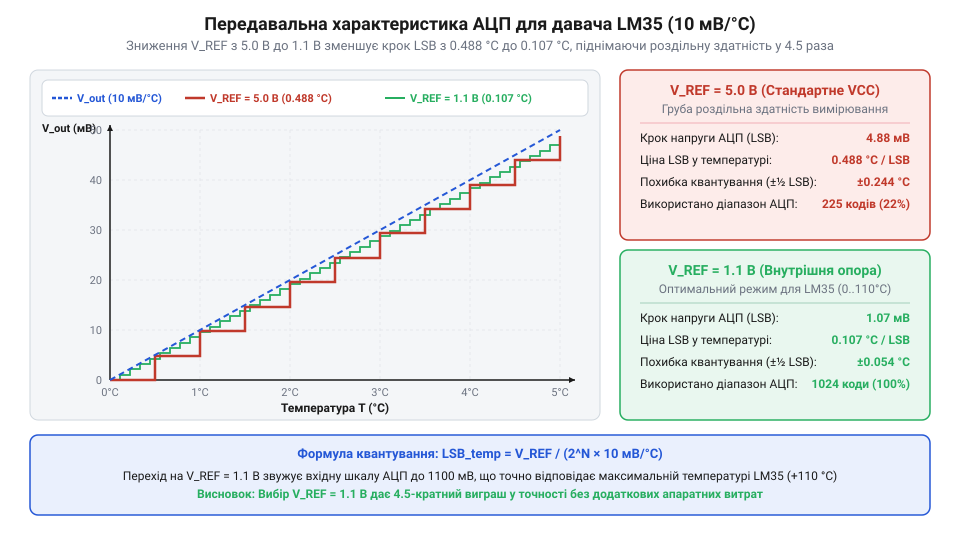
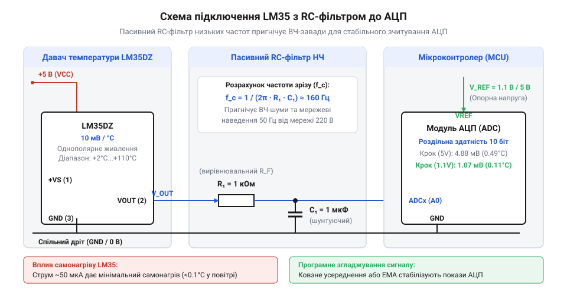
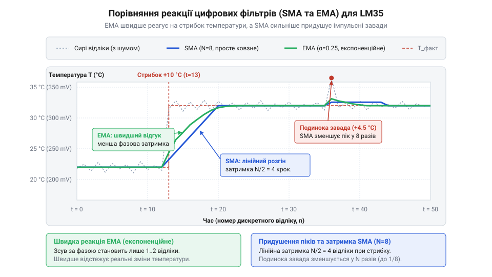
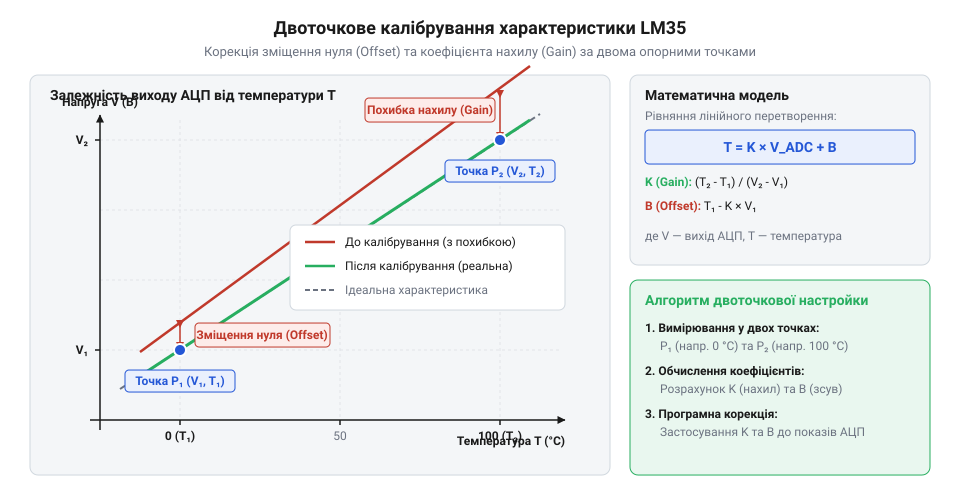

# Програмне зчитування та обробка сигналів LM35 у мікроконтролерах

Аналоговий давач температури LM35 формує напругу, прямо пропорційну температурі за шкалою Цельсія з коефіцієнтом передачі 10 мВ/°C. Проте пряме зчитування аналогового сигналу АЦП мікроконтролера без належної схемотехнічної підготовки та програмної фільтрації призводить до нестабільних показань, хаотичних шумів та похибок вимірювання до 2–5 °C. Надійна робота вимагає реалізації повного конвеєра: від вибору джерела опорної напруги та апаратного RC-фільтра до оверсемплінгу, цифрової фільтрації та двоточкового калібрування.



---

## 1. Проблема прямого оцифрування та шум квантування

При прямому підключенні виходу LM35 до аналогового входу мікроконтролера розробник стикається з трьома основними джерелами похибок:

1. **Нестабільність опорної напруги живлення**: Якщо як опорну напругу АЦП (V_ref) використовується загальна шина живлення мікроконтролера 5.0 В або 3.3 В, будь-які коливання навантаження (увімкнення світлодіода, модуля Wi-Fi/Bluetooth, реле) викликають просідання живлення. Оскільки цифровий код АЦП відображає лише відношення V_in / V_ref, просідання опорної напруги сприймається програмою як раптовий стрибок температури.
2. **Низька роздільна здатність квантування**: При 10-бітному АЦП та опорній напрузі 5.0 В ціна одного кванта LSB становить близько 4.88 мВ. Оскільки 10 мВ відповідає 1 °C, один крок АЦП еквівалентний зміні температури майже на 0.5 °C. Показання приладу фізично не можуть мати плавнішого кроку.
3. **Електромагнітні наводки та ємнісне навантаження**: Довгі дроти працюють як антени, вловлюючи високочастотні завади від імпульсних блоків живлення та ШІМ. Крім того, пряме підключення кабелю ємністю понад 50 пФ до виходу LM35 може викликати автоколивання внутрішнього підсилювача мікросхеми.

---

## 2. Вибір опорної напруги V_ref та розрахунок дискретності LSB

Для мінімізації похибки квантування необхідно узгодити діапазон АЦП з максимальною очікуваною напругою сенсора:



У діапазоні від 0 °C до +100 °C вихідна напруга LM35 змінюється від 0.0 В до 1.0 В. Використання повної шкали 5.0 В залишає 80% діапазону АЦП невикористаними.

### Порівняння конфігурацій опорної напруги:
* **V_ref = 5.0 В (10-біт АЦП, базова конфігурація Arduino)**:
  `LSB = 5000 мВ / 1024 = 4.883 мВ/LSB`
  `T_res = 4.883 мВ / 10 мВ/°C ≈ 0.488 °C/LSB` (дуже груба дискретність).
* **V_ref = 1.1 В (внутрішнє джерело Internal Bandgap ATmega328P)**:
  `LSB = 1100 мВ / 1024 = 1.074 мВ/LSB`
  `T_res = 1.074 мВ / 10 мВ/°C ≈ 0.107 °C/LSB` (покращення точності майже в 5 разів!).
* **V_ref = 3.3 В (12-біт АЦП STM32 / ESP32)**:
  `LSB = 3300 мВ / 4096 = 0.806 мВ/LSB`
  `T_res = 0.806 мВ / 10 мВ/°C ≈ 0.081 °C/LSB`.

Перемикання АЦП на внутрішнє високостабільне джерело 1.1 В або використання зовнішнього джерела ІОН (TL431, REF192) усуває залежність від пульсацій шини живлення та кардинально підвищує точність вимірювання.

---

## 3. Апаратний RC-фільтр на вході АЦП

Для запобігання паразитним автоколиванням вихідного каскаду LM35 та усунення високочастотного шуму перед входом АЦП встановлюють фільтр низьких частот:



Схема містить ізолюючий послідовний резистор R = 1.0 кОм та керамічний конденсатор C = 100 нФ (NP0/X7R), підключений до аналогової землі:

```text
f_cut = 1 / (2 × pi × R × C) = 1 / (2 × 3.1415 × 1000 Ом × 100 × 10^-9 Ф) ≈ 159 Гц
```

Цей фільтр вирішує три важливі задачі:
1. Ізолює вихідний підсилювач LM35 від паразитної ємності монтажної лінії та ємності вибірки АЦП, повністю усуваючи дзвін та збудження.
2. Ефективно пригнічує високочастотні завади та наводки промислової мережі частотою 50 Гц / 60 Гц.
3. Слугує накопичувальним буфером енергії для швидкої зарядки внутрішнього конденсатора вибірки-зберігання (Sample-and-Hold) АЦП під час комутації каналів.

---

## 4. Цифрова програмна фільтрація: SMA, EMA та медіана

Після апаратного оцифрування відліки надходять у програмний блок цифрової фільтрації, який пригнічує залишковий білий шум та усуває поодинокі аномальні викиди:



* **Ковзне середнє (Simple Moving Average, SMA)**:
  Зберігає буфер із N останніх вибірок (наприклад, N = 16) і обчислює їхнє середнє арифметичне. Ефективно згладжує флуктуації, але потребує виділення масиву в оперативній пам'яті.
* **Експоненційне згладжування (Exponential Moving Average, EMA)**:
  Фільтр першого порядку без використання масиву (потребує лише однієї змінної стану):
  ```text
  Y[k] = alpha × X[k] + (1 - alpha) × Y[k - 1]
  ```
  де alpha — коефіцієнт згладжування (типово 0.05...0.2). Забезпечує плавний стабільний вихід при мінімальному навантаженні на процесор.
* **Медіанний фільтр (Median Filter)**:
  Сортує непарну кількість вибірок (наприклад, 5 або 7) за зростанням і вибирає центральний елемент. Ідеально відсікає аномальні імпульсні викиди від комутації потужних навантажень, які спотворюють звичайне середнє арифметичне.

---

## 5. Двоточкове калібрування нуля та масштабу

Незважаючи на високу заводську лінійність LM35, реальні вимірювальні тракти містять похибки зміщення операційного підсилювача та допуски опорної напруги АЦП. Для усунення систематичної похибки застосовують лінійне двоточкове калібрування:



Калібрувальне рівняння зв'язує розраховану сиру температуру T_raw із точною каліброваною величиною T_cal:

```text
T_cal = K_gain × T_raw + T_offset
```

Процедура знаходження поправок:
1. **Точка нуля (0.0 °C)**: Сенсор поміщають у суміш танучого льоду з дистильованою водою. Якщо прилад показує +0.4 °C, фіксується зміщення нуля `T_offset = -0.4 °C`.
2. **Точка масштабу (+50.0 °C або +100.0 °C)**: Сенсор поміщають у прецизійний термостат або пару киплячої води. Якщо прилад показує +98.8 °C замість 100.0 °C, обчислюють коефіцієнт корекції нахилу `K_gain = (100.0 - 0.0) / (98.8 - 0.4) ≈ 1.0163`.

Збереження цих двох констант в енергонезалежній пам'яті (EEPROM / Flash) мікроконтролера гарантує точність вимірювання температури кращу за ±0.2 °C у всьому робочому діапазоні.
