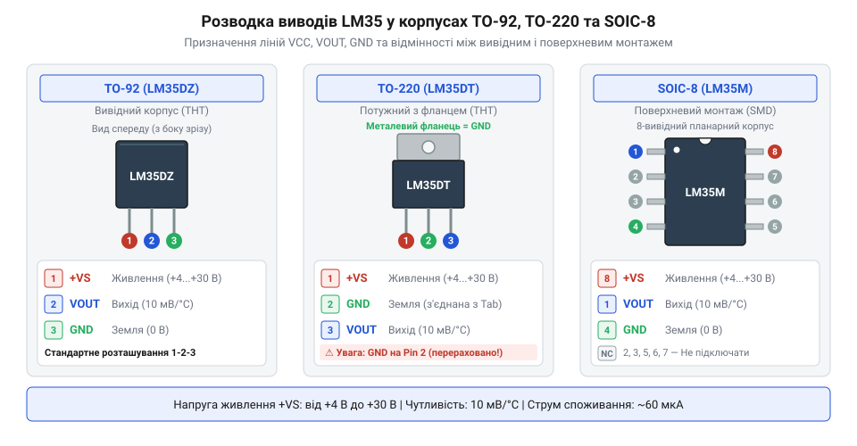
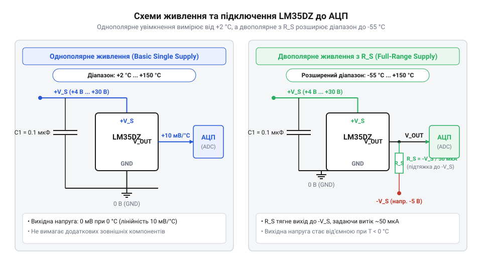

# Залізний інтерфейс LM35: цокольовка корпусів, електричні параметри та схеми обв'язки

## Проблема зняття точно каліброваної температури

Точне вимірювання температури в електронних системах вимагає перетворення фізичного стану речовини в електричний сигнал. У простому випадку інженери застосовують [аналогові термісторні датчики](root:cat-hw-sensors/ky-013-thermistor), опір яких змінюється залежно від температури. Проте термістори мають виражену нелінійну залежність опору, що змушує мікроконтролер обчислювати складні логарифмічні рівняння або використовувати ресурсомісткі таблиці перетворення. Термопари дозволяють вимірювати екстремальні температури, але їхній вихідний сигнал становить одиниці мікровольт і вимагає складного компенсаційного кола для холодного спаю (англ. @@en|cold junction@@ від *cold* — холодний та *junction* — з'єднання). Використання [платинових термоопорів PT100](root:cat-hw-sensors/pt100-rtd) забезпечує високу точність, але потребує стабільних джерел струму та [спеціалізованих перетворювачів опору](root:cat-hw-sensors/max31865-rtd-converter), що здорожчує кінцевий пристрій.

Щоб оминути складну аналогову обробку та трудомістке калібрування кожної плати, застосовують інтегральні напівпровідникові сенсори. У них джерело опорної напруги на основі ширини забороненої зони (англ. @@en|bandgap@@ від *band* — зона та *gap* — щілина) поєднане з масштабуючим підсилювачем на одному кремнієвому кристалі. Давач `LM35` належить саме до такого класу пристроїв. Його внутрішньо відкалібровано безпосередньо в градусах Цельсія.

Головною перевагою `LM35` є жорстко фіксований лінійний коефіцієнт перетворення, що становить `10 мВ/°C`. Напруга на виході датчика лінійно пропорційна температурі навколишнього середовища. При нульовій температурі Цельсія вихідна напруга дорівнює нулю вольт (за умов двополярного живлення). Як зазначає [загальний огляд резистивних датчиків](root:cat-hw-sensors/rtd-resistance-temperature-detectors-family-overview), лінійне перетворення значно спрощує подальше оцифрування аналого-цифровим перетворювачем (АЦП), оскільки не потребує складних математичних апроксимацій у програмі. Для реалізації алгоритмів обробки відліків АЦП, ковзного осереднення та калібрування зсуву напруги дивіться статтю про [програмне зчитування та обробку сигналів LM35 у мікроконтролерах](root:cat-hw-sensors/lm35/api-lm35-software-driver.md).

Розрахунок вихідної напруги `V_out` для заданої температури `T` виконують за прямою співвідношення:

```
V_out = 10 мВ/°C × T
= 0.010 В/°C × 25 °C     [підстановка кімнатної температури 25 °C]
= 0.250 В                [обчислення вихідної напруги]
= 250 мВ                 [переведення в мілівольти]
```

Для правильної передачі цього сигналу на вхід АЦП мікроконтролера необхідно забезпечити належні умови залізного інтерфейсу: стабільність напруги живлення, придушення завад, відсутність паразитного самонагрівання та узгодження з ємністю сполучної лінії.

## Призначення виводів та режими живлення

Для практичного застосування сенсора `LM35` необхідно чітко розрізняти цокольовку (англ. @@en|pinout@@ від *pin* — вивід та *out* — назовні) залежно від конструктивного виконання корпусу (англ. @@en|package@@ від *package* — упаковка, корпус). Виробник випускає давач у трьох основних типах корпусів: пластмасовому `TO-92` для монтажу в отвори, потужному `TO-220` з металевим прапорцем та поверхневому `SOIC-8`.

Виводи сенсора відповідають за три лінії: живлення `+V_S` (`VCC`), вихідний аналоговий сигнал `V_OUT` та спільний провід `GND`. У корпусі `TO-92` при погляді на плоску мітку знизу виводи розташовані зліва направо: вивід 1 — `+V_S`, вивід 2 — `V_OUT`, вивід 3 — `GND`. У корпусі `TO-220` металева пластина розсіювання тепла електрично з'єднана з виводом 3 (`GND`), що важливо враховувати під час монтажу на спільний радіатор. У поверхневому корпусі `SOIC-8` вивід `V_OUT` виведений на ніжку 1, `GND` — на ніжку 4, а живлення `+V_S` підключається до ніжки 8 (ніжки 2, 3, 5, 6 та 7 є не задіяними внутрішньо).


*Розпиновка корпусів LM35: у TO-92 та TO-220 три виводи відповідають живленню, виходу та землі, а в SOIC-8 виводи VOUT, GND та VCC розподілені по кутах корпусу.*

Сенсор `LM35` збереже працездатність у широкому діапазоні напруг живлення `+V_S` від `+4 В` до `+30 В`. Низький власний струм споживання (близько `60 мкА`) робить пристрій практично нечутливим до нестабільності джерела живлення в низькочастотному діапазоні. Проте високочастотні завади та імпульсні піки на лінії `VCC` можуть через ємності внутрішніх переходів потрапляти у вихідний каскад емітерного повторювача (англ. @@en|emitter follower@@).

Щоб запобігти збоям та шуму на виході, безпосередньо біля виводів давача встановлюють шунтувальний конденсатор (англ. @@en|bypass capacitor@@). Керамічний конденсатор ємністю `0.1 мкФ` (100 нФ) з низьким еквівалентним послідовним опором розміщують на відстані не більше `5 мм` від виводів `+V_S` та `GND`. Якщо лінія живлення проходить поруч із силовими комутаційними колами, рекомендується сформувати `RC`-фільтр живлення з послідовного резистора `100 Ом` та паралельного конденсатора `10 мкФ`.

## Схеми однополярного й двополярного увімкнення

Спосіб обв'язки `LM35` визначається діапазоном температур, який необхідно виміряти. Виробник передбачає дві основні концепції живлення: однополярну для вимірювань у додатній області та двополярну для роботи в повному діапазоні від `-55 °C` до `+150 °C`.

При однополярному живленні вивід `GND` підключають безпосередньо до системного нуля, а `+V_S` — до джерела напруги від `+4 В` до `+30 В`. Вихід `V_OUT` з'єднують безпосередньо з входом АЦП. Така схема забезпечує вимірювання температур від `+2 °C` до `+150 °C`. Нижній поріг у `+2 °C` зумовлений тим, що вихідний транзистор емітерного повторювача при наближенні потенціалу виходу до землі виходить із лінійного режиму насичення та не може вловлювати мікроамперні струми без від'ємного зсуву.


*Схеми обв'язки LM35: ліворуч однополярне увімкнення для додатних температур, праворуч двополярне живлення з підтягувальним резистором RS для вимірювання від'ємних температур.*

Для вимірювання від'ємних температур вихід `V_OUT` підтягують резистором `R_S` (англ. @@en|pull-down resistor@@) до від'ємного джерела живлення `-V_S`. Струм через резистор `R_S` забезпечує витікання струму з емітерного каскаду `LM35`, коли напруга на виході стає нижчою за потенціал землі. Величина струму витікання при мінімальній температурі має становити не менше `50 мкА`.

Розрахунок величини підтягувального резистора `R_S` для роботи до `-55 °C` (що відповідає вихідній напрузі `V_out = -550 мВ`) при від'ємній напрузі живлення `-V_S = -5 В` виконують за формулою:

```
R_S = (V_out_min - (-V_S)) / I_bias
= (-0.55 В - (-5.0 В)) / 0.000050 А    [підстановка напруги виходу при -55 °C та струму зсуву 50 мкА]
= 4.45 В / 0.000050 А                  [обчислення спаду напруги на резисторі]
= 89000 Ом                             [отримання розрахункового опору]
= 89 кОм                               [вибір ближнього стандартного номіналу 82 кОм або 100 кОм]
```

Якщо в системі відсутня шина від'ємної напруги `-V_S`, виміряти мінусові температури можна за допомогою діодного зсуву землі. Для цього між виводом `GND` датчика та спільною землею схеми послідовно вмикають два кремнієві діоди (наприклад, `1N4148`), які піднімають потенціал землі сенсора на `~1.2 В`. Тоді при температурі `-55 °C` потенціал виходу `V_OUT` відносно системної землі становитиме `1.2 В - 0.55 В = +0.65 В`, що дозволяє оцифровувати сигнал звичайним однополярним АЦП у диференційному режимі. Для розрахунку схем масштабування вихідного діапазону та активної фільтрації сигналу дивіться матеріал про [підсилення та узгодження сигналів LM35 на операційних підсилювачах](root:cat-hw-sensors/lm35-operational-amplifier-circuits).

## Декуплинг ємкісного навантаження й довгих ліній

Вихідний каскад `LM35` виконаний за схемою емітерного повторювача із низьким вихідним опором (близько `0.1 Ом` для змінного струму на частоті `1 кГц`). Проте при підключенні датчика до довгих кабельних трас або ліній із високою ємністю виникає проблема втрати стабільності зворотного зв'язку.

Ємкісне навантаження (англ. @@en|capacitive load@@) `C_L`, що перевищує `50 пФ`, разом із вихідним опором транзистора створює додатковий полюс у передавальній функції підсилювача. Це зменшує запас по фазі. У результаті виникає паразитна генерація (англ. @@en|parasitic oscillation@@) на частотах від `1 МГц` до `10 МГц`. Неозброєним оком чи звичайним вольтметром цю генерацію виявити важко, але вона призводить до зсуву постійної складової вихідної напруги, хаотичного шуму та похибки вимірювання температури на кілька градусів.

Для виключення генерації при віддаленому розміщенні сенсора застосовують декуплинг (англ. @@en|decoupling@@ від лат. *copula* — зв'язок). Основним методом є виділення ємності навантаження за допомогою послідовного ізолюючого резистора `R_S` або застосування згашувального `RC`-ланцюга (англ. @@en|snubber@@ від англ. *snub* — гасити).

Розглянемо вибір елементів захисту для кабелю довжиною `10 м` із погонною ємністю `100 пФ/м`:

```
C_L = 10 м × 100 пФ/м
= 1000 пФ                 [обчислення загальної ємності кабелю]
= 1 нФ                    [переведення в нанофаради]
```

Оскільки сумарна ємність `1000 пФ` суттєво перевищує критичну межу `50 пФ`, пряме підключення кабелю викликає високочастотний автоколивальний режим.

Для стабілізації схеми безпосередньо до виводу `V_OUT` датчика підключають послідовний ізолюючий резистор `R_S` номіналом від `75 Ом` до `300 Ом` (при високому вхідному опорі АЦП можна використовувати до `2 кОм`). Резистор відсікає ємність кабелю від внутрішнього вузла зворотного зв'язку. Додатково паралельно навантаженню на стороні датчика вмикають демпферний `RC`-ланцюг з послідовно з'єднаних резистора `R_1 = 75 Ом` та конденсатора `C_1 = 1 мкФ`. Таке рішення створює низькоомний шлях для високочастотних струм струмів і повністю усуває паразитну генерацію.

## Тепловий режим та захист від перевантажень

Оскільки `LM35` є активним напівпровідниковим пристроєм, струм, що протікає через кристал, перетворюється на тепло. Ефект самонагрівання (англ. @@en|self-heating@@) створює різницю температур між внутрішнім p-n переходом та навколишнім середовищем, що може спотворити результати вимірювання.

Власний струм споживання `LM35` становить близько `I_q = 60 мкА`. Обчислимо потужність `P`, що розсіюється на кристалі при напрузі живлення `+5 В` без вихідного навантаження:

```
P = V_CC × I_q
= 5 В × 0.000060 А        [підстановка напруги живлення та струму споживання]
= 0.00030 Вт               [обчислення розсіюваної потужності]
= 0.30 мВт                 [переведення у мілівати]
```

Тепловий опір «кристал — навколишнє середовище» `θ_JA` (англ. @@en|junction-to-ambient thermal resistance@@ — тепловий опір кристал-довкілля) для корпусу `TO-92` у нерухомому повітрі становить близько `180 °C/Вт`. Розрахуємо величину підвищення температури кристала `ΔT`:

```
ΔT = P × θ_JA
= 0.00030 Вт × 180 °C/Вт   [підстановка потужності та теплового опору]
= 0.054 °C                 [обчислення температури самонагрівання]
```

Значення `0.054 °C` є дуже малим і не виходить за межі паспортної точності датчика (`0.5 °C`). Проте якщо напруга живлення підвищується до `+30 В`, а вихід навантажений низькоомним резистором зі струмом `1 мА`, розсіювана потужність зростає до `~30 мВт`, що призводить до самонагріву на `5.4 °C`. Для мінімізації самонагріву живлення сенсора слід обирати мінімально достатнім (`+4 В` ... `+5 В`), а вхідний опір вимірювального приладу має бути не менше `100 кОм`.

Тепловий контакт із вимірюваним об'єктом забезпечується переважно через виводи датчика, оскільки мідні ніжки мають значно вищу теплопровідність, ніж пластиковий корпус. Тому при вимірюванні температури поверхні виводи `LM35` слід припаювати до широких мідних площадок друкованої плати, притиснутих до об'єкта.

Захист від нештатних режимів передбачає запобігання переполярності та перенапрузі. Подача зворотної напруги на виводи `+V_S` та `GND` призводить до миттєвого пробою внутрішніх діодів субстрату та виходу сенсора з ладу. Для захисту в лінію живлення послідовно вмикають діод Шотткі (наприклад, `1N5819`) з низьким спадом напруги або застосовують паралельний захисний діод із самовідновлюваним запобіжником. Вихід `LM35` має внутрішнє обмеження струму короткого замикання (близько `10-15 мА`), проте тривале коротке замикання на шину `+V_S` при високій напрузі може спричинити тепловий руйнівний пробій кристала.