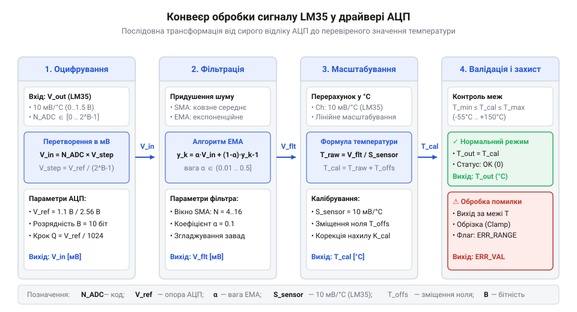
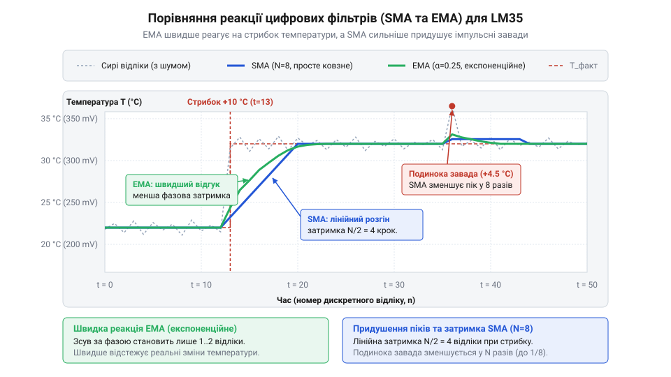

# Програмний інтерфейс зчитування LM35: драйвер оцифрування та первинної обробки

## Проблема прямого зчитування відліків АЦП

Пряме зчитування аналогової напруги давача температури LM35 без спеціально розробленого програмного шару обробки призводить до нестабільних показань у прикладній логіці. Сама аналогова мікросхема-давач формує лінійну напругу, прямо пропорційну температурі навколишнього середовища: при 25 °C вихідний потенціал становить рівно 250 мВ. Проте коли цей аналоговий сигнал подається на вхідний вивід, де працює @@uk|аналогово-цифровий перетворювач@@ (від лат. @@la|analogus@@ — відповідний та @@la|digitus@@ — палець, число; @@uk|АЦП@@), оцифровані значення зазвичай далекі від стабільних фізичних градусів.

Головна причина полягає в тому, що сирий код @@en|АЦП@@ відображає лише відношення вхідного сигналу до опорної напруги в конкретний момент квантування. Якщо системне джерело живлення має пульсації або змінює свій рівень під навантаженням (наприклад, при увімкненні Wi-Fi модуля чи світлодіода), опорна напруга плаває. Через це незмінне значення температури дає абсолютно різні числові відліки в регістрі мікроконтролера. Крім того, аналогова лінія зв'язку виступає антенним провідником, який збирає @@en|електромагнітні завади@@ від сусідніх цифрових шин і ліній ШІМ, викликаючи хаотичні високочастотні викиди.

При використанні 10-розрядного @@en|АЦП@@ із базовою опорною напругою 5.0 В значення одного найменшого розряду становить близько 4.88 мВ. Оскільки чутливість LM35 дорівнює 10 мВ/°C, при 10-бітному АЦП та опорній напрузі 5 В кожна одиниця молодшого розряду сирого коду відповідає зміні температури майже на 0.5 °C. Достатньо невеликої завади амплітудою в пару мілівольт, щоб виміряне значення в програмі «стрибало» на 1–2 °C за один крок оцифрування. На відміну від [цифрових давачів DS18B20](root:cat-hw-sensors/ds18b20), де внутрішній контролер видає готові кадровані цифрові пакети, або [аналогових термісторів KY-013](root:cat-hw-sensors/ky-013-thermistor), що вимагають нелінійного розрахунку, LM35 потребує первинної нормалізації та згладжування на стороні мікроконтролера.

Спроба звертатися до регістрів @@en|АЦП@@ безпосередньо з прикладної програми створює жорстку прив'язку до конкретної архітектури заліза і робить код вразливим до будь-яких сплесків наводки. Щоб відокремити апаратну частину зчитування від прикладної логіки керування, створюють програмний @@en|драйвер@@ (від англ. @@en|driver@@ — @@en|to drive@@, керувати). Такий шар бере на себе завдання вибору стабільного опорного рівня, перетворення сирих кодових значень у градуси Цельсія з урахуванням апаратних зміщень та первинної цифрової фільтрації шумів.

## Ініціалізація АЦП та вибір опорної напруги

Правильна ініціалізація програмного інтерфейсу починається з узгодження параметрів @@en|АЦП@@ із фізичними характеристиками давача LM35. Пристрій формує вихідний сигнал із постійним коефіцієнтом передачі 10 мВ на кожен градус Цельсія. У базовій схемі підключення діапазон вимірюваних температур від 0 °C до 100 °C відповідає вихідній напрузі від 0.0 В до 1.0 В.

Якщо підключити LM35 до @@en|АЦП@@, що використовує як @@en|джерело опорної напруги@@ повну напругу живлення мікроконтролера Vref = 5.0 В, більша частина шкали перетворювача залишається невикористаною. При розрядності N = 10 біт загальна кількість рівнів оцифрування дорівнює 2ⁿ = 1024 (від 0 до 1023). Ціна найменшого розряду, або @@en|дискрет квантування@@ (від лат. @@la|discretus@@ — розділений; @@en|LSB@@), розраховується як відношення опорної напруги до максимального значення коду:

```
LSB = Vref / 2ⁿ
```

Здійснимо чисельний розрахунок для джерела Vref = 5.0 В та розрядності N = 10:

```
LSB = 5000 мВ / 1023
    = 4.8876 мВ/дискрет            [розрахунок кроку напруги]
```

Оскільки чутливість давача S_lm35 = 10 мВ/°C, роздільна здатність вимірювання за температурою T_res становить:

```
T_res = LSB / S_lm35
      = 4.8876 мВ / 10 мВ/°C
      = 0.4888 °C/дискрет          [розрахунок роздільної здатності]
```

Для підвищення точності слід перемикати @@en|АЦП@@ на внутрішнє високостабільне джерело опорної напруги. Наприклад, використання внутрішнього джерела Vref = 1.1 В (поширене в мікроконтролерах AVR) або Vref = 2.048 В істотно зменшує дискрет квантування:

```
LSB = 1100 мВ / 1023
    = 1.0753 мВ/дискрет            [крок при Vref = 1.1 В]

T_res = 1.0753 мВ / 10 мВ/°C
      = 0.1075 °C/дискрет          [підвищена роздільна здатність]
```

Перехід від 5.0 В до 1.1 В опорної напруги покращує точність оцифрування майже в 4.5 раза, дозволяючи фіксувати зміни температури з точністю до десятого градуса Цельсія. Докладніше про вибір та конфігурацію внутрішніх і зовнішніх опорних рівнів дивіться у матеріалі про [джерела опорної напруги АЦП мікроконтролерів](root:hw-arch/adc-voltage-reference-sources).

Конструкція ініціалізації програмного @@en|драйвер@@ повинна зберігати ключові параметри вимірювального тракту в окремій структурі налаштувань. Модуль приймає величину Vref у мілівольтах, розрядність N у бітах, а також початкові коефіцієнти @@uk|калібрування@@ (від араб. @@ar|qalib@@ — форма для лиття через фр. @@fr|calibre@@).

Нижче наведено програмний інтерфейс ініціалізації структури конфігурації для C та C++:

:::tabs
@tab c|esp-idf
:::code api-lm35-software-driver/c/lm35-init.c
@tab cpp|arduino
:::code api-lm35-software-driver/cpp/lm35driver.cpp
:::

## Перерахунок відліків та параметри калібрування

Математичний перерахунок сирих кодів @@en|АЦП@@ у температурні показники базується на відновленні вхідної напруги та її масштабуванні з урахуванням системних відхилень. У першому наближенні виміряна напруга V_in обчислюється шляхом множення сирого коду ADC_raw на значення @@en|дискрет квантування@@ LSB.

Для конвертації отриманої напруги у фізичну температуру значення V_in у мілівольтах ділиться на крутизну характеристики давача S_lm35 = 10.0 мВ/°C. Загальний розрахунковий ланцюг без калібрувальних поправок має вигляд:

```
V_in = ADC_raw × LSB                             [перетворення коду в напругу]
T_raw = V_in / 10.0                              [перетворення напруги в температуру]
```

Однак апаратні компоненти завжди мають реальні допуски: опорна напруга може відхилятися від номіналу на кілька відсотків, а сам давач LM35 володіє початковим зміщенням нуля та похибкою чутливості. Для компенсації цих системних спотворень у формулу вводять @@en|коефіцієнт масштабування@@ K_scale та @@en|коефіцієнт зміщення@@ T_offset:

```
T_cal = (ADC_raw × LSB / 10.0) × K_scale + T_offset  [каліброване значення температури]
```

Процедура @@en|калібрування@@ передбачає вимірювання двох еталонних точок (наприклад, при 0 °C у танучому льоду та при 50 °C у термостаті). Якщо при 0 °C сирий розрахунок показує +0.4 °C, T_offset задається як -0.4 °C. Якщо ж при розширенні діапазону виявляється кутовий нахил характеристики, корегується мультиплікативний множник K_scale.

Послідовну структуру проходження даних від апаратного оцифрування до отримання кінцевого фізичного значення показано на блок-схемі:


*Послідовність обробки сигналу LM35 від зчитування сирого регістру АЦП до отримання каліброваного значення температури в градусах Цельсія.*

Реалізація обчислювальної функції драйвера забезпечує точне лінійне перетворення з урахуванням збережених коефіцієнтів:

:::tabs
@tab c|esp-idf
:::code api-lm35-software-driver/c/lm35-raw-to-celsius.c
@tab cpp|arduino
```cpp
// У складі класу LM35Driver
float readCelsius(uint32_t raw_adc) const {
    if (lsb_mv_ <= 0.0f) {
        return 0.0f;
    }
    float voltage_mv = static_cast<float>(raw_adc) * lsb_mv_;
    float temp_raw = voltage_mv / 10.0f;
    return (temp_raw * config_.scale_factor) + config_.offset_celsius;
}
```
:::

Завдяки відокремленню математичного перерахунку від зчитування регістрів, розробник має змогу легко проводити тестування та коригувати коефіцієнти без зміни апаратного шару.

## Цифрова фільтрація шумів вимірювального каналу

Навіть при використанні прецизійної опорної напруги аналоговий тракт піддається дії високочастотних електричних завад, що спричиняють вихідний @@en|шум@@ вимірювань. Для стабілізації показань у складі @@en|драйвер@@ реалізують алгоритми цифрової фільтрації, які придушують випадкові відхилення. Найбільш ефективними та легкими для обчислень на мікроконтролерах є алгоритми простого та експоненційного ковзного середнього.

@@uk|Фільтр простого ковзного середнього@@ (від англ. @@en|Simple Moving Average@@; @@en|SMA@@) усереднює останні M послідовних вимірювань. Алгоритм вимагає збереження історії значень у @@en|кільцевий буфер@@ (від англ. @@en|ring buffer@@):

```
T_sma = (1 / M) × ∑ T_i                            [сумування M останніх відліків]
```

Головна перевага @@en|SMA@@ — повне придушення високочастотних випадкових викидів. Проте цей метод вимагає виділення оперативної пам'яті під масив розміру M та створює лінійну часову затримку відгуку на швидку зміну температури, пропорційну довжині буфера.

@@uk|Фільтр експоненційного ковзного середнього@@ (від англ. @@en|Exponential Moving Average@@; @@en|EMA@@) не потребує збереження масиву попередніх вимірів, що робить його ідеальним рішенням для систем із обмеженими ресурсами пам'яті. Поточне фільтроване значення обчислюється через попереднє значення фільтра та поточний сирий відлік:

```
T_ema[k] = α × T_raw[k] + (1 - α) × T_ema[k-1]
```

Тут α — коефіціент згладжування в діапазоні від 0.0 до 1.0. Малі значення α (наприклад, 0.05 або 0.1) забезпечують сильне придушення шумів, але уповільнюють реакцію на зміни. Великі значення (наприклад, 0.4 або 0.5) роблять фільтр динамічнішим, але пропускають більше високочастотних пульсацій.

Для порівняння динаміки згладжування обох алгоритмів наведено часовий графік відгуку на зашумлений сигнал:


*Порівняння відгуку алгоритмів простого (SMA) та експоненційного (EMA) ковзного середнього при обробці зашумленого сигналу аналогового давача LM35.*

Нижче наведено повну реалізацію фільтрації @@en|EMA@@ та @@en|SMA@@ у складі програмного @@en|драйвер@@:

:::tabs
@tab c|esp-idf
:::code api-lm35-software-driver/c/lm35-sma-init.c
@tab cpp|arduino
:::code api-lm35-software-driver/cpp/movingaveragefilter.cpp
:::

Вибір між @@en|SMA@@ та @@en|EMA@@ залежить від доступної пам'яті та вимог до динаміки систем терморегулювання.

## Валідація значень та обробка помилок

Отримання математично обчисленого значення температури не гарантує його фізичної правильності. Апаратний обрив провідника, коротке замикання лінії живлення або збій @@en|АЦП@@ можуть призводити до того, що на вхід потрапляють крайні значення напруги. Для захисту виконавчих механізмів (наприклад, щоб запобігти безперервному увімкненню нагрівача при обриві давача) програмний @@en|драйвер@@ повинен виконувати обов'язкову валідацію показань.

Паспортний @@uk|робочий діапазон@@ давача LM35 у базі становить від 0 °C до +100 °C (або від -55 °C до +150 °C при використанні двополярного живлення та підтягувального резистора). Якщо оцифрована температура виходить за ці межі, функція зчитування зобов'язана повертати відповідний статус помилки замість передачі хибного значення в прикладну логіку.

Типові причини несправностей аналогового тракту LM35:
1. **Обрив лінії сигналу або земляного провідника**: вхід @@en|АЦП@@ підтягується до нуля або підвішується в повітрі, формуючи сирий код близький до 0 (температура < 0 °C у однополярній схемі). 2. **Коротке замикання на лінію живлення VCC**: вхідний потенціал перевищує Vref, призводячи до насичення @@en|АЦП@@ та повернення максимального коду (2ⁿ - 1), що відповідає температурі вищій за +150 °C.

Для надійної обробки помилок у @@en|інтерфейс прикладного програмування@@ (@@en|API@@) впроваджують перераховний тип статусів та передачу обчисленої температури за вказівником чи посиланням:

:::tabs
@tab c|esp-idf
:::code api-lm35-software-driver/c/lm35-read-temperature.c
@tab cpp|arduino
:::code api-lm35-software-driver/cpp/lm35status.cpp
:::

Перевірка статусу виклику гарантує, що прикладна логіка мікроконтролера вчасно виявить несправність датчика та переведе керовану систему в безпечний аварійний стан.