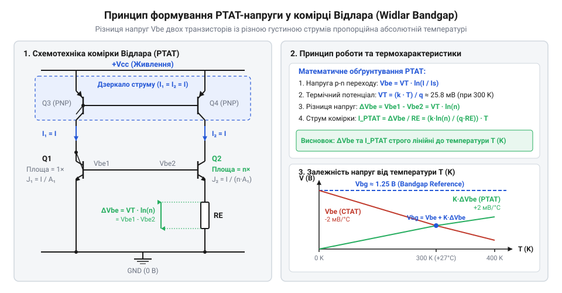
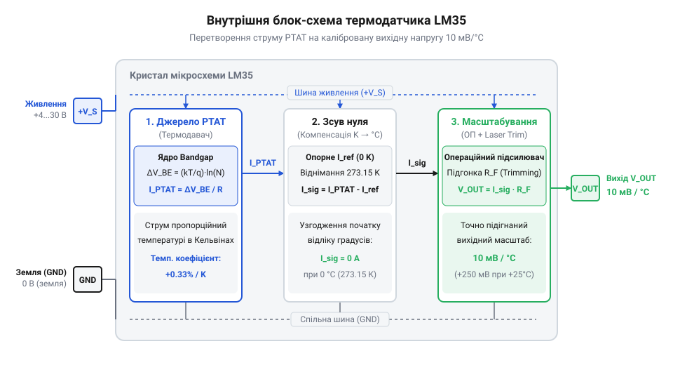

# Історія розробки напівпровідникових термометрів та створення LM35

<preknowlist>
- [KY-013 — аналоговий давач температури (термістор)](root:cat-hw-sensors/ky-013-thermistor) — принцип вимірювання температури через зміну опору аналогових компонентів
- [DS18B20 — цифровий давач температури (1-Wire)](root:cat-hw-sensors/ds18b20) — концепція інтегрування АЦП та цифрового шинного інтерфейсу безпосередньо в термодатчик
</preknowlist>

## Обмеження термодіодів та технологічний розкид

Електронне вимірювання температури в перші десятиліття розвитку напівпровідникової техніки спиралося на компоненти зі зміною опору, такі як [аналогові термістори KY-013](root:cat-hw-sensors/ky-013-thermistor) (від грец. *therme* — тепло та англ. *resistor* — опір). Однак висока нелінійність термісторів змушувала інженерів шукати альтернативу серед фундаментальних напівпровідникових елементів. Природним кандидатом став класичний p-n перехід (англ. @@en|p-n junction@@, від англ. *junction* — з'єднання) кремнієвого діода або транзистора. Термодіод (від грец. *therme* — тепло та *dis* — двічі, *hodos* — шлях) обіцяв простішу фізику: при проходженні прямого струму спад напруги на p-n переході зменшується зі зростанням температури.

Фізична залежність прямої напруги база-емітер `V_be` від температури визначається з рівняння Шокли для струму колектора `I_c` біполярного транзистора. У цьому рівнянні `I_s` позначає зворотний струм насичення (англ. @@en|saturation current@@, від лат. *saturatio* — насичення), `q` — елементарний електричний заряд, `k` — сталу Больцмана, а `T` — абсолютну температуру в кельвінах:

I_c = I_s · (e^(q · V_be / (k · T)) - 1)
V_be = (k · T / q) · ln(I_c / I_s)      [логарифмування та нехтування одиницею при прямому зміщенні]

З вираженого рівняння видно, що при фіксованому струмі `I_c` напруга `V_be` виявляє залежність від температури `T`. Однак сам струм насичення `I_s` фундаментально залежить від температури за кубічним законом і від ширини забороненої зони кремнію. Через цю сильну температурну залежність `I_s` температурний коефіцієнт (англ. @@en|Temperature Coefficient@@, від лат. *coefficiens* — той, що сприяє) напруги `V_be` є від'ємним і становить приблизно `-2.0 мВ/°C` (або `-2.0 мВ/K`). Такий від'ємний нахил залежності називають @@en|CTAT@@ (англ. @@en|Complementary to Absolute Temperature@@).

Головна перепона дискретних p-n переходів полягає в технологічному розкиді параметрів. Струм насичення `I_s` прямо пропорційний площі p-n переходу та обернено пропорційний концентрації домішок, введених під час легування (англ. @@en|doping@@, від голл. *doopen* — занурювати) кремнію. У технологічному процесі виготовлення напівпровідникових пластин (англ. @@en|wafers@@) площа переходу та рівень легування варіюються від однієї партії до іншої на 10–30%. 

Через цей розкид при стабільній кімнатній температурі +25 °C та фіксованому струмі `I_c = 100 мкА` напруга `V_be` різних екземплярів навіть одного типу транзисторів коливається в діапазоні від 600 мВ до 700 мВ. Для оцінки похибки обчислимо еквівалентний температурний зсув `Error_T` при варіації `ΔV_be = 100 мВ`:

Error_T = ΔV_be / (dV_be / dT)
= 100 мВ ÷ 2.0 мВ/°C     [ділення варіації напруги на температурний коефіцієнт]
= 50 °C                  [абсолютна похибка вимірювання без калібрування]

Похибка у 50 °C означає, що поодинокий p-n перехід неможливо використовувати як взаємозамінний давач без індивідуального калібрування кожного екземпляра. На відміну від металевих датчиків, про які йдеться у матеріалі про [платинових термоопорах PT100](root:cat-hw-sensors/pt100-rtd), дискретні напівпровідникові діоди вимагали складних підлаштувальних схем на етапі виробництва. Інженерні пошуки зупинилися перед викликом: створити схемотехнічний метод, який повністю нейтралізує технологічний розкид струму насичення `I_s`.

## Прорив Боба Відлара та концепція PTAT

У 1971 році видатний інженер-схемотехнік Боб Відлар (англ. @@en|Bob Widlar@@), працюючи в компанії National Semiconductor, запропонував принципово нове рішення — джерело опорної напруги на ширині забороненої зони (англ. @@en|Bandgap Reference@@, від англ. *bandgap* — ширина забороненої зони та *reference* — опора/орієнтир). Ідея Відлара полягала у використанні двох транзисторів, виготовлених на одному кремнієвому кристалі в єдиному технологічному циклі, але працюючих із різною густиною струму (англ. @@en|Current Density@@, від лат. *densus* — густий).

Оскільки обидва транзистори розташовані поруч на одному кристалі, їхні струми насичення `I_s` на одиницю площі є ідентичними. Обчислимо різницю напруг база-емітер `ΔV_be` між транзисторами `Q₁` та `Q₂`, що працюють із густинами колекторних струмів `J₁ = I_c1 / A₁` та `J₂ = I_c2 / A₂` (де `A₁` та `A₂` — площі p-n переходів):

ΔV_be = V_be1 - V_be2
= (k · T / q) · ln(J₁ / I_s) - (k · T / q) · ln(J₂ / I_s)      [використання властивості різниці логарифмів]
= (k · T / q) · ln(J₁ / J₂)                                   [скорочення однакового струму насичення I_s]
= V_T · ln(N)                                                 [позначення теплової напруги V_T та співвідношення густин N]

У цьому виведенні величину `V_T = k · T / q` називають тепловою напругою (англ. @@en|Thermal Voltage@@, від грец. *therme* — тепло), а `N = J₁ / J₂` — співвідношенням густин струмів. Результат виявився фундаментальним: залежний від технологічного розкиду струм насичення `I_s` повністю скоротився. Різниця напруг `ΔV_be` визначається виключно фундаментальними константами `k` і `q`, абсолютною температурою `T` та співвідношенням густин струмів `N`.

Оскільки `d(ΔV_be)/dT = (k / q) · ln(N)`, отримана напруга виявляє позитивний температурний коефіцієнт і є строго пропорційною абсолютній температурі. Цей принцип отримав назву @@en|PTAT@@ (англ. @@en|Proportional to Absolute Temperature@@, від лат. *proportio* — співвідношення, *absolutus* — безумовний та *temperatura* — належний стан). Обчислимо значення температурного коефіцієнта для співвідношення густин `N = 10`:

d(ΔV_be)/dT = (k / q) · ln(N)
= 86.17 мкВ/К × 2.3026   [множення теплового коефіцієнта на натуральний логарифм 10]
= 198.4 мкВ/K            [отримання позитивного температурного коефіцієнта PTAT]

Напруга `V_be` має від'ємний коефіцієнт @@en|CTAT@@ (`-2.0 мВ/K`), а різниця `ΔV_be` — позитивний коефіцієнт @@en|PTAT@@ (`+0.1984 мВ/K`). Підсилюючи `ΔV_be` за допомогою масштабуючих резисторів і додаючи її до `V_be`, Відлар створив термостабільні [джерела опорної напруги](root:hw-analog/voltage-reference-sources) з напругою `V_bg ≈ 1.205 В`. Водночас саме выделена напруга `ΔV_be` стала ідеальною основою для побудови точних напівпровідникових термометрів.


*Схематичний принцип компенсації температурного коефіцієнта: різниця напруг двох транзисторів формує лінійний PTAT-сигнал, який не залежить від технологічних розкидів кремнію.*

## Створення LM35 та інтегроване лазерне підганяння

Розвиток концепції @@en|PTAT@@ у 1970-х роках привів інженерів National Semiconductor до створення монолітних аналогових датчиків температури. Ранні PTAT-мікросхеми (зокрема LM135) формували вихідну напругу, пропорційну шкалі Кельвіна (10 мВ/K, що відповідало 2.73 В при 0 °C). Для зручного використання у вбудованих системах потрібен був давач із прямою шкалою Цельсія. Так з'явилася мікросхема @@en|LM35@@, яка реалізувала вихідний масштабний коефіцієнт (англ. @@en|Scale Factor@@, від лат. *scala* — сходи та *factor* — той, що робить) `10 мВ/°C` із нульовою напругою при 0 °C.

Структура LM35 об'єднала на єдиному кристалі первинне PTAT-ядро, операційний підсилювач (англ. @@en|Operational Amplifier@@, від лат. *operatio* — дія та *amplificatio* — розширення) та прецизійну мережу резисторів.


*Блок-схема каскадів LM35: первинний PTAT-струм перетворюється та масштабується операційним підсилювачем із лазерним підганянням резисторів у точну вихідну напругу 10 мВ/°C.*

Головним технічним проривом під час масового випуску LM35 стало застосування лазерного підганяння (англ. @@en|Laser Trimming@@, від англ. *trim* — підрізати, підганяти) тонкоплівкових резисторів (англ. @@en|thin-film resistors@@) безпосередньо на напівпровідниковій пластині. До розрізання пластини на окремі кристали автоматизований стенд вимірював параметри кожного чипа при контрольованій температурі. Високоточний лазер випалював спеціальні мікроперемички на тонкоплівкових резисторах, підганяючи коефіцієнт підсилення операційного підсилювача та зсув нуля.

Завдяки лазерному підганянню мікросхема LM35 отримала фабричне калібрування з типовою точністю `±0.25 °C` при кімнатній температурі без використання зовнішніх підлаштувальних елементів. Вихідний сигнал `250 мВ` при +25 °C та `1.000 В` при +100 °C передається через низькоомний вихід, що дозволяє підключати сенсор безпосередньо до вхідних аналогово-цифрових перетворювачів. На відміну від складних кіл узгодження, описаних в [огляді термоопорів RTD](root:cat-hw-sensors/rtd-resistance-temperature-detectors-family-overview), LM35 перетворила складний аналоговий ланцюг на простий трьохвивідний компонент у корпусі @@en|TO-92@@ (`VCC`, `GND`, `VOUT`), встановивши стандарт перед появою цифрових сенсорів на кшталт [цифрового сенсора DS18B20](root:cat-hw-sensors/ds18b20).

## Спростування міфів та фізичні обмеження

Поява мікросхеми @@en|LM35@@ породила чимало легенд у середовищі інженерів-розробників. Найпоширеніша омана стверджує, що LM35 була першим інтегральним термометром у історії електронної промисловості. Насправді компанія @@en|National Semiconductor@@ випустила LM35 у 1983 році завдяки праці інженера Карла Нельсона (Carl Nelson). За шість років до цього, у 1977 році, Майк Тімко (Mike Timko) з компанії @@en|Analog Devices@@ розробив токовий термодатчик @@en|AD590@@, а Боб Відлар (Bob Widlar) створив лінійку @@en|LM135@@ ще наприкінці 1970-х років. Прорив Нельсона полягав не у винайденні напівпровідникового вимірювання температури, а в тому, що новий давач вперше видавав напругу, прямо пропорційну температурі за шкалою Цельсія (10 мВ/°C), без потреби віднімати початковий зсув у 2.73 В, притаманний кельвінівським сенсорам. Докладніше про схемотехніку PTAT-джерела струму та застосування в струмових петлях читайте у статті про [аналоговий токовий давач температури AD590](root:cat-hw-sensors/ad590-current-output-temp-sensor).

Другий міф — ідеальна @@en|лінійність@@ (від лат. *linea* — лінія) вихідного сигналу за будь-яких умов роботи. У специфікаціях вказано вражаючу лінійність із похибкою не більше 0.5 °C, проте в реальних схемах на точність вимірювання суттєво впливають фізичні ефекти, вільні від маркетингових обіцянок. Головним із них є @@en|самонагрівання@@ (англ. *self-heating* — власний розігрів) кремнієвого кристала під дією електричного струму.

Будь-який електронний компонент розсіює потужність, коли через нього протікає струм. У мікросхемі LM35 @@en|струм споживання@@ у стані спокою становить близько 60 мкА. При живленні напругою 5 В виділена теплова потужність обчислюється як вихідна потужність кристала:

```
P = V_cc × I_q
= 5 В × 60 мкА                [потужність спокою кристала]
= 0.3 мВт                     [розсіювана теплова потужність]
```

Ця потужність мусить розсіятися через пластиковий @@en|корпус@@ (від лат. *corpus* — тіло) компонента в навколишнє середовище. Конструкція корпусу TO-92 має @@en|тепловий опір@@ (англ. *thermal resistance* — тепловий опір) навколишньому середовищу близько 180 °C/Вт у нерухомому повітрі. Збільшення температури кристала понад температуру середовища розраховують за формулою:

```
ΔT = P × θ_JA
= 0.0003 Вт × 180 °C/Вт       [перегрів кристала понад середовище]
= 0.054 °C                    [величина температурного зсуву]
```

У звичайних умовах похибка в пів сотої градуса здається мізерною. Проте якщо живити LM35 від напруги 30 В та навантажити її вихід низькоомним резистором, струм споживання зростає, а виділена потужність сягає десятків міліватів. У цьому разі кристал нагріється на 2–5 °C вище навколишнього повітря, і давач вимірюватиме власне тепло, а не температуру об'єкта.

Іншим джерелом помилок є @@en|дрейф живлення@@, що характеризується @@en|коефіцієнтом пригнічення нестабільності живлення@@ (англ. *Power Supply Rejection Ratio*, @@en|PSRR@@). Незважаючи на внутрішні джерела опорної напруги, пульсації та нестабільність шини живлення частково проникають на вихідний каскад операційного підсилювача, додаючи паразитного шуму до чутливого сигналу в 10 мВ/°C. Уважне зчитування паспортних даних вимагає від інженера враховувати не лише номінальну точність при 25 °C, а й умови охолодження, струм навантаження та чистоту живлення.

## Еволюція від LM35 до цифрових датчиків

Протягом 1980-х років аналоговий сигнал 10 мВ/°C вважався стандартом зручності, адже для вимірювання температури достатньо було підключити вихід LM35 до звичайного вольтметра. Однак розвиток мікроконтролерних систем у 1990-х роках оголив фундаментальні обмеження аналогової передачі даних. Сигнал напруги малої амплітуди надзвичайно вразливий до електромагнітних завад, спаду напруги на довгих дротах та падіння потенціалу на спільній шині заземлення.

Крім того, підключення аналогового датчика вимагає наявності в мікроконтролері @@en|аналогово-цифрового перетворювача@@ (від англ. *analog-to-digital converter*, @@en|АЦП@@) та прецизійного джерела опорної напруги. Якщо 10-розрядний АЦП використовує опорну напругу 5 В, величина одного молодшого розряду (англ. *Least Significant Bit*, @@en|LSB@@) становить:

```
LSB = V_ref ÷ 1024
= 5 В ÷ 1024                  [роздільна здатність 10-розрядного АЦП]
≈ 4.88 мВ                     [значення одного кванту напруги]
```

Оскільки масштабний коефіцієнт LM35 дорівнює 10 мВ/°C, крок @@en|дискретизації@@ (від лат. *discretus* — розділений) за температурою складе майже 0.5 °C. Щоб отримати роздільну здатність у 0.1 °C, інженеру доводилося будувати зовнішні підсилювачі та ретельно фільтрувати шуми, що зводило нанівець простоту схемотехніки. На відміну від [простих аналогових термісторів KY-013](root:cat-hw-sensors/ky-013-thermistor), які потребували розрахунку складних нелінійних рівнянь, LM35 давала лінійний сигнал, але проблема зцифрування все одно лишалася на боці мікроконтролера.

Необхідність багатоточкового моніторингу та підвищення завадозахищеності привела до зміни парадигми наприкінці 1990-х років. Спроби винести АЦП ближче до первинного елемента завершилися тим, що інженери об'єднали на одному силіцієвому кристалі кремнієвий p-n перехід, дельта-сігма АЦП, блок цифрової калібровки та шинний @@en|трансивер@@ (від англ. *transceiver*, утвореного від *transmitter* — передавач та *receiver* — приймач).

Так з'явилися інтегральні @@en|цифрові датчики@@. Компанія @@en|Dallas Semiconductor@@ у 1999 році представила легендарний [цифровий сенсор DS18B20](root:cat-hw-sensors/ds18b20), який використовував протокол @@en|1-Wire@@ для передачі зцифрованого значення температури по одному дрітові живлення та даних. На зміну одноточковим вимірюванням прийшла можливість об'єднувати десятки сенсорів на єдиній шині без втрати точності.

Сучасні вбудовані системи майже повністю перейшли на цифрові інтерфейси. Для вимірювання мікроклімату використовують високоінтегровані рішення на кшталт [сенсора вологості SHT30](root:cat-hw-sensors/sht30), де температура й вологість вимірюються й передаються цифровою шиною @@en|I2C@@ з роздільною здатністю до 0.01 °C. Водночас аналогова класика не зникла повністю: у високотемпературному промисловому середовищі, де напівпровідникові кристали деградують, застосовують [платинові термоопори PT100](root:cat-hw-sensors/pt100-rtd).

Вибір між аналоговим і цифровим підходом сьогодні визначається архітектурою системи. Аналогові давачі на кшталт LM35 залишаються доцільними у простих автономних схемах аналогового регулювання (наприклад, у термореле без мікроконтролера), тоді як для цифрових вбудованих систем із кабельною мережею понад пів метра цифрові датчики є беззаперечним стандартом.