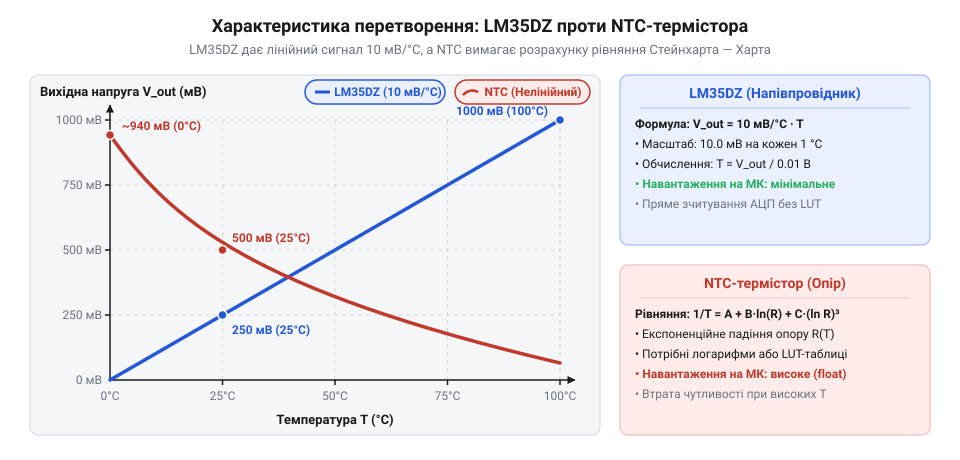
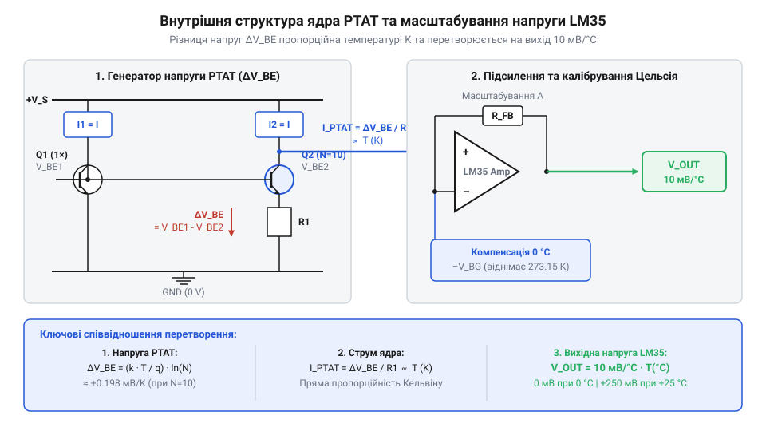
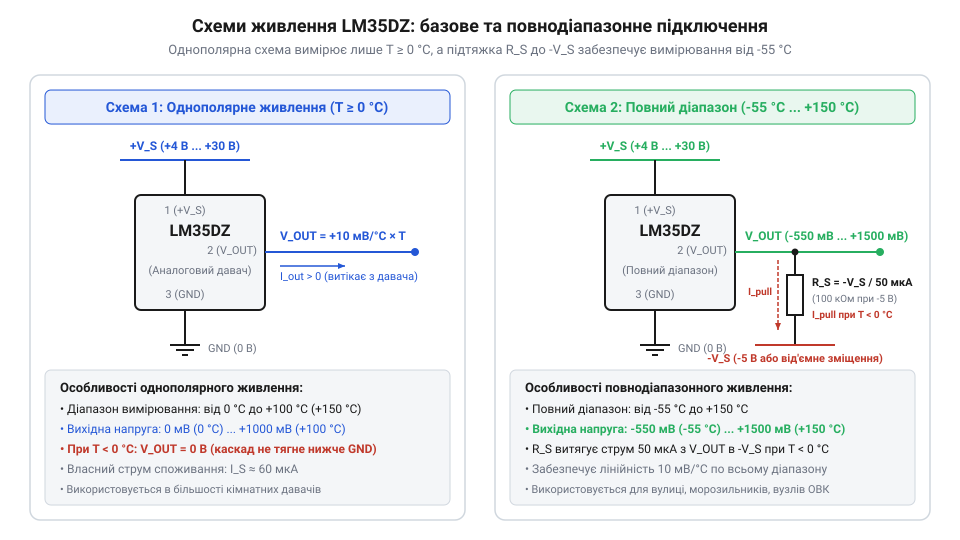
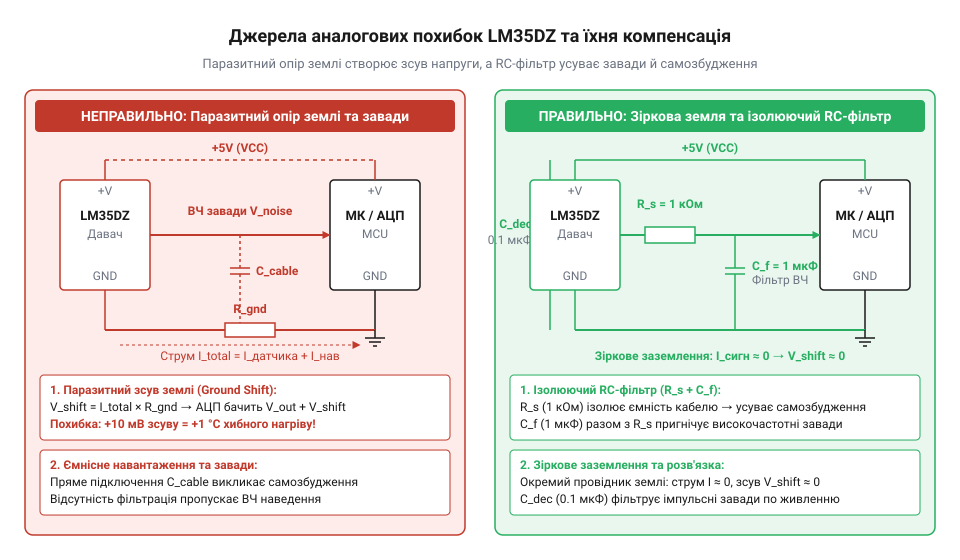
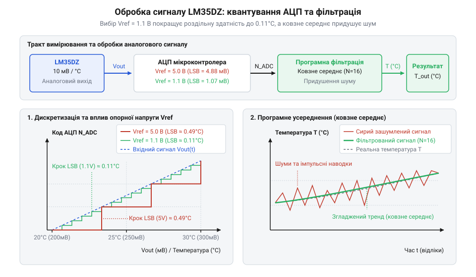
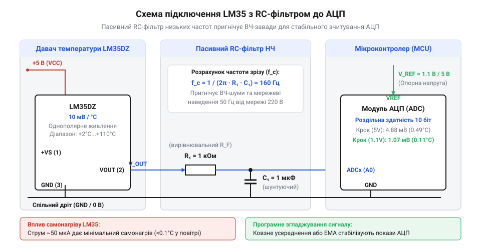

# LM35DZ — аналоговий давач температури (10 мВ/°C)

<preknowlist>
- [KY-013 — аналоговий давач температури (термістор)](root:cat-hw-sensors/ky-013-thermistor) — принцип роботи нелінійного NTC-термістора та відмінність від лінійного інтегрального перетворювача
- [DS18B20 — цифровий давач температури (1-Wire)](root:cat-hw-sensors/ds18b20) — переваги цифрового інтерфейсу 1-Wire та дискретизація температури всередині давача
- [PT100 — платиновий термоопір](root:cat-hw-sensors/pt100-rtd) — відмінність активних напівпровідникових давачів від пасивних платинових перетворювачів опору
</preknowlist>

## Нелінійність термісторів та виклик калібрування

Вимога до вимірювання температури в електронних системах виникає на кожному кроці — від термостатів побутових приладів до систем захисту акумуляторних батарей. Найпростішим і найдешевшим вирішенням цієї задачі тривалий час залишався @@en|NTC-термістор@@ (від @@en|Negative Temperature Coefficient@@ — негативний температурний коефіцієнт) — пасивний напівпровідниковий @@en|резистор@@, опір якого зменшується із зростанням температури. Однак при спробі зняти показники з термістора за допомогою @@en|мікроконтролер@@а розробник миттєво стикається з фундаментальною фізичною перешкодою: залежність опору матеріалу від температури є глибоко нелінійною та підпорядковується експоненціальному закону.

Нелінійність виникає через фізику генерації носіїв заряду у спечених оксидах перехідних металів, з яких виготовляють @@en|NTC-термістор@@. Під час підвищення температури теплова енергія вибиває електрони у зону провідності, що призводить до стрімкого падіння опору. Якщо включити такий [аналоговий термістор KY-013](root:cat-hw-sensors/ky-013-thermistor) у класичний @@en|дільник напруги@@ з постійним резистором `R_ref`, вихідна напруга `V_out` розраховується за формулою:

```
V_out = V_cc · (R_NTC / (R_ref + R_NTC))      [вихідна напруга дільника з термістором]
```

Оскільки сам опір `R_NTC` змінюється експоненціально, вихідний сигнал дільника набуває S-подібної або викривленої експоненціальної форми. На практиці це означає, що при низьких температурах чутливість кола є високою, а при високих — напруга майже припиняє змінюватися, втрачаючи роздільну здатність.

Щоб перетворити виміряний опір `R_NTC` або напругу у реальні градуси @@en|Цельсій@@я, @@en|мікроконтролер@@ змушений обчислювати складне @@en|рівняння Стейнхарта-Харта@@ (від @@en|Steinhart-Hart equation@@):

```
1 / T = A + B · ln(R_NTC) + C · (ln(R_NTC))³      [рівняння Стейнхарта-Харта для абсолютної температури K]
```

Тут `T` — температура у @@en|Кельвін@@ах, `R_NTC` — виміряний опір термістора у Омах, а `A`, `B` і `C` — коефіцієнти Стейнхарта-Харта, які визначаються індивідуально для кожної серії давачів. Спрощений варіант цього виразу відомий як формула з B-параметром (від @@en|B-parameter equation@@):

```
R(T) = R₀ · exp(B · (1/T - 1/T₀))      [залежність опору від B-коефіцієнта]
```

Для 8-бітних або низькоспоживаючих @@en|мікроконтролер@@ів обчислення логарифмів `ln()` та експонент `exp()` із плаваючою крапкою подвійної точності є надзвичайно важким завданням. Воно вимагає тисяч тактів процесора, збільшує розмір прошивки та підвищує енергоспоживання системи. Альтернативою є збереження у @@en|флеш-пам'ять@@і великих таблиць перерахунку (від @@en|lookup table@@) та застосування лінійної інтерполяції, що відбирає дорогоцінний обсяг пам'яті й усе одно створює похибку дискретизації. Математичний розрахунок коефіцієнтів апроксимації та методи компенсації викладено у статті про [рівняння Стейнхарта-Харта](root:hw-sensing/steinhart-hart).

До математичного виклику додається проблема калібрування. Через технологічні допуски при спіканні кераміки екземпляри @@en|NTC-термістор@@ів навіть з однієї партії мають розкид базового опору `R₀` до `±5%` і розкид коефіцієнта `B` до `±2%`. Це змушує виробників або проводити індивідуальне точкове @@en|калібрування@@ кожного приладу при кількох температурах, або миритися з похибкою вимірювання у `2...5 °C`. До того ж з часом нелінійні керамічні матеріали деградують, змінюючи свої параметри під дією термоциклювання.

Наочно різницю між нелінійним відгуком термістора та ідеальним прямолінійним сигналом давача демонструє порівняльний графік:


*Порівняння нелінійної експоненціальної кривої термістора та строго лінійної характеристики LM35DZ у діапазоні температур.*

Потреба усунути обчислювальне навантаження та позбутися складної обв'язки підштовхнула інженерів до створення інтегральних напівпровідникових давачів. Детальна [історія розробки напівпровідникових термометрів](root:cat-hw-sensors/lm35/hist-bandgap-temp-sensors.md) показує, як еволюція від найпростіших термодіодів до схем із широкою забороненою зоною дозволила перенести формувачі сигналу безпосередньо на кремнієвий кристал.

Саме ці дослідження привели до створення аналогової мікросхеми @@en|LM35DZ@@ (від @@en|National Semiconductor@@). Замість зміни опору @@en|LM35DZ@@ генерує аналогову напругу, яка строго лінійно залежить від температури за шкалою @@en|Цельсій@@я з фіксованим масштабом `10 мВ/°C`. Завдяки цьому при температурі `0 °C` вихідна напруга становить `0 мВ`, при `+25 °C` — `250 мВ`, а при `+100 °C` — `1000 мВ` (`1.0 В`). @@en|Мікроконтролер@@у більше не потрібні ані складні формули, ані обчислення з плаваючою крапкою — для отримання температури достатньо просто поділити виміряне значення напруги в мілівольтах на 10.

## Фізика P-N переходу та лінійність

Щоб зрозуміти, як мікросхеми на кшталт @@en|LM35DZ@@ досягають прямолінійної залежності вихідної напруги від температури, необхідно звернутися до фізики @@en|P-N перехід@@у біполярних транзисторів. При проходженні прямого струму `I_C` через @@en|P-N перехід@@ напруга між базою та емітером `V_BE` описується рівнянням Шокли (від @@en|Shockley diode equation@@):

```
I_C = I_S · (exp(q · V_BE / (k · T)) - 1)      [рівняння струму колектора біполярного транзистора]
```

Тут `I_S` — насичений струм витоку переходу (від @@en|saturation current@@), `q` — елементарний заряд (`1.602176634 × 10⁻¹⁹ Кл`), `k` — стала Больцмана (`1.380649 × 10⁻²³ Дж/К`), а `T` — абсолютна температура у @@en|Кельвін@@ах. Поодинокий @@en|P-N перехід@@ має негативний температурний коефіцієнт напруги `V_BE`, який становить приблизно `-2 мВ/°C`. Однак використовувати один транзистор як точний давач неможливо: величина `I_S` критично залежить від ступеня легування кремнію, площі переходу та технологічних дефектів кристала, через що кожен окремий екземпляр транзистора вимагає індивідуального підлаштування.

Розв'язанням цієї фізичної проблеми стало використання ядра @@la|PTAT@@ (від @@en|Proportional To Absolute Temperature@@ — пропорційно абсолютній температурі). Схема @@la|PTAT@@ складається з двох ідентичних біполярних транзисторів `Q₁` та `Q₂`, які сформовані поруч на одному монолітному кристалі кремнію, але працюють при різних щільностях струму колектора `J₁` та `J₂`. Щільність струму `J` визначається відношенням струму колектора `I_C` до фізичної площі емітера `A_E`:

```
J = I_C / A_E      [щільність струму через емітерний перехід]
```

Якщо один з транзисторів має площу емітера у `n` разів більшу за інший (`A_E2 = n · A_E1`), або через них пропускаються струми у заданому співвідношенні, то при відніманні напруг база-емітер двох транзисторів величина насиченого струму `I_S`, яка містить усі технологічні нестабільності, повністю скорочується.

Різниця напруг база-емітер `ΔV_BE` між двома транзисторами дорівнює:

```
ΔV_BE = V_BE1 - V_BE2
      = (k · T / q) · ln(J₁ / J₂)      [різниця напруг база-емітер через щільності струму]
      = (k / q) · ln(n) · T            [пропорційність абсолютній температурі T]
```

У цій формулі коефіцієнт `(k / q) · ln(n)` визначається виключно фундаментальними фізичними константами (`k` та `q`) та геометричним співвідношенням площ транзисторів `n` на кремнієві масці при фотолітографії. Оскільки геометричне співвідношення на одному кристалі витримується з точністю до часток відсотка, різниця напруг `ΔV_BE` стає строго лінійною функцією від absoluteної температури @@en|Кельвін@@а `T` без жодного впливу технологічних коливань легування кремнію.

Будову внутрішнього вимірювального ядра та систему формування напруги показує принципова схема давача:


*Схема формування пропорційного абсолютній температурі струму та його перетворення у напругу 10 мВ/°C.*

Величина `ΔV_BE` вимірюється в мілівольтах і росте пропорційно абсолютній температурі за шкалою @@en|Кельвін@@а. Для співвідношення площ `n = 8` температурний коефіцієнт напруги `ΔV_BE` становить приблизно `+0.179 мВ/К`. Щоб перетворити цю напругу на зручний сигнал за шкалою @@en|Цельсій@@я (`°C`), внутрішня схема @@en|LM35DZ@@ виконує дві послідовні аналогові операції:

1. Зсув нуля: Оскільки абсолютний нуль за шкалою @@en|Цельсій@@я (`0 °C`) відповідає `273.15 K`, внутрішнє @@en|bandgap-ядро@@ (від @@en|bandgap reference@@ — широкосмуговий опорний елемент) з негативним температурним коефіцієнтом створює опорну напругу зсуву. Вона віднімає рівно `273.15 K` еквівалентної напруги, роблячи вихідний сигнал рівним `0 В` при температурі танення льоду (`0 °C`). 2. Масштабування: Внутрішній прецизійний @@en|операційний підсилювач@@ підсилює отриманий зсунутий сигнал у необхідну кількість разів, формуючи нормований коефіцієнт масштабування `10 мВ/°C`.

Детальна [математична модель PTAT-ефекту](root:cat-hw-sensors/lm35/math-ptat-bandgap-physics.md) описує точний розрахунок температурного коефіцієнта та компенсацію температурних похибок другого порядку у силіконовому кристалі. Принцип дії та схемотехнічне побудування осередків термокомпенсації розкрито у матеріалі про [джерела опорної напруги bandgap](root:hw-analog/voltage-reference-sources).

Формування однакових резисторів та коефіцієнтів підсилення всередині монолітної мікросхеми здійснюється на етапі виробництва за допомогою технології @@en|лазерне підганяння@@ (від @@en|laser trimming@@). Спеціальний лазер випалює мікроскопічні перемички на тонкоплівкових резисторах безпосередньо на кремнієві пластині під час тестування при фіксованій температурі. Це забезпечує точність калібрування @@en|LM35DZ@@ у `±0.5 °C` при кімнатній температурі та `±0.9 °C` у всьому робочому діапазоні без необхідності зовнішнього налаштування розробником.

Завдяки активній напівпровідниковій структурі @@en|LM35DZ@@ кардинально відрізняється як від пасивних елементів, так і від складних цифрових систем. На відміну від [платинових термоопорів PT100](root:cat-hw-sensors/pt100-rtd), які вимагають вимірювальних мостів і зовнішніх джерел струму, @@en|LM35DZ@@ є готовим активним генератором напруги із низьким вихідним опором (`0.1 Ом` для змінного струму). А у порівнянні з [цифровими давачами DS18B20](root:cat-hw-sensors/ds18b20) він не потребує програмної реалізації часово-чутливих протоколів зв'язку, подаючи сигнал безпосередньо на аналоговий вхід @@en|мікроконтролер@@а.

## Схеми живлення та вимірювальний діапазон

Функціонування активного аналогового датчика температури LM35DZ базується на роботі внутрішнього підсилювача та генератора струму, пропорційного абсолютній температурі. Оскільки [математика PTAT-ефекту](root:cat-hw-sensors/lm35/math-ptat-bandgap-physics.md) формує базову напругу в мікровольтах, внутрішня схема мікросхеми масштабує цей сигнал до значень 10 мВ/°C. Проте для стабільної роботи вихідного каскаду пристрій потребує зовнішньої енергії, а конфігурація джерела живлення безпосередньо визначає межі температур, які здатна виміряти система.

При стандартному підключенні датчик працює від одного джерела постійного струму з напругою від +4 В до +30 В (найчастіше +5 В у цифрових системах). Схема містить три виводи: живлення `V_CC` (вивід 1), вихід напруги `V_out` (вивід 2) та спільний провідник `GND` (вивід 3). Повна цокольовка для різних типів виконань (TO-92, TO-220, SOIC-8) представлена у [залізному інтерфейсі LM35](root:cat-hw-sensors/lm35/api-lm35-hardware-interface.md).

У режимі однополярного живлення вихідний каскад датчика побудовано за схемою @@en|emitter follower@@ (з @@la|emitter@@ — той, що випромінює, та @@en|follower@@ — повторювач). Емітерний транзистор здатний витікати струм у навантаження, але не може опускати вихідну напругу нижче потенціалу власного виводу `GND`. Тож при нулі градусів Цельсія вихідна напруга дорівнює нулю volt:

```
V_out = 10 мВ/°C · T
= 0.010 В/°C · 0 °C       [підстановка нижньої межі додатного діапазону]
= 0.000 В                 [вихідна напруга при 0 °C]
```

З підвищенням температури вихідна напруга зростає лінійно. Наприклад, при кімнатній температурі +25 °C та при точці кипіння води +100 °C обчислення мають такий вигляд:

```
V_out = 0.010 В/°C · 25 °C
= 0.250 В                 [вихідна напруга при +25 °C]
```

```
V_out = 0.010 В/°C · 100 °C
= 1.000 В                 [вихідна напруга при +100 °C]
```

Оскільки напруга виходу в однополярному режимі не може стати від'ємною, будь-яка температура нижче 0 °C приведе до насичення вихідного транзистора, і напруга залишиться на позначці 0 В. Це обмежує застосування однополярної схеми виключно додатним діапазоном від 0 °C до +100 °C (для модифікації LM35DZ) або до +150 °C (для LM35A). Практична реалізація такого вимірювача детально розібрана у [проєкті вимірювача додатних температур](root:cat-hw-sensors/lm35/proj-lm35-single-supply-monitor.md).


*Схема однополярного живлення для додатних температур (ліворуч) та двополярного підключення з підтягувальним резистором R_S до негативної шини для розширеного діапазону від -55 °C до +150 °C (праворуч).*

Для вимірювання від'ємних температур (аж до -55 °C) вихідна напруга датчика має опускатися нижче потенціалу системної землі — наприклад, до -550 мВ при -55 °C. Для цього вихідний каскад необхідно вивести в активний режим за допомогою зовнішнього всмоктування струму.

Перший спосіб реалізації повного діапазону полягає у використанні двополярного живлення (наприклад, +5 В та -5 В). Між вихідним виводом `V_out` та негативною шиною живлення `-V_S` підключають резистор @@en|pull-down@@ (з @@en|pull@@ — тягнути, та @@en|down@@ — вниз). Цей підтягувальний резистор `R_S` створює постійний відтік струму з вихідного вузла, дозволяючи напрузі ставати від'ємною відносно `GND`. Величина опору `R_S` розраховується з умови забезпечення струму відтоку порядку 50 мкА при найнижчій робочій температурі:

```
R_S = |-V_S| / I_pull
= 5.0 В / 0.000050 А      [обчислення опору підтяжки для негативного джерела 5 В]
= 100000 Ом               [номінал резистора 100 кОм]
```

Другий спосіб застосовується в системах, де відсутнє негативне джерело живлення. Для створення від'ємного зсуву використовують схему @@en|level shifting@@ на двох послідовно ввімкнених діодах між виводом `GND` датчика та системною землею. Діоди створюють опорний зсув потенціалу звичайного заземлення датчика приблизно на +1.2 В вище за землю мікроконтролера. Вихідний резистор `R_S` приєднують до системної землі, завдяки чому напруга на виході датчика відносно системної землі завжди залишається додатною (від +0.65 В при -55 °C до +2.7 В при +150 °C). Загальна температура визначається як різниця напруг між виводом `V_out` та піднятим виводом `GND` датчика. Схемотехніку та налаштування таких кіл висвітлено у [проєкті моніторингу повного діапазону](root:cat-hw-sensors/lm35/proj-lm35-full-range-bipolar.md).

Після формування напруги виходу її необхідно оцифрувати за допомогою аналогово-цифрового перетворювача (АЦП) мікроконтролера. Точність та крок вимірювання температури прямим чином залежать від розрядності АЦП `N` та опорної напруги `V_ref`. Крок квантування за напругою, який визначає @@en|least significant bit@@ (найменший значущий розряд, LSB), обчислюється за формулою:

```
V_LSB = V_ref / (2ⁿ)
```

Якщо 10-бітний АЦП мікроконтролера (наприклад, ATmega328P) використовує стандартну опорну напругу живлення `V_ref = 5.0 В`, крок квантування становить:

```
V_LSB = 5.000 В / 1024
= 0.00488 В               [значення одного відліку АЦП дорівнює 4.88 мВ]
```

Оскільки коефіцієнт передачі LM35DZ дорівнює 10 мВ/°C, дискретність вимірювання температури становить:

```
ΔT_LSB = V_LSB / 0.010 В/°C
= 4.88 мВ / 10 мВ/°C      [ділення кроку напруги на чутливість датчика]
= 0.488 °C                [роздільна здатність становить близько 0.5 °C]
```

Переключення АЦП на внутрішнє прецизійне джерело опорної напруги `V_ref = 1.1 В` істотно змінює параметри вимірювання:

```
V_LSB = 1.100 В / 1024
= 0.001074 В              [крок напруги зменшується до 1.074 мВ]
```

```
ΔT_LSB = 1.074 мВ / 10 мВ/°C
= 0.107 °C                [роздільна здатність покращується до 0.11 °C]
```

Використання опорної напруги 1.1 В обмежує максимальну вимірювану напругу величиною 1100 мВ, що відповідає температурі +110 °C. Це повністю покриває робочий діапазон LM35DZ (від 0 °C до +100 °C) та забезпечує майже п'ятикратне збільшення точності дискретизації без додавання зовнішніх активних компонентів. Повний розрахунок похибок оцифрування наведено у [математичній моделі оцифрування напруги LM35](root:cat-hw-sensors/lm35/math-lm35-adc-scaling.md), а стабільність джерел `V_ref` розглянуто у матеріалі про [джерела опорної напруги АЦП](root:hw-analog/adc-reference-voltage-stability).

## Джерела аналогових похибок та компенсація

Після побудови вимірювального кола на практиці виникають викривлення вихідного сигналу, зумовлені фізичними процесами у напівпровіднику та паразитичними параметрами монтажу. Незважаючи на заводську калібровку LM35DZ, аналогова природа сигналу робить його чутливим до самонагріву, падіння напруги на спільних провідниках та ємнісного навантаження.

Першим джерелом системної похибки є @@en|self-heating@@ (самонагрів кристала). Струм споживання мікросхеми у спокої `I_q` становить приблизно 56 мкА (до 80 мкА при граничних температурах). Цей струм, протікаючи крізь кристал під дією напруги живлення `V_CC`, виділяє теплову потужність:

```
P_d = V_CC · I_q
= 5.0 В · 0.000056 А      [обчислення виділюваної потужності при живленні 5 В]
= 0.00028 Вт              [розсіювання становить 0.28 мВт]
```

Тепловий опір корпусу TO-92 відносно нерухомого повітря становить @@en|thermal resistance@@ `θ_JA ≈ 220 °C/Вт`. Приріст температури кремнієвого кристала над температурою навколишнього середовища обчислюється як:

```
ΔT_self = P_d · θ_JA
= 0.00028 Вт · 220 °C/Вт  [перемноження потужності на тепловий опір]
= 0.0616 °C               [зсув температури внаслідок власного нагріву]
```

При живленні +5 В у нерухомому повітрі самонагрів додає лише 0.06 °C, що знаходиться в межах допуску. Проте якщо живити датчик від максимальної напруги `V_CC = 30 В`, потужність зростає до 2.4 мВт, а приріст температури сягає `ΔT_self ≈ 0.53 °C`. Додатковий струм навантаження, що витікає з виводу `V_out`, також збільшує розсіювану потужність. Для мінімізації самонагріву необхідно обирати мінімально достатнє живлення (+4...+5 В) та використовувати високоімпедансні входи вимірювачів (вхідний опір `> 100 кОм`).


*Вплив паразитного опору спільного провідника землі на виникнення температурної похибки (зліва) та застосування зіркоподібної топології заземлення й RC-фільтрації для захисту аналогової лінії (справа).*

Другим критичним чинником є падіння напруги на провіднику землі. Оскільки масштаб сигналу становить лише 10 мВ/°C, будь-який паразитний потенціал на виводі `GND` додається безпосередньо до вихідного сигналу. Якщо вивід землі датчика підключений до спільної шини, через яку протікає струм живлення потужних споживачів (реле, світлодіоди, сервоприводи), паразитний опір провідника `R_wire` створює падіння напруги:

```
V_err = I_load · R_wire
= 0.100 А · 0.10 Ом       [струм навантаження 100 мА на опорі провідника 0.1 Ом]
= 0.010 В                 [падіння напруги становить 10 мВ]
```

Падіння напруги в 10 мВ спричиняє хибне підвищення показань температури рівно на +1.0 °C. Для усунення цього ефекту застосовується топологія @@en|star ground@@ (з @@en|star@@ — зірка, та @@en|ground@@ — земля). Аналогова земля датчика (AGND) має підключатися окремим провідником безпосередньо до виводу землі АЦП або мікроконтролера, віддалено від силових контурів. Докладніше фізику цих явищ розкрито у матеріалі про [паразитні контури заземлення](root:hw-analog/ground-loop).

Третім джерелом нестабільності є ємнісне навантаження аналогового виходу. Вихідний каскад LM35 має низький вихідний @@en|impedance@@ (з @@la|impedio@@ — перешкоджати) на постійному струмі (близько 0.1 Ом), але при підключенні довгого екранованого кабелю з власною ємністю `C_L > 50 пФ` у петлі зворотного зв'язку внутрішнього підсилювача виникає фазовий зсув. Це призводить до високочастотного самозбудження та коливань вихідної напруги.

Для ізоляції ємнісного навантаження в розрив сигналу між виводом `V_out` та кабелем встановлюють демпфувальний резистор `R_S` номіналом від 1 до 2 кОм. При використанні шунтувального конденсатора паралельно входу АЦП створюють ізолюючий RC-ланцюг (`R_S = 75 Ом`, `C = 1 мкФ` з послідовним резистором 330 Ом). Лінію живлення обов'язково шунтують керамічним конденсатором номіналом 0.1 мкФ (@@en|bypass capacitor@@), встановленим безпосередньо біля корпусних виводів датчика.


*Дискретизація аналогового сигналу LM35 в АЦП мікроконтролера: порівняння квантування при широкій та вузькій опорній напрузі V_ref та згладжування шуму цифровим фільтром усереднення.*

Оцифрований сигнал АЦП навіть за умови апаратного фільтрування містить високочастотні наводки та квантовий шум. Для його пригнічення застосовують цифрове ковзне усереднення (@@en|moving average@@). Алгоритм експоненційного ковзного усереднення (EMA) обчислює згладжене значення `S_n` без збереження великих масивів даних:

```
S_n = α · X_n + (1 - α) · S_(n-1)
```

де `X_n` — поточний відлік АЦП, `S_(n-1)` — попереднє згладжене значення, а `α` — коефіцієнт вагомості нових даних (наприклад, 0.1).

Нижче наведено практичну реалізацію зчитування LM35DZ із використанням внутрішньої опорної напруги та алгоритму EMA-фільтрації для мікроконтролерів:

:::tabs
@tab C (ESP-IDF)
:::code lm35-d/c/esp-idf/read-lm35-temperature-c.c
@tab C++ (Arduino)
:::code lm35-d/cpp/arduino/setup.cpp
:::

Готові програмні структури та функції драйвера детально розібрано у [програмному інтерфейсі зчитування LM35](root:cat-hw-sensors/lm35/api-lm35-software-driver.md).

При виборі датчика для конкретної системи важливо оцінити системні компроміси LM35DZ у порівнянні з альтернативними рішеннями. 

У зіставленні з цифровими давачами, такими як [цифровий давач DS18B20](root:cat-hw-sensors/ds18b20), LM35DZ не потребує складних програмних протоколів (1-Wire) та обчислювальних затримок на оцифрування (до 750 мс), видаючи напругу миттєво. Це робить його ідеальним для швидких аналогових систем автоматичного керування (компаратори, ПІД-регулятори). Проте DS18B20 повністю захищений від аналогового шуму лінії та падіння напруги заземлення, оскільки передає дані в цифровому коді.

Порівняно з NTC-термісторами, як-от [аналоговий давач KY-013](root:cat-hw-sensors/ky-013-thermistor), LM35DZ виграє за рахунок заводського калібрування та строго лінійної характеристики 10 мВ/°C. NTC-термістор потребує ресурсоємного обчислення рівняння Стейнхарта-Харта на мікроконтролері або таблиць перетворення, тоді як LM35DZ обчислюється одною операцією ділення на 10.

У порівнянні з промисловими датчиками опору, якими є [платиновий термоопір PT100](root:cat-hw-sensors/pt100-rtd), LM35DZ значно дешевший і не потребує мостових вимірювальних схем чи спеціалізованих перетворювачів. Проте PT100 працює у ширшому діапазоні (від -200 °C до +850 °C) та має вищу довгострокову стабільність.

Таким чином, LM35DZ залишається оптимальним вибором для локального моніторингу помірних температур у діапазоні -55 °C...+150 °C, де вимагається лінійність, мінімальна обчислювальна складність та безпосереднє аналогове керування. Огляд усієї серії напівпровідникових аналогових сенсорів доступний у матеріалі [огляд родини напівпровідникових аналогових давачів](root:cat-hw-sensors/analog-temp-sensors-family), а фундаментальні витоки їх створення висвітлює [історія розробки напівпровідникових термометрів](root:cat-hw-sensors/lm35/hist-bandgap-temp-sensors.md).

## Оцифрування АЦП та програмна фільтрація

Вихідна напруга напівпровідникового давача @@en|LM35DZ@@ змінюється неперервно зі швидкістю `10 mV/°C`. Проте мікроконтролер є цифровим пристроєм, який оперує виключно дискретними двійковими числами. Щоб перетворити плавний аналоговий потенціал у цифровий код, використовують @@en|АЦП@@ (аналогово-цифрові перетворювачі, від латинського @@la|analogus@@ — відповідний та @@la|digitus@@ — палець, відлік; англійською @@en|ADC@@ — Analog-to-Digital Converter). Точність та чутливість усієї температурної системи залежать від двох ключових параметрів АЦП: його розрядності `N` та величини @@en|опорної напруги@@ (від англійського @@en|reference voltage@@, `V_ref`).

Розрядність `N` визначає число дискретних рівнів `2ⁿ`, на які АЦП розбиває весь вимірювальний діапазон напруги від `0 V` до `V_ref`. Мінімальний крок зміни напруги, який здатен розрізнити перетворювач, відповідає відліку в один найменший значущий розряд (від англійського @@en|LSB@@ — Least Significant Bit). Величина напруги на один розряд `V_LSB` та відповідна роздільна здатність вимірювання температури `ΔT_LSB` обчислюються за формулами:

```
V_LSB = V_ref / (2ⁿ - 1)
```

```
ΔT_LSB = V_LSB / S
= V_ref / ((2ⁿ - 1) × 0.010 V/°C)
```

де `S = 0.010 V/°C` — крутизна характеристики @@en|LM35DZ@@.

У більшості мікроконтролерів за замовчуванням як `V_ref` використовується напруга живлення схеми `5.0 V`. Для типового 10-бітного АЦП (`2¹⁰ = 1024` дискретних станів від `0` до `1023`) це створює суттєву інженерну проблему:

```
V_LSB = 5.0 V / 1023
= 0.004887 V
= 4.887 mV                      [підстановка опорної напруги 5.0 V та 10-бітного АЦП]

ΔT_LSB = 4.887 mV / 10 mV/°C
= 0.4887 °C                     [дискретність вимірювання температури]
```

При такій конфігурації зміна цифрового коду АЦП лише на одиницю спричиняє стрибок обчисленої температури майже на `0.5 °C`. Причина кроку полягає в тому, що опорна напруга `5.0 V` розрахована на вимірювальний діапазон до `+500 °C`, хоча @@en|LM35DZ@@ фізично вимірює температуру лише до `+100 °C` (або `+150 °C` у двополярному режимі). Більше 70% шкали АЦП залишаються невикористаними, знижуючи точність оцифрування.

Розв'язанням є перемикання АЦП на внутрішнє прецизійне джерело опорної напруги `V_ref = 1.1 V` (наприклад, у мікроконтролерах родини ATmega) або `1.2 V`:

```
V_LSB = 1.1 V / 1023
= 0.001075 V
= 1.075 mV                      [ціна розряду при опорній напрузі 1.1 V]

ΔT_LSB = 1.075 mV / 10 mV/°C
= 0.1075 °C                     [покращена роздільна здатність]
```

Зниження опорної напруги збільшує роздільну здатність системи майже в п'ять разів — з `0.49 °C` до `0.11 °C` на молодший розряд. Широкий аналіз розрахунку дискретизації, похибок дискретизації та вибору опорних шин надає вивчення [моделі квантування та похибок](root:cat-hw-sensors/lm35/math-lm35-adc-scaling.md). Крім того, на точність вимірювання суттєво впливають дрейф та джитер самої опорної напруги, тому для стабільних показань досліджують питання [стабільності опорної напруги АЦП](root:hw-analog/adc-reference-voltage-stability).

Навіть при виборі оптимальної опорної напруги реальний аналоговий сигнал @@en|LM35DZ@@ піддається впливу електромагнітних завад від цифрових ліній мікроконтролера, імпульсних джерел живлення та радіомодулів. Для очищення сигналу перед оцифруванням застосовують апаратну низькочастотну фільтрацію.


*Схема підключення LM35DZ до входу АЦП через пасивний RC-фільтр із послідовним резистором для усунення самозбудження.*

Проте при підключенні пасивного @@en|RC-фільтра@@ (від англійського @@en|RC filter@@) до виходу @@en|LM35DZ@@ виникає схемотехнічна пастка. Вихідний каскад мікросхеми виконано на вихідному транзисторі за схемою емітерного повторювача. Пряме підключення до ніжки `V_out` ємнісного навантаження понад `50 pF` створює додатковий зсув фази в колі зворотного зв'язку внутрішнього підсилювача, що призводить до самозбудження та високочастотної генерації напруги.

Для усунення самозбудження між виходом @@en|LM35DZ@@ та входом АЦП послідовно вмикають ізолювальний резистор `R_s` номіналом від `1 kΩ` до `2.2 kΩ`, а шунтувальний конденсатор `C_f` ємністю `100 nF` або `1 μF` підключають безпосередньо між аналоговим входом мікроконтролера та сигнальною землею. Частота зрізу такого фільтра `f_c = 1 / (2 × π × R_s × C_f)` при `R_s = 1 kΩ` та `C_f = 1 μF` становить приблизно `159 Hz`, що ефективно відсікає мережеві наводки `50 Hz` та високочастотний шум. Детальні електричні схеми обв'язки та варіанти монтажу описує [залізний інтерфейс LM35](root:cat-hw-sensors/lm35/api-lm35-hardware-interface.md).

Апаратний фільтр пригнічує високочастотні завади, але для усунення низькочастотних температурних флуктуацій та флікер-шуму АЦП необхідна додаткова цифрова обробка у програмі мікроконтролера.

Просте арифметичне усереднення масиву з `M` вибірок вимагає виділення значного обсягу оперативної пам'яті (від англійського @@en|RAM@@ — Random Access Memory) та створює паузи в обчисленнях. Набагато ефективнішим є експоненційне ковзне усереднення (від англійського @@en|exponential moving average@@, EMA). Алгоритм EMA оновлює фільтроване значення при кожному новому відліку АЦП за формулою:

```
y[k] = α × x[k] + (1 - α) × y[k-1]
```

де `x[k]` — поточне значення температури, обчислене з коду АЦП, `y[k-1]` — попереднє фільтроване значення, а `α` — коефіцієнт згладжування у діапазоні від `0` до `1`. При значеннях `α = 0.1...0.2` фільтр забезпечує високу гладкість показань без суттєвої затримки відгуку системи. Детальний опис алгоритмів первинної обробки наведено у [драйвері первинної обробки](root:cat-hw-sensors/lm35/api-lm35-software-driver.md), а повний приклад працездатної схеми та драйвера представлено в [проєкті однополярного вимірювача](root:cat-hw-sensors/lm35/proj-lm35-single-supply-monitor.md).

Практична реалізація зчитування напруги @@en|LM35DZ@@, обчислення температури та її EMA-фільтрації для двох популярних платформ мікроконтролерів наведена у коді нижче.

:::tabs
@tab C (ESP-IDF)
:::code lm35-d/c/esp-idf/app-main.c
@tab C++ (Arduino)
:::code lm35-d/cpp/arduino/setup-2.cpp
:::

## Межі застосування та порівняння давачів

Незважаючи на високу лінійність та простоту зчитування, напівпровідниковий давач @@en|LM35DZ@@ має чітко визначені фізичні та технологічні межі застосування. Робочий діапазон модифікації @@en|LM35DZ@@ у пластиковому корпусі @@en|TO-92@@ обмежений температурами від `0 °C` до `+100 °C`, тоді як прецизійні версії у металевому корпусі модифікації @@en|LM35@@ здатні працювати від `-55 °C` до `+150 °C`.

Верхня межа `+150 °C` є абсолютним фізичним бар'єром для будь-яких аналогових інтегральних давачів на основі кремнію. При температурах понад `+150 °C` концентрація власних носіїв заряду в кремнієвому кристалі починає перевищувати концентрацію легуючих домішок, p-n переходи втрачають свои випрямні властивості, а внутрішні струми витоку призводять до незворотного фізичного руйнування структури мікросхеми.

Головна перевага @@en|LM35DZ@@ полягає в тому, що аналоговий вихід формує вихідну напругу безперервно у реальному часі. Вихідний сигнал не потребує програмного декодування, ініціалізації шин чи математичного перетворення складних функцій. Це дозволяє будувати аналогові терморегулятори на компараторах взагалі без використання мікроконтролерів. Повну схемотехніку для вимірювання від'ємних температур описує [проєкт моніторингу повного діапазону](root:cat-hw-sensors/lm35/proj-lm35-full-range-bipolar.md). Розуміння витоків цієї технології надає [історія напівпровідникових термометрів](root:cat-hw-sensors/lm35/hist-bandgap-temp-sensors.md), а фундаментальну теоретичну базу формує вивчення [фізики PTAT-ефекту](root:cat-hw-sensors/lm35/math-ptat-bandgap-physics.md). Комплексну картину аналогових сенсорів розкриває [огляд родин аналогових датчиків](root:cat-hw-sensors/analog-temp-sensors-family).

Водночас аналогова природа вихідного сигналу @@en|LM35DZ@@ створює суттєві недоліки при побудові розподілених вимірювальних систем. Передача слабкого аналогового сигналу рівня мілівольтів на відстань понад кілька метрів призводить до викривлення показань через падіння напруги на опорі дротів та високу чутливість до електромагнітних наводок. Крім того, кожен давач @@en|LM35DZ@@ потребує окремого аналогового входу АЦП на мікроконтролері.


*Порівняння характеристики вихідного сигналу LM35DZ з нелінійною кривою NTC-термістора та термоопором PT100.*

Для прийняття обґрунтованого інженерного рішення щодо вибору давача необхідно порівняти @@en|LM35DZ@@ з альтернативними класами температурних вимірювачів.

Першим альтернативним класом є NTC-термістори (від англійського @@en|NTC thermistor@@, Negative Temperature Coefficient), які широко застосовуються у таких модулях, як [аналогового термістора KY-013](root:cat-hw-sensors/ky-013-thermistor) або [порогового модуля KY-028](root:cat-hw-sensors/ky-028-temp). NTC-термістор є пасивним напівпровідниковим резистором, опір якого зменшується за експоненціальним законом при зростанні температури. Головна перевага термістора — низька вартість та висока чутливість при низьких температурах. Проте його характеристика глибоко нелінійна, що вимагає складних обчислень за рівнянням Стейнхарта-Харта та індивідуального калібрування. На відміну від термісторів, @@en|LM35DZ@@ має строго лінійний вихід `10 mV/°C` і фабрично відкалібрований безпосередньо у градусах Цельсія.

Другим класом є цифрові давачі температури, яскравим представником яких є [цифрового давача DS18B20](root:cat-hw-sensors/ds18b20), який використовує послідовний цифровий інтерфейс @@en|1-Wire@@ (від англійського @@en|1-Wire@@). Цифрові сенсори виконують АЦП-перетворення безпосередньо всередині власного корпусу та передають дані у вигляді цифрових пакетів із перевіркою контрольної суми. Це робить їх абсолютно завадостійкими при передачі на сотні метрів та дозволяє підключати десятки датчиків паралельно до одного проводу мікроконтролера. 

Проте @@en|DS18B20@@ потребує значного часу на оцифрування (до `750 ms` при 12-бітній роздільності) та вимагає виконання суворих часових інтервалів програмного протоколу. @@en|LM35DZ@@ видає сигнал миттєво і не створює програмного навантаження на процесор. Інші цифрові датчики вологості та температури, такі як [простого давача DHT11](root:cat-hw-sensors/dht11), [прецизійного сенсора SHT30](root:cat-hw-sensors/sht30), [комбінованого модуля GY-21](root:cat-hw-sensors/gy-21), [цифрового вимірювача AHT20](root:cat-hw-sensors/aht20-sensor) або комбінації [зв'язки AHT20 та BMP280](root:cat-hw-sensors/aht20-bmp280), орієнтовані на мікрокліматичний моніторинг. При розрахунку точки роси в таких системах використовують математичне моделювання за допомогою [розрахунку за формулою Магнуса-Тетенса](root:cat-hw-sensors/magnus-formula).

Третім класом є високоточні платинові термоопори (від англійського @@en|RTD@@ — Resistance Temperature Detector), уособленням яких є [платинового термоопору PT100](root:cat-hw-sensors/pt100-rtd). Давачі @@en|PT100@@ працюють згідно з вимогами [міжнародного стандарту IEC 60751](root:cat-hw-sensors/iec-60751-standard-for-rtd) та охоплюють екстремальний температурний діапазон від `-200 °C` до `+850 °C`. Широкий вибір конфігурацій описує [огляд родини давачів RTD](root:cat-hw-sensors/rtd-resistance-temperature-detectors-family-overview).

Проте платинові давачі є пасивними елементами із дуже малою зміною опору (приблизно `0.385 Ω/°C`), що вимагає застосування прецизійних джерел струму, мостових вимірювальних схем та спеціалізованих мікросхем, таких як у [спеціалізованого перетворювача MAX31865](root:cat-hw-sensors/max31865-rtd-converter). Крім того, при розводці віддалених аналогових ліній критично важливо уникати [паразитних контурів заземлення](root:hw-analog/ground-loop). Іншим класом для надвисоких температур є термопари (від грецького @@el|thermos@@ — теплий та латинського @@la|par@@ — пара; англійською @@en|thermocouple@@), які здатні працювати при температурах понад `+1000 °C`.

Для полегшення вибору сенсора під конкретну задачу зведено ключові технічні параметри в інженерну матрицю порівняння.

| Параметр | LM35DZ | NTC-термістор | DS18B20 (1-Wire) | PT100 (RTD) |
| :--- | :--- | :--- | :--- | :--- |
| **Діапазон вимірювання** | `0 °C... +100 °C` | `-40 °C... +125 °C` | `-55 °C... +125 °C` | `-200 °C... +850 °C` |
| **Тип вихідного сигналу** | Аналогова напруга `10 mV/°C` | Аналоговий опір | Цифровий протокол `1-Wire` | Аналоговий опір |
| **Лінійність характеристики** | Висока (пряма лінія) | Низька (експонента) | Цифрова (дискретна) | Висока (майже лінійна) |
| **Час відгуку / Затримка** | Миттєвий (< 1 ms) | Швидкий (10–100 ms) | Повільний (до 750 ms) | Середній (100–500 ms) |
| **Складність програмного драйвера** | Мінімальна (просте зчитування АЦП) | Середня (рівняння Стейнхарта) | Висока (реалізація 1-Wire) | Середня/Висока (SPI до АЦП) |
| **Максимальна відстань до МК** | Коротка (< 2 м) | Коротка (< 5 м) | Довга (до 100 м) | Середня (по 3/4-провідній схемі) |

Обирати @@en|LM35DZ@@ доцільно у випадках, коли вимірювання проводиться локально на друкованій платі або всередині приладу у діапазоні `0...+100 °C`, необхідна нульова затримка відгуку для аналогових кіл зворотного зв'язку або коли обчислювальні ресурси мікроконтролера занадто обмежені для складних цифрових протоколів. Відмовитися від @@en|LM35DZ@@ слід на користь цифрових сенсорів при великих відстанях кабелю, а на користь @@en|PT100@@ або термопар — при температурах вище `+150 °C`.