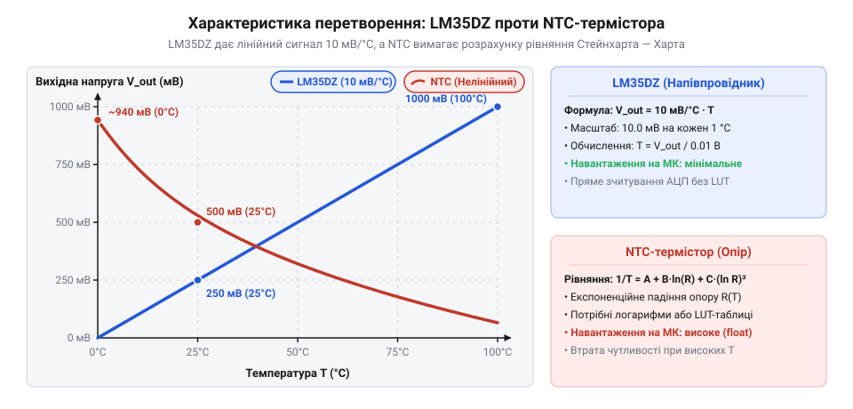
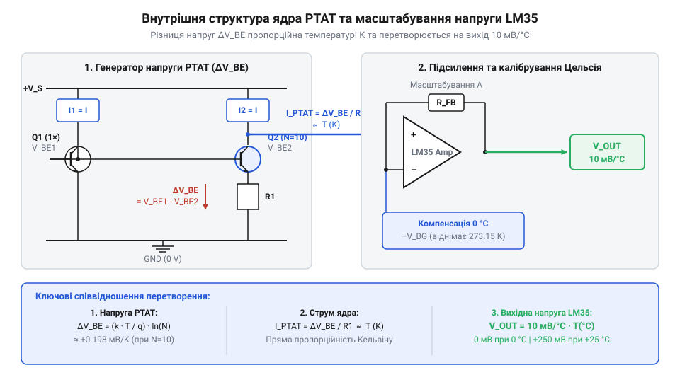
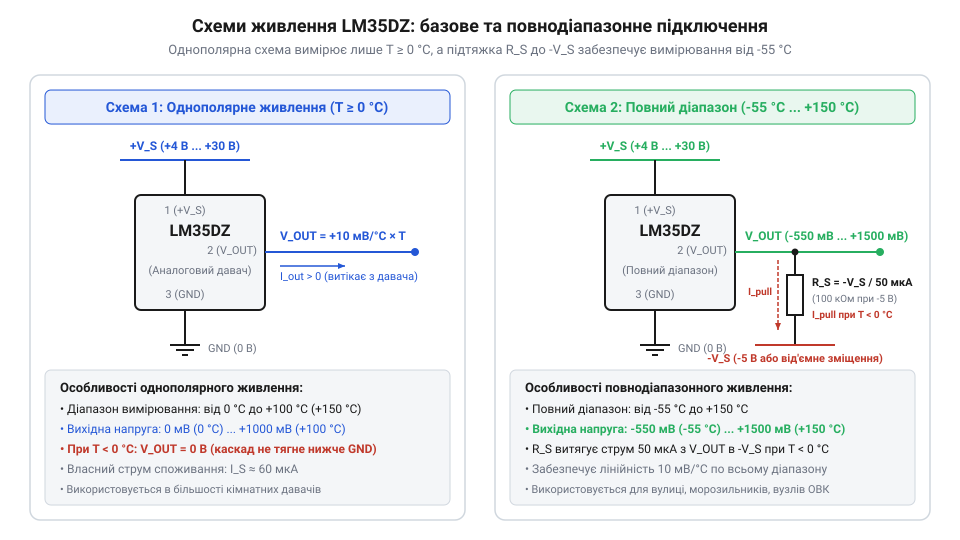
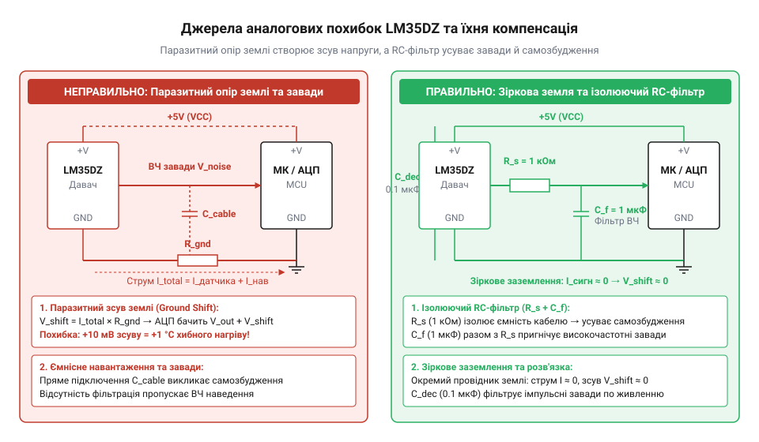

# LM35DZ — аналоговий давач температури (10 мВ/°C)

<preknowlist>
- [KY-013 — аналоговий давач температури (термістор)](root:cat-hw-sensors/ky-013-thermistor) — принцип роботи нелінійного NTC-термістора та відмінність від лінійного інтегрального перетворювача
- [DS18B20 — цифровий давач температури (1-Wire)](root:cat-hw-sensors/ds18b20) — переваги цифрового інтерфейсу 1-Wire та дискретизація температури всередині давача
- [PT100 — платиновий термоопір](root:cat-hw-sensors/pt100-rtd) — відмінність активних напівпровідникових давачів від пасивних платинових перетворювачів опору
</preknowlist>

## Нелінійність термісторів та виклик калібрування

Пасивні @@en|NTC@@-елементи, як-от у схемах [аналогових термісторів KY-013](root:cat-hw-sensors/ky-013-thermistor), змінюють опір за нелінійною експоненціальною залежністю. Для обчислення температури мікроконтролер має розраховувати складне рівняння @@en|Steinhart-Hart@@. Через S-подібну вихідну характеристику чутливість схеми падає при нагріванні з втратою роздільної здатності, а кожен термістор вимагає індивідуального калібрування.


*Залежність вихідної напруги від температури для термістора у дільнику напруги та інтегрального давача LM35DZ.*

Інтегральний давач @@en|LM35DZ@@ розв'язує ці проблеми апаратно: його вихідна напруга строго лінійна з масштабом 10 мВ/°C (0 В при 0 °C, 250 мВ при +25 °C і 1000 мВ при +100 °C). Для отримання температури мікроконтролеру достатньо поділити виміряну напругу в мілівольтах на 10.

## Фізика PTAT-ядра та лінійна характеристика

Лінійну характеристику @@en|LM35DZ@@ створює ядро @@en|PTAT@@ (від англ. *Proportional To Absolute Temperature* — пропорційний абсолютній температурі). Пара біполярних транзисторів @@en|BJT@@ (від англ. *Bipolar Junction Transistor* — біполярний транзистор) з різною щільністю струму генерує різницю напруг, пропорційну температурі в кельвінах.


*Внутрішня структура давача LM35DZ: формування PTAT-струму, температурна компенсація та підсилення вихідного сигналу.*

Джерело @@en|bandgap@@ (від англ. *band gap* — заборонена зона) зсуває нуль до 0 °C, а лазерне підганяння резисторів забезпечує масштаб 10 мВ/°C. На відміну від [пасивних платинових датчиків PT100](root:cat-hw-sensors/pt100-rtd), вихідний підсилювач з опором 0.1 Ом дає змогу подавати сигнал напряму на АЦП. Докладніше про принцип роботи схеми PTAT та джерел напруги забороненої зони читайте у статті про [джерела опорної напруги bandgap та PTAT-ядра](root:hw-analog/voltage-reference-sources).

## Конфігурації живлення та вибір V_ref АЦП

Однополярне живлення (+4...+30 В) дозволяє @@en|LM35DZ@@ вимірювати температуру від 0 °C до +100 °C, бо при 0 °C вихід дорівнює 0 В. Для розширення діапазону від -55 °C до +150 °C (де при -55 °C вихід становить -550 мВ) застосовують двополярне живлення та резистор @@en|pull-down@@ до від'ємної лінії.


*Конфігурації включення LM35DZ для додатного та повного діапазонів температур.*

Точність вимірювання залежить від опорної напруги @@en|V_ref@@ аналого-цифрового перетворювача @@en|ADC@@. Для 10-бітового АЦП із @@en|V_ref@@ = 5.0 В крок квантування @@en|LSB@@ (від англ. *Least Significant Bit* — найменший значущий розряд) становить:

```
LSB = V_ref / 2ⁿ
    = 5000 / 1023        [заміна опорної напруги V_ref = 5000 мВ та n = 10 біт]
    ≈ 4.89 мВ/крок       [обчислення кроку квантування]
```

При чутливості 10 мВ/°C один крок АЦП відповідає 0.49 °C. Перехід на внутрішню опорну напругу 1.1 В покращує дискретизацію:

```
LSB = V_ref / 2ⁿ
    = 1100 / 1023        [заміна опорної напруги V_ref = 1100 мВ та n = 10 біт]
    ≈ 1.075 мВ/крок      [обчислення кроку квантування]
```

Це підвищує роздільну здатність дискретизації майже вп'ятеро — до 0.11 °C на відлік.

## Джерела аналогових похибок та заходи компенсації

Низький струм споживання @@en|LM35DZ@@ (60 мкА) мінімізує самонагрів кристала в повітрі до 0.08 °C. Падіння напруги від інших компонентів на спільному провіднику усувають зіркоподібним заземленням @@en|star ground@@ безпосередньо до землі АЦП. Для запобігання самозбудженню вихідного каскаду через ємність довгих дротів (>50 пФ) лінію сигналу захищають @@en|RC-filter@@, а залишковий шум пригнічують ковзним усередненням @@en|moving average@@.


*Основні чинники аналогових завад у колах LM35DZ та схемні методи їхнього пригнічення.*

## Межі застосування та компроміси аналогового давача

Понад +150 °C струми витоку p-n переходів кремнію порушують роботу @@en|PTAT@@-ядра.

На відміну від [цифрового давача DS18B20](root:cat-hw-sensors/ds18b20) з шинним протоколом чи платинових термоопор із [перетворювачем MAX31865](root:cat-hw-sensors/max31865-rtd-converter), @@en|LM35DZ@@ надає миттєвий аналоговий відгук без навантаження на процесор і складної обв'язки.


*Порівняння лінійності, діапазону та складності зчитування для різних типів датчиків температури.*