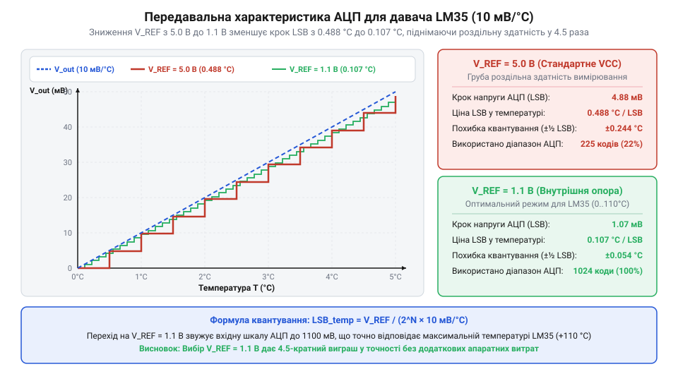

# Математична модель оцифрування напруги LM35 та обчислення похибок АЦП

<preknowlist>
- [KY-013 — аналоговий давач температури (термістор)](root:cat-hw-sensors/ky-013-thermistor) — Базове розуміння знімання аналогового сигналу напруги, пропорційного температурі, та відмінності лінійних напівпровідникових давачів від нелінійних резистивних дільників.
</preknowlist>

## Втрата точності під час прямого оцифрування

Підключення аналогового температурного давача LM35 до мікроконтролера здається інженерно простою задачею: вихідний сигнал давача подають безпосередньо на вхід аналогово-цифрового перетворювача (англ. @@en|Analog-to-Digital Converter@@, ADC). Проте під час використання налаштувань перетворення за замовчуванням розробники стикаються з несподіваною деградацією точності вимірювання. Температура на дисплеї починає змінюватися стрибками по пів градуса Цельсія, хоча сам напівпровідниковий кристалічний елемент давача здатний реагувати на значно менші коливання.

Причина цієї проблеми полягає в неузгодженості між вихідним діапазоном напруги давача та динамічним діапазоном (англ. @@en|Dynamic Range@@) АЦП. Давач LM35 має лінійну масштабну характеристику `10 мВ/°C` із нульовою вихідною напругою при `0 °C`. У типовому діапазоні кімнатних та виробничих температур від `0 °C` до `+50 °C` вихідна напруга давача змінюється в межах від `0 В` до `0.5 В`. Навіть при граничному нагріві до `+100 °C` вихідний рівень становить лише `1.0 В`.

Більшість 8-бітних та 32-бітних мікроконтролерів після скидання використовують як опорну напругу (англ. @@en|Reference Voltage@@, Vref) системну шину живлення `5.0 В` або `3.3 В`. Якщо 10-бітний АЦП працює з опорною напругою `5.0 В`, його шкала перетворення ділиться на `1024` рівні дискретизації. Коли максимальна напруга давача при `+100 °C` становить `1.0 В`, цифровий перетворювач використовує лише `205` кодів із `1024` доступних. Понад 80% шкали АЦП залишаються повністю незадіяними.

Порівняно з [аналоговим термісторним давачем KY-013](root:cat-hw-sensors/ky-013-thermistor), де нелінійний резистивний дільник розтягує напругу майже на весь діапазон живлення, лінійний давач LM35 із фіксованим коефіцієнтом передачі віддає низьку абсолютну напругу. Використання завищеного Vref призводить до того, що ціна молодшого розряду (англ. @@en|Least Significant Bit@@, LSB) стає надто великою. АЦП фізично не здатний помітити зміну напруги, меншу за крок квантування, що утворює штучну втрату роздільної здатності ще до врахування апаратних шумів.

Щоб усунути цей бар'єр і повніше використати розрядність (англ. @@en|Bit Depth@@) перетворювача, необхідно побудувати математичну модель аналогово-цифрового тракту. Вона дозволяє кількісно оцінити вплив розрядності й опорної напруги на дискретність вимірювання та обґрунтовано обрати оптимальний режим оцифрування.

## Математична модель перетворення та розрахунок LSB

Математичний опис вимірювального тракту починається з передавальної функції давача LM35. Вихідна напруга давача `V_out` (у вольтах) лінійно залежить від вимірюваної температури `T` (у градусах Цельсія):

```
V_out = S · T
```

де `S` — коефіцієнт чутливості (англ. @@en|Sensitivity Scale Factor@@), який для серії LM35 становить `0.010 В/°C` (або `10 мВ/°C`).

Аналогово-цифровий перетворювач із розрядністю `n` біт ділить діапазон від `0 В` до опорної напруги `V_ref` на `2ⁿ` однакових ступенів. Ціна одного молодшого розряду `V_LSB` в абсолютних одиницях напруги визначається співвідношенням:

```
V_LSB = V_ref / 2ⁿ
```

Підставивши вираз вихідної напруги давача в рівняння оцифрування, отримуємо формулу цифрового коду `D`, який формується на виході АЦП під час вимірювання температури `T`:

```
D = floor(V_out / V_LSB)
  = floor((S · T) / (V_ref / 2ⁿ)) [підстановка формули V_LSB]
  = floor((S · T · 2ⁿ) / V_ref)  [зведення дробу]
```

Функція `floor` округлює значення до найближчого меншого цілого числа, що відображає природу процедури квантування за рівнем.

Щоб визначити роздільну здатність вимірювального тракту безпосередньо в температурних одиницях, обчислимо ціну молодшого розряду в градусах Цельсія `T_LSB`. Вона показує мінімальну зміну температури, яка викликає зміну цифрового коду АЦП на одиницю:

```
T_LSB = V_LSB / S
      = (V_ref / 2ⁿ) / S        [підстановка виразу V_LSB]
      = V_ref / (S · 2ⁿ)        [спрощення триповерхового дробу]
```

Отримана формула показує, що ціна розряду прямо пропорційна опорній напрузі `V_ref` та обернено пропорційна розрядності АЦП `2ⁿ` й чутливості давача `S`.

Розглянемо практичні значення `V_LSB` та `T_LSB` для поширених конфігурацій АЦП (`10`, `12` та `16` біт) при системних напругах живлення `5.0 В`, `3.3 В` та зниженій внутрішній опорній напрузі `1.1 В`, що доступна в більшості мікроконтролерів.

| Розрядність АЦП (n) | Опорна напруга (V_ref) | Кількість рівнів (2ⁿ) | Ціна розряду напруги (V_LSB) | Дискретність температури (T_LSB) |
| :--- | :--- | :--- | :--- | :--- |
| **10 біт** | 5.0 В | 1024 | 4.8828 мВ | 0.4883 °C |
| **10 біт** | 3.3 В | 1024 | 3.2227 мВ | 0.3223 °C |
| **10 біт** | 1.1 В | 1024 | 1.0742 мВ | 0.1074 °C |
| **12 біт** | 5.0 В | 4096 | 1.2207 мВ | 0.1221 °C |
| **12 біт** | 3.3 В | 4096 | 0.8057 мВ | 0.0806 °C |
| **12 біт** | 1.1 В | 4096 | 0.2686 мВ | 0.0269 °C |
| **16 біт** | 5.0 В | 65536 | 0.0763 мВ | 0.0076 °C |
| **16 біт** | 3.3 В | 65536 | 0.0503 мВ | 0.0050 °C |
| **16 біт** | 1.1 В | 65536 | 0.0168 мВ | 0.0017 °C |

**Обчислення дискретності для 10-бітного АЦП з внутрішньою опорною напругою 1.1 В:**

```
V_LSB = 1.1 / 2¹⁰
      = 1.1 / 1024              [піднесення степеня розрядності]
      = 0.0010742 В             [ділення напруги]
      = 1.0742 мВ               [переведення в мілівольти]

T_LSB = V_LSB / S
      = 1.0742 мВ / (10 мВ/°C) [ділення на крутизну характеристики давача]
      = 0.10742 °C              [ціна молодшого розряду в градусах]
```

*Висновок:* Зміна режимів джерела опорної напруги з `5.0 В` на внутрішній опорник `1.1 В` без жодних апаратних модифікацій схеми зменшує ціну розряду 10-бітного АЦП з `0.488 °C` до `0.107 °C`, тобто покращує роздільну здатність вимірювання в `4.55` рази.


*Передавальна характеристика оцифрування напруги LM35 для опорних напруг 5 В та 1.1 В.*

## Фізичні складові похибок та самонагрів кристала

Розрахована ціна розряду `T_LSB` визначає лише теоретичну межу роздільної здатності оцифрування. Реальна точність вимірювального тракту обмежується сумою фізичних дефектів аналогової частини та самого АЦП. Загальну похибку формують п'ять основних складових.

Перша складова — похибка квантування (англ. @@en|Quantization Error@@) `ΔT_quant`. Вона виникає через дискретизацію неперервного аналогового сигналу на обмежену кількість цифрових рівнів. Для ідеального АЦП похибка квантування лежить у межах від `-0.5 LSB` до `+0.5 LSB`:

```
ΔT_quant = ± 0.5 · T_LSB
```

Для 10-бітного АЦП при `V_ref = 5.0 В` похибка квантування становить `± 0.244 °C`, тоді як при `V_ref = 1.1 В` вона зменшується до `± 0.054 °C`.

Друга складова — власна абсолютна похибка давача `ΔT_sensor`, яка включає початковий зсув нуля (англ. @@en|Offset Error@@) та відхилення крутизни характеристики. Згідно з паспортними даними для LM35DZ, типова точність при температурі `+25 °C` становить `± 0.6 °C`, а в усьому робочому діапазоні не перевищує `± 1.5 °C`.

Третя складова — власна нелінійність характеристики. Вона складається з нелінійності давача `ΔT_NL` (не перевищує `± 0.25 °C` для LM35) та інтегральної нелінійності (англ. @@en|Integral Non-Linearity@@, INL) АЦП `ΔT_INL`. Траєкторія перетворення реального АЦП відхиляється від ідеальної прямої на `± 1`–`2 LSB`.

Четверта складова — похибка джерела опорної напруги `ΔT_vref`. Внутрішні джерела напруги `1.1 В` у масових мікроконтролерах без заводського калібрування мають технологічний розкид до `± 5%` від номіналу. Якщо реальне значення опорної напруги становить `1.15 В` замість `1.10 В`, обчислена температура міститиме пропорційну відносну похибку `5%`. При температурі `25 °C` це дає додатковий зсув `ΔT_vref = 25 · 0.05 = ± 1.25 °C`, що повністю перекриває переваги високої розрядності АЦП. Докладніше про будову, температурну стабільність та методи калібрування джерел Vref читайте у статті про [внутрішні джерела опорної напруги мікроконтролерів](root:hw-arch/vnutrishni-dzherela-atsp).

П'ята складова — температурний дрейф унаслідок самонагріву (англ. @@en|Self-Heating Effect@@) кристала `ΔT_self`. Напівпровідникова структура давача споживає струм живлення `I_S` від джерела напруги `V_CC`. Електрична потужність `P`, що розсіюється на кристалі, перетворюється на тепло:

```
P = V_CC · I_S
```

Збільшення температури кристала `ΔT_self` відносно довкілля розраховується через тепловий опір (англ. @@en|Thermal Resistance@@) конструкції корпус-середовище `θ_JA` (вимірюється в `°C/Вт`):

```
ΔT_self = P · θ_JA
        = (V_CC · I_S) · θ_JA   [підстановка електричної потужності P]
```

**Обчислення температурного зсуву від самонагріву LM35 у корпусі TO-92:**

```
P = V_CC · I_S
  = 5.0 В · 0.00008 А           [струм споживання I_S = 80 мкА]
  = 0.0004 Вт                   [потужність 0.4 мВт]

ΔT_self = P · θ_JA
        = 0.0004 Вт · 220 °C/Вт [тепловий опір TO-92 у нерухомому повітрі]
        = 0.088 °C              [додатковий нагрів кристала]
```

Якщо напругу живлення давача підвищити до `15 В`, споживана потужність зросте до `1.8 мВт`, а самонагрів досягне `ΔT_self = 0.0018 · 220 = 0.396 °C`. На відміну від [цифрового давача DS18B20](root:cat-hw-sensors/ds18b20), де періодичне опитування дозволяє переводити кристал у режим сну, аналоговий давач LM35 при постійній подачі живлення нагрівається безперервно.

## Розрахунок сумарного бюджету похибок вимірювального тракту

Кожна з розглянутих складових похибок діє на підсумковий результат вимірювання. Для обчислення загальної похибки температурного тракту застосовують два математичні підходи: метод найгіршого випадку (англ. @@en|Worst-Case Analysis@@) та метод середньоквадратичного сумування (англ. @@en|Root Sum of Squares@@, RSS).

Метод найгіршого випадку виходить з припущення, що всі похибки одночасно досягають своїх максимально можливих значень і складаються в одному напрямку. Сумарна похибка найгіршого випадку `ΔT_worst` обчислюється як пряма сума абсолютних модулів усіх складових:

```
ΔT_worst = |ΔT_quant| + |ΔT_sensor| + |ΔT_INL| + |ΔT_vref| + |ΔT_self|
```

Цей метод дає 100% гарантовану верхню межу похибки, проте для реальних систем він виявляється надмірно песимістичним, оскільки ймовірність одночасного збігу екстремальних відхилень усіх незалежних параметрів дуже мала.

Метод середньоквадратичного сумування (RSS) базується на теорії ймовірностей. Якщо складові похибок є взаємно незалежними випадковими величинами з нормальним розподілом, підсумкова похибка `ΔT_RSS` визначається як квадратний корінь із суми квадратів окремих похибок:

```
ΔT_RSS = √(ΔT_quant² + ΔT_sensor² + ΔT_INL² + ΔT_vref² + ΔT_self²)
```

Розрахуємо сумарний бюджет похибок для системи з LM35DZ та 10-бітним АЦП при `V_ref = 1.1 В` (попередньо відкаліброваним до точності `± 1%`, що дає `ΔT_vref = ± 0.25 °C` при `25 °C`).

**Обчислення сумарного бюджету похибок методом найгіршого випадку та RSS:**

```
ΔT_worst = 0.054 + 0.500 + 0.107 + 0.250 + 0.088
         = 0.999 °C             [пряма сума похибок]

ΔT_RSS = √(0.054² + 0.500² + 0.107² + 0.250² + 0.088²)
       = √(0.0029 + 0.2500 + 0.0114 + 0.0625 + 0.0077) [обчислення квадратів]
       = √0.3345                [сума квадратів складових]
       = 0.578 °C               [квадратний корінь суми]
```

Порівняльний аналіз показує важливе інженерне правило: основними чинниками похибки у зваженому бюджеті є точність самого давача (`0.500 °C`) та похибка опорної напруги (`0.250 °C`). Внесок похибки квантування 10-бітного АЦП (`0.054 °C`) у загальну дисперсію становить лише `0.0029 / 0.3345 ≈ 0.87%`.

Це означає, що нарощування розрядності АЦП з 10 до 16 біт без калібрування джерела `V_ref` та без застосування прецизійного давача підвищеної точності не дає жодного реального виграшу в точності вимірювання.

Для обґрунтованого вибору конфігурації вимірювального тракту застосовують правило десятикратного запасу: ціна розряду `T_LSB` повинна бути принаймні в 5–10 разів меншою за власну похибку давача `ΔT_sensor`. Для LM35DZ з похибкою `± 0.5 °C` оптимальною є дискретність `T_LSB ≤ 0.05 °C`. Ця умова повністю виконується при використанні 12-бітного АЦП з опорною напругою `1.1 В` (`T_LSB ≈ 0.027 °C`).

У задачах, де вимагається досягнення підсумкової похибки кращої за `0.1 °C`, аналогові напівпровідникові давачі поступаються місцем вимірювальним системам на [платинових термоопорах PT100](root:cat-hw-sensors/pt100-rtd) із диференційними прецизійними АЦП.