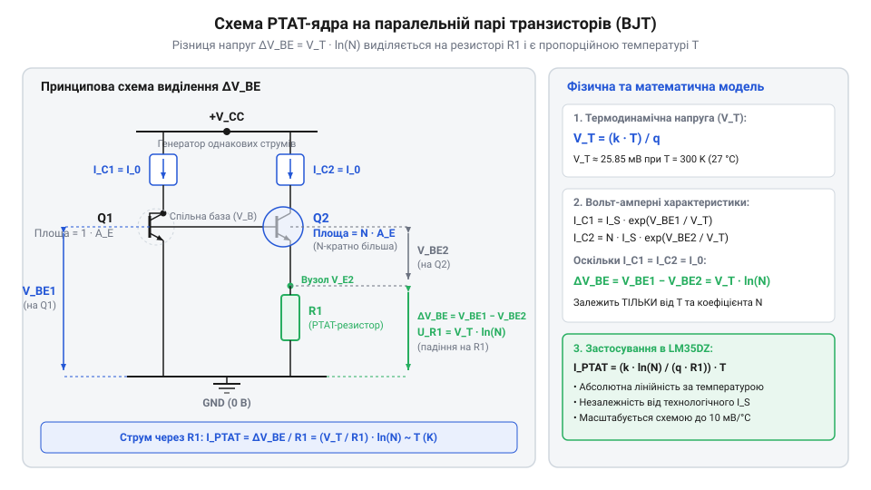
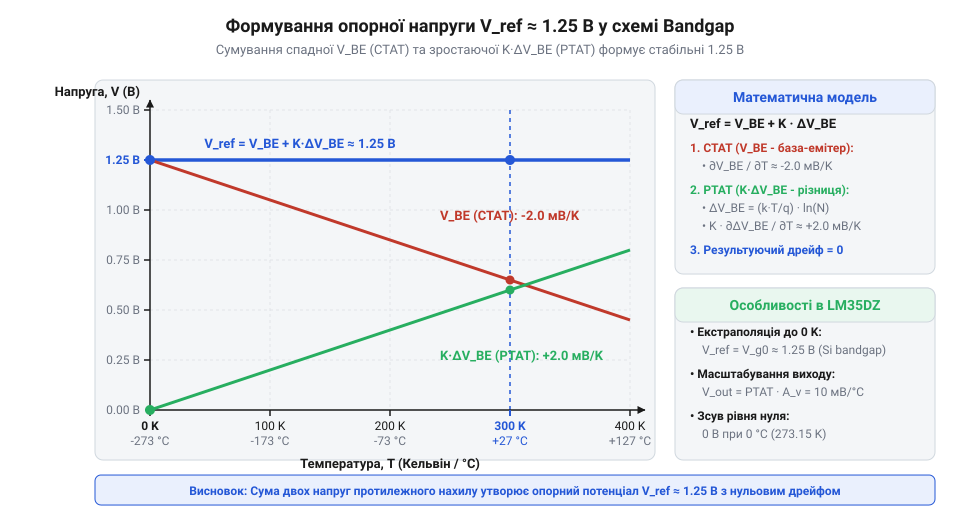
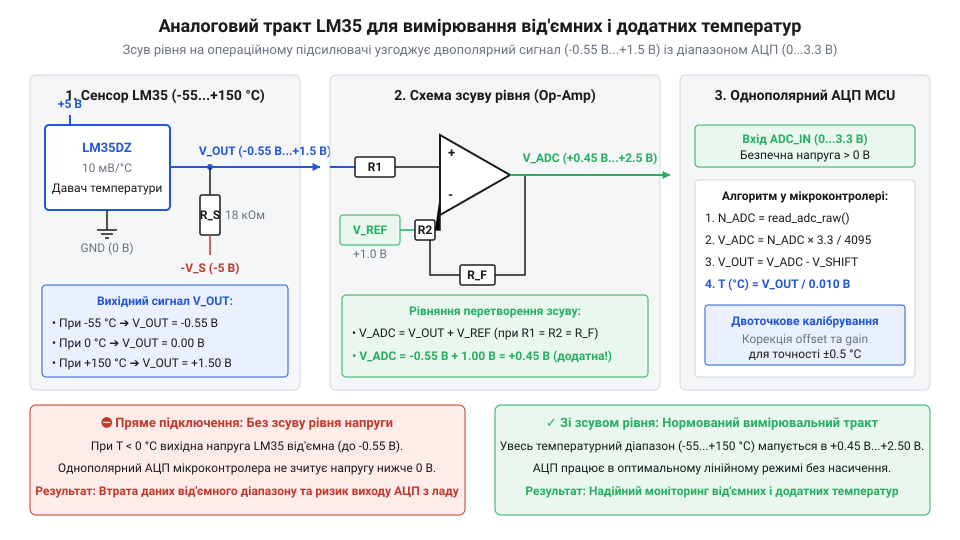
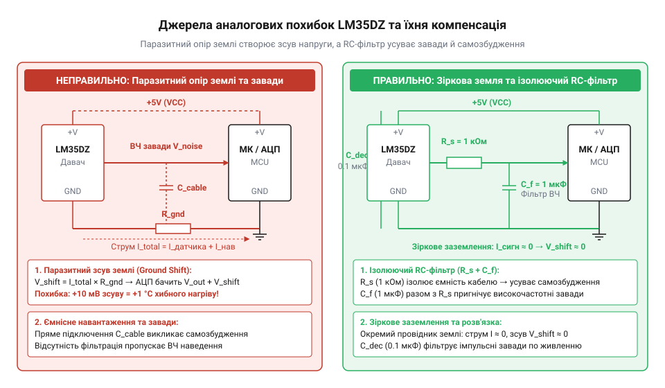

# Математика PTAT-ефекту та фізика формування температурної залежності bandgap

## Проблема температурного дрейфу напівпровідникових переходів

Прямозміщений p-n перехід біполярного транзистора або діода здається найпростішим елементом для вимірювання температури, адже прямо падаюча напруга змінюється разом із нагріванням кристала. Однак спроба використати прямолінійно напругу база-емітер `V_be` як температурний сигнал наражається на фундаментальну нелінійність та високий технологічний дрейф.

Прямий струм колектора біполярного транзистора `I_c` (від англ. @@en|collector current@@) описується класичним рівнянням Шоклі:

`I_c = I_s · (e^(V_be / V_T) - 1) ≈ I_s · e^(V_be / V_T)`

Тут `V_T = k · T / q` — термодинамічна напруга (від англ. @@en|thermal voltage@@), яка прямо пропорційна абсолютній температурі `T`. На перший погляд, зі зростанням температури величина `V_T` лінійно збільшується із коефіцієнтом `k / q ≈ 86.17 мкВ/К`. Проте зворотний струм насичення `I_s` (від англ. @@en|saturation current@@) має надзвичайно сильну та нелінійну залежність від температури, зумовлену генеруванням власних носіїв заряду в напівпровіднику:

`I_s(T) = B · T^γ · e^(-V_G0 / V_T)`

У цій формулі `B` — технологічний коефіцієнт, що залежить від геометрії переходу та концентрації домішок, `γ` (гамма) — показник температурної залежності рухливості носіїв заряду (зазвичай `γ ≈ 3 … 4`), а `V_G0` — напруга екстраполяції забороненої зони кремнію до абсолютного нуля (`V_G0 ≈ 1.205 В`). 

Виразивши напругу база-емітер `V_be` (від англ. @@en|base-emitter voltage@@) через струм колектора, дістаємо покрокове перетворення:

```
V_be = V_T · ln(I_c / I_s)
     = V_T · ln(I_c / (B · T^γ · e^(-V_G0 / V_T)))           [підстановка формули струму насичення I_s(T)]
     = V_T · ( ln(I_c / (B · T^γ)) + V_G0 / V_T )             [властивості логарифма добутку та показника степеня]
     = V_G0 + V_T · ln(I_c / (B · T^γ))                       [розкриття дужок]
```

Щоб визначити, як змінюється `V_be` із температурою при фіксованому струмі `I_c`, обчислимо першу похідну за температурою `T`:

```
dV_be / dT = d/dT [ V_G0 + (k · T / q) · ln(I_c / (B · T^γ)) ]
           = (k / q) · ln(I_c / (B · T^γ)) + (k · T / q) · (-γ / T)   [диференціювання за правилом добутку]
           = (V_be - V_G0) / T - γ · (k / q)                           [підстановка виразу для V_be]
           = (V_be - V_G0 - γ · V_T) / T                                [зведення до спільного знаменника]
```

Підставивши типові значення для кімнатної температури `T = 300 К` (`26.85 °C`), де `V_be ≈ 0.65 В`, `V_G0 ≈ 1.205 В`, `γ ≈ 3.2` та `V_T ≈ 25.86 мВ`, отримуємо від'ємний температурний коефіцієнт:

`dV_be / dT ≈ (0.65 - 1.205 - 3.2 · 0.02586) / 300 ≈ -2.13 мВ/К`

Таку спадну залежність називають @@en|CTAT@@ (від англ. @@en|Complementary to Absolute Temperature@@ — доповняльний до абсолютної температури). На відміну від первинних перетворювачів, якими є [платинові термоопори PT100](root:cat-hw-sensors/pt100-rtd) або розсипні компоненти в [модулях терморезисторів KY-013](root:cat-hw-sensors/ky-013-thermistor), одиночний p-n перехід не може слугувати точним аналоговим давачем без індивідуального калібрування. Технологічний розкид параметра `B` і площі емітера між різними екземплярами транзисторів зміщує `V_be` на `±30 … 50 мВ`, що еквівалентно похибці вимірювання температури в `15 … 25 °C`. Крім того, наявність члена `γ · V_T` спричиняє параболічну нелінійність сигнальної характеристики.

Отже, головний виклик аналогової мікроелектроніки полягає у виділенні чистого фізичного сигналу, позбавленого впливу неконтрольованої технологічної константи `B` та експоненційного струму `I_s(T)`.

## Математичне виведення напруги PTAT-ефекту

Ідея усунення технологічної нестабільності струму насичення `I_s` полягає у використанні диференційної пари з двох біполярних транзисторів `Q1` та `Q2`, які виготовлені в єдиному технологічному процесі на спільному кремнієвому кристалі.

Завдяки топологічному розміщенню транзисторів поряд на пластині, їхні питомі густини струму насичення на одиницю площі емітера `J_s = I_s / A` є строго однаковими. Якщо транзистор `Q1` має площу емітерного переходу `A_1`, а транзистор `Q2` — площу `A_2`, то їхні струми насичення співвідносяться як `I_s1 = J_s · A_1` та `I_s2 = J_s · A_2`.

Однак математична фіксація пропорції вимагає також суворого контролю співвідношення робочих колекторних струмів `I_c1` та `I_c2`. Для цього в аналоговому ядрі застосовують дзеркало струму (від англ. @@en|current mirror@@) — схемотехнічну структуру на паралельній парі транзисторів зі спільним керуючим вузлом, яка вирівнює або фіксує пропорцію струмів гілок. Оскільки транзистори дзеркала формуються на тому ж кристалі, вони з високою точністю задають рівність `I_c1 = I_c2` (або фіксоване кратне співвідношення `I_c1 / I_c2 = M`). Це унеможливлює випадковий дрейф струмів від коливань напруги живлення й гарантує, що співвідношення густин струму визначається виключно геометрією емітерів.

Нехай крізь транзистори протікають колекторні струми `I_c1` та `I_c2`. Знайдемо різницю напруг база-емітер `ΔV_be = V_be1 - V_be2`:

```
ΔV_be = V_be1 - V_be2
      = V_T · ln(I_c1 / I_s1) - V_T · ln(I_c2 / I_s2)                   [рівняння Шоклі для двох транзисторів]
      = V_T · ln( (I_c1 / (J_s · A_1)) / (I_c2 / (J_s · A_2)) )         [вираження струмів насичення через густину J_s та площі]
      = V_T · ln( (I_c1 · A_2) / (I_c2 · A_1) )                         [скорочення однакового параметра J_s]
      = (k · T / q) · ln(N)                                             [за умови однакових струмів I_c1 = I_c2 та N = A_2 / A_1]
```


*Схема паралельної пари біполярних транзисторів із різною площею емітерів та генератором струмів, на якій показано формування диференційної напруги delta-Vbe.*

Результат цього виведення є фундаментальним: нелінійний параметр `J_s(T)`, який містив технологічний розкид та складну залежність від температури, повністю скоротився. Отримана диференційна напруга `ΔV_be` прямо пропорційна абсолютній температурі `T` (від англ. @@en|absolute temperature@@). Таку залежність називають @@en|PTAT@@ (від англ. @@en|Proportional to Absolute Temperature@@ — пропорційно абсолютній температурі).

Температурний коефіцієнт напруги PTAT визначається виключно фундаментальними фізичними константами та геометричним співвідношенням площ емітерів `N = A_2 / A_1` (від англ. @@en|emitter area ratio@@):

`d(ΔV_be) / dT = (k / q) · ln(N)`

У цьому виразі використовуються фундаментальні величини:
- `k = 1.380649 × 10⁻²³ Дж/К` — стала Больцмана (від англ. @@en|Boltzmann constant@@);
- `q = 1.602176634 × 10⁻¹⁹ Кл` — елементарний заряд (від англ. @@en|elementary charge@@);
- `k / q ≈ 86.173 мкВ/К` (`0.086173 мВ/К`) — універсальний фізичний коефіцієнт.

Розрахуємо практичний приклад для класичної інтегральної топології, де мультиемітерний транзистор складається з `N = 8` однакових транзисторних осередків, включених паралельно біля одного центрального транзистора. 

При `N = 8` маємо `ln(8) = ln(2³) = 3 · ln(2) ≈ 2.07944`.

Тоді температурний коефіцієнт дорівнює:

`d(ΔV_be) / dT = 0.086173 мВ/К · 2.07944 ≈ 0.1792 мВ/К`

Обчислимо значення напруги `ΔV_be` при двох температурних точках:
1. При `T = 300 К` (`26.85 °C`): `ΔV_be = 0.086173 мВ/К · 300 К · 2.07944 ≈ 53.76 мВ`. 2. При `T = 373.15 К` (`100 °C`): `ΔV_be = 0.086173 мВ/К · 373.15 К · 2.07944 ≈ 66.87 мВ`.

Отриманий PTAT-сигнал має високу лінійність і стабільність, оскільки геометричне співвідношення `N` задається фотолітографічними масками під час виготовлення кристала і не змінюється під час експлуатації.

## Фізика та синтез напруги bandgap

Маючи у своєму розпорядженні два сигнали із протилежними температурними коефіцієнтами — від'ємним `dV_be / dT ≈ -2.13 мВ/К` (CTAT) та позитивним `d(ΔV_be) / dT ≈ +0.1792 мВ/К` (PTAT) — ми можемо зсинтезувати опорну напругу `V_ref`, яка взагалі не залежить від температури.

Формула зваженого підсумовування сигналів має вигляд:

`V_ref = V_be + α · ΔV_be`

де `α` (альфа) — масштабний коефіцієнт підсилення PTAT-напруги.

Для досягнення нульового температурного коефіцієнта `dV_ref / dT = 0` виставимо умову компенсації:

```
dV_ref / dT = dV_be / dT + α · d(ΔV_be) / dT = 0
α = - (dV_be / dT) / (d(ΔV_be) / dT)                                     [умова температурної компенсації]
```

Підставивши розраховані значення дрейфів для `N = 8`, отримуємо необхідне значення масштабного коефіцієнта:

`α ≈ - (-2.13 мВ/К) / (0.1792 мВ/К) ≈ 11.89`


*Графік залежності напруг Vbe (CTAT) та delta-Vbe (PTAT) від температури, а також їх результуючої суми Vref.*

Фізичний зміст сумарної напруги `V_ref` розкривається при екстраполяції прямих до точки absolute zero. Якщо підставити апроксимацію `V_be(T)` у формулу компенсації, то отримана термостабільна напруга дорівнює напрузі екстраполяції забороненої зони кремнію `V_G0 ≈ 1.205 … 1.25 В`. Саме тому таке джерело напруги називають @@en|bandgap reference@@ (від англ. @@en|bandgap voltage reference@@ — опорна напруга забороненої зони).

Практичну схемотехнічну реалізацію зваженого підсумовування `V_ref = V_be + α · ΔV_be` виконують за допомогою топології, відомої як @@en|осередок Брокау@@ (від англ. @@en|Brokaw cell@@). У цій схемі операційний підсилювач через від'ємний зворотний зв'язок утримує рівність колекторних струмів двох транзисторів `I_c1 = I_c2 = I`, змушуючи диференційну напругу `ΔV_be` падати на емітерному резисторі `R_1`. У результаті крізь резистор протікає струм `I_PTAT = ΔV_be / R_1`, пропорційний абсолютній температурі. Оскільки цей струм від обох гілок підсумовується у спільному емітерному резисторі `R_2`, на ньому формується спад напруги `V_R2 = 2 · (R_2 / R_1) · ΔV_be`, який додається до напруги база-емітер `V_be1`. Підсумкова напруга ядра становить `V_ref = V_be1 + 2 · (R_2 / R_1) · ΔV_be`, де масштабний коефіцієнт `α = 2 · R_2 / R_1` визначається виключно відношенням опорів двох резисторів. На відміну від абсолютних значень опору, які в напівпровідниковому виробництві можуть дрейфувати на `±20%`, геометричне співвідношення резисторів на спільному кристалі виготовляється з точністю до `0.1%`, що забезпечує прецизійну термокомпенсацію без потреби в індивідуальному налаштуванні кожного елемента. Детальніше про математичну модель та схемотехніку компенсації дрейфу в цьому аналоговому ядрі читайте в матеріалі про [комірку Брокау в джерелах опорної напруги bandgap](root:hw-analog/brokaw-bandgap-cell).

`V_out(T_C) = A · ΔV_be - V_shift`

Розкриємо цей вираз через температуру та виставимо умову нульового виходу при `T = 273.15 К`:

```
V_out(T_C) = A · ΔV_be - V_shift
           = A · (k / q) · ln(N) · T - V_shift                          [підстановка виразу для PTAT]
           = A · (k / q) · ln(N) · (T - 273.15)                         [умова нульового потенціалу при 273.15 K]
           = S · T_C                                                    [лінійна шкала Цельсія]
```

Звідси розраховуємо необхідний коефіцієнт підсилення аналогового операційного підсилювача `A`:

`A = S / ( (k / q) · ln(N) ) = 10 мВ/К / 0.1792 мВ/К ≈ 55.8`

Напруга зсуву `V_shift`, яка формується з внутрішнього bandgap-джерела `V_ref`, повинна становити:

`V_shift = A · ΔV_be(273.15 К) = 55.8 · (0.086173 мВ/К · 273.15 К · 2.07944) ≈ 2.7315 В`

У реальних інтегральних мікросхемах точність вимірювання обмежується технологічними неідеальностями напівпровідникового кристала:
1. **Зсув напруги операційного підсилювача** (від англ. @@en|input offset voltage@@) `V_os`. Оскільки вхідний зміщення підсилюється у `A ≈ 55.8` разів, навіть незначна напруга зсуву `V_os = 1 мВ` призводить до вихідної похибки `55.8 мВ`, що становить `5.58 °C` похибки вимірювання температури. 2. **Невідповідність опорів резисторів** у схемах масштабування, що потребує подгонки резисторів під час виготовлення. 3. **Ефект Ерлі** (модуляція ширини бази колекторною напругою), що змінює співвідношення струмів `I_c1 / I_c2`.

Синтезовані за цим принципом аналогові ядра PTAT та bandgap входять до складу багатьох сучасних мікросхем, зокрема таких як [цифровий давач DS18B20](root:cat-hw-sensors/ds18b20), прецизійний [модуль давача SHT30](root:cat-hw-sensors/sht30) та інтегроване кліматичне рішення [інтегрований чип AHT20](root:cat-hw-sensors/aht20-sensor).

## Масштабування сигналу в шкалу Цельсія

Прямий вихідний сигнал `ΔV_be` дифпари біполярних транзисторів пропорційний абсолютній температурі в Кельвінах та має температурний дрейф близько `0.1792 мВ/К` (при співвідношенні площ емітерів `N = 8`). При температурі танення льоду `0 °C` (`273.15 К`) напруга `ΔV_be` становить не нуль, а приблизно `48.95 мВ`. Для практичного застосування в аналоговій вимірювальній техніці, як-от у класичних давачах типу LM35, потрібна лінійна напруга відносно шкали Цельсія (від англ. @@en|Celsius scale@@) з чутливістю `S = 10 мВ/°C` (`0.01 В/°C`) та строго нульовим потенціалом при `0 °C`.

Щоб перетворити абсолютну температурну залежність у зручну вихідну напругу `V_out(T_C) = S · T_C`, внутрішня аналогова схема виконує дві послідовні операції: масштабування підсиленням та зсув рівнів (від англ. @@en|level shifting@@). Для цього застосовують диференційний масштабний підсилювач (від англ. @@en|scaling amplifier@@), який підсилює сигнал `ΔV_be` у `A` разів та віднімає від нього опорну напругу зсуву `V_shift`:

`V_out = A · ΔV_be(T) - V_shift`

Головна умова формування нуля при `0 °C` полягає в тому, щоб напруга `V_shift` точно дорівнювала підсиленій PTAT-напрузі при `T = 273.15 К`. Виразимо вихідну напругу через абсолютну температуру `T` та температуру Цельсія `T_C = T - 273.15`:

```
V_out = A · ΔV_be(T) - V_shift
      = A · (k / q) · ln(N) · T - A · (k / q) · ln(N) · 273.15           [підстановка формули PTAT та умови для V_shift]
      = A · (k / q) · ln(N) · (T - 273.15)                               [винесення спільного множника]
      = A · (k / q) · ln(N) · T_C                                        [перехід до шкали Цельсія]
```

Для забезпечення стандартного коефіцієнта масштабування `S = 10 мВ/°C` добуток коефіцієнта підсилення `A` (від англ. @@en|gain coefficient@@) на дрейф PTAT-напруги має дорівнювати `S`. Звідси виводиться необхідне значення коефіцієнта підсилення операційного підсилювача (від англ. @@en|op-amp@@):

`A = S / ( (k / q) · ln(N) )`

**Обчислення параметрів підсилення для N = 8 та шкали 10 мВ/°C**

```
d(ΔV_be) / dT = (k / q) · ln(8) ≈ 0.086173 мВ/К · 2.07944 ≈ 0.1792 мВ/К   [температурний дрейф PTAT-сигналу]
A = S / (d(ΔV_be) / dT) = 10 мВ/К / 0.1792 мВ/К ≈ 55.80                    [необхідний коефіцієнт підсилення ОП]
ΔV_be(273.15 К) = 0.1792 мВ/К · 273.15 К ≈ 48.946 мВ                        [PTAT-напруга при 0 °C]
V_shift = A · ΔV_be(273.15 К) = 55.80 · 48.946 мВ ≈ 2731.2 мВ = 2.7312 В   [необхідна напруга зсуву рівня]
```

Отже, операційний підсилювач підвищує крутизну сигнальної характеристики з `0.1792 мВ/°C` до `10 мВ/°C`, а стабільна напруга зсуву `V_shift ≈ 2.7312 В`, зсинтезована з джерела опорної напруги @@en|bandgap reference@@, компенсує початковий потенціал при `0 °C`.


*Принципова схема масштабного операційного підсилювача із резистивним дільником для перетворення PTAT-сигналу в шкалу Цельсія.*

У практичній схемотехніці зсув потенціалу формується за допомогою внутрішньокристального резистивного дільника. Співвідношення опорів (від англ. @@en|resistor ratio@@) задає необхідну пропорцію між термостабільною напругою bandgap `V_ref ≈ 1.205 В` та опорним зсувом `V_shift`. На відміну від первинних перетворювачів, якими є [аналоговий терморезистор KY-013](root:cat-hw-sensors/ky-013-thermistor) або [платиновий термоопір PT100](root:cat-hw-sensors/pt100-rtd), що вимагають зовнішніх мостових кіл та джерел зсуву, аналогове ядро PTAT із масштабуванням відразу видає відкалібровану напругу прямо в шкалі Цельсія. Подібні аналогові структури масштабування є базовим блоком перед внутрішнім аналого-цифровим перетворенням у пристроях на зразок [цифрового давача DS18B20](root:cat-hw-sensors/ds18b20) та [модуля температури SHT30](root:cat-hw-sensors/sht30). Для ознайомлення з технологічними процесами точного налаштування співвідношення опорів дільника на етапі фабрикації чипа перегляньте статтю про [технологію лазерного підганяння резисторів у напівпровідникових давачах температури](root:hw-sensing/laser-trimming-bjt-sensors).

## Вплив технологічних неідеальностей на точність

Ідеальна математична модель PTAT-ефекту передбачає абсолютно однакове співвідношення площ емітерів, ідеальні операційні підсилювачі та відсутність стороннього теплового впливу. Однак під час виробництва напівпровідникових кристалів технологічний розкид параметрів спричиняє відхилення характеристик від розрахованих значень.

Першим чинником похибки є геометрична неузгодженість (від англ. @@en|mismatch@@) площ емітерних переходів `N = A_2 / A_1`. Через розкид літографічного травлення реальне співвідношення дорівнює `N · (1 + ε_N)`, де `ε_N` — відносна похибка площі. Знайдемо вплив цієї неідеальності на PTAT-напругу:

```
ΔV_be_real = (k · T / q) · ln(N · (1 + ε_N))
           ≈ (k · T / q) · ( ln(N) + ε_N )                              [наближення ln(1 + x) ≈ x при малому x]
           = ΔV_be_ideal + (k · T / q) · ε_N                            [виділення абсолютної похибки напруги]
```

Оскільки `ln(8) ≈ 2.0794`, технологічна похибка площі емітера `ε_N = 1%` (`0.01`) призводить до відносної похибки крутизни `ε_S = 0.01 / 2.0794 ≈ 0.48%`. При температурі `300 К` це створює абсолютне відхилення показів близько `1.44 К` (`~0.15 °C` на кожний відсоток розкиду площ). Аналогічно, розкид температурного коефіцієнта опору (від англ. @@en|Temperature Coefficient of Resistance@@ — @@en|TCR@@) у масштабних резисторах змінює співвідношення підсилення `A` при зміні температури довкілля.

Найгострішою проблемою аналогового тракту є вхідна напруга зсуву підсилювача (від англ. @@en|input offset voltage@@) `V_os`. Оскільки операційний підсилювач підсилює малий диференційний сигнал `ΔV_be` у `A ≈ 55.8` разів, напруга `V_os` додається безпосередньо до корисного сигналу, спричиняючи значний зсув температури `ΔT_err`.

**Обчислення похибки температури від напруги зсуву ОП**

```
d(ΔV_be) / dT = 0.1792 мВ/°C                                            [температурна чутливість PTAT при N = 8]
ΔT_err = V_os / (d(ΔV_be) / dT) = 1.0 мВ / 0.1792 мВ/°C ≈ 5.58 °C      [похибка температури при V_os = 1 мВ]
```

Виведення показує, що навіть незначне вхідне зміщення `V_os = 1 мВ` створює катастрофічну похибку вимірювання в `5.58 °C`. Це пояснює, чому в прецизійних інтегральних давачах температури застосовують схеми лазерного підганяння резисторів та автокомпенсації зсуву. Про фізику зниження напруги зсуву та практичну реалізацію динамічного обнулення дрейфу розповідає стаття про [методи автокомпенсації зсуву та калібрування напівпровідникових давачах температури](root:hw-sensing/offset-cancellation-trimming).


*Схема джерел похибок аналогового давача температури: неузгодженість емітерів, напруга зсуву підсилювача, нелінійність другого порядку та самонагрів кристала.*

Додатковим фізичним обмеженням є нелінійність другого порядку (від англ. @@en|second-order nonlinearity@@) температурного дрейфу `V_be`. Оскільки логарифмічний член залежності струму насичення від температури не є строго лінійним, результуюча характеристика bandgap має параболічний прогин. Без спеціальних схем корекції кривизни це дає залишкову нелінійність `0.5 … 1.5 °C` у широкому діапазоні температур (від `-55 °C` до `+150 °C`). Для глибшого розуміння математичних моделей та схемотехніки вирівнювання параболічного прогину характеристик дивіться статтю про [методи корекції нелінійності другого порядку в джерелах bandgap](root:hw-analog/curvature-correction-bandgap).

Останнім суттєвим чинником є власне нагрівання (від англ. @@en|self-heating@@) кристала струмом споживання `I_q`. Потужність `P = V_cc · I_q`, яка розсіюється в мікросхемі, підвищує температуру напівпровідникового кристала `T_die` відносно температури довкілля `T_amb` залежно від термічного опору кристала до довкілля (від англ. @@en|thermal resistance junction-to-ambient@@) `θ_JA`:

`ΔT_self = P · θ_JA = V_cc · I_q · θ_JA`

**Обчислення власного нагрівання корпусу TO-92 при різній напрузі живлення**

```
P_5V = 5 В · 80 × 10⁻⁶ А = 0.40 мВт = 0.0004 Вт                          [споживана потужність при 5 В]
ΔT_5V = 0.0004 Вт · 180 °C/Вт = 0.072 °C                                [підйом температури кристала при 5 В]
P_30V = 30 В · 80 × 10⁻⁶ А = 2.40 мВт = 0.0024 Вт                        [споживана потужність при 30 В]
ΔT_30V = 0.0024 Вт · 180 °C/Вт = 0.432 °C                               [підйом температури кристала при 30 В]
```

Збільшення напруги живлення з `5 В` до `30 В` підвищує похибку від самонагріву з незначних `0.072 °C` до суттєвих `0.432 °C`. Для мінімізації цієї похибки в мікросхемах зменшують струм споживання та знижують напругу живлення. У цифрових сенсорах, як-от [цифровий чип AHT20](root:cat-hw-sensors/aht20-sensor) або вимірювальних інтерфейсах, подібних до [перетворювач опору MAX31865](root:cat-hw-sensors/max31865-rtd-converter), застосовують також імпульсне опитування ядра для запобігання тепловому перегріву кристала.